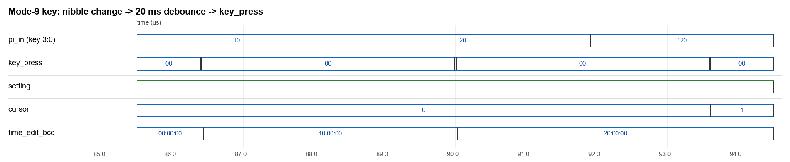
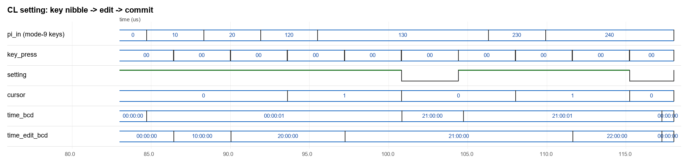

# 按键操作说明书

> 项目：基于 KX-MS65 实验箱的电子时钟  
> 平台：KX-10CL006/10 核心板，Quartus Prime Standard 17.1  
> 版本：v1.0  
> 读者：第一次接触模式 9 按键、看不懂 PI/PIO 的初学者

---

## 阅读说明

这份说明书回答：

1. 模式 9 的 8 个按键分别接在哪里？
2. 为什么按一次是“4 位二进制加 1”，而不是普通按下/松开？
3. FPGA 为什么不能清零？怎么检测“按下了一次”？
4. 核心板 K1～K4 分别做什么？
5. 每个模式下按键是什么功能？
6. 代码里哪个模块负责按键？顶层怎么连？

学完你能：

- 对照引脚表找到 8 个模式 9 键和 4 个核心键；
- 解释 `nibble_key.v` 的同步、消抖、变化检测；
- 看懂 `key_ctrl.v` 的模式/设置状态机；
- 自己改一个键位并说明要改哪里。

---

## 第 1 章 认识按键

### 1.1 实验箱上有哪些按键

| 按键 | 位置 | 数量 | 类型 |
|---|---|---|---|
| 键 1～8 | 动态配置 IO 板 | 8 | 4 位十六进制计数器 |
| K1～K4 | 核心板 | 4 | 普通独立按键，低有效 |
| 系统复位键 | 动态配置板 | 1 | 复位动态配置电路，不参与本设计 |

### 1.2 两种完全不同的按键

**普通按键**：

```text
松开 -> 1
按下 -> 0
```

FPGA 读的是电平，需要自己消抖、找边沿。

**模式 9 的按键**：

```text
每按一次 -> 对应的 4 位值加 1
```

FPGA 读到的不是“0/1”，而是一个 4 位 nibble，例如 `0000`、`0001`、`0010`……

---

## 第 2 章 模式 9 按键的硬件连接

### 2.1 键 1～8 与 PI/PIO

| 物理键 | nibble | FPGA 引脚（bit3～bit0） |
|---|---|---|
| 键 1 | `PI[3:0]` | `N8, M8, P6, L7` |
| 键 2 | `PI[7:4]` | `T4, R5, K8, R3` |
| 键 3 | `PI[11:8]` | `T8, R9, T6, R7` |
| 键 4 | `PI[15:12]` | `T12, R13, T10, R11` |
| 键 5 | `PIO[3:0]` | `N2, P1, L6, N5` |
| 键 6 | `PIO[7:4]` | `A4, B1, G2, K2` |
| 键 7 | `PIO[11:8]` | `L1, J6, L3, P3` |
| 键 8 | `PIO[15:12]` | `B4, C3, D3, J1` |

> `PI`、`PIO` 都是 16 位总线。每个键占一个 4 位 nibble，不是占 4 个独立按键。

### 2.2 为什么 PI/PIO 只能作为输入

模式 9 下，8 个 nibble 由动态配置板上的 CPLD 驱动：

```text
按键 -> CPLD 内部 4 位计数器 -> PI/PIO -> FPGA
```

FPGA 端如果强行驱动 `PI/PIO`，就会和 CPLD 的输出“打架”，可能损坏器件。所以：

- 顶层把 `pi_in`、`pio_in` 声明为 `input`；
- 代码只读，不写；
- 不能由 FPGA 清零 nibble。

### 2.3 上电初值和 16 次回绕

上电/复位后，nibble 可能是任意值，不要假设一定是 `0000`。  
FPGA 在复位释放后先把当前值锁进 `prev`，之后只认“变化”。

以键 8 为例：

```text
按第 1 次：0000 -> 0001
按第 2 次：0001 -> 0010
...
按第 15 次：1110 -> 1111
按第 16 次：1111 -> 0000
```

每次变化都算一次按下；16 次回绕不会丢键。

---

## 第 3 章 怎么把“加 1”变成“按下一次”

### 3.1 两级同步

`PI/PIO` 相对 50 MHz 是异步的，直接比较可能产生亚稳态。  
`nibble_key.v` 先做两级触发器：

```verilog
sync0 <= nibble_in;
sync1 <= sync0;
```

后面只用 `sync1`，保证进入 FPGA 内部的值已经稳定。

### 3.2 20 ms 消抖

按键机械抖动一般持续几毫秒到十几毫秒。  
本设计用 1 ms tick 计数 20 次：

```text
值变化 -> 等 20 ms -> 还是新值 -> 认一次按下
```

如果 20 ms 内又变了，就重新计时。

### 3.3 影子寄存器 `prev`

```text
prev      上一次已经确认的值
candidate 正在确认的新值
```

- 上电后 `prev` 先等于当前值；
- 当前值和 `prev` 不同，才开始计时；
- 稳定 20 ms 后，`prev` 更新，同时输出一个 `press` 脉冲；
- 之后值不再变，就不会重复输出。

### 3.4 一次变化一个脉冲

`press` 只高一个 50 MHz 周期。  
`key_ctrl` 看到这个脉冲，就执行一次动作。

### 3.5 16 次回绕为什么不会误判

因为只比较“当前值 != prev”，不比较大小：

```text
1111 -> 0000 也是“不同”，照样产生一次 press
```

### 3.6 按住会不会连发

手册只写“每按键一次，输出递增 1”，没有保证按住会连续递增。  
所以：

- 模式 9 键不做长按连发；
- 核心板 K2/K3 做 0.5 s 后 10 Hz 连发；
- 如果底板按住确实会连续计数，FPGA 端会自然看到多次变化，也会跟着连加，但不作为设计前提。

---

## 第 4 章 核心板 K1～K4

### 4.1 引脚与低有效

| 按键 | FPGA 引脚 | 作用 |
|---|---|---|
| K1 | `P9` | 全局手动复位 |
| K2 | `N9` | 设置时 +1，按住 0.5 s 后 10 Hz 连加 |
| K3 | `M10` | 设置时 −1，按住 0.5 s 后 10 Hz 连减 |
| K4 | `P11` | 大号“进入/确认”，和键 7 等效 |

按下为 0，松开为 1。

### 4.2 消抖与连发

`core_key.v`：

- 2 级同步；
- 20 ms 消抖；
- 刚按下产生一次 `press`；
- `REPEAT_EN=1` 时，按住 0.5 s 后每 100 ms 再来一次 `press`。

K1 用 `REPEAT_EN=0`，只做复位；K2/K3 用 `REPEAT_EN=1`；K4 只做确认。

---

## 第 5 章 按键总表与操作逻辑

### 5.1 模式 9 按键总表

| 键 | CL | AL | St | Cd |
|---|---|---|---|---|
| 8 | 转 AL；设置中取消转 AL | 转 St；设置中取消转 St | 转 Cd | 转 CL；设置中取消转 CL |
| 7 | 进入/确认设置 | 进入/确认设置 | — | 未运行且未到期：进入/确认设置；运行/到期：— |
| 6 | — | — | — | 未运行：复位到设定值；运行：— |
| 5 | — | — | — | 启动/暂停 |
| 4 | 设置：光标左移 | 设置：光标左移 | — | 设置：光标左移 |
| 3 | 设置：光标右移 | 设置：光标右移 | — | 设置：光标右移 |
| 2 | 设置：+1 | 设置：+1 | 清零并暂停 | 未运行：清零到 0；设置：+1 |
| 1 | 设置：−1 | 正常：闹钟开关；设置：−1 | 启动/暂停 | 设置：−1 |

### 5.2 核心板按键

| 键 | 作用 |
|---|---|
| K1 | 全局复位 |
| K2 | 设置时 +1，按住连加 |
| K3 | 设置时 −1，按住连减 |
| K4 | 进入/确认设置 |

### 5.3 常用操作

#### 设置时钟

```text
1. 键 8 切到 CL
2. 键 7 或 K4 进入设置，CL 闪烁
3. 键 4/3 移到要调的位
4. 键 2/1 或 K2/K3 加减
5. 键 7 或 K4 确认；键 8 取消并转 AL
```

#### 设置闹钟

```text
1. 键 8 切到 AL
2. 键 1 开关闹钟（LED2 指示）
3. 键 7/K4 进入设置
4. 6 位光标调整时、分、秒
5. 键 7/K4 确认；键 8 取消并转 St
```

#### 秒表

```text
1. 键 8 切到 St
2. 键 1 启动/暂停
3. 键 2 清零并暂停
```

#### 倒计时

```text
1. 键 8 切到 Cd
2. 键 7/K4 进入设置，调整时、分、秒，确认
3. 键 5 启动/暂停
4. 键 6 复位到设定值
5. 键 2 清零到 0
```

### 5.4 光标与数字范围

6 位光标：

```text
cursor = 0  1  2  3  4  5
         时十 时个 分十 分个 秒十 秒个
```

- 键 4 左移，键 3 右移，0～5 循环；
- 时十位 0～2；
- 时个位在时十位为 2 时 0～3，否则 0～9；
- 分/秒十位 0～5，个位 0～9；
- 只改选中位，不向相邻位进位。

### 5.5 键 8 的“取消”是什么

设置时按 key8：

- 不执行 `edit_commit`；
- `setting` 清零；
- 模式切到下一个；
- 编辑值不写回正式值。

所以 key8 是“取消并跳转”，不是“保存”。

---

## 第 6 章 代码讲解

### 6.1 代码分工

| 文件 | 层次 | 作用 |
|---|---|---|
| `nibble_key.v` | 底层 | 单路 nibble 同步、20 ms 消抖、变化检测 |
| `core_key.v` | 底层 | 核心键消抖、按下、连发 |
| `key_input.v` | 中间层 | 例化 8 路 nibble + 4 路核心键 |
| `key_ctrl.v` | 控制层 | 模式/设置状态机、光标、动作译码 |
| `digital_clock_top.v` | 顶层 | 把按键模块和其他模块连起来 |

### 6.2 `nibble_key.v` 完整代码

```verilog
//============================================================================
// 文件名  : nibble_key.v
// 功能    : 模式 9 的单路 4 位按键检测
//============================================================================
module nibble_key #(
    parameter integer DEBOUNCE_MS = 20
)(
    input  wire       clk,
    input  wire       rst_n,
    input  wire       tick_1khz,
    input  wire [3:0] nibble_in,
    output reg        press
);

    reg [3:0] sync0;
    reg [3:0] sync1;
    reg [3:0] prev;
    reg [3:0] candidate;
    reg [4:0] cnt;
    reg       initialized;

    always @(posedge clk) begin
        sync0 <= nibble_in;
        sync1 <= sync0;

        if (!rst_n) begin
            prev        <= 4'd0;
            candidate   <= 4'd0;
            cnt         <= 5'd0;
            initialized <= 1'b0;
            press       <= 1'b0;
        end
        else begin
            press <= 1'b0;

            if (tick_1khz) begin
                if (!initialized) begin
                    prev        <= sync1;
                    candidate   <= sync1;
                    cnt         <= 5'd0;
                    initialized <= 1'b1;
                end
                else if (sync1 != candidate) begin
                    candidate <= sync1;
                    cnt       <= 5'd0;
                end
                else if (candidate != prev) begin
                    if (cnt == DEBOUNCE_MS - 1) begin
                        prev  <= candidate;
                        press <= 1'b1;
                        cnt   <= 5'd0;
                    end
                    else begin
                        cnt <= cnt + 1'b1;
                    end
                end
                else begin
                    cnt <= 5'd0;
                end
            end
        end
    end

endmodule
```

### 6.3 `core_key.v` 完整代码

```verilog
//============================================================================
// 文件名  : core_key.v
// 功能    : 核心板独立按键的消抖、按下脉冲和长按连发
//============================================================================
module core_key #(
    parameter integer DEBOUNCE_MS     = 20,
    parameter integer REPEAT_DELAY_MS = 500,
    parameter integer REPEAT_RATE_MS  = 100,
    parameter integer REPEAT_EN       = 0
)(
    input  wire clk,
    input  wire rst_n,
    input  wire tick_1khz,
    input  wire key_n,
    output reg  press
);

    reg [1:0] sync0;
    reg [1:0] sync1;
    reg       level;
    reg [4:0] db_cnt;
    reg [8:0] hold_cnt;
    reg [6:0] rep_cnt;
    reg       repeating;

    always @(posedge clk) begin
        sync0 <= {sync0[0], key_n};
        sync1 <= sync0;

        if (!rst_n) begin
            level     <= 1'b1;
            db_cnt    <= 5'd0;
            hold_cnt  <= 9'd0;
            rep_cnt   <= 7'd0;
            repeating <= 1'b0;
            press     <= 1'b0;
        end
        else begin
            press <= 1'b0;

            if (tick_1khz) begin
                if (sync1[1] != level) begin
                    if (db_cnt == DEBOUNCE_MS - 1) begin
                        level     <= sync1[1];
                        db_cnt    <= 5'd0;
                        hold_cnt  <= 9'd0;
                        rep_cnt   <= 7'd0;
                        repeating <= 1'b0;
                        if (sync1[1] == 1'b0)
                            press <= 1'b1;
                    end
                    else begin
                        db_cnt <= db_cnt + 1'b1;
                    end
                end
                else begin
                    db_cnt <= 5'd0;

                    if ((level == 1'b0) && (REPEAT_EN != 0)) begin
                        if (!repeating) begin
                            if (hold_cnt == REPEAT_DELAY_MS - 1) begin
                                repeating <= 1'b1;
                                hold_cnt  <= 9'd0;
                                rep_cnt   <= 7'd0;
                                press     <= 1'b1;
                            end
                            else begin
                                hold_cnt <= hold_cnt + 1'b1;
                            end
                        end
                        else begin
                            if (rep_cnt == REPEAT_RATE_MS - 1) begin
                                rep_cnt <= 7'd0;
                                press   <= 1'b1;
                            end
                            else begin
                                rep_cnt <= rep_cnt + 1'b1;
                            end
                        end
                    end
                end
            end
        end
    end

endmodule
```

### 6.4 `key_input.v` 完整代码

```verilog
//============================================================================
// 文件名  : key_input.v
// 功能    : 模式 9 的 8 个 nibble 按键 + 核心板 K1~K4
//============================================================================
module key_input(
    input  wire        clk,
    input  wire        rst_n,
    input  wire        tick_1khz,
    input  wire [15:0] pi_in,
    input  wire [15:0] pio_in,
    input  wire [3:0]  key_core_n,
    output wire [7:0]  key_press,
    output wire [3:0]  core_press
);

    nibble_key u_key1 (
        .clk(clk), .rst_n(rst_n), .tick_1khz(tick_1khz),
        .nibble_in(pi_in[3:0]),  .press(key_press[0])
    );
    nibble_key u_key2 (
        .clk(clk), .rst_n(rst_n), .tick_1khz(tick_1khz),
        .nibble_in(pi_in[7:4]),  .press(key_press[1])
    );
    nibble_key u_key3 (
        .clk(clk), .rst_n(rst_n), .tick_1khz(tick_1khz),
        .nibble_in(pi_in[11:8]), .press(key_press[2])
    );
    nibble_key u_key4 (
        .clk(clk), .rst_n(rst_n), .tick_1khz(tick_1khz),
        .nibble_in(pi_in[15:12]),.press(key_press[3])
    );
    nibble_key u_key5 (
        .clk(clk), .rst_n(rst_n), .tick_1khz(tick_1khz),
        .nibble_in(pio_in[3:0]), .press(key_press[4])
    );
    nibble_key u_key6 (
        .clk(clk), .rst_n(rst_n), .tick_1khz(tick_1khz),
        .nibble_in(pio_in[7:4]), .press(key_press[5])
    );
    nibble_key u_key7 (
        .clk(clk), .rst_n(rst_n), .tick_1khz(tick_1khz),
        .nibble_in(pio_in[11:8]),.press(key_press[6])
    );
    nibble_key u_key8 (
        .clk(clk), .rst_n(rst_n), .tick_1khz(tick_1khz),
        .nibble_in(pio_in[15:12]),.press(key_press[7])
    );

    core_key #(.REPEAT_EN(0)) u_core_k1 (
        .clk(clk), .rst_n(rst_n), .tick_1khz(tick_1khz),
        .key_n(key_core_n[0]), .press(core_press[0])
    );
    core_key #(.REPEAT_EN(1)) u_core_k2 (
        .clk(clk), .rst_n(rst_n), .tick_1khz(tick_1khz),
        .key_n(key_core_n[1]), .press(core_press[1])
    );
    core_key #(.REPEAT_EN(1)) u_core_k3 (
        .clk(clk), .rst_n(rst_n), .tick_1khz(tick_1khz),
        .key_n(key_core_n[2]), .press(core_press[2])
    );
    core_key #(.REPEAT_EN(0)) u_core_k4 (
        .clk(clk), .rst_n(rst_n), .tick_1khz(tick_1khz),
        .key_n(key_core_n[3]), .press(core_press[3])
    );

endmodule
```

### 6.5 `key_ctrl.v` 的关键部分

完整代码在 `rtl/key_ctrl.v`，核心是“先处理 key8，再处理 key7/K4，再处理设置，再处理各模式”。

```verilog
wire enter_req;
assign enter_req = key_press[6] | core_press[3]; // 键 7 或 K4

if (key_press[7]) begin
    setting <= 1'b0;
    cursor  <= 3'd0;
    mode    <= next_mode(mode);
end
else if (enter_req) begin
    if (setting) begin
        edit_commit <= 1'b1;
        setting     <= 1'b0;
        cursor      <= 3'd0;
    end
    else if ((mode == MODE_CL) ||
             (mode == MODE_AL) ||
             ((mode == MODE_CD) && (!cd_running) && (!cd_expired))) begin
        edit_load <= 1'b1;
        setting   <= 1'b1;
        cursor    <= 3'd0;
    end
end
else if (setting) begin
    if (key_press[3]) begin
        if (cursor == 3'd0) cursor <= 3'd5;
        else                cursor <= cursor - 1'b1;
    end
    else if (key_press[2]) begin
        if (cursor == 3'd5) cursor <= 3'd0;
        else                cursor <= cursor + 1'b1;
    end
    else if (key_press[1] | core_press[1]) digit_inc <= 1'b1;
    else if (key_press[0] | core_press[2]) digit_dec <= 1'b1;
end
else begin
    case (mode)
        MODE_AL: if (key_press[0]) alarm_en_toggle <= 1'b1;
        MODE_ST: if (key_press[0]) sw_start_pause <= 1'b1;
                 else if (key_press[1]) sw_clear <= 1'b1;
        MODE_CD: if (key_press[4]) cd_start_pause <= 1'b1;
                 else if (key_press[5] && !cd_running) cd_reset <= 1'b1;
                 else if (key_press[1] && !cd_running) cd_clear <= 1'b1;
        default: ;
    endcase
end
```

注意：

- `key_press[7]` 是键 8，优先级最高；
- `key_press[6]` 是键 7，`core_press[3]` 是 K4；
- `edit_load`、`edit_commit`、`digit_inc/dec` 都是单周期脉冲；
- 三个编辑模块靠 `mode` 判断自己是否响应，避免在 AL 设置时误改时钟。

### 6.6 顶层例化

```verilog
key_input u_key_input (
    .clk(clk50),
    .rst_n(sys_rst_n),
    .tick_1khz(tick_1khz),
    .pi_in(pi_in),
    .pio_in(pio_in),
    .key_core_n(key_core_n),
    .key_press(key_press),
    .core_press(core_press)
);

key_ctrl u_key_ctrl (
    .clk(clk50),
    .rst_n(sys_rst_n),
    .key_press(key_press),
    .core_press(core_press),
    .cd_running(cd_running),
    .cd_expired(cd_expired),
    .mode(mode),
    .setting(setting),
    .cursor(cursor),
    .edit_load(edit_load),
    .edit_commit(edit_commit),
    .digit_inc(digit_inc),
    .digit_dec(digit_dec),
    .alarm_en_toggle(alarm_en_toggle),
    .sw_start_pause(sw_start_pause),
    .sw_clear(sw_clear),
    .cd_start_pause(cd_start_pause),
    .cd_reset(cd_reset),
    .cd_clear(cd_clear),
    .beep_silence(beep_silence)
);
```

---

## 第 7 章 仿真与上板验证

### 7.1 模式 9 按键波形



观察点：

1. `pi_in` 的 nibble 从 `0x10` 变到 `0x20`，再到 `0x120`；
2. 变化后约 20 ms（仿真中 20 个 1 ms tick），`key_press` 出现一个窄脉冲；
3. `setting=1` 时，`time_edit_bcd` 从 `00:00:00` 变到 `10:00:00`、`20:00:00`；
4. `cursor` 在按 key3 后从 0 变 1。

### 7.2 CL 设置波形



观察点：

1. key7 进入设置，`setting` 变 1；
2. `time_bcd` 仍在走秒，`time_edit_bcd` 冻结；
3. key2 两次，编辑值 00:00:00 -> 10:00:00 -> 20:00:00；
4. key7 确认，`time_bcd` 写入 21:00:00；
5. 再次进入设置，key3 移光标、key2 改到 22:00:00，key8 取消，`time_bcd` 仍是 21:00:00。

### 7.3 上板现象

| 操作 | 现象 |
|---|---|
| 上电/K1 复位 | `CL 00:00:00`，LED1 心跳 |
| 键 8 | `CL -> AL -> St -> Cd -> CL` |
| 键 7/K4 | 设置时模式标识闪烁，选中位闪烁 |
| 键 4/3 | 光标左右移动 |
| 键 2/1 | 选中位加减 |
| K1 按下 | 全局复位 |
| K2/K3 长按 | 设置值连续加减 |

---

## 第 8 章 常见问题

| 现象 | 原因 | 解决 |
|---|---|---|
| 按键没反应 | 模式不是 No.9；nibble 没变化 | 看 LCD 模式，检查 PI/PIO |
| 按 16 次回绕后不响应 | 代码只比较大小 | 本代码只比较“不等”，应正常 |
| 上电误触发一次 | 没锁存初始值 | `initialized` 先锁 `prev` |
| 按住不连发 | 模式 9 键本身不保证连发 | 用 K2/K3 连发 |
| 键位映射错 | nibble 顺序接反 | 对照表 2-1 |
| 设置时正式时间停了 | 代码把 `time_reg` 也冻结了 | 只冻结 `edit_reg` |
| 取消后时间变了 | 把 key8 写成了 commit | key8 只清 `setting`，不 commit |
| K1 复位后按键乱 | nibble 初值被误判 | 复位释放后先锁 `prev` |

---

## 第 9 章 本章小结与练习

### 9.1 小结

- 模式 9 的 8 个键是 4 位计数器，不是普通按键。
- FPGA 不能清零，只能检测变化；用 `prev` 影子寄存器。
- 20 ms 稳定判断消抖，一次变化一个 `press` 脉冲。
- K2/K3 负责连发，K1 复位，K4 做大号确认。
- `key_ctrl` 用模式 + 设置状态机把按键翻译成动作。
- key8 是“取消并跳转”，key7/K4 是“进入/确认”。

### 9.2 练习

1. 把键 1 和键 2 的功能交换，要改哪几个 always 分支？
2. 如果要把消抖时间改成 30 ms，改哪个参数？
3. 如果 K2/K3 连发太快，改哪个参数？
4. 为什么 `key_press` 只高一个周期，而 `core_press` 可以多次高？
5. 画出 CL 设置时 `key_ctrl`、`time_counter`、`display_ctrl` 的信号流。
