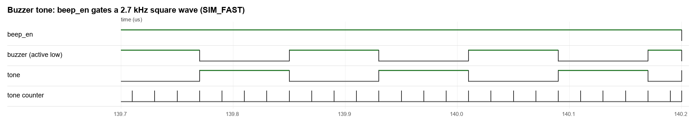
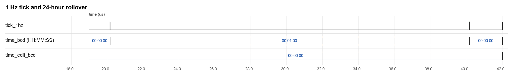
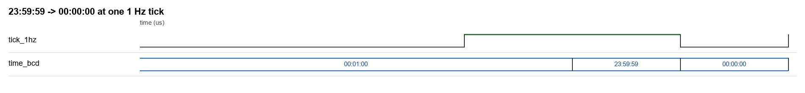

# 分频器说明书

> 项目：基于 KX-MS65 实验箱的电子时钟  
> 平台：KX-10CL006/10 核心板，Quartus Prime Standard 17.1  
> 版本：v1.0  
> 读者：会基本计数器，但不懂“为什么不能拿分频输出当时钟”的初学者

---

## 阅读说明

这份说明书只讲两件事：

1. 50 MHz 怎么变成 1 Hz、100 Hz、1 kHz、2 Hz 的“节拍”。
2. 2.7 kHz 的蜂鸣器方波怎么产生。

学完你能：

- 自己算出 50 MHz 分频到任意频率的计数终值；
- 看懂 `clk_gen.v` 和 `buzzer_tone.v`；
- 在 ModelSim 里测出 tick 周期和方波周期；
- 说清“分频时钟”和“单周期使能”的区别。

---

## 第 1 章 为什么需要分频

### 1.1 50 MHz 太快

实验箱核心板只有一个 50 MHz 有源晶振：

- 人眼看到的秒表，10 ms 才需要变一次；
- 数码管扫描，1 ms 扫一位就够；
- 时钟走秒，1 秒才需要加 1；
- 蜂鸣器发声，2.7 kHz 左右就够。

如果直接用 50 MHz 去驱动这些逻辑，计数器会跑得飞快，人眼和耳朵都反应不过来。

### 1.2 频率、周期、占空比

| 概念 | 公式 | 例子 |
|---|---|---|
| 频率 `f` | 每秒变化次数 | 50 MHz = 50,000,000 Hz |
| 周期 `T` | `1/f` | 50 MHz -> 20 ns |
| 占空比 | 高电平时间 / 周期 | 50% 就是高低各一半 |

### 1.3 两种分频写法

**写法 A：分频时钟**

```verilog
always @(posedge clk50)
    if (cnt == N-1) begin
        cnt <= 0;
        clk_1hz <= ~clk_1hz;
    end
    else cnt <= cnt + 1;
```

然后别的模块写 `always @(posedge clk_1hz)`。

**写法 B：单周期使能**

```verilog
always @(posedge clk50)
    if (cnt == N-1) begin
        cnt <= 0;
        tick_1hz <= 1'b1;
    end
    else begin
        cnt <= cnt + 1;
        tick_1hz <= 1'b0;
    end
```

别的模块仍然写 `always @(posedge clk50)`，只在 `if (tick_1hz)` 时做一次动作。

### 1.4 为什么本设计选写法 B

| 对比 | 分频时钟 | 单周期使能 |
|---|---|---|
| 时钟域 | 多个 | 只有一个 50 MHz |
| 时序约束 | 每个时钟都要约束 | 只约束 `clk50` |
| 门控时钟 | 容易产生 | 不需要 |
| 仿真 | 要处理多个时钟 | 只看一个时钟和 tick |
| 代码 | 看起来短 | 多一个 `if (tick_1hz)` |

本设计选 **单周期使能**：全设计只有一个时钟，TimeQuest 只需要一条 20 ns 约束。

---

## 第 2 章 硬件连接

### 2.1 50 MHz 时钟

| 信号 | FPGA 引脚 | 说明 |
|---|---|---|
| `clk50` | `M15` | 核心板 50 MHz 有源晶振，全局时钟输入 |

### 2.2 蜂鸣器

| 信号 | FPGA 引脚 | 说明 |
|---|---|---|
| `buzzer` | `T13` | 板载无源蜂鸣器，PNP 三极管驱动，低有效 |

蜂鸣器电路要点：

- 无源蜂鸣器不能只给直流，必须给方波；
- PNP 三极管发射极接 3.3 V，基极经电阻接 FPGA；
- FPGA 输出**低电平**时三极管导通，蜂鸣器响；
- 所以代码里 `buzzer = ~(beep_en & tone)`。

---

## 第 3 章 分频参数怎么算

### 3.1 计数器从 0 到 N−1

如果输入时钟频率是 `f_clk`，想要输出频率 `f_out`，计数器终值：

```text
N = f_clk / f_out
```

计数器从 0 计到 N−1，计满归零，产生一个单周期 tick。

### 3.2 本设计的参数

| tick | 目标 | 计数终值 N | 所需最小位宽 |
|---|---|---|---|
| `tick_1hz` | 1 Hz | 50,000,000 | 26 位 |
| `tick_100hz` | 100 Hz | 500,000 | 19 位 |
| `tick_1khz` | 1 kHz | 50,000 | 16 位 |
| `tick_2hz` | 每 250 ms 翻转 | 12,500,000 | 24 位 |

> 为了代码统一，`clk_gen.v` 里四个计数器都声明为 26 位；综合工具会自动优化掉未用到的位。

> `tick_2hz` 的名字容易误会：它是“每 250 ms 来一个脉冲”的翻转使能。显示模块每来一次就翻转 `blink2`，所以 `blink2` 的方波周期是 500 ms，即 2 Hz。

### 3.3 为什么 1 Hz 是 50,000,000 而不是 25,000,000

因为这里产生的是**单周期 tick**，不是 50% 占空比的方波：

```text
计数 0 ... 49,999,999 -> tick 高 1 个 50 MHz 周期 -> 归零
```

每 50,000,000 个 50 MHz 周期，tick 高一个周期，所以 tick 的频率是 1 Hz。

### 3.4 计数器位宽怎么选

`2^25 = 33,554,432`，不够 50,000,000；`2^26 = 67,108,864`，够。  
所以 1 Hz 计数器用 26 位。

---

## 第 4 章 `clk_gen` 模块

### 4.1 端口

```verilog
module clk_gen #(
    parameter integer CLK_FREQ = 50_000_000,
    parameter integer SIM_FAST = 0
)(
    input  wire clk,
    input  wire rst_n,
    output reg  tick_1hz,
    output reg  tick_100hz,
    output reg  tick_1khz,
    output reg  tick_2hz
);
```

### 4.2 参数

```verilog
localparam integer DIV_1HZ   = (SIM_FAST != 0) ? 1000 : CLK_FREQ;
localparam integer DIV_100HZ = (SIM_FAST != 0) ? 8    : (CLK_FREQ / 100);
localparam integer DIV_1KHZ  = (SIM_FAST != 0) ? 4    : (CLK_FREQ / 1000);
localparam integer DIV_2HZ   = (SIM_FAST != 0) ? 250  : (CLK_FREQ / 4);
```

- `SIM_FAST=0`：综合/上板，使用真实分频。
- `SIM_FAST=1`：仿真，使用很短的分频值，让 1 秒在仿真中只占 1000 个 50 MHz 周期。

### 4.3 完整代码

```verilog
//============================================================================
// 文件名  : clk_gen.v
// 功能    : 由 50 MHz 时钟产生 1 Hz、100 Hz、1 kHz、2 Hz 的单周期使能
//============================================================================
module clk_gen #(
    parameter integer CLK_FREQ = 50_000_000,
    parameter integer SIM_FAST = 0
)(
    input  wire clk,
    input  wire rst_n,
    output reg  tick_1hz,
    output reg  tick_100hz,
    output reg  tick_1khz,
    output reg  tick_2hz
);

    localparam integer DIV_1HZ   = (SIM_FAST != 0) ? 1000 : CLK_FREQ;
    localparam integer DIV_100HZ = (SIM_FAST != 0) ? 8    : (CLK_FREQ / 100);
    localparam integer DIV_1KHZ  = (SIM_FAST != 0) ? 4    : (CLK_FREQ / 1000);
    localparam integer DIV_2HZ   = (SIM_FAST != 0) ? 250  : (CLK_FREQ / 4);

    reg [25:0] cnt_1hz;
    reg [25:0] cnt_100hz;
    reg [25:0] cnt_1khz;
    reg [25:0] cnt_2hz;

    always @(posedge clk) begin
        if (!rst_n) begin
            cnt_1hz   <= 26'd0;
            cnt_100hz <= 26'd0;
            cnt_1khz  <= 26'd0;
            cnt_2hz   <= 26'd0;
            tick_1hz   <= 1'b0;
            tick_100hz <= 1'b0;
            tick_1khz  <= 1'b0;
            tick_2hz   <= 1'b0;
        end
        else begin
            // 1 Hz
            if (cnt_1hz == DIV_1HZ - 1) begin
                cnt_1hz  <= 26'd0;
                tick_1hz <= 1'b1;
            end
            else begin
                cnt_1hz  <= cnt_1hz + 1'b1;
                tick_1hz <= 1'b0;
            end

            // 100 Hz
            if (cnt_100hz == DIV_100HZ - 1) begin
                cnt_100hz  <= 26'd0;
                tick_100hz <= 1'b1;
            end
            else begin
                cnt_100hz  <= cnt_100hz + 1'b1;
                tick_100hz <= 1'b0;
            end

            // 1 kHz
            if (cnt_1khz == DIV_1KHZ - 1) begin
                cnt_1khz  <= 26'd0;
                tick_1khz <= 1'b1;
            end
            else begin
                cnt_1khz  <= cnt_1khz + 1'b1;
                tick_1khz <= 1'b0;
            end

            // 2 Hz 闪烁使能（每 250 ms 一次）
            if (cnt_2hz == DIV_2HZ - 1) begin
                cnt_2hz  <= 26'd0;
                tick_2hz <= 1'b1;
            end
            else begin
                cnt_2hz  <= cnt_2hz + 1'b1;
                tick_2hz <= 1'b0;
            end
        end
    end

endmodule
```

### 4.4 逐段解释

- 四个计数器并行计数，互不影响。
- 每个计数器到 `DIV-1` 时归零，并让对应 tick 高一个周期。
- 其余时间 tick 保持 0，所以下游模块只会在 tick 那一个周期动作一次。
- 复位时计数器清零、tick 清零。

---

## 第 5 章 蜂鸣器音频分频

### 5.1 2.7 kHz 怎么来

人耳对 2~4 kHz 比较敏感，选 2.7 kHz 左右：

```text
TONE_DIV = 50,000,000 / (2 × 2700) ≈ 9259
```

计数器每计到 9259−1，`tone` 翻转一次：

- 半周期 = 9259 × 20 ns ≈ 185.18 µs；
- 周期 ≈ 370.36 µs；
- 频率 ≈ 2.70 kHz。

### 5.2 完整代码

```verilog
//============================================================================
// 文件名  : buzzer_tone.v
// 功能    : 产生约 2.7 kHz 方波，驱动板载无源蜂鸣器
//============================================================================
module buzzer_tone #(
    parameter integer SIM_FAST = 0
)(
    input  wire clk,
    input  wire rst_n,
    input  wire beep_en,
    output wire buzzer
);

    // 50 MHz / (2 * 2700) ≈ 9259
    localparam integer TONE_DIV = (SIM_FAST != 0) ? 4 : 9259;

    reg [13:0] cnt;
    reg        tone;

    always @(posedge clk) begin
        if (!rst_n) begin
            cnt  <= 14'd0;
            tone <= 1'b0;
        end
        else if (!beep_en) begin
            cnt  <= 14'd0;
            tone <= 1'b0;
        end
        else if (cnt == TONE_DIV - 1) begin
            cnt  <= 14'd0;
            tone <= ~tone;
        end
        else begin
            cnt <= cnt + 1'b1;
        end
    end

    // 低有效：beep_en=1 且 tone=1 时输出低，蜂鸣器响
    assign buzzer = ~(beep_en & tone);

endmodule
```

### 5.3 低有效怎么理解

| `beep_en` | `tone` | `buzzer` | 蜂鸣器 |
|---|---|---|---|
| 0 | 0 | 1 | 不响 |
| 1 | 0 | 1 | 不响 |
| 1 | 1 | 0 | 响 |
| 0 | 1 | 1 | 不响 |

`beep_en=0` 时 `buzzer` 强制为高，蜂鸣器关断；`beep_en=1` 时 `buzzer` 随 `tone` 翻转，形成方波。

### 5.4 实际波形



图中：

- `beep_en=1` 时才开始翻转；
- `buzzer` 低有效，所以 `tone=1` 时 `buzzer=0`；
- 计数到 3 归零，这是 `SIM_FAST=1` 的短分频，真实综合时是 9259。

---

## 第 6 章 仿真

### 6.1 看 1 Hz tick



观察点：

1. `tick_1hz` 只高一个 50 MHz 周期；
2. 每个 tick，`time_bcd` 的秒个位加 1；
3. 00:00:59 的下一个 tick 变成 00:01:00。

### 6.2 看 24 小时回绕



观察点：

1. `23:59:59` 在 tick 前保持；
2. tick 后直接变 `00:00:00`；
3. 不会出现 24:00:00。

### 6.3 看蜂鸣器方波


观察点：

1. `beep_en` 为高时，`tone` 才翻转；
2. `buzzer` 与 `tone` 反相；
3. 计数器 0→1→2→3→0，周期稳定。

### 6.4 仿真时间说明

`SIM_FAST=1` 时：

- 1 kHz tick 每 4 个 50 MHz 周期一次；
- 1 Hz tick 每 1000 个周期一次；
- 闹钟 2.4 s 在仿真中约 180 µs。

所以波形图上的 µs 不是真实秒，而是压缩后的仿真时间。上板时必须 `SIM_FAST=0` 重新编译。

---

## 第 7 章 常见问题

| 现象 | 原因 | 解决 |
|---|---|---|
| 没有 tick | 复位一直为低；计数器没到终值 | 检查 `rst_n`、`DIV_*` |
| 频率差一倍 | 把 tick 当成了 50% 方波 | 确认是“每 N 个周期一个脉冲” |
| 频率差很多 | `CLK_FREQ` 写错 | 确认是 50_000_000 |
| 仿真跑不完 | 用了真实 50,000,000 | 仿真时 `SIM_FAST=1` |
| 综合后频率不对 | 忘了把 `SIM_FAST` 改回 0 | 全编译前检查参数 |
| 蜂鸣器不响 | `beep_en` 没拉高；极性反了 | 看 `beep_en` 和 `buzzer` |
| 蜂鸣器一直响 | 只给了直流，或 `beep_en` 常 1 | 必须方波，且节奏状态机要能回 IDLE |
| 计数器位宽不够 | 50,000,000 超过 25 位 | 用 26 位 |

---

## 第 8 章 本章小结与练习

### 8.1 小结

- 分频的本质是“数够 N 个时钟周期，产生一个动作”。
- 本设计用单周期 tick，不用分频时钟。
- 1 Hz、100 Hz、1 kHz、2 Hz 四个 tick 都由 50 MHz 计数器产生。
- 蜂鸣器用 2.7 kHz 方波，低有效，PNP 驱动。
- `SIM_FAST` 只用于仿真，综合时必须为 0。

### 8.2 练习

1. 如果要产生 10 Hz tick，计数终值是多少？需要多少位？
2. 如果把 `DIV_1HZ` 写成 25,000,000，tick 频率是多少？
3. 为什么 `buzzer = beep_en & tone` 会让蜂鸣器一直响或不响？
4. 把 `TONE_DIV` 改成 4629，频率大约是多少？
5. 用 ModelSim 测出 `tick_1khz` 的周期，和 1 ms 对比。
