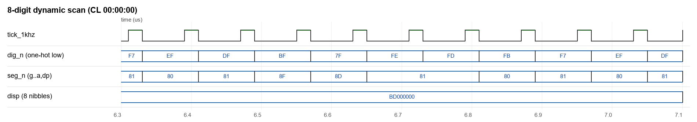
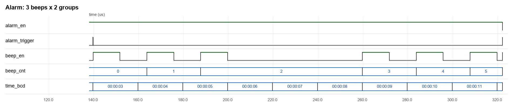
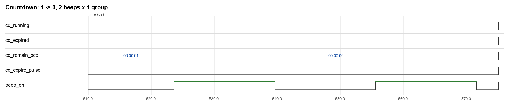
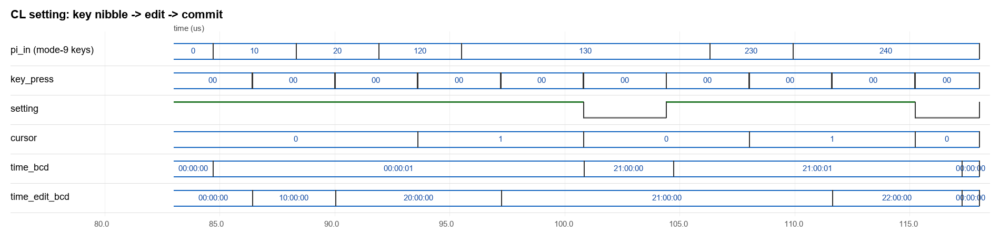

# 系统架构说明书

> 项目：基于 KX-MS65 实验箱的电子时钟  
> 平台：KX-10CL006/10 核心板，Quartus Prime Standard 17.1  
> 版本：v1.0  
> 读者：已经看过按键和分频器、想知道“整个系统怎么搭起来”的初学者

---

## 阅读说明

这份说明书回答四个问题：

1. 系统由哪些模块组成？
2. 按键、时钟、闹钟、秒表、倒计时、显示、蜂鸣器之间怎么连？
3. 数据从按键走到数码管，中间经过了什么？
4. 代码文件怎么组织，先看哪个、后看哪个？

建议配合以下文件阅读：

- `rtl/digital_clock_top.v`：顶层
- `rtl/key_ctrl.v`：模式/设置状态机
- `rtl/display_ctrl.v`：显示扫描
- `sim/tb_digital_clock_top.v`：仿真
- `images/`：实际波形

---

## 第 1 章 从需求到模块

### 1.1 六个功能

| 功能 | 输入 | 输出 | 主要模块 |
|---|---|---|---|
| 时钟 | 50 MHz、按键 | 6 位 BCD 时间 | `time_counter` |
| 闹钟 | 50 MHz、按键、当前时间 | 闹钟时间、触发脉冲 | `alarm_ctrl` |
| 秒表 | 50 MHz、按键 | 分/秒/厘秒 | `stopwatch` |
| 倒计时 | 50 MHz、按键 | 剩余时间、到期脉冲 | `countdown` |
| 显示 | 各模式数据 | 段选、位选、LED | `display_ctrl`、`seg_decode` |
| 声音 | 触发脉冲 | 蜂鸣器方波 | `beep_ctrl`、`buzzer_tone` |

### 1.2 三条设计原则

1. **单时钟域**：所有寄存器都用 50 MHz，分频只产生单周期使能 `tick_*`，不产生新的时钟。
2. **控制与数据分开**：`key_ctrl` 只负责“现在是什么模式、光标在哪、按了什么键”；时间、闹钟、秒表、倒计时各自维护自己的数据。
3. **设置用编辑缓冲**：设置时改“编辑值”，确认后才写回正式值；取消不生效。

### 1.3 模块总览

```text
digital_clock_top
├── clk_gen              50 MHz -> tick_1hz / tick_100hz / tick_1khz / tick_2hz
├── key_input
│   ├── nibble_key × 8   模式 9 的 8 路 4 位按键
│   └── core_key × 4     核心板 K1~K4
├── key_ctrl             模式 FSM + 设置 FSM + 动作译码
├── bcd_digit_adj × 6    24 位 BCD 按位加/减
├── time_counter         正式时钟 + 编辑缓冲
├── alarm_ctrl           闹钟设置、开关、比较、触发
├── stopwatch            秒表
├── countdown            倒计时
├── beep_ctrl            提示音节奏
├── buzzer_tone          2.7 kHz 方波
├── display_ctrl         8 位扫描、模式选择、LED
└── seg_decode           七段译码
```

---

## 第 2 章 系统总框图

```text
                    ┌──────────────────────────────────────┐
                    │          digital_clock_top           │
                    │                                      │
 50 MHz ───────────►│ clk_gen                              │
 M15                │  ├─ tick_1hz                         │
                    │  ├─ tick_100hz                       │
                    │  ├─ tick_1khz                        │
                    │  └─ tick_2hz                         │
                    │                                      │
 PI[15:0] ─────────►│ key_input                            │
 PIO[15:0] ────────►│  ├─ nibble_key × 8                   │
 K1~K4 ────────────►│  └─ core_key × 4                     │
                    │        │ key_press[7:0]               │
                    │        │ core_press[3:0]              │
                    │        ▼                             │
                    │ key_ctrl                             │
                    │  ├─ mode / setting / cursor           │
                    │  ├─ edit_load / edit_commit           │
                    │  └─ digit_inc / digit_dec             │
                    │        │                             │
                    │        ├──────────────┬─────────────┐ │
                    │        ▼              ▼             ▼ │
                    │ time_counter    alarm_ctrl    countdown
                    │        │              │             │ │
                    │        │ time_bcd     │ alarm_trigger│
                    │        ▼              ▼             ▼ │
                    │ display_ctrl     beep_ctrl ◄── cd_expire_pulse
                    │        │              │             │
                    │        ▼              ▼             │
                    │ seg_n/dig_n/led_n  buzzer_tone ─────┼──► T13
                    └──────────────────────────────────────┘
                                     │
                                     ▼
                              8 位数码管 + LED1~4
```

### 2.1 一句话数据流

> 50 MHz 产生 tick → 按键输入变成单周期脉冲 → `key_ctrl` 决定模式/动作 → 时间/闹钟/秒表/倒计时更新 → `display_ctrl` 选出 8 个 nibble → 段选/位选扫描 → 数码管显示；到点脉冲 → `beep_ctrl` → 2.7 kHz 方波 → 蜂鸣器。

### 2.2 三条“后台继续”规则

- 时钟 `time_bcd` 永远按 1 Hz 走，设置时也不停。
- 秒表 `run_reg` 只在 St 模式按键控制，切到其他模式后继续计数。
- 倒计时 `run_reg` 只在 Cd 模式按键控制，切到其他模式后继续倒计时。

---

## 第 3 章 顶层接口与引脚

### 3.1 顶层端口

```verilog
module digital_clock_top #(
    parameter integer CLK_FREQ = 50_000_000,
    parameter integer SIM_FAST = 0
)(
    input  wire        clk50,
    input  wire [15:0] pi_in,
    input  wire [15:0] pio_in,
    input  wire [3:0]  key_core_n,
    output wire [7:0]  seg_n,
    output wire [7:0]  dig_n,
    output wire        buzzer,
    output wire [3:0]  led_n
);
```

| 端口 | 位宽 | 方向 | 说明 |
|---|---|---|---|
| `clk50` | 1 | 输入 | 50 MHz，`M15` |
| `pi_in` | 16 | 输入 | 模式 9：键 1~4 |
| `pio_in` | 16 | 输入 | 模式 9：键 5~8 |
| `key_core_n` | 4 | 输入 | K1~K4，低有效 |
| `seg_n` | 8 | 输出 | 段选 `{g,f,e,d,c,b,a,dp}`，低有效 |
| `dig_n` | 8 | 输出 | 位选，低有效 |
| `buzzer` | 1 | 输出 | 蜂鸣器，低有效 |
| `led_n` | 4 | 输出 | LED1~4，低有效 |

### 3.2 I/O 分组

| 分组 | 数量 | 说明 |
|---|---|---|
| `PO[15:0]` | 16 | 8 段选 + 8 位选 |
| `PI[15:0]` | 16 | 键 1~4 的 4 个 nibble |
| `PIO[15:0]` | 16 | 键 5~8 的 4 个 nibble |
| 核心按键 | 4 | K1~K4 |
| 时钟 | 1 | `M15` |
| 蜂鸣器 | 1 | `T13` |
| LED | 4 | `T15/M9/L9/T14` |
| **合计** | **58** | 完整表见 `constraints/pin_assignments.csv` |

### 3.3 关键引脚

| 信号 | 引脚 |
|---|---|
| 50 MHz | `M15` |
| K1 复位 | `P9` |
| K2 + | `N9` |
| K3 − | `M10` |
| K4 确认 | `P11` |
| 蜂鸣器 | `T13` |
| 段选 `g..dp` | `C2,D1,B3,A3,B5,A5,B7,B6` |
| 位选 数码8..1 | `L4,R1,N1,P2,K1,L2,G1,J2` |

> 位选 `dig_n[0]` 对应最右边的数码 1，`dig_n[7]` 对应最左边的数码 8。

---

## 第 4 章 时钟与复位

### 4.1 单时钟 + tick 使能

`clk_gen` 的输出不是“1 Hz 时钟”，而是“每 1 秒高一个 50 MHz 周期的使能”：

```verilog
if (cnt_1hz == DIV_1HZ - 1) begin
    cnt_1hz  <= 0;
    tick_1hz <= 1'b1;
end
else begin
    cnt_1hz  <= cnt_1hz + 1;
    tick_1hz <= 1'b0;
end
```

这样做的好处：

- 全设计只有一个时钟 `clk50`，TimeQuest 只需要约束一个 20 ns 时钟。
- 不需要 `BUFG` 或门控时钟，避免时钟偏斜和 CDC。
- 仿真时可以只改 `SIM_FAST`，不用改所有模块。

### 4.2 四个 tick

| tick | 真实周期 | 用途 |
|---|---|---|
| `tick_1hz` | 1 s | 时钟走秒、闹钟比较、倒计时减 1 |
| `tick_100hz` | 10 ms | 秒表厘秒 |
| `tick_1khz` | 1 ms | 数码管扫描、按键消抖、蜂鸣器节奏 |
| `tick_2hz` | 250 ms 翻转 | 2 Hz 闪烁、LED1 心跳 |

### 4.3 复位

```text
上电 -> POR 计数器约 20 ms -> por_done=1
K1  -> 20 ms 消抖 -> k1_db=1（松开）
sys_rst_n = por_done & k1_db
```

- 所有时序逻辑用同步复位：`always @(posedge clk) if (!rst_n) ...`
- K1 按住时 `sys_rst_n=0`，松开并稳定 20 ms 后释放。
- K1 不会清零动态配置板的 nibble；`key_input` 复位后会重新锁存当前 nibble。
- 复位默认值：CL、`00:00:00`、闹钟关、秒表 0、倒计时 `00:05:00`。

### 4.4 仿真加速

```verilog
localparam integer DIV_1HZ   = (SIM_FAST != 0) ? 1000 : CLK_FREQ;
localparam integer DIV_100HZ = (SIM_FAST != 0) ? 8    : (CLK_FREQ / 100);
localparam integer DIV_1KHZ  = (SIM_FAST != 0) ? 4    : (CLK_FREQ / 1000);
localparam integer DIV_2HZ   = (SIM_FAST != 0) ? 250  : (CLK_FREQ / 4);
```

- 综合时 `SIM_FAST=0`，必须使用真实分频。
- 仿真时 `SIM_FAST=1`，1 秒被压缩成 1000 个 50 MHz 周期，便于在微秒级仿真时间里跑完秒表、闹钟、倒计时。
- 波形图中的时间轴是“仿真时间”，不是真实秒；例如闹钟 2.4 s 在仿真中约 180 µs。

---

## 第 5 章 数据通路

### 5.1 BCD 格式

```text
time_bcd[23:0] = {hh_t, hh_o, mm_t, mm_o, ss_t, ss_o}
```

| 字段 | 范围 | 说明 |
|---|---|---|
| `hh_t` | 0~2 | 时的十位 |
| `hh_o` | 0~9，`hh_t=2` 时 0~3 | 时的个位 |
| `mm_t/ss_t` | 0~5 | 分/秒十位 |
| `mm_o/ss_o` | 0~9 | 分/秒个位 |

为什么用 BCD：

- 显示时直接拆成 4 位，不用二进制转 BCD。
- 按位调整时直接对某一位加/减，初学者容易理解。
- 资源代价可接受：整个设计 1,584 LE，仍只占 25%。

### 5.2 时钟 `time_counter`

```text
tick_1hz ──► 秒个位 +1 ──► 秒十位 ──► 分个位 ──► 分十位 ──► 时个位 ──► 时十位
                                      │
                                      └─ 23:59:59 -> 00:00:00
```

- 正式时钟 `time_reg` 一直在走。
- 设置时 `edit_reg` 从 `time_reg` 复制，冻结不动。
- 确认：`time_reg <= edit_reg`。
- 取消：不写回，`time_reg` 继续走。

### 5.3 闹钟 `alarm_ctrl`

```text
time_bcd ──┐
           ├── 相等比较 ──► match ──► 上升沿 ──► alarm_trigger
alarm_bcd ─┘        ▲
                    │
                 alarm_en
```

- 闹钟精确到秒。
- 只有 `alarm_en=1` 且 `time_bcd == alarm_bcd` 时才可能触发。
- 用 `match_d` 做上升沿检测，同一秒只产生一个脉冲。
- 时间离开相等状态后 `match_d` 自动清零，下一天同一秒可以再次触发。

### 5.4 秒表 `stopwatch`

```text
tick_100hz ──► 厘秒 00~99 ──► 秒 00~59 ──► 分 00~99
                                  │
                             99:59.99 自动停
```

- key1 启动/暂停。
- key2 清零并暂停。
- 切到其他模式后 `run_reg` 保持，继续后台计数。

### 5.5 倒计时 `countdown`

```text
preset_bcd ──► remain_bcd ──► 每秒减 1 ──► 00:00:00
                   │                         │
                   │                         └─ expire_pulse
                   └─ key6 复位到 preset
```

- key5 启动/暂停。
- key6 未运行时复位到设定值。
- key2 未运行时清零到 0。
- 剩余为 0 时 key5 启动无效，所以不会“0 启动立刻响”。
- 只有从 `00:00:01` 减到 `00:00:00` 才产生 `expire_pulse`。

### 5.6 显示 `display_ctrl`

```text
d[7] d[6] | d[5] d[4] | d[3] d[2] | d[1] d[0]
 模式 模式 |  时十 时个 |  分十 分个 |  秒十 秒个
```

- 1 kHz 扫描，8 位轮流选通。
- 位选低有效，同一时刻只有一位为 0。
- 段选低有效，段码按 `{g,f,e,d,c,b,a,dp}`。
- 小数点在第 4 位和第 2 位（`d[4]`、`d[2]`），显示成 `HH.MM.SS` 或 `MM.SS.CC`。
- 模式标识：`CL`、`AL`、`St`、`Cd`。
- 设置时选中位 2 Hz 闪烁；CL/AL 设置时模式标识也闪烁；Cd 运行/暂停/到期时模式标识闪烁。

实际扫描波形：



---

## 第 6 章 控制通路

### 6.1 模式状态机

| 模式 | 编码 | 显示 |
|---|---|---|
| CL | `2'b00` | `CL` |
| AL | `2'b01` | `AL` |
| St | `2'b10` | `St` |
| Cd | `2'b11` | `Cd` |

```text
        key8            key8            key8            key8
  CL ─────────► AL ─────────► St ─────────► Cd ─────────► CL
```

- 正常显示：key8 切下一个模式。
- 设置中：key8 取消并切下一个模式。
- St/Cd 切走后继续后台运行。

### 6.2 设置子状态机

```text
  IDLE ──(key7/K4)──► SET ──(key7/K4)──► IDLE（确认）
   ▲                   │
   └──(key8，取消)─────┘
```

- `setting=1` 时，`cursor` 选择当前位。
- CL/AL/Cd 都是 6 位光标：时十、时个、分十、分个、秒十、秒个。
- key4 左移，key3 右移，0~5 循环。
- key2/K2 加 1，key1/K3 减 1。

### 6.3 进入设置的条件

| 模式 | 条件 |
|---|---|
| CL | 任何时候 |
| AL | 任何时候 |
| St | 不允许 |
| Cd | `!cd_running && !cd_expired` |

### 6.4 按键动作译码

`key_ctrl` 把“模式 + 按键”翻译成“动作脉冲”：

| 动作 | 目标模块 | 说明 |
|---|---|---|
| `edit_load` | 时间/闹钟/倒计时 | 进入设置，复制当前值到编辑值 |
| `edit_commit` | 时间/闹钟/倒计时 | 确认，写回正式值 |
| `digit_inc` | 时间/闹钟/倒计时 | 选中位 +1 |
| `digit_dec` | 时间/闹钟/倒计时 | 选中位 −1 |
| `alarm_en_toggle` | `alarm_ctrl` | AL 正常时开关闹钟 |
| `sw_start_pause` | `stopwatch` | St 启动/暂停 |
| `sw_clear` | `stopwatch` | St 清零 |
| `cd_start_pause` | `countdown` | Cd 启动/暂停 |
| `cd_reset` | `countdown` | Cd 复位到设定值 |
| `cd_clear` | `countdown` | Cd 清零到 0 |
| `beep_silence` | `beep_ctrl` | 任意键静音 |

> 三个编辑模块都接收 `mode`，只在自己的模式下响应 `edit_*` / `digit_*`，避免在 AL 设置时误改时钟编辑值。

### 6.5 蜂鸣器状态机

```text
IDLE ──alarm_trigger──► ON ──150ms──► OFF ──150ms──► ON ...（3 下）
  ▲                                               │
  │                                               ├─ 第一组结束 -> GAP 600ms -> 第二组
  │                                               └─ 第二组结束 -> IDLE
  │
  └──cd_expire──► ON ──200ms──► OFF ──200ms──► ON ──200ms──► OFF ──► IDLE（2 下）
```

- 闹钟：3 下×2 组。
- 倒计时：2 下×1 组。
- 任意键 `silence` 立即回 IDLE。
- 闹钟触发优先于倒计时。

实际波形：





---

## 第 7 章 典型数据流例子

### 7.1 CL 设置：正式时钟与编辑缓冲

```text
按 key7
  -> key_ctrl: edit_load=1, setting=1, cursor=0
  -> time_counter: edit_reg <= time_reg
  -> display_ctrl: 显示 edit_reg
  -> time_reg 仍然每秒 +1

按 key2
  -> key_ctrl: digit_inc=1
  -> bcd_digit_adj: 只改 cursor 选中的那一位
  -> edit_reg 更新

按 key7
  -> key_ctrl: edit_commit=1, setting=0
  -> time_counter: time_reg <= edit_reg

按 key8
  -> key_ctrl: setting=0, mode=AL
  -> time_counter 不写回，正式时钟继续走
```

关键点：**设置时改的是 `edit_reg`，不是 `time_reg`。**  
所以“取消”才有意义，正式时钟也不会因为设置而停走。



### 7.2 AL 到点：比较→触发→响

```text
time_bcd == alarm_bcd 且 alarm_en=1
  -> match=1
  -> match 上升沿 -> alarm_trigger 单周期脉冲
  -> beep_ctrl 进入闹钟序列
  -> buzzer_tone 输出 2.7 kHz 方波
  -> 3 下，停 600 ms，再 3 下
```

### 7.3 St 后台运行

```text
St 模式 key1 -> sw_start_pause -> stopwatch.run_reg=1
切到 Cd      -> run_reg 保持 1
切回 St      -> 显示继续增加
```

### 7.4 Cd 到 0

```text
remain_bcd=00:00:01
  -> tick_1hz
  -> remain_bcd<=00:00:00
  -> run_reg<=0, expired<=1
  -> expire_pulse 单周期
  -> beep_ctrl 进入倒计时序列（2 下）
  -> display_ctrl 显示 00:00:00，Cd 闪烁，LED4 闪烁
```

---

## 第 8 章 模块接口与代码结构

### 8.1 模块接口表

| 模块 | 主要输入 | 主要输出 |
|---|---|---|
| `clk_gen` | `clk`, `rst_n` | `tick_1hz`, `tick_100hz`, `tick_1khz`, `tick_2hz` |
| `nibble_key` | `clk`, `rst_n`, `tick_1khz`, `nibble_in` | `press` |
| `core_key` | `clk`, `rst_n`, `tick_1khz`, `key_n` | `press` |
| `key_input` | `pi_in`, `pio_in`, `key_core_n` | `key_press[7:0]`, `core_press[3:0]` |
| `key_ctrl` | `key_press`, `core_press`, `cd_running`, `cd_expired` | 模式、设置、光标、动作脉冲 |
| `bcd_digit_adj` | `bcd_in`, `cursor`, `inc` | `bcd_out` |
| `time_counter` | `tick_1hz`, `mode`, `edit_*`, `digit_*`, `cursor` | `time_bcd`, `edit_bcd` |
| `alarm_ctrl` | `mode`, `time_bcd`, `edit_*`, `digit_*`, `cursor`, `alarm_en_toggle` | `alarm_bcd`, `alarm_edit_bcd`, `alarm_en`, `alarm_trigger` |
| `stopwatch` | `tick_100hz`, `start_pause`, `clear` | `min_bcd`, `sec_bcd`, `cs_bcd`, `running` |
| `countdown` | `tick_1hz`, `mode`, `edit_*`, `digit_*`, `cursor`, `start_pause`, `reset`, `clear` | `preset_bcd`, `remain_bcd`, `edit_bcd`, `running`, `paused`, `expired`, `expire_pulse` |
| `beep_ctrl` | `tick_1khz`, `alarm_trigger`, `cd_expire`, `silence` | `beep_en` |
| `buzzer_tone` | `clk`, `beep_en` | `buzzer` |
| `display_ctrl` | 各模式数据、`setting`、`cursor`、`blink` | `seg_n`, `dig_n`, `led_n` |
| `seg_decode` | `bcd`, `dp`, `blank` | `seg_n[7:0]` |

### 8.2 顶层连线

```verilog
clk_gen u_clk_gen(...);
key_input u_key_input(...);
key_ctrl u_key_ctrl(...);
time_counter u_time_counter(...);
alarm_ctrl u_alarm_ctrl(...);
stopwatch u_stopwatch(...);
countdown u_countdown(...);
beep_ctrl u_beep_ctrl(...);
buzzer_tone u_buzzer_tone(...);
display_ctrl u_display_ctrl(...);
```

对应源码：`rtl/digital_clock_top.v`。

### 8.3 文件树

```text
rtl/
  digital_clock_top.v
  clk_gen.v
  nibble_key.v
  core_key.v
  key_input.v
  key_ctrl.v
  bcd_digit_adj.v
  time_counter.v
  alarm_ctrl.v
  stopwatch.v
  countdown.v
  beep_ctrl.v
  buzzer_tone.v
  display_ctrl.v
  seg_decode.v
```

### 8.4 命名约定

| 后缀/前缀 | 含义 |
|---|---|
| `_n` | 低有效，如 `seg_n`、`dig_n`、`led_n`、`rst_n` |
| `_bcd` | BCD 编码 |
| `tick_*` | 单周期使能，不是时钟 |
| `edit_*` | 编辑缓冲 |
| `alarm_*` | 闹钟 |
| `cd_*` | 倒计时 |
| `sw_*` | 秒表 |
| `MODE_*` | 模式编码 |

---

## 第 9 章 资源与时序

### 9.1 实际结果

| 资源 | 占用 |
|---|---|
| Logic elements | 1,584 / 6,272（25%） |
| Registers | 680 |
| User I/O | 58 / 177（33%） |
| PLL | 0 / 2 |
| M9K | 0 / 30 |
| DSP | 0 / 30 |

### 9.2 时序

```text
Slow 1200mV 85°C Setup : 9.256 ns
Slow 1200mV 85°C Hold  : 0.452 ns
Minimum pulse width    : 9.687 ns
```

50 MHz 周期 20 ns，setup slack 9.256 ns，说明还有很大余量。

### 9.3 关于 AN447 警告

Quartus 报告 37 个引脚使用 3.3-V LVTTL，提示要满足 Cyclone 10 LP 的 3.3 V 接口要求。这是**接口电平提示**，不是编译错误：

- 实验箱核心板 VCCIO 为 3.3 V；
- 显示、按键、蜂鸣器、LED 都是板内 3.3 V 信号；
- 上板时不要给这些 IO 外加 5 V。

---

## 第 10 章 设计取舍

### 10.1 为什么用 tick 使能，不用分频时钟

| 做法 | 优点 | 缺点 |
|---|---|---|
| 分频时钟 `always @(posedge clk_1hz)` | 写法直观 | 多时钟域、门控时钟、时序分析复杂 |
| 单周期使能 `tick_1hz` | 单时钟、易约束、易仿真 | 代码里要多写一个 `if (tick_1hz)` |

本设计选后者，因为整个系统只有一个 50 MHz 时钟，TimeQuest 只需要一条 20 ns 约束。

### 10.2 为什么用 BCD

- 显示和按位调整直接；
- 不需要二进制转 BCD 的组合逻辑；
- 代价是寄存器多一点，但 10CL006 资源足够。

### 10.3 为什么用编辑缓冲

如果设置时直接改正式时间：

- 按“取消”无法恢复；
- 设置秒位时，下一拍 1 Hz 会立刻改掉；
- 代码里“确认/取消”的语义不清晰。

编辑缓冲把“正在编辑”和“正式运行”分开，逻辑更清楚。

### 10.4 为什么不做断电保存

FPGA 是 SRAM，断电后寄存器全丢。要做断电保存需要：

- 非易失存储（EPCS16/W25Q64）存设置；
- 或者带电池的 RTC（DS1302/DS3231）保持时间。

这会增加硬件和文档复杂度，本实验不做。

---

## 第 11 章 本章小结与练习

### 11.1 小结

- 系统是“单时钟 + tick 使能 + 控制/数据分离”的结构。
- 按键只产生脉冲，`key_ctrl` 决定动作，数据模块各自维护数据。
- 设置用编辑缓冲，确认才写回。
- 显示是 1 kHz 动态扫描，段选/位选都低有效。
- 蜂鸣器由节奏状态机和 2.7 kHz 方波发生器组成。

### 11.2 练习

1. 画出 CL 设置时 `time_reg`、`edit_reg`、`display` 三者的关系。
2. 如果要把秒表改成 1 ms 分辨率，需要改哪个 tick、哪个计数器？
3. 如果要在 AL 模式显示“闹钟开/关”，你会改 `display_ctrl` 的哪几位？
4. 如果要把倒计时上限改成 99:59:59，`bcd_digit_adj` 和 `countdown` 各要改什么？
5. 为什么 `alarm_ctrl` 不需要 `tick_1hz` 也能工作？
