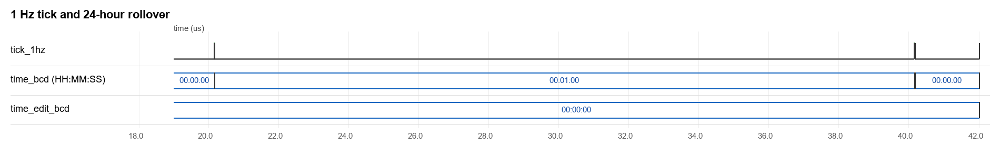
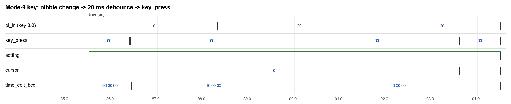
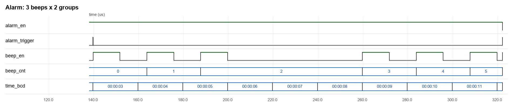
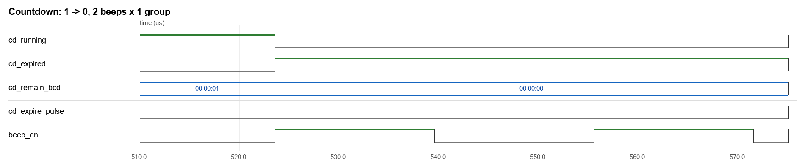
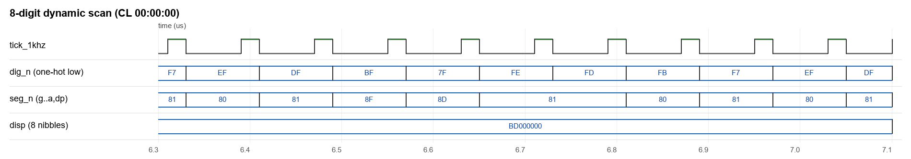

# 仿真操作流程说明书

> 项目：基于 KX-MS65 实验箱的电子时钟  
> 平台：Quartus Prime Standard 17.1 + ModelSim-ASE 17.1  
> 版本：v1.0  
> 读者：第一次打开 Quartus/ModelSim，不知道从哪里点起的初学者

---

## 阅读说明

这份说明书按“从零开始”的顺序写：

1. 仿真前要准备什么；
2. 怎么打开 Quartus 工程、怎么编译；
3. 怎么用 ModelSim 跑 testbench；
4. 怎么加波形、看波形、量时间；
5. 每个测试用例看什么；
6. 报错怎么处理。

本工程的 testbench 是**自检**的：运行结束会打印 `ALL TESTS PASSED` 或错误数量，不需要你逐条手算。

---

## 第 1 章 仿真前准备

### 1.1 软件

| 软件 | 版本 | 用途 |
|---|---|---|
| Quartus Prime Standard | 17.1 | 编译、综合、下载 |
| ModelSim-ASE | 17.1 | 跑 testbench、看波形 |
| Cyclone 10 LP 器件库 | 17.1 | 10CL006/010 |

### 1.2 文件

| 文件 | 作用 |
|---|---|
| `rtl/*.v` | 15 个 RTL 模块 |
| `sim/tb_digital_clock_top.v` | 自检 testbench |
| `sim/compile.do` | 建库、编译 |
| `sim/run_sim.do` | 编译 + 加载 + 加波形 + 运行 |
| `sim/wave_all.do` | 分组加波形 |
| `sim/run_sim.bat` | Windows 一键批处理 |

### 1.3 路径

建议把工程放在**不含中文、不含空格**的路径下。  
当前工程路径：

```text
C:\ZZJ\APP\intelFPGA\17.1\MyprojectsZZJ\DigitalClock
```

如果 ModelSim 启动时报缺少 DLL，通常是缺少 32 位 VC++ 运行库；安装 Microsoft Visual C++ 2013 Redistributable (x86) 即可。

---

## 第 2 章 打开 Quartus 工程

### 2.1 打开

1. 启动 Quartus Prime Standard 17.1。
2. `File -> Open Project`。
3. 选择 `DigitalClock.qpf`。
4. 确认 Device 为 `10CL006YU256C8G`；若核心板丝印是 010，改为 `10CL010YU256C8G`，引脚不变。

### 2.2 编译

1. `Processing -> Start Compilation`。
2. 等待 Analysis & Synthesis、Fitter、Assembler、TimeQuest 全部完成。
3. 看到 `Full Compilation was successful` 即可。
4. 生成文件：`output_files/DigitalClock.sof`。

编译结果参考：

```text
0 errors, 1 warning（AN447 3.3 V 接口提示）
1,584 / 6,272 LE
680 registers
58 / 177 user I/O
50 MHz setup slack 9.256 ns
```

> 仿真其实不要求先跑完整编译；但先编译一次可以确认 RTL 没有综合错误。

---

## 第 3 章 用 ModelSim 跑自检仿真

### 3.1 方式一：Windows 批处理（推荐给第一次用的人）

在工程根目录执行：

```bat
sim\run_sim.bat
```

它会自动：

1. 删除旧的 `work` 库；
2. 新建 `work`；
3. 编译 `rtl/*.v`；
4. 编译 `tb_digital_clock_top.v`；
5. 加载 `work.tb_digital_clock_top`；
6. `run -all`；
7. 退出。

看到下面两行即成功：

```text
==== ALL TESTS PASSED ====
# Errors: 0, Warnings: 0
```

### 3.2 方式二：ModelSim GUI

1. 打开 ModelSim-ASE。
2. `File -> Change Directory`，切到 `DigitalClock/sim`。
3. 在 Transcript 中执行：

```tcl
do run_sim.do
```

`run_sim.do` 的内容是：

```tcl
do compile.do
vsim work.tb_digital_clock_top
do wave_all.do
run -all
```

也可以分步：

```tcl
do compile.do
vsim work.tb_digital_clock_top
do wave_all.do
run -all
```

### 3.3 `compile.do` 做了什么

```tcl
if {[file exists work]} {
    vdel -all -lib work
}
vlib work
vmap work work

foreach f [glob ../rtl/*.v] {
    vlog $f
}
vlog ./tb_digital_clock_top.v
```

- `vlib work`：建立 ModelSim 工作库；
- `vmap work work`：把逻辑库名 `work` 映射到当前目录；
- `vlog`：编译 Verilog；
- `glob ../rtl/*.v`：让 Tcl 展开通配符（Windows 下直接写 `vlog ../rtl/*.v` 有时不展开）。

### 3.4 方式三：Quartus 原生仿真（可选）

如果 Quartus 已配置 ModelSim：

1. `Assignments -> Settings -> EDA Tool Settings -> Simulation`。
2. Tool name 选 `ModelSim`。
3. 添加 `tb_digital_clock_top.v`，设置仿真顶层。
4. `Tools -> Run Simulation Tool -> RTL Simulation`。

本工程推荐用方式一或方式二，路径和脚本都已经准备好，受 Quartus 版本差异影响小。

---

## 第 4 章 看波形

### 4.1 一键加波形

执行：

```tcl
do wave_all.do
```

会按组加入：

- Clock / Reset
- Mode 9 keys
- Mode / Setting
- Time / Alarm
- Stopwatch / Countdown
- Display / Buzzer

### 4.2 手动加波形

例如只看时间：

```tcl
add wave -radix hex /tb_digital_clock_top/dut/time_bcd
add wave -radix binary /tb_digital_clock_top/dut/tick_1hz
```

常用选项：

| 选项 | 作用 |
|---|---|
| `-radix hex` | 十六进制 |
| `-radix unsigned` | 无符号十进制 |
| `-radix binary` | 二进制 |
| `-divider "..."` | 分组标题 |
| `-group` | 折叠组 |

### 4.3 波形窗口操作

| 操作 | 方法 |
|---|---|
| 放大/缩小 | 工具栏放大镜，或 `Zoom Full` |
| 量周期 | 放两个光标，看时间差 |
| 改进制 | 右键信号 -> Radix |
| 找信号 | `View -> Objects`，或 `add wave` |
| 重新运行 | `restart -f`，再 `run -all` |
| 保存波形格式 | `File -> Save Format` |

### 4.4 时间单位

testbench 使用：

```verilog
`timescale 1ns/1ps
```

波形时间通常显示为 ns 或 µs。  
注意：`SIM_FAST=1` 时时间是**压缩后的仿真时间**，不是真实秒。

---

## 第 5 章 testbench 结构

`sim/tb_digital_clock_top.v` 主要由四部分组成。

### 5.1 时钟和 DUT

```verilog
digital_clock_top #(
    .CLK_FREQ(50_000_000),
    .SIM_FAST(1)
) dut ( ... );

always #10 clk50 = ~clk50; // 20 ns 周期
```

### 5.2 等待任务

```verilog
task wait_clk(input integer n);
    repeat (n) @(posedge clk50);
endtask

task wait_1hz(input integer n);
    repeat (n) @(posedge dut.tick_1hz);
    @(posedge clk50);
    #1;
endtask
```

为什么 `wait_1hz` 后面还要等一个 `clk50`：

- `tick_1hz` 是 `clk_gen` 在时钟沿产生的使能；
- 下游模块在**下一个**时钟沿才真正更新；
- 所以看到 tick 后要再等一拍，才能看到时间/倒计时的新值。

### 5.3 按键任务

```verilog
task press_key(input integer k);
    case (k)
        1: pi_in[3:0] = pi_in[3:0] + 1'b1;
        ...
        8: pio_in[15:12] = pio_in[15:12] + 1'b1;
    endcase
    wait_clk(180); // 大于 20 ms 消抖
endtask
```

`press_key` 模拟“模式 9 的 nibble 加 1”，不是把某个引脚拉低。

### 5.4 自检任务

```verilog
task check32(input [255:0] name, input [31:0] actual, input [31:0] expected);
    if (actual !== expected) begin
        $display("ERROR [%0s] ...", name);
        errors = errors + 1;
    end
    else $display("PASS [%0s] = %h", name, actual);
endtask
```

运行结束：

```verilog
if (errors == 0)
    $display("==== ALL TESTS PASSED ====");
else
    $display("==== TEST FAILED : %0d ERRORS ====", errors);
```

### 5.5 预置内部值

为了缩短仿真时间，testbench 会直接给内部寄存器赋值，例如：

```verilog
@(negedge clk50);
dut.u_time_counter.time_reg = 24'h235959;
```

这相当于“把时间先拨到 23:59:59”，然后等一个 tick 看是否回到 00:00:00。  
这是仿真专用的快捷方式，综合代码里没有这种赋值。

### 5.6 VCD

testbench 里有：

```verilog
$dumpfile("tb.vcd");
$dumpvars(0, tb_digital_clock_top);
```

运行后会在 `sim/` 下生成 `tb.vcd`，可用于 Wave 查看或脚本绘制波形图。

---

## 第 6 章 测试用例

| 组 | 用例 | 主要检查 |
|---|---|---|
| 1 | 复位默认值 | CL、00:00:00、闹钟关、秒表 0、倒计时 00:05:00 |
| 2 | 1 Hz 与回绕 | 00:00:59→00:01:00；23:59:59→00:00:00 |
| 3 | 模式切换 | key8：CL→AL→St→Cd→CL |
| 4 | CL 设置 | 编辑值冻结、光标、加减、确认、取消 |
| 5 | AL 闹钟 | 开关、LED2、到点、3 下×2 组 |
| 6 | 秒表 | 启动/暂停/清零/最大值/后台 |
| 7 | 倒计时 | 设置/启动/暂停/复位/清零/0 启动不响/到 0 响 2 下×1 组 |
| 8 | K2 连发、K1 复位 | 连发次数 ≥2；复位回默认 |
| 9 | 显示扫描 | 8 位 one-hot、模式标识 |

当前结果：

```text
9 组用例
74 个 PASS
0 个 ERROR
==== ALL TESTS PASSED ====
```

---

## 第 7 章 波形分析示例

课程要求波形下方选 3～5 个关键点分析。下面给出写法示例。

### 7.1 1 Hz 走秒



关键点：

1. `tick_1hz` 只高一个 50 MHz 周期，说明它是“使能”而不是“1 Hz 时钟”。
2. 第一个 tick 后，`time_bcd` 从 `00:00:00` 变成 `00:01:00`，说明 59→00 的进位正确。
3. 第二个 tick 前预置为 `23:59:59`，tick 后变成 `00:00:00`，说明 24 小时回绕正确。

### 7.2 模式 9 按键



关键点：

1. `pi_in` 的 nibble 从 `0x10` 变到 `0x20`，是按下一次键 2 的结果。
2. 变化后约 20 ms，`key_press` 出现一个窄脉冲，说明消抖和变化检测生效。
3. `time_edit_bcd` 从 `00:00:00` 变成 `10:00:00`，说明设置值被加 1。
4. `cursor` 后移到 1，说明 key3 的右移生效。

### 7.3 闹钟 3 下×2 组



关键点：

1. `alarm_trigger` 在时间等于闹钟值时出现一个单周期脉冲。
2. `beep_en` 出现 3 个脉冲，然后停约 600 ms，再出现 3 个脉冲，共 6 下。
3. `beep_cnt` 从 0 计到 5，说明两组各 3 下。
4. 第二组结束后 `beep_en` 回 0，不会无限响。

### 7.4 倒计时到 0



关键点：

1. `cd_remain_bcd` 从 `00:00:01` 变到 `00:00:00`。
2. `cd_running` 在同一时刻变 0，`cd_expired` 变 1。
3. `cd_expire_pulse` 只高一个周期。
4. `beep_en` 出现 2 个脉冲，只响一组。

### 7.5 动态扫描



关键点：

1. `dig_n` 始终只有一个 0，说明同一时刻只选通一位。
2. `dig_n` 依次为 `F7/EF/DF/BF/7F/FE/FD/FB`，对应数码 4/5/6/7/8/1/2/3 的循环。
3. `seg_n` 随 `dig_n` 改变，说明段码跟着当前位变化。
4. `disp` 保持 `BD000000`，说明 CL + 00:00:00 的内容没有乱。

---

## 第 8 章 常见错误

| 现象 | 原因 | 解决 |
|---|---|---|
| `Failed to open design unit file "..\rtl\*.v"` | Windows 下 `vlog` 没展开通配符 | 用 `compile.do` 或 `run_sim.bat` |
| `vsim` 不是内部或外部命令 | PATH 没加 ModelSim | 用 `run_sim.bat`，或把 `win32aloem` 加入 PATH |
| 启动 ModelSim 报缺少 DLL | 缺 32 位 VC++ 运行库 | 安装 VC++ 2013 Redistributable (x86) |
| `Design unit 'tb_digital_clock_top' not found` | 没编译 testbench | 先 `do compile.do` |
| 没有波形 | 没加信号，或仿真没跑 | `do wave_all.do`，`run -all` |
| 全是 X | 复位没释放，或时钟没接 | 检查 `sys_rst_n`、`clk50` |
| 仿真很慢 | `SIM_FAST=0` | testbench 用 `SIM_FAST=1` |
| 时间差一拍 | tick 后立刻检查 | `wait_1hz` 后多等一个 `clk50` |
| 找不到信号路径 | 层次名写错 | 从 `Objects` 窗口拖信号 |
| `run -all` 不结束 | testbench 没有 `$finish` | 检查 testbench 末尾 |

---

## 第 9 章 本章小结与练习

### 9.1 小结

- 本工程用 `SIM_FAST=1` 把 1 秒压缩成 1000 个 50 MHz 周期。
- 推荐用 `run_sim.bat` 或 `do run_sim.do`。
- `wait_1hz` 后要多等一个时钟沿，才能看到下游模块更新。
- testbench 是自检的，最后看 `ALL TESTS PASSED`。
- 波形分析要写清“什么时候变、为什么变、变了说明什么”。

### 9.2 练习

1. 只跑前 3 组测试，怎么改 testbench？
2. 把 `SIM_FAST` 改成 0，仿真时间会变成多少？为什么？
3. 给 `alarm_trigger` 加一个光标，量出脉冲宽度是多少个时钟周期？
4. 在波形里找到 `key_press[1]`，说明它为什么只高一个周期。
5. 把 `wave_all.do` 改成只显示 Clock、Time、Alarm 三组。
