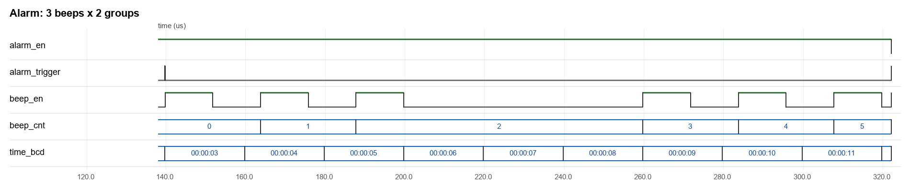
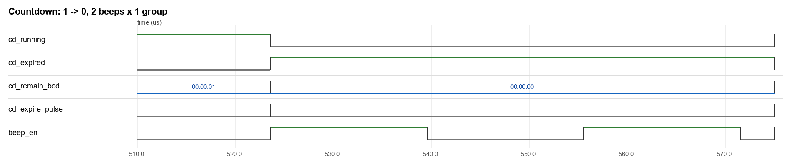
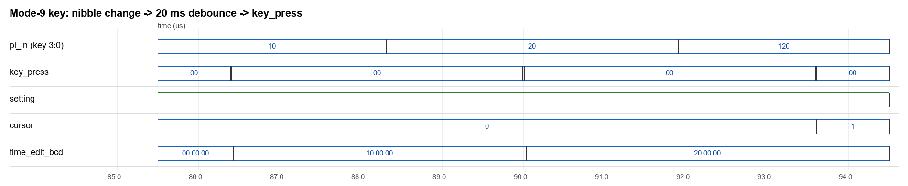
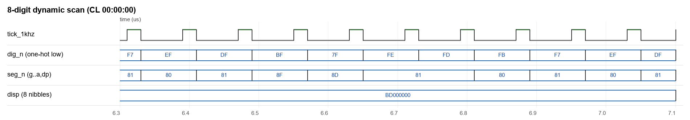

# 最终方案

> 项目：基于 KX-MS65 实验箱的电子时钟  
> 平台：KX-10CL006/10 核心板，Quartus Prime Standard 17.1  
> 版本：v1.0  
> 用途：最终配置、编译下载、上板演示、测试记录和总结

---

## 第 1 章 方案概述

### 1.1 功能清单

| 功能 | 实现 |
|---|---|
| 时钟 | 24 小时 `HH:MM:SS`，可调时、分、秒 |
| 闹钟 | `HH:MM:SS`，可开关，LED2 指示；到点响 3 下×2 组 |
| 秒表 | `MM:SS:CC`，10 ms，启动/暂停/清零，最大 99:59.99 |
| 倒计时 | `HH:MM:SS`，启动/暂停/复位/清零；到 0 响 2 下×1 组 |
| 显示 | 8 位动态数码管，模式标识 + 6 位数值 |
| 按键 | 模式 9 键 1～8 + 核心板 K1～K4 |
| 复位 | 上电复位 + K1 手动复位 |
| 断电保存 | 不做 |

### 1.2 设计指标

| 项目 | 指标 |
|---|---|
| 时钟 | 50 MHz |
| 显示扫描 | 1 kHz，8 位 |
| 走时精度 | 50 MHz 整数分频，1 Hz |
| 蜂鸣器 | 约 2.7 kHz 方波 |
| 资源 | 1,584 LE，680 寄存器，58 I/O |
| 时序 | 50 MHz setup slack 9.256 ns |

---

## 第 2 章 最终硬件配置

### 2.1 实验箱与核心板

| 项目 | 配置 |
|---|---|
| 实验箱 | 杭州康芯 KX-MS65 系列 |
| 核心板 | KX-10CL006/10 |
| FPGA | `10CL006YU256C8G`（若丝印 010，改 `10CL010YU256C8G`，引脚不变） |
| 软件 | Quartus Prime Standard 17.1 |
| 仿真 | ModelSim-ASE 17.1 |
| 下载 | USB-Blaster，JTAG，`.sof` |
| 显示 | 动态配置 IO 模式 **No.9** |
| 供电 | 5 V / 2 A 或 USB-B |

### 2.2 完整引脚表（58 个 I/O）

#### 时钟、核心按键、蜂鸣器、LED

| 信号 | 位 | FPGA 引脚 | 说明 |
|---|---|---|---|
| `clk50` | — | `M15` | 50 MHz |
| `key_core_n` | 0 | `P9` | K1 复位 |
| `key_core_n` | 1 | `N9` | K2 + |
| `key_core_n` | 2 | `M10` | K3 − |
| `key_core_n` | 3 | `P11` | K4 确认 |
| `buzzer` | — | `T13` | 低有效 |
| `led_n` | 0 | `T15` | LED1 1 Hz 心跳 |
| `led_n` | 1 | `M9` | LED2 闹钟开关 |
| `led_n` | 2 | `L9` | LED3 秒表后台 |
| `led_n` | 3 | `T14` | LED4 倒计时后台/到期 |

#### 数码管段选 `seg_n[7:0]`

| 位 | 模式 9 | FPGA 引脚 |
|---|---|---|
| 7 | `PO[7]`/g | `C2` |
| 6 | `PO[6]`/f | `D1` |
| 5 | `PO[5]`/e | `B3` |
| 4 | `PO[4]`/d | `A3` |
| 3 | `PO[3]`/c | `B5` |
| 2 | `PO[2]`/b | `A5` |
| 1 | `PO[1]`/a | `B7` |
| 0 | `PO[0]`/dp | `B6` |

#### 数码管位选 `dig_n[7:0]`

| 位 | 模式 9 | FPGA 引脚 | 数码管 |
|---|---|---|---|
| 0 | `PO[8]` | `J2` | 数码 1（最右） |
| 1 | `PO[9]` | `G1` | 数码 2 |
| 2 | `PO[10]` | `L2` | 数码 3 |
| 3 | `PO[11]` | `K1` | 数码 4 |
| 4 | `PO[12]` | `P2` | 数码 5 |
| 5 | `PO[13]` | `N1` | 数码 6 |
| 6 | `PO[14]` | `R1` | 数码 7 |
| 7 | `PO[15]` | `L4` | 数码 8（最左） |

#### 模式 9 按键输入

| 信号 | 位 | 对应键 | FPGA 引脚 |
|---|---|---|---|
| `pi_in` | 15..12 | 键 4 | `T12, R13, T10, R11` |
| `pi_in` | 11..8 | 键 3 | `T8, R9, T6, R7` |
| `pi_in` | 7..4 | 键 2 | `T4, R5, K8, R3` |
| `pi_in` | 3..0 | 键 1 | `N8, M8, P6, L7` |
| `pio_in` | 15..12 | 键 8 | `B4, C3, D3, J1` |
| `pio_in` | 11..8 | 键 7 | `L1, J6, L3, P3` |
| `pio_in` | 7..4 | 键 6 | `A4, B1, G2, K2` |
| `pio_in` | 3..0 | 键 5 | `N2, P1, L6, N5` |

> 完整 CSV：`constraints/pin_assignments.csv`。

---

## 第 3 章 最终按键与显示

### 3.1 模式 9 按键

| 键 | CL | AL | St | Cd |
|---|---|---|---|---|
| 8 | 转 AL；设置中取消转 AL | 转 St；设置中取消转 St | 转 Cd | 转 CL；设置中取消转 CL |
| 7 | 进入/确认设置 | 进入/确认设置 | — | 未运行且未到期：进入/确认设置 |
| 6 | — | — | — | 未运行：复位到设定值 |
| 5 | — | — | — | 启动/暂停 |
| 4 | 设置：光标左移 | 设置：光标左移 | — | 设置：光标左移 |
| 3 | 设置：光标右移 | 设置：光标右移 | — | 设置：光标右移 |
| 2 | 设置：+1 | 设置：+1 | 清零并暂停 | 未运行：清零到 0；设置：+1 |
| 1 | 设置：−1 | 正常：闹钟开关；设置：−1 | 启动/暂停 | 设置：−1 |

### 3.2 核心板按键

| 键 | 作用 |
|---|---|
| K1 | 全局复位 |
| K2 | 设置 +1，按住 0.5 s 后 10 Hz 连加 |
| K3 | 设置 −1，按住 0.5 s 后 10 Hz 连减 |
| K4 | 大号“进入/确认” |

### 3.3 显示布局

```text
数码8 数码7 | 数码6 数码5 | 数码4 数码3 | 数码2 数码1
 模式 模式 |   时十 时个 |   分十 分个 |   秒十 秒个
```

- `CL`：`HH.MM.SS`
- `AL`：`HH.MM.SS`
- `St`：`MM.SS.CC`
- `Cd`：`HH.MM.SS`
- 小数点在第 4 位和第 2 位（`d[4]`、`d[2]`）。
- 设置时选中位 2 Hz 闪烁；CL/AL 设置时模式标识也闪烁；Cd 运行/暂停/到期时模式标识闪烁。

### 3.4 LED

| LED | 功能 |
|---|---|
| LED1 | 1 Hz 心跳（亮 0.5 s、灭 0.5 s） |
| LED2 | 闹钟开关 |
| LED3 | 秒表后台运行 |
| LED4 | 倒计时后台运行；到期 2 Hz 闪烁 |

---

## 第 4 章 系统框图与模块

```text
50 MHz -> clk_gen -> tick_1hz/100hz/1khz/2hz
PI/PIO + K1~K4 -> key_input -> key_ctrl -> time/alarm/stopwatch/countdown
                                      -> display_ctrl -> seg/dig/led
                                      -> beep_ctrl -> buzzer_tone -> T13
```

| 模块 | 作用 |
|---|---|
| `clk_gen` | 四个 tick |
| `nibble_key` / `core_key` / `key_input` | 按键输入 |
| `key_ctrl` | 模式/设置状态机 |
| `bcd_digit_adj` | BCD 按位加减 |
| `time_counter` | 时钟 + 编辑缓冲 |
| `alarm_ctrl` | 闹钟 |
| `stopwatch` | 秒表 |
| `countdown` | 倒计时 |
| `beep_ctrl` / `buzzer_tone` | 提示音 |
| `display_ctrl` / `seg_decode` | 显示 |
| `digital_clock_top` | 顶层 |

---

## 第 5 章 Quartus 编译与下载

### 5.1 打开工程

```text
File -> Open Project -> DigitalClock.qpf
```

确认 Device：`10CL006YU256C8G`。  
如果核心板是 010，改成 `10CL010YU256C8G`，引脚表不变。

### 5.2 全编译

```text
Processing -> Start Compilation
```

结果：

```text
0 errors, 1 warning（AN447 3.3 V 接口提示）
1,584 / 6,272 LE
680 registers
58 / 177 I/O
50 MHz setup slack 9.256 ns
```

生成文件：

```text
output_files/DigitalClock.sof
```

### 5.3 下载

1. 用 USB-B 线连接核心板 USB-Blaster 口。
2. `Tools -> Programmer`。
3. Hardware Setup 选 USB-Blaster。
4. Mode 选 JTAG。
5. 添加 `DigitalClock.sof`。
6. 勾选 Program/Configure。
7. Start。

下载成功后，FPGA 立即运行；断电后 `.sof` 配置丢失，需要重新下载。

### 5.4 固化（可选）

如果需要掉电保存配置，可用 Quartus 的 Convert Programming Files 生成 `.jic`，通过 JTAG 写入 EPCS16。  
本实验日常调试用 `.sof` 即可。

---

## 第 6 章 上板操作步骤

### 6.1 准备

1. 实验箱上电。
2. 按动态配置板的模式选择键，使 LCD 显示 **No.9**。
3. 下载 `DigitalClock.sof`。
4. 按 K1 复位。

### 6.2 CL 演示

| 步骤 | 操作 | 预期 |
|---|---|---|
| 1 | 上电/复位 | `CL 00:00:00`，LED1 心跳 |
| 2 | 等待 5 s | 秒位正常增加 |
| 3 | 键 7 进入设置 | CL 闪烁，选中位闪烁 |
| 4 | 键 4/3 移光标 | 选中位左右移动 |
| 5 | 键 2/1 加减 | 选中位加减，正式时钟仍在后台走 |
| 6 | 键 7 确认 | 写入新时间，CL 常亮 |
| 7 | 再进入设置，键 8 | 取消并转 AL |

### 6.3 AL 演示

| 步骤 | 操作 | 预期 |
|---|---|---|
| 1 | 键 8 切到 AL | 显示 `AL HH.MM.SS` |
| 2 | 键 1 | 闹钟开/关，LED2 亮/灭 |
| 3 | 键 7 进入设置 | AL 闪烁 |
| 4 | 设置到当前时间后 5 s | 确认 |
| 5 | 等待到点 | 响 3 下，停约 0.6 s，再响 3 下 |

### 6.4 St 演示

| 步骤 | 操作 | 预期 |
|---|---|---|
| 1 | 键 8 切到 St | `St 00.00.00` |
| 2 | 键 1 | 启动，LED3 亮 |
| 3 | 再按 key1 | 暂停，LED3 灭 |
| 4 | 键 2 | 清零 |
| 5 | 启动后切到 Cd | 秒表继续后台，LED3 仍亮 |

### 6.5 Cd 演示

| 步骤 | 操作 | 预期 |
|---|---|---|
| 1 | 键 8 切到 Cd | `Cd 00.05.00`，Cd 常亮 |
| 2 | 键 7 设置到 `00:00:03` | 确认后显示 3 s |
| 3 | 键 5 启动 | Cd 闪烁，LED4 亮 |
| 4 | 到 0 | 响 2 下，显示 00:00:00，Cd 闪烁 |
| 5 | 键 6 | 回到设定值，可再次启动 |
| 6 | 键 2 清零后按 key5 | 不启动、不响 |

---

## 第 7 章 测试结果

### 7.1 仿真

| 项目 | 结果 |
|---|---|
| ModelSim 编译 | 0 errors, 0 warnings |
| 用例 | 9 组 |
| 检查点 | 74 PASS / 0 ERROR |
| 结论 | `ALL TESTS PASSED` |

关键波形：









### 7.2 资源与时序

| 项目 | 结果 |
|---|---|
| Logic elements | 1,584 / 6,272（25%） |
| Registers | 680 |
| User I/O | 58 / 177（33%） |
| PLL / RAM / DSP | 0 / 0 / 0 |
| Setup slack | 9.256 ns |
| Hold slack | 0.452 ns |
| 最小脉宽 slack | 9.687 ns |

### 7.3 上板测试记录表（待填）

| 编号 | 测试项 | 操作 | 预期 | 实测 | 备注 |
|---|---|---|---|---|---|
| H1 | 上电显示 | 模式 9，下载，K1 | CL 00:00:00 |  |  |
| H2 | 走秒 | 等 10 s | 秒增加 10 |  |  |
| H3 | 时钟设置 | key7/4/3/2/1 | 时间改变，确认后生效 |  |  |
| H4 | 取消设置 | key8 | 不保存，转 AL |  |  |
| H5 | 闹钟开关 | AL，key1 | LED2 亮/灭 |  |  |
| H6 | 闹钟响 | 到点 | 3 下×2 组 |  |  |
| H7 | 秒表 | St，key1/2 | 启动/暂停/清零 |  |  |
| H8 | 倒计时 | Cd，key5 | 启动/暂停 |  |  |
| H9 | 倒计时到 0 | 等 0 | 2 下×1 组 |  |  |
| H10 | 0 启动 | 清零后 key5 | 不启动、不响 |  |  |
| H11 | K2 连发 | 设置中按住 K2 | 连续加 |  |  |
| H12 | K1 复位 | 按 K1 | 回默认值 |  |  |

### 7.4 照片建议

上板后补拍：

1. 实验箱整体 + 模式 9 LCD 显示。
2. CL 正常显示。
3. 闹钟响时的蜂鸣器/显示。
4. 倒计时到 0 时的显示。
5. 设置状态，选中位闪烁。

照片要求：裁掉无关部分，图下方写 1～2 句现象说明。

---

## 第 8 章 常见问题与排错

| 现象 | 可能原因 | 解决 |
|---|---|---|
| 数码管全灭 | 模式不是 9；下载失败 | 看 LCD 模式，重新下载 |
| 数码管全亮 | 段选/位选极性反 | 检查 `seg_n`/`dig_n` 低有效 |
| 按键无反应 | PI/PIO 没接好；模式不对 | 检查 JP3/JP4，确认 No.9 |
| 按键乱跳 | 20 ms 消抖不够 | 增大 `DEBOUNCE_MS` |
| 时间不走 | `tick_1hz` 没有 | 检查 `clk_gen`、`clk50` |
| 时间走太快 | `SIM_FAST` 还是 1 | 综合前改回 0 |
| 蜂鸣器不响 | `beep_en` 没高；极性反 | 看 `beep_en`、`buzzer` |
| 蜂鸣器一直响 | 节奏状态机没回 IDLE | 检查 `silence`、`beep_cnt` |
| 下载失败 | USB-Blaster 没识别 | 重装驱动，换 USB 口 |
| 编译报 AN447 | 3.3 V 接口提示 | 实验箱 3.3 V 正常，不要外加 5 V |

---

## 第 9 章 设计总结

### 9.1 完成的功能

- 24 小时时钟、闹钟、秒表、倒计时；
- 8 位动态扫描、模式标识、选中位闪烁；
- 模式 9 的 8 个按键 + 核心板 K1～K4；
- 闹钟 3 下×2 组、倒计时 2 下×1 组；
- 后台计时、编辑缓冲、0 启动不响；
- Quartus 17.1 全编译通过，ModelSim 自检通过。

### 9.2 调试中修正的问题

1. **模式 9 按键不是普通按键**：一开始容易把 `PI/PIO` 当电平键；后来改成 `prev` 变化检测。
2. **“取消”不能用直接改正式时间实现**：改成编辑缓冲，key8 只清 `setting`，不 commit。
3. **蜂鸣器节奏必须用 1 ms tick**：`beep_ctrl` 的定时器如果每个 50 MHz 周期都加，声音会快 50,000 倍；必须用 `tick_1khz` 门控。
4. **小数点位置**：`d[5]/d[3]` 会显示在十位和个位之间；正确位置是 `d[4]/d[2]`，才是 `HH.MM.SS`。
5. **LED1 不能悬空**：改成 1 Hz 心跳，既消除“stuck at VCC”警告，又能指示系统在运行。

### 9.3 不足与改进

| 不足 | 改进 |
|---|---|
| 不做断电保存 | 加 RTC（DS1302/DS3231）+ EEPROM |
| 没有上板照片 | 用实验箱补拍 |
| 3.3 V 接口有 AN447 提示 | 按实验箱原有 3.3 V 接口使用，必要时加串阻 |
| 1,584 LE 比估算高 | 仍只占 25%，可接受；若要省资源可合并 nibble 实例 |
| 闹钟和倒计时同时到时只响闹钟 | 可加“待播队列” |

### 9.4 验收清单

- [ ] Quartus 全编译 0 errors
- [ ] ModelSim `ALL TESTS PASSED`
- [ ] 模式 9 显示正常
- [ ] 8 个模式 9 键都有响应
- [ ] K1～K4 正常
- [ ] CL 设置/取消正常
- [ ] AL 开关/到点正常
- [ ] St 启动/暂停/清零正常
- [ ] Cd 启动/暂停/复位/清零正常
- [ ] 闹钟 3 下×2 组
- [ ] 倒计时 2 下×1 组
- [ ] LED1～LED4 正常

---

## 第 10 章 附录

### 10.1 代码

```text
rtl/digital_clock_top.v
rtl/clk_gen.v
rtl/nibble_key.v
rtl/core_key.v
rtl/key_input.v
rtl/key_ctrl.v
rtl/bcd_digit_adj.v
rtl/time_counter.v
rtl/alarm_ctrl.v
rtl/stopwatch.v
rtl/countdown.v
rtl/beep_ctrl.v
rtl/buzzer_tone.v
rtl/display_ctrl.v
rtl/seg_decode.v
```

### 10.2 工程与约束

```text
DigitalClock.qpf
DigitalClock.qsf
DigitalClock.sdc
constraints/pin_assignments.csv
```

### 10.3 仿真

```text
sim/tb_digital_clock_top.v
sim/compile.do
sim/run_sim.do
sim/run_sim.bat
sim/wave_all.do
sim/render_wave.py
```

### 10.4 波形

```text
images/wave_time.png
images/wave_rollover.png
images/wave_key.png
images/wave_cl_set.png
images/wave_alarm.png
images/wave_countdown.png
images/wave_display.png
images/wave_buzzer.png
```

### 10.5 参考资料

- 杭州康芯 KX-MS65 实验箱使用手册
- EDA 技术实验指导书（杭州康芯实验箱）
- Intel Cyclone 10 LP 器件手册
- Quartus Prime 17.1 用户手册
- ModelSim-ASE 17.1 用户手册
