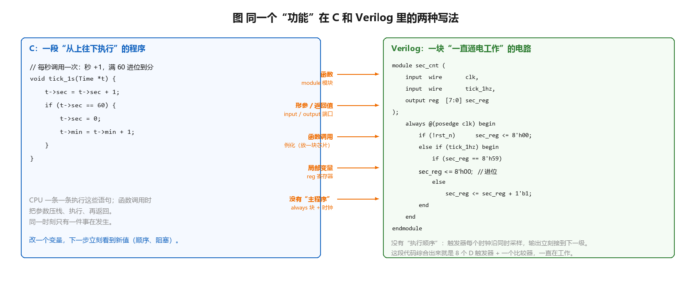

# 01 从 C 到 Verilog：先把脑子里的“CPU”换成“电路”

| 学完你能做什么 | 说清 Verilog 和 C 的根本差别；看懂本工程里最基础的 `module` / `always` / `assign`；不再用 C 的思维去猜 Verilog 的行为 |
|---|---|
| 前置知识 | 会 C 的变量、`if`、`for`、函数；不需要任何数字电路基础 |
| 对应源文件 | `rtl/clk_gen.v`、`rtl/nibble_key.v`、`rtl/buzzer_tone.v`（只作例子，不要求全懂） |
| 预计阅读 | 25 分钟 |

---

## 1.1 你写下的不是“程序”，而是一张“电路图”

写 C 的时候，你脑子里应该有这样一幅画面：

```text
CPU 取指令 → 执行 → 取下一條指令 → 执行 → ...
```

代码是**一条一条按顺序执行**的：第 3 行执行完，才轮到第 4 行。所以 C 里的 `a = b; c = a;` 能放心地认为“`c` 拿到的是新的 `a`”。

写 Verilog 的时候，这个画面必须换掉。你描述的是一个**电路**：

```text
一堆逻辑门 + 一堆触发器，通电以后全部同时工作，没有“先执行谁”这回事
```

Verilog 文件读起来像程序，但它描述的是“哪些门连到哪些门、哪些触发器在哪个时钟沿更新”。所以：

| C 的世界 | Verilog 的世界 |
|---|---|
| 代码按行顺序执行 | 所有 `always` 块**同时**工作 |
| 有 `main()` 作为入口 | **没有** `main()`，`module` 一上电就在工作 |
| 函数调用发生在某一刻 | 例化是“放一块芯片并把线焊上”，一直连在那里 |
| `int x` 是一个可以随时读写的变量 | 信号要么是导线（wire），要么是触发器（reg） |
| `for` 循环跑 N 次 | 硬件里没有“循环”，只有“复制 N 份”或“用计数器数 N 次” |
| 可以用 `sleep()` / `delay()` | 综合不出来，只能用计数器和时钟 |

> 一句话记住：**C 是“告诉 CPU 怎么做”，Verilog 是“画出一张会自己工作的电路图”。**

---

## 1.2 三句话记住 Verilog 的全部骨架

本工程的 15 个文件加起来 1900 多行，但骨架只有三句话：

### 第一句：`module` 就是一块芯片

```verilog
module buzzer_tone #(
    parameter integer SIM_FAST = 0
)(
    input  wire clk,
    input  wire rst_n,
    input  wire beep_en,
    output wire buzzer
);
    // ... 芯片内部的电路 ...
endmodule
```

把它想成一颗 4 条腿的芯片：`clk`、`rst_n`、`beep_en` 是输入脚，`buzzer` 是输出脚。
`module` 这个名字（`buzzer_tone`）就是芯片型号，文件名必须是 `buzzer_tone.v`——Quartus 靠这个找文件。

### 第二句：`assign` 和 `always @(*)` 是“连线”，没有记忆

```verilog
assign buzzer = ~(beep_en & tone);
```

这行的意思不是“执行一次赋值”，而是**焊一根线**：`buzzer` 这根线的电平，永远等于 `beep_en & tone` 取反。
左边变了，右边立刻跟着变（延迟只有几个纳秒），不存在“什么时候更新”。

`always @(*)` 也一样，只是里面可以写 `if` / `case`，写起来更像 C：

```verilog
always @(*) begin
    case (bcd)
        4'h0: seg_n = 8'h81;
        4'h1: seg_n = 8'hF3;
        // ...
    endcase
end
```

`@(*)` 的意思是“只要括号里任何一个信号变了，就把这块重新算一遍”。它综合出来是一堆与门或门，**存不住值**。

### 第三句：`always @(posedge clk)` 是“触发器”，有时钟沿才更新

```verilog
always @(posedge clk) begin
    if (!rst_n) begin
        cnt_1hz  <= 26'd0;
        tick_1hz <= 1'b0;
    end
    else if (cnt_1hz == DIV_1HZ - 1) begin
        cnt_1hz  <= 26'd0;
        tick_1hz <= 1'b1;
    end
    else begin
        cnt_1hz  <= cnt_1hz + 1'b1;
        tick_1hz <= 1'b0;
    end
end
```

这段的意思是：**每来一个 50 MHz 时钟上升沿**，把 `cnt_1hz` 加 1；数到终值就回 0，同时把 `tick_1hz` 拉高一个周期。
`posedge clk` = “时钟的上升沿”，这就是触发器的“拍照时刻”。两次时钟沿之间，`cnt_1hz` 的值一动不动。

三句话合起来的对照表：

| 你想要的功能 | 写法 | 有没有记忆 |
|---|---|---|
| 两根线连起来、做点与或非 | `assign y = a & b;` | 无 |
| 带 `if`/`case` 的选择、译码 | `always @(*)` | 无 |
| 计数器、状态、寄存器、一切“记住上一次”的东西 | `always @(posedge clk)` | 有 |

---

## 1.3 同一个功能，C 和 Verilog 各写一遍



看图要点：左右两边的**功能完全一样**（秒加 1，满 60 回 0 并进位）。区别只在“什么时候算”：
左边由 CPU 一条条执行，右边由时钟沿一拍一拍推动。左边改完变量下一步就能用，右边要等到下一个时钟沿才生效——这个差别就是后面 `=` 和 `<=` 的全部由来。

C 版本里 `t->sec` 是**内存**，Verilog 版本里 `sec_reg` 是**触发器**。内存可以随时读写；触发器只在时钟沿更新，其余时间保持。

---

## 1.4 C 程序员的 8 个思维陷阱

初学者 90% 的“代码看着没错但结果不对”，都出在这张表里：

| # | 你的 C 直觉 | Verilog 的真相 | 本工程里正确的写法 |
|---|---|---|---|
| 1 | `for (i=0;i<8;i++)` 循环处理 8 位 | 硬件没有循环，时间上不存在“依次” | `nibble_key` 例化 8 次，或用 `scan_idx` 每 1 ms 轮一位 |
| 2 | `a = b; c = a;` 之后 `c == b` | 时序逻辑里 `<=` 是“同时赋值”，右边用的是旧值 | `press <= 1'b1;` 与其它寄存器的更新互不干扰 |
| 3 | 函数调用一次执行一次 | 例化 = 复制一份硬件，永远在跑 | `key_input.v` 里 8 个 `nibble_key` 是 8 份独立硬件 |
| 4 | `int` / `float` / `double` | 没有 `int`，只有**定宽**的位向量；没有小数（除非自己定点） | `reg [25:0] cnt_1hz;`、`input wire [23:0] time_bcd` |
| 5 | 数组 `int a[8]` | 综合工具不喜欢“用变量当下标”，一般写成向量拼接 | `disp[31:0]` 装 8 个 nibble，用 `disp[(i*4) +: 4]` 取一位 |
| 6 | `printf` 打印调试 | 板上没有 `printf`，要看波形或断点 | `$display` 只在仿真里有；上板用 SignalTap / LED |
| 7 | `if` 分支里随便写几句 | 组合逻辑必须给**所有分支**赋值，否则综合出锁存器 | `always @(*)` 开头先 `disp = 32'h0;` 再 `case` |
| 8 | 全局变量到处改 | 一根 `wire` 只能有一个驱动源；多个模块输出同一根线会报错 | 每个信号只有一个产生者（见第 04 章连线表） |

再强调最容易踩的两个：

**陷阱 2 的具体样子。** 下面的代码在 C 里是“把 b 给 a，再把 a 给 c”，结果 `c == b`：

```verilog
// 错误示范（时序逻辑里用了阻塞赋值）
always @(posedge clk) begin
    a = b;
    c = a;      // c 拿到的是新的 a，等价于 c = b
end
```

而用非阻塞赋值时，两条语句是**同时**发生的：

```verilog
// 正确写法
always @(posedge clk) begin
    a <= b;
    c <= a;     // c 拿到的是这个时钟沿之前的 a（旧的 a）
end
```

记住结论：**`always @(posedge clk)` 里一律用 `<=`；`always @(*)` 和 `function` 里一律用 `=`。** 本工程严格遵守这一条，你照着写就不会错。

**陷阱 7 的具体样子。** 组合逻辑里漏赋值，综合工具会“记住上一次的值”，生成一个你根本没想要的锁存器（Latch）：

```verilog
// 错误示范：bcd 是 4'hF 时，seg_n 没有被赋值 → 综合出锁存器
always @(*) begin
    case (bcd)
        4'h0: seg_n = 8'h81;
        4'h1: seg_n = 8'hF3;
    endcase
end
```

所以 `seg_decode.v` 里写了 `default: seg_n = 8'hFF;`，`display_ctrl.v` 里写 `disp = 32'h00000000;` 打头——不是啰嗦，是防锁存器。

---

## 1.5 为什么 Verilog 里看不到 `delay(500)`

C 里让灯闪很简单：

```c
while (1) {
    LED = 1;
    delay_ms(500);
    LED = 0;
    delay_ms(500);
}
```

Verilog 里**没有** `delay_ms()` 这种东西：`#500` 这种延时只有仿真器认，综合工具直接忽略或报错。板子上也没有“一个 500 ms 之后自己执行下一句”的机制。

正确做法是：**用一个计数器，把 50 MHz 数成 1 Hz，然后用“使能脉冲”去做每秒钟该做的事**。这正是 `clk_gen.v` 干的事：

```verilog
    // SIM_FAST=1 时使用很短的计数终值，只用于仿真加速。
    localparam integer DIV_1HZ   = (SIM_FAST != 0) ? 1000 : CLK_FREQ;

    reg [25:0] cnt_1hz;

            if (cnt_1hz == DIV_1HZ - 1) begin
                cnt_1hz  <= 26'd0;
                tick_1hz <= 1'b1;
            end
            else begin
                cnt_1hz  <= cnt_1hz + 1'b1;
                tick_1hz <= 1'b0;
            end
```

三个细节值得先记住，后面第 05、07 章会反复用到：

1. **`cnt_1hz` 是 26 位**：因为 50 000 000 < 2²⁶ = 67 108 864。位宽不够会溢出，时间就走快。
2. **数到 `DIV_1HZ - 1` 才回 0**：从 0 数到 49 999 999 正好是 50 000 000 个时钟（1 秒）。
3. **`tick_1hz` 只高 1 个时钟周期（20 ns）**：它是一个“今天该加 1 了”的开关，不是时钟。下游模块永远写 `always @(posedge clk)`，里面用 `if (tick_1hz)` 判断。

`SIM_FAST` 是给仿真用的参数：仿真时把“1 秒”从 5000 万个周期缩到 1000 个周期，否则跑一次要等很久。上板时必须为 0。

---

## 1.6 五个会反复出现的高频词

| 词 | 一句话解释 | 本工程例子 | 新手常见误解 |
|---|---|---|---|
| 时钟（clock） | 板子上 50 MHz 的方波，所有触发器都听它指挥 | `clk50`，引脚 M15，周期 20 ns | 以为每个模块有自己的时钟 |
| 复位（reset） | 让所有寄存器回到初值；低有效表示 0 才复位 | `sys_rst_n`，上电 20 ms + K1 手动 | 以为不复位也能从 0 开始（仿真里是 `x`） |
| 使能（tick / enable） | 一个时钟周期宽的脉冲，告诉模块“该动一次了” | `tick_1hz`、`tick_100hz`、`tick_1khz`、`tick_2hz` | 以为 tick 可以当时钟用（不行） |
| 低有效（active low） | 名字带 `_n`，0 表示“有效/点亮/按下” | `seg_n`、`dig_n`、`led_n`、`key_core_n` | 看到 0 以为是“关” |
| 位宽（width） | 信号占几个二进制位，必须够大 | `[23:0] time_bcd`、`[7:0] seg_n` | 用 8 位去装 5000 万的计数器 |

位宽这一条值得单独看一眼。本工程的数码管段码是低有效，`seg_decode.v` 里“显示 0”写的是 `8'h81`：

```verilog
            4'h0: seg_n = 8'h81; // 0
```

`8'h81` = `1000_0001`，最低位（dp）是 1 表示小数点不亮，最高位（g）是 1 表示中间一横不亮，其余 6 位是 0 表示 a~f 六段亮——所以显示出来是“0”。

---

## 1.7 读这个工程之前，先记住这张“地图”

| 你想知道的事 | 去看 |
|---|---|
| 这块板子上有什么、15 个文件各干什么 | 第 02 章 |
| 怎么建工程、编译、锁引脚、下载 | 第 03 章 |
| 顶层是怎么把模块连起来的 | 第 04 章 |
| 时钟和按键是怎么处理的 | 第 05 章 |
| 时钟/闹钟/秒表/倒计时/显示/蜂鸣器怎么算的 | 第 06 章 |
| 语法查不到、报错看不懂 | 第 07 章 |
| 怎么跑仿真、波形怎么看 | 第 08 章 |
| 怎么设断点、单步看寄存器 | 第 09 章 |
| 怎么下载到板子、不动了怎么查 | 第 10 章 |
| 引脚表、术语表、报错速查 | 第 11 章 |

建议的读法：**02 → 03（先让工程在你电脑上编译通过）→ 04 → 05/06（对着代码看）→ 08 → 09 → 10**。第 07 章当字典，遇到语法再翻。

---

## 1.8 本章小结

- Verilog 描述的是**同时工作的电路**，不是顺序执行的程序；没有 `main`，没有 `delay`。
- `module` = 芯片；`assign` / `always @(*)` = 连线（无记忆）；`always @(posedge clk)` = 触发器（有时钟沿才更新）。
- 时序逻辑用 `<=`，组合逻辑用 `=`；组合逻辑必须覆盖所有分支，否则出锁存器。
- 时间不是“等出来的”，是“数出来的”：计数器 + tick 使能。
- 名词先混个脸熟：时钟、复位、tick、低有效、位宽。

## 1.9 练习

1. 下面两段代码功能一样吗？为什么？
   ```verilog
   always @(posedge clk) begin a <= b; c <= a; end
   always @(posedge clk) begin a =  b; c =  a; end
   ```
2. 本工程为什么要用 `tick_1hz` 而不是直接产生一个 1 Hz 的时钟去驱动其他模块？
3. `cnt_1hz` 只有 26 位，如果改成 20 位会怎样？请算出 2²⁰ 是多少。
4. 把 `seg_decode.v` 里的 `default` 分支删掉，综合时可能出现什么问题？

<details>
<summary>答案要点</summary>

1. 不一样。第一段两条赋值同时发生，`c` 得到的是旧的 `a`；第二段顺序执行，`c` 得到新的 `a`（等于 `b`）。时序逻辑必须用 `<=`。
2. 分频时钟会让设计出现多个时钟域，时序分析变复杂、容易出亚稳态；用单周期使能可以全系统只用一个 50 MHz 时钟。
3. 20 位最大只能数到 1 048 575，数不到 50 000 000，计数器会一直循环溢出，`tick_1hz` 频率变成错误的快很多倍（大约每 1 048 576 个周期一次）。
4. `bcd = 4'hA~4'hF` 时 `seg_n` 没有被赋值，综合工具会推断出锁存器（Latch），出现 “inferred latch” 警告，行为也可能和仿真不一致。

</details>
