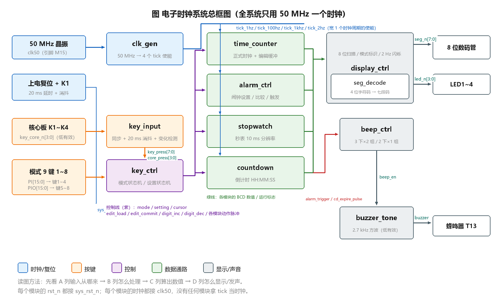
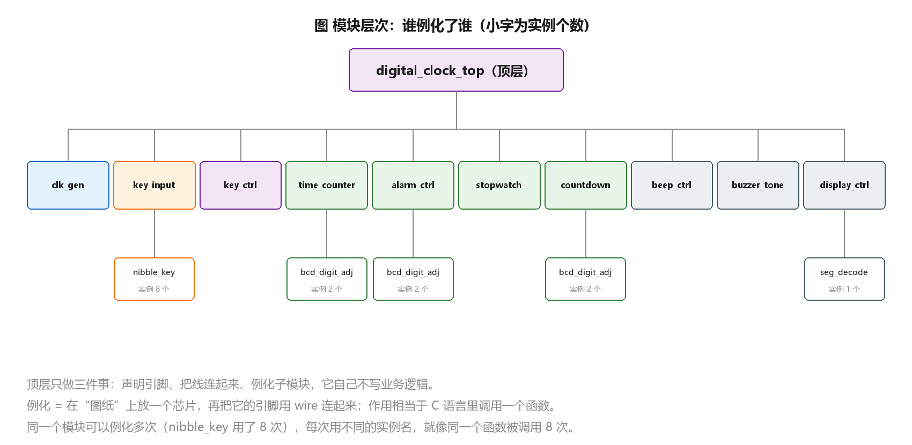
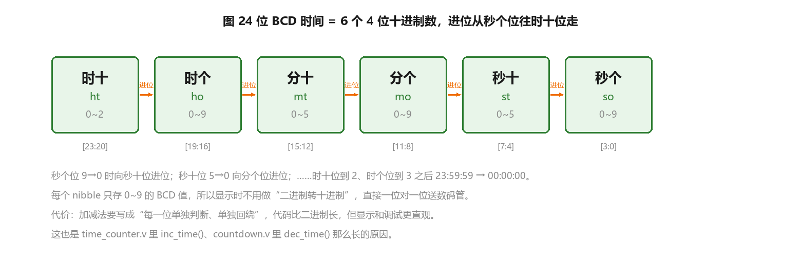

# 02 认识这个工程：功能、硬件、文件、模块

| 项目 | 说明 |
|---|---|
| 学完你能做什么 | 用自己的话讲清这个电子钟从 50 MHz 晶振到数码管的完整链路；打开目录能指出每类文件的职责；看到 15 个模块名就猜出它大概做什么；分清哪些文件必须进 git、哪些删了也能重建。 |
| 前置知识 | 会一点 C 语言（if / for / 函数 / 变量）。不需要 Verilog、FPGA、Quartus、ModelSim 的任何基础。 |
| 预计阅读 | 约 40 分钟。建议把 Quartus 工程打开放在旁边对照，遇到文件名就点开看一眼。 |

> 这一章不讲 Verilog 语法，也不讲 Quartus 怎么点按钮。目标只有一个：动手之前，先在脑子里建一张“这个工程长什么样、谁负责什么”的地图。语法在第 07 章，Quartus 操作在第 03 章。

## 2.1 先看它跑起来是什么样

先看结果，再看实现。把实验箱的显示模式拨到 **No.9**，用 USB-Blaster 下载 `output_files/DigitalClock.sof`，按一下核心板的 K1 复位，正常情况下会看到：

1. 数码管最左两位显示 `CL`，右边六位是 `00.00.00`（时、分之后各有一个小数点亮着，README 里把它写作 `00:00:00`）。
2. 最后一位每秒加 1；走到 `00.00.59` 的下一秒变成 `00.01.00`，分进位、秒归零。
3. LED1 亮 0.5 s、灭 0.5 s，一秒一个完整周期——这是程序还活着的心跳。
4. 按模式 9 的键 8，最左两位从 `CL` 变 `AL`，再按变 `St`，再按变 `Cd`，再按回到 `CL`。
5. 在 `CL`、`AL` 或未运行且未到期的 `Cd` 下按键 7（或核心板 K4），模式标识开始 2 Hz 闪烁，进入设置；再按一次键 7/K4 确认退出。
6. 在 `AL` 模式下，闹钟打开时最左边的 `AL` 会以 1 Hz 慢闪（关掉就常亮）——不看 LED2 也能知道闹钟开没开。
7. 设置中，当前选中的那一位数字也在闪；键 4/键 3 左右移光标，键 2 或 K2 加 1，键 1 或 K3 减 1。
8. 设置中按键 8 表示“放弃修改”，并直接跳到下一个模式。

四个模式轮流转，每个模式显示什么、能干什么：

| 模式 | 前两位 | 六位数值 | 这个模式能做什么 |
|---|---|---|---|
| `CL` 时钟 | `CL` | 当前时间 `HH.MM.SS` | 正常走时；键 7/K4 进入设置，可改时、分、秒 |
| `AL` 闹钟 | `AL` | 闹钟时间 `HH.MM.SS` | 键 1 开关闹钟；键 7/K4 设置；到点响 3 下 × 2 组 |
| `St` 秒表 | `St` | `MM.SS.CC`，10 ms 分辨率 | 键 1 启动/暂停，键 2 清零；最大 99:59.99 |
| `Cd` 倒计时 | `Cd` | 剩余 `HH.MM.SS`，默认 `00:05:00` | 键 1 启动/暂停，键 2 恢复设定值（未运行时）；清零到 0 在设置里改 |

8 位数码管从左到右是这样分工的（以刚复位的 `00:00:00` 为例）：

| 数码位（从左到右） | 作用 | `CL` 正常时 | 设置时 |
|---|---|---|---|
| 数码8、数码7 | 模式标识 | `CL` | 2 Hz 闪烁 |
| 数码6、数码5 | 时（CL/AL/Cd）或分（St） | `00` | 选中位闪 |
| 数码4、数码3 | 分（CL/AL/Cd）或秒（St） | `00` | 选中位闪 |
| 数码2、数码1 | 秒（CL/AL/Cd）或厘秒（St） | `00` | 选中位闪 |

四颗 LED 各有分工：

| LED | 现象 | 含义 |
|---|---|---|
| LED1 | 0.5 s 亮、0.5 s 灭 | 1 Hz 心跳，证明 50 MHz 时钟和复位都正常 |
| LED2 | 常亮 / 灭 | 闹钟已开启 / 已关闭 |
| LED3 | 常亮 / 灭 | 秒表正在运行 / 未运行 |
| LED4 | 常亮 / 2 Hz 闪 | 倒计时正在运行 / 已经到期 |

三个新手最容易误判成“坏了”的地方：

- 倒计时的默认设定值是 `00:05:00`，不是 `00:00:00`。上电看到 `Cd 00.05.00` 是对的。
- 剩余时间为 0 时按键 1 启动无效，也不会响；只有从 `00:00:01` 减到 `00:00:00` 才触发提示音。
- 设置时被编辑的那份时间冻结不走，但正式时钟仍在后台走秒；确认时用编辑值覆盖正式时钟，取消则丢弃编辑值。

整个系统内部长这样（图里颜色就是本章 2.5 要讲的两条通路）：



看图要点：全图只有左上角一个 50 MHz 晶振，所有模块共用它；紫色线是控制（模式、光标、动作脉冲），绿色线是数据（BCD 数值和运行标志）；`display_ctrl` 和 `beep_ctrl` 只消费数据，不会反过来改时间。

## 2.2 硬件：实验箱、核心板、模式 9

### 2.2.1 全系统只有一颗 50 MHz 心跳

硬件是杭州康芯 KX-MS65 实验箱加 KX-10CL006 核心板，核心板上的 FPGA 是 Cyclone 10 LP 系列的 `10CL006YU256C8G`（256 脚、C8 速度等级）。工程用 Quartus Prime Standard 17.1 建立，器件型号锁在工程设置里。板上有一颗 50 MHz 晶振，接到 FPGA 的 `M15` 脚，周期 20 ns。工程的时序约束（Timing Constraint）就写了一行：

```tcl
create_clock -name clk50 -period 20.000 [get_ports {clk50}]
```

整份设计没有用锁相环（PLL），也没有第二个时钟。1 Hz、100 Hz、1 kHz、2 Hz 这些慢节奏全部由 `clk_gen` 数周期数出来，做成“宽一个时钟周期的使能（Enable）”，而不是分频出一个新时钟。这样做的好处是：全芯片只有一个时钟域，时序分析简单，也不会出现门控时钟（Gated Clock）那种难查的问题。

四个使能的账很好算，都是“数到第几个 50 MHz 周期”：

| 使能 | 分频系数（周期数） | 实际间隔 | 主要用在 |
|---|---|---|---|
| `tick_1hz` | 50,000,000 | 1 s | 正式时钟走秒、倒计时减秒 |
| `tick_100hz` | 500,000 | 10 ms | 秒表的厘秒位 |
| `tick_1khz` | 50,000 | 1 ms | 按键消抖、数码管扫描、蜂鸣器节奏 |
| `tick_2hz` | 12,500,000 | 250 ms 来一次 | 显示闪烁、LED1 心跳 |

`tick_2hz` 的名字容易让人误会：它每 250 ms 来一个脉冲，下游每来一次翻转一次，翻转周期是 500 ms，正好是 2 Hz 的闪烁；LED1 再二分频一次，变成 1 Hz 心跳。

### 2.2.2 8 位共阳数码管：段选和位选都低有效

实验箱上是 8 位共阳（Common Anode）数码管。共阳的意思是每一位的公共端接正极，所以：

- 段选（Segment）`seg_n[7:0]` 低有效：某位输出 0，对应的那一段才亮。
- 位选（Digit Select）`dig_n[7:0]` 低有效：某位输出 0，对应的那一位数码管才被选中。

8 位数码管的段选线是并联的，同一时刻只能亮一位。`display_ctrl` 每 1 ms 换一位（由 `tick_1khz` 推动），8 位轮一遍 8 ms，刷新率 125 Hz，人眼看到的是 8 位同时亮。这叫动态扫描（Dynamic Scanning）。

段选按 `{g, f, e, d, c, b, a, dp}` 排列，位选里 `dig_n[0]` 是最右边那一位。时和分后面各点一个小数点，所以读数看起来是 `HH.MM.SS`。

这里有一个容易踩的坑：位选 `dig_n[3]` 锁在封装引脚 `K1` 上，这个 `K1` 是 FPGA 的引脚编号，和核心板上那颗叫 K1 的按键没有关系。

### 2.2.3 模式 9：8 个按键其实是 8 个 4 位计数器

这是整套硬件里最反直觉的一点。

模式 9 是实验箱“动态配置 IO”的一种模式。在这个模式下，8 个按键不是普通的高低电平按键，而是底板 CPLD 里的 8 个 4 位十六进制计数器（4 位一组，也叫一个 nibble）：每按一次，对应那 4 位加 1，从 `0000` 数到 `1111` 再回到 `0000`。

关键限制：**这 4 位由底板 CPLD 驱动，FPGA 只能读，不能写，也不能清零。** 想让计数器归零，只能按底板上的模式/复位键或切换一次模式；FPGA 端不能清零，也不需要清零——计数器从 `1111` 自己绕回 `0000` 时，FPGA 只会把它当成又一次“值变了”，照样能认对。

所以 FPGA 端绝不能“判断这个引脚是不是 0”来认按键，只能“判断这 4 位的值有没有变”。`nibble_key` 做的就是这件事：先把异步输入同步到 50 MHz，再看值是否连续 20 ms 保持不变，稳定变化才产生一个单周期脉冲。手册没有保证按住会连续计数，所以工程按“按一次变一次”来设计：值不变就不连发；即使底板真的连发，FPGA 也只会看到多次变化、跟着连发。这也是为什么要另外用核心板 K2/K3 做连加连减。

一次按键在 FPGA 眼里是这样走完的：

1. 手按下，底板 CPLD 把对应 nibble 加 1。
2. 新值经过引脚进入 FPGA，相对 50 MHz 是异步的，先打两拍同步。
3. 同步后的值和“上次确认值”比较，不同就开始数 20 个 1 ms。
4. 20 ms 内值又变，说明是抖动或连按，重新计时。
5. 连续 20 ms 不变，更新“上次确认值”，并输出一个周期宽的 `press`。

8 个键和 PI/PIO 的对应关系（每组 4 位，按 bit3～bit0 列出）：

| 物理键 | 顶层端口位段 | 引脚（bit3, bit2, bit1, bit0） |
|---|---|---|
| 键 1 | `pi_in[3:0]` | `N8, M8, P6, L7` |
| 键 2 | `pi_in[7:4]` | `T4, R5, K8, R3` |
| 键 3 | `pi_in[11:8]` | `T8, R9, T6, R7` |
| 键 4 | `pi_in[15:12]` | `T12, R13, T10, R11` |
| 键 5 | `pio_in[3:0]` | `N2, P1, L6, N5` |
| 键 6 | `pio_in[7:4]` | `A4, B1, G2, K2` |
| 键 7 | `pio_in[11:8]` | `L1, J6, L3, P3` |
| 键 8 | `pio_in[15:12]` | `B4, C3, D3, J1` |

32 根线的完整清单在 `constraints/pin_assignments.csv`，一行一个信号，可以和 `DigitalClock.qsf` 逐条对照。

### 2.2.4 核心板 K1~K4 和无源蜂鸣器

核心板的 K1~K4 是普通机械按键，低有效，工程里给这 4 根线打开了弱上拉（Weak Pull-up）：不按时读到 1，按下时读到 0。机械按键会抖，所以 `core_key` 也做 20 ms 消抖；K2/K3 额外做“按住 0.5 s 后以 10 Hz 连发”，方便快速调时间。

| 核心键 | 在工程里的作用 | 是否连发 |
|---|---|---|
| K1 | 全局复位（上电复位之外的手动复位） | 否 |
| K2 | 设置中 +1 | 是，0.5 s 后 10 Hz |
| K3 | 设置中 −1 | 是，0.5 s 后 10 Hz |
| K4 | 进入/确认设置，等同键 7 | 否 |

蜂鸣器是无源蜂鸣器（Passive Buzzer），经一个 PNP 三极管驱动，低有效：FPGA 输出 0 时三极管导通，蜂鸣器响。无源蜂鸣器不会自己发声，必须给它 2.7 kHz 方波；`buzzer_tone` 负责产生这个方波，`beep_ctrl` 只负责“什么时候该响”。输出极性在代码里只有一行：

```verilog
    assign buzzer = ~(beep_en & tone);
```

### 2.2.5 关键引脚表

| 信号 | 位宽 | 引脚 | 说明 |
|---|---|---|---|
| `clk50` | 1 | `M15` | 50 MHz 系统时钟 |
| `key_core_n` | 4 | `P9, N9, M10, P11` | 核心板 K1~K4，低有效，弱上拉 |
| `buzzer` | 1 | `T13` | 蜂鸣器，低有效 |
| `led_n` | 4 | `T15, M9, L9, T14` | LED1~4，低有效 |
| `seg_n` | 8 | `D1, B3, A3, B5, A5, B7, B6, C2` | 段选 g, f, e, d, c, b, a, dp（实测段序，见 11 章） |
| `dig_n` | 8 | `L4, R1, N1, P2, K1, L2, G1, J2` | 位选 数码8～数码1 |
| `pi_in` / `pio_in` | 各 16 | 见 CSV | 模式 9 键 1~8，每 4 位一个键 |

这些引脚在 `DigitalClock.qsf` 里用 `set_location_assignment` 锁定，在 `constraints/pin_assignments.csv` 里有一份同样的清单。两个文件不一致时，以 qsf 为准——Quartus 只读 qsf。

qsf 末尾还统一规定了 I/O 标准：全部是 3.3-V LVTTL；段选、位选、蜂鸣器、LED 这四组额外设了 8 mA 驱动电流。这些设置跟着工程走，不需要每次编译前重设。

## 2.3 工程目录：每个文件到底干什么

Quartus 的“工程”不是某一个文件，而是“一个入口文件 + 一份设置 + 一堆源文件”的组合。打开工程时你双击的是 `DigitalClock.qpf`，但真正记录“用哪个器件、顶层是谁、包含哪些 .v、每个引脚接哪里”的是 `DigitalClock.qsf`。qsf 里的 `PROJECT_OUTPUT_DIRECTORY` 还决定了编译产物统一放进 `output_files/`。

这些文件不是并列的，而是一条单向依赖链：

1. `DigitalClock.qpf` 是入口，记录修订名；Quartus 据此找到同名的 `.qsf`。
2. `.qsf` 列出器件、顶层、15 个 `.v`、`.sdc`，以及每个引脚的位置。
3. 综合读取 `rtl/*.v`，布局布线（Fitter）按 `.sdc` 的时钟约束和 qsf 的引脚分配执行。
4. 结果写进 `output_files/`（`.sof`、报告）和 `db/`（数据库）。

| 路径 | 是什么 | 必须进 git？ | 删了会怎样 |
|---|---|---|---|
| `DigitalClock.qpf` | 工程入口，记录 Quartus 版本和修订名（Project Revision） | 必须 | Quartus 找不到工程 |
| `DigitalClock.qsf` | 工程设置：器件、顶层、源文件清单、引脚、I/O 标准 | 必须 | 所有设置丢失 |
| `DigitalClock.sdc` | 时序约束：50 MHz 周期、异步输入的 false path | 必须 | 时序分析没有依据 |
| `rtl/` | 15 个 `.v` 源文件，真正被综合的代码 | 必须 | 没有电路可综合 |
| `sim/` | testbench（测试平台）、ModelSim 脚本、波形渲染脚本 | 必须 | 无法做仿真（Simulation）验证 |
| `constraints/` | `pin_assignments.csv` 引脚清单 | 必须 | 少一份可核对的引脚表 |
| `images/` | 仿真波形 PNG，文档里引用 | 必须 | 文档图片全部挂掉 |
| `docs/` | 旧说明书、设计基线、本教程 | 必须 | 文档丢失 |
| `output_files/` | `.sof`、编译报告等产物 | 不必 | 重新编译即可生成 |
| `db/` | Quartus 内部数据库（网表 Netlist、时序中间结果） | 不必 | 重新编译生成，首次编译变慢 |
| `incremental_db/` | 增量编译（Incremental Compilation）的复用数据 | 不必 | 重新编译生成 |

一句话记法：**源码和约束进 git，编译产物不进。** 仓库根目录的 `.gitignore` 已经把 `db/`、`incremental_db/`、`output_files/`、`*.sof`、`sim/work/`、`*.vcd`、`*.wlf` 都排除了。

`db/` 和 `incremental_db/` 是 Quartus 自己管理的数据库目录，不要手工改，也不要从别人那里拷贝——器件版本或代码一变，它们就失效，删掉重编最干净。

### 2.3.1 qsf 里的一行 = 工程里的一个 .v

打开 `DigitalClock.qsf`，会看到 15 行几乎一样的语句：

```tcl
set_global_assignment -name VERILOG_FILE rtl/digital_clock_top.v
set_global_assignment -name VERILOG_FILE rtl/clk_gen.v
set_global_assignment -name VERILOG_FILE rtl/nibble_key.v
```

一行就是“把一个 `.v` 加进工程”。15 行对应 `rtl/` 下 15 个文件。Quartus 综合（Synthesis）时按这张清单读文件，再用 `TOP_LEVEL_ENTITY digital_clock_top` 指定的顶层往下找例化（Instantiation）关系。少写一行，就等于少了一个模块：综合时找不到它，例化它的地方会报错。

反过来，在 Quartus 图形界面里“Add Files”做的事，本质就是往 qsf 追加这样一行。所以完全可以用文本编辑器改 qsf，效果和点界面一样。

### 2.3.2 “工程”和“文件”不是一回事

- 一个工程 = 1 个 `.qpf` + 1 个 `.qsf` + N 个源文件（外加 `.sdc` 约束）。`.qpf` 是门牌号，`.qsf` 是户口本，`rtl/*.v` 才是人。
- `.qsf` 是纯文本，一行一条设置，可以手工改，也可以 `git diff`。改引脚、加文件、换器件，在 diff 里都看得一清二楚。
- 源文件不必和工程放在同一个目录，qsf 里写的是相对路径（`rtl/xxx.v`），所以整个文件夹可以整体搬走。
- 备份或发给同学时，复制 `qpf`、`qsf`、`sdc`、`rtl/`、`sim/`、`constraints/` 就够了；`db/`、`incremental_db/`、`output_files/` 不用带，对方编译一次就会生成。
- 三个文件共享基名 `DigitalClock`。要改工程名，`.qpf`、`.qsf`、`.sdc` 三个文件名要一起改，qpf 里的 `PROJECT_REVISION` 也要同步，否则 Quartus 按旧修订名找不到 qsf。
- 注意：Quartus 打开工程时会把 qsf 读进内存，保存设置时整体重写。要手工改 qsf，先关掉 Quartus，改完再打开。

## 2.4 15 个模块一览

`rtl/` 下正好 15 个 `.v`，每个文件一个 `module`，名字和文件名一致。模块（module）可以理解成 C 里的函数：有输入、有输出，写一次可以被调用多次；区别是硬件模块是同时工作的。模块对外的输入/输出叫端口（Port）。其中 1 个是顶层（Top-level），14 个是子模块。下表按“从输入到输出”的大致顺序排列。

| 模块名 | 类型 | 一句话作用 | 关键输入 | 关键输出 | 被谁例化 |
|---|---|---|---|---|---|
| `clk_gen` | 时序 | 50 MHz 数出 1 Hz / 100 Hz / 1 kHz / 2 Hz 单周期使能 | `clk`, `rst_n` | `tick_1hz`, `tick_100hz`, `tick_1khz`, `tick_2hz` | 顶层 ×1 |
| `nibble_key` | 时序 | 一个模式 9 按键：同步 + 20 ms 消抖 + 变化检测 | `clk`, `rst_n`, `tick_1khz`, `nibble_in[3:0]` | `press` | `key_input` ×8 |
| `core_key` | 时序 | 一个核心板按键：消抖 + 按下脉冲 + 可选连发 | `clk`, `rst_n`, `tick_1khz`, `key_n` | `press` | `key_input` ×4 |
| `key_input` | 结构化 | 把 8 个 nibble 键和 4 个核心键汇总成两个向量 | `pi_in[15:0]`, `pio_in[15:0]`, `key_core_n[3:0]`, `tick_1khz` | `key_press[7:0]`, `core_press[3:0]` | 顶层 ×1 |
| `key_ctrl` | 时序（状态机 FSM） | 按键脉冲 → 模式、设置、光标，以及各模块的动作脉冲 | `key_press[7:0]`, `core_press[3:0]`, `cd_running`, `cd_expired` | `mode[1:0]`, `setting`, `cursor[2:0]`, `edit_load`, `edit_commit`, `digit_inc`, `digit_dec`，再加 7 个动作脉冲 | 顶层 ×1 |
| `bcd_digit_adj` | 组合 | 24 位 BCD 里选一位 +1/−1，个位满 10 进本段十位 | `bcd_in[23:0]`, `cursor[2:0]`, `inc` | `bcd_out[23:0]` | `time_counter` ×2、`alarm_ctrl` ×2、`countdown` ×2 |
| `time_counter` | 时序 | 正式时钟走秒 + 设置用的编辑缓冲 | `tick_1hz`, `mode[1:0]`, `edit_load`, `edit_commit`, `digit_inc`, `digit_dec`, `cursor[2:0]` | `time_bcd[23:0]`, `edit_bcd[23:0]` | 顶层 ×1 |
| `alarm_ctrl` | 时序 | 闹钟设置、开关、与当前时间比较、单次触发 | `time_bcd[23:0]`, `mode`, `edit_load`, `edit_commit`, `digit_inc`, `digit_dec`, `cursor`, `alarm_en_toggle` | `alarm_bcd[23:0]`, `alarm_edit_bcd[23:0]`, `alarm_en`, `alarm_trigger` | 顶层 ×1 |
| `stopwatch` | 时序 | 10 ms 分辨率秒表，最大 99:59.99 | `tick_100hz`, `start_pause`, `clear` | `min_bcd[7:0]`, `sec_bcd[7:0]`, `cs_bcd[7:0]`, `running` | 顶层 ×1 |
| `countdown` | 时序 | 倒计时的设定、剩余、启动/暂停/恢复设定值/到期 | `tick_1hz`, `mode`, `edit_load`, `edit_commit`, `digit_inc`, `digit_dec`, `cursor`, `start_pause`, `reset` | `preset_bcd[23:0]`, `remain_bcd[23:0]`, `edit_bcd[23:0]`, `running`, `paused`, `expired`, `expire_pulse` | 顶层 ×1 |
| `beep_ctrl` | 时序（状态机 FSM） | 把触发变成“3 下×2 组”或“2 下×1 组”的响/停节奏 | `tick_1khz`, `alarm_trigger`, `cd_expire`, `silence` | `beep_en` | 顶层 ×1 |
| `buzzer_tone` | 时序 | `beep_en` 期间产生约 2.7 kHz 低有效方波 | `beep_en` | `buzzer` | 顶层 ×1 |
| `display_ctrl` | 混合 | 选模式/数值、8 位扫描、2 Hz 闪烁、驱动 LED | `tick_1khz`, `tick_2hz`, `mode`, `setting`, `cursor`, 各路 BCD 与运行标志 | `seg_n[7:0]`, `dig_n[7:0]`, `led_n[3:0]` | 顶层 ×1 |
| `seg_decode` | 组合 | 4 位字符码 → 8 位低有效七段码 | `bcd[3:0]`, `dp`, `blank` | `seg_n[7:0]` | `display_ctrl` ×1 |
| `digital_clock_top` | 顶层 | 例化 10 个子模块、连线、上电复位、接引脚 | `clk50`, `pi_in[15:0]`, `pio_in[15:0]`, `key_core_n[3:0]` | `seg_n[7:0]`, `dig_n[7:0]`, `buzzer`, `led_n[3:0]` | 综合时是顶层；仿真时由 `tb_digital_clock_top` 例化 |

层次关系画出来是这样：



看图要点：顶层只例化 10 个直接子模块，自己不含业务逻辑；`bcd_digit_adj` 被三个数据模块各用两次（加、减各一次），`nibble_key` 被 `key_input` 用了 8 次。全设计一共 29 个例化点，但只有 15 个模块定义——同一个模块可以反复例化，就像同一个 C 函数可以被调用多次。

关于这张表，有三点值得先记住：

1. `digital_clock_top` 里除了上电复位和 K1 消抖，几乎只有例化和连线。找功能不要从顶层找，要顺着信号名去子模块找。
2. `key_input` 自己不做任何判断，只是把 12 个按键检测器摆好、把结果打包。K1 的 `core_key` 也例化了，但它的输出 `core_press[0]` 没人用——K1 只负责复位。
3. 只有 `bcd_digit_adj` 和 `seg_decode` 是纯组合逻辑（Combinational Logic）；`key_input` 只是结构化连线；其余模块都含时序逻辑（Sequential Logic）。组合逻辑“输入一变输出立刻变”，时序逻辑“等时钟沿才更新”，这是第 07 章的重点。

## 2.5 两条通路：数据通路 vs 控制通路

把图2-1 里的模块按“它们搬的是什么”分成两类，整个工程会清楚很多。

- **数据通路（Datapath）**：搬的是“值”。时分秒、闹钟时间、秒表计数、倒计时剩余，以及 `running`/`expired` 这类状态标志。`clk_gen` 提供节拍，`time_counter`、`alarm_ctrl`、`stopwatch`、`countdown` 负责算，`display_ctrl`/`seg_decode` 负责显示，`beep_ctrl`/`buzzer_tone` 负责发声。
- **控制通路（Control Path）**：搬的是“命令”。`key_input` 把物理按键变成脉冲，`key_ctrl` 决定现在是什么模式、要不要进设置、光标在哪、这次按键该产生哪个动作。它输出的是 `mode`、`setting`、`cursor` 和一组单周期动作脉冲。

`key_ctrl` 的端口列表就是这条边界的证据：

```verilog
    output reg  [1:0] mode,
    output reg        setting,
    output reg  [2:0] cursor,

    output reg        edit_load,
    output reg        edit_commit,
    output reg        digit_inc,
    output reg        digit_dec,
```

它没有任何 24 位 BCD 输入，也看不到当前时间；反过来，`time_counter` 的端口里也没有 `key_press`，它只认 `edit_load`、`edit_commit`、`digit_inc`、`digit_dec` 这几个动作。两边靠“动作脉冲”对话，不靠“共享变量”。

| 层 | 包含模块 | 信号长什么样 | 想改什么时动这里 |
|---|---|---|---|
| 控制 | `key_input`, `key_ctrl` | 1 位脉冲、2 位模式、3 位光标 | 换按键定义、改进入设置的条件、改光标循环规则 |
| 数据 | `clk_gen`, `time_counter`, `alarm_ctrl`, `stopwatch`, `countdown` | 24 位或 8 位 BCD、`running`/`expired` 标志 | 改走时规则、进位边界、计数范围 |
| 输出 | `display_ctrl`, `seg_decode`, `beep_ctrl`, `buzzer_tone` | 段选/位选、`beep_en`、`buzzer` | 改显示布局、闪烁规则、提示音节奏 |

把 `key_ctrl` 的输出逐个摊开，就能看到“控制”到底控制了什么：

| 输出 | 位宽 | 送给谁 | 作用 |
|---|---|---|---|
| `mode` | 2 | 三个数据模块、`display_ctrl` | 当前是哪一种功能 |
| `setting` | 1 | `display_ctrl` | 是否在设置，决定显示正式值还是编辑值 |
| `cursor` | 3 | 三个数据模块、`display_ctrl` | 正在编辑哪一位 |
| `edit_load` | 1 | 三个数据模块 | 把正式值复制进编辑缓冲 |
| `edit_commit` | 1 | 三个数据模块 | 把编辑值写回正式值 |
| `digit_inc` / `digit_dec` | 各 1 | 三个数据模块 | 选中位加/减 1 |
| `alarm_en_toggle`、`sw_start_pause`、`sw_clear`、`cd_start_pause`、`cd_reset` | 各 1 | 对应的数据模块 | 各模式的专用动作 |
| `beep_silence` | 1 | `beep_ctrl` | 任意键提前静音 |

为什么要费劲分开？四个理由：

1. **改功能时只改一层。** 想把 CL 改成 12 小时制，动 `time_counter` 和 `display_ctrl` 就够，`key_ctrl` 一行不用改；想把“键 1 减 1”换成“键 6 减 1”，只动 `key_ctrl`。
2. **能单独测试。** testbench 可以直接给 `digit_inc` 一个脉冲，不用模拟按键抖动，就能验证“加 1 对不对”。仓库里 82 项仿真测试能跑得这么快，就是因为可以绕开按键层直接驱动动作。
3. **状态机保持简单。** `key_ctrl` 只需要回答“现在哪个模式、光标在哪、这个键该干什么”，不需要知道 23:59:59 之后怎么进位。
4. **避免一个模块什么都管。** 如果让 `time_counter` 自己读按键、自己判模式、自己算显示，它会变成一个几百行、谁都不敢改的巨块。

把一次操作串起来看，边界会更清楚。假设用户在 `CL` 设置中按 K2 加 1：

1. `core_key` 消抖，产生一个周期宽的 `press`。
2. `key_input` 把它放到 `core_press[1]`。
3. `key_ctrl` 发现当前 `setting=1` 且 `core_press[1]=1`，把 `digit_inc` 拉高一个周期。
4. `time_counter` 收到 `digit_inc`，用 `bcd_digit_adj` 算出“编辑值 +1”，写回 `edit_reg`。
5. `display_ctrl` 因为 `setting=1`，显示 `edit_bcd` 而不是 `time_bcd`，被选中的那一位数字随之变化。

整条链上没有任何一个模块“既读按键又改时间”。这就是分层的价值。

反过来，如果破坏这条边界，麻烦立刻出现：让 `time_counter` 直接读 `key_press`，testbench 就必须模拟 20 ms 抖动才能测“加一秒”；让 `display_ctrl` 自己算进位，12 小时制就要改三个模块；让 `key_ctrl` 保存当前时间，模式逻辑和计时逻辑就缠在一起，谁也不敢动。边界不是形式，它是为了“改一处、只坏一处”。

## 2.6 命名约定：看到名字就知道是什么

这份代码的命名相当规整，记住下面几条，读代码时能省一半时间。

| 约定 | 例子 | 含义 |
|---|---|---|
| `_n` 结尾 | `sys_rst_n`、`seg_n`、`dig_n`、`key_core_n`、`led_n` | 低有效（Active Low）：0 才表示复位、点亮、选中、按下 |
| `tick_xxx` | `tick_1hz`、`tick_100hz`、`tick_1khz`、`tick_2hz` | 单周期使能，只宽一个 `clk50` 周期，**不是时钟** |
| `xxx_bcd` | `time_bcd`、`alarm_bcd`、`sw_min_bcd` | 每 4 位一个十进制数字（BCD，Binary-Coded Decimal） |
| `_reg` 结尾 | `time_reg`、`edit_reg`、`alarm_reg`、`run_reg` | 时序逻辑的输出寄存器（Register）；没有后缀的多为 `wire` 或模块输出端口 |
| `edit_` / `xxx_edit_bcd` | `edit_load`、`edit_commit`、`time_edit_bcd` | 设置时的编辑缓冲，以及“装载/提交”它的两个脉冲 |
| `cursor` | `cursor[2:0]` | 当前选中的是 6 位数字中的哪一位，0～5 |
| `mode` | `mode[1:0]` | 2 位四模式：`00` CL、`01` AL、`10` St、`11` Cd |
| `setting` | `setting` | 1 = 正在设置，0 = 正常显示 |

几个前缀也值得记：`sw_` 都是秒表（Stopwatch），`cd_` 都是倒计时（Countdown），`alarm_` 都是闹钟，`time_` 都是正式时钟。看到 `cd_remain_bcd` 就能读出“倒计时的剩余时间，BCD 格式”。

### 2.6.1 tick 是使能，不是时钟

`tick_1hz` 这类信号每秒只有 1 个时钟周期为 1，其余全是 0。它只是被当作“这一拍可以加一秒”的许可条件，而不是接到时钟端当时钟用。所以全设计只有一个时钟 `clk50`，所有触发器（Flip-flop）都在同一个时钟沿更新。这也是为什么 `clk_gen` 的注释写着“不产生分频时钟”。

### 2.6.2 24 位 BCD 就是 6 个十进制数字

`time_bcd[23:0]` 不是二进制数，而是 6 个 4 位十进制数字拼起来：



看图要点：24 位被切成 6 个 nibble，从高到低是时十、时个、分十、分个、秒十、秒个，每个只存 0～9；进位从最右边的秒个往左走，秒个 9→0 时秒十加 1，时十到 2、时个到 3 之后 23:59:59 回到 00:00:00。

这样做的好处是显示时不用做“二进制转十进制”：`display_ctrl` 把 24 位拆成 6 个 nibble，一个 nibble 直接送一位数码管。代价是加一/减一要逐位判断、逐位回绕，所以 `time_counter` 里的 `inc_time()` 和 `countdown` 里的 `dec_time()` 看起来很长。8 位的 `xxx_bcd`（秒表的 `min_bcd`、`sec_bcd`、`cs_bcd`）同理，是 2 个十进制数字。

### 2.6.3 cursor、mode、setting 三个控制量

`cursor` 从 0 到 5，是从左往右数的：

| cursor | 0 | 1 | 2 | 3 | 4 | 5 |
|---|---|---|---|---|---|---|
| 选中位 | 时十 | 时个 | 分十 | 分个 | 秒十 | 秒个 |

`display_ctrl` 里扫描位 `scan_idx` 是从右往左数的（0 是最右边），所以“光标位”和“扫描位”的换算是 `5 - cursor`。后面讲数码管扫描时会反复用到这个换算。

`mode` 只有 2 位，四个值刚好用完；`setting` 是 1 位，只在 CL、AL 和“未运行且未到期的 Cd”里会变成 1。St 模式没有设置状态——秒表没有“设定值”可改。

## 2.7 本章小结

1. 一个 Quartus 工程 = 1 个 `.qpf` + 1 个 `.qsf` + 一堆源文件。`.qsf` 是纯文本，决定器件、顶层、文件清单和引脚，能 diff、能手工改。
2. 整个系统只有 50 MHz 一个时钟；1 Hz、100 Hz、1 kHz 和用于闪烁的 `tick_2hz` 都是单周期使能，不是分频时钟。
3. `rtl/` 里 15 个 `.v` = 14 个子模块 + 1 个顶层，共 29 个例化点；`digital_clock_top` 只做复位、连线和例化。
4. 模式 9 的 8 个按键是底板 CPLD 驱动的 4 位计数器，FPGA 只能读、只能检测变化，不能清零。
5. 数码管是共阳、段选和位选都低有效，8 位动态扫描；`seg_n` 的顺序是 g,f,e,d,c,b,a,dp。
6. 设计分成数据通路和控制通路：`key_ctrl` 不碰 BCD，数据模块不碰按键，两边只传动作脉冲。
7. 命名有规律：`_n` 低有效、`tick_` 使能、`_bcd` 十进制数字、`_reg` 寄存器、`edit_` 编辑缓冲。
8. `db/`、`incremental_db/`、`output_files/` 是编译产物，删了能重建；`qpf`、`qsf`、`sdc`、`rtl/`、`sim/` 必须保留。

如果这 8 条你能不看笔记复述出来，就可以进第 03 章，真的把工程打开、编译、下载了。

## 2.8 练习

1. 同学把 `db/`、`incremental_db/`、`output_files/` 全删了，只把剩下的文件发给你。你能编译出 `.sof` 吗？为什么？
2. 有人手滑删掉了 qsf 里的 `set_global_assignment -name VERILOG_FILE rtl/stopwatch.v`，综合会发生什么？
3. 模式 9 的键 5 被按住 3 秒不动，`nibble_key` 会连续产生 `press` 脉冲吗？为什么？
4. 现在 CL 的读数是 `HH.MM.SS`。如果想让两个小数点都不显示，应该改哪个模块？`time_counter` 要动吗？

**答案解析**

1. 能。`qpf`/`qsf`/`sdc`/`rtl` 都在，缺的只是编译中间产物和报告，重新编译会全部生成。
2. 综合时找不到 `stopwatch` 模块，顶层例化它的地方报错，编译失败。
3. 按工程假设不会：值不变就没有脉冲；即使底板按住会连续计数，也只会变成多次正常按键，不会误判。
4. 改 `display_ctrl.v` 里控制小数点的 `cur_dp`；`time_counter` 不用动，它只负责数值。
