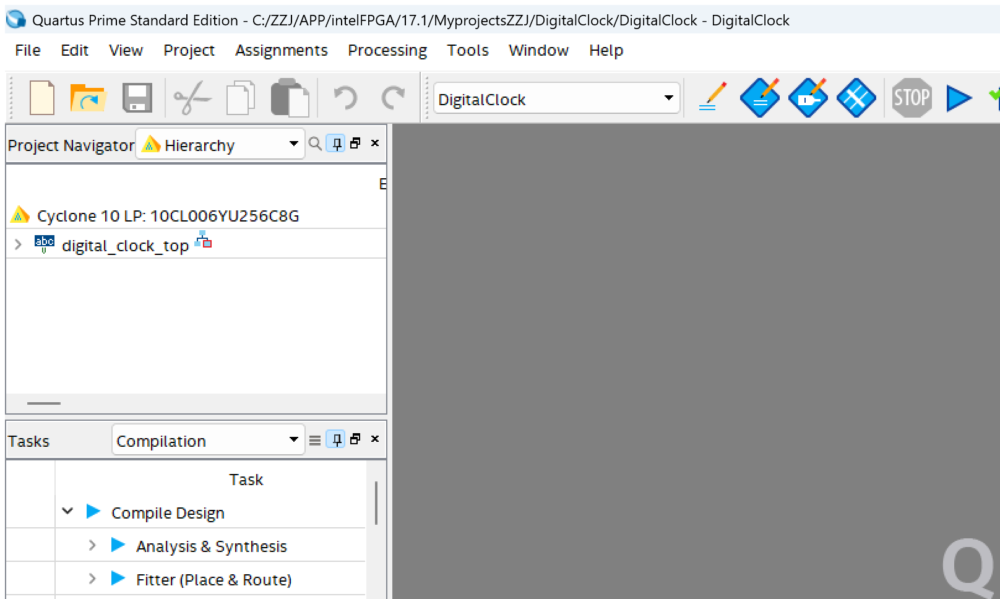
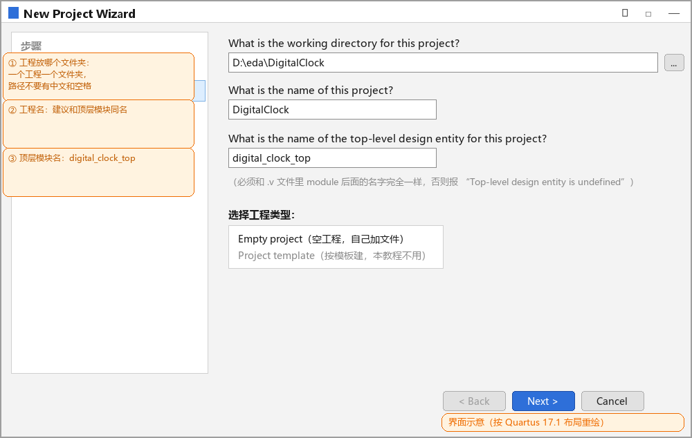
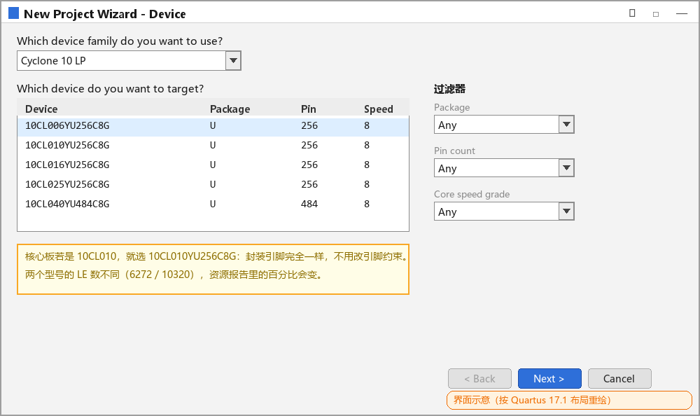
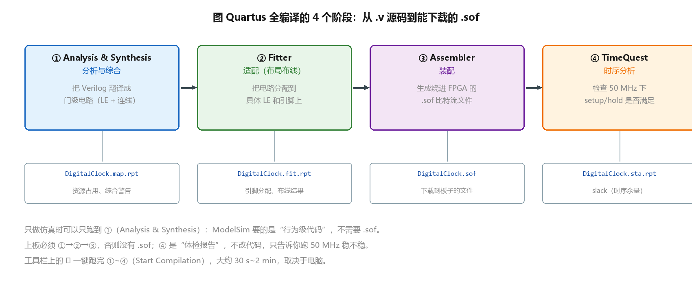
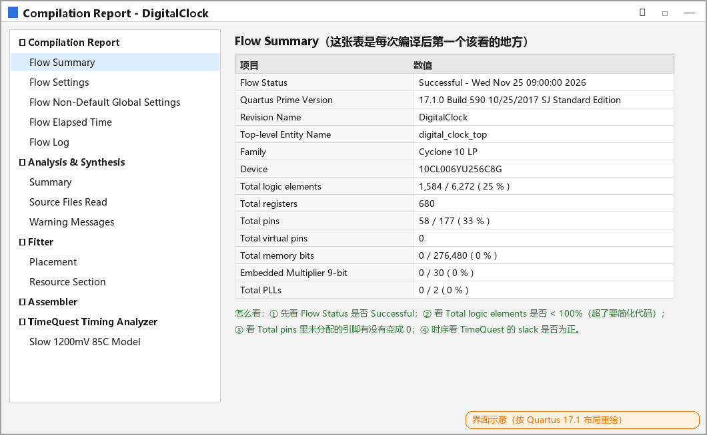
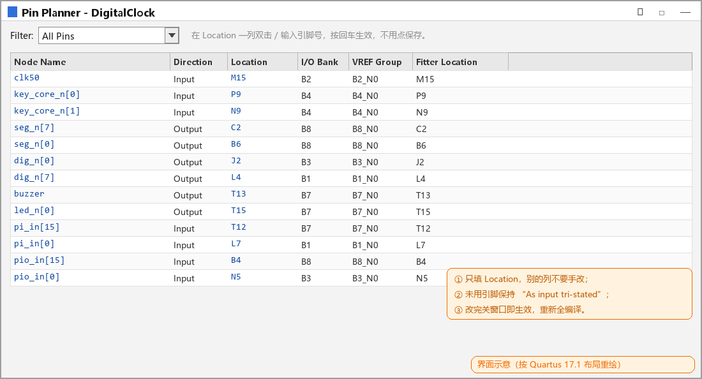
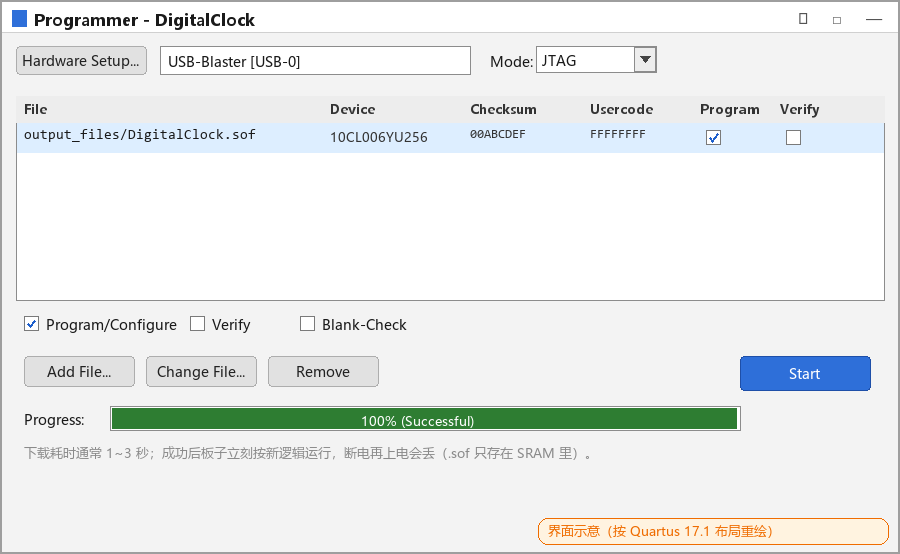

# 03 Quartus 17.1 全流程：建工程、管文件、编译、锁引脚、下载

| 学完你能做什么 | 独立打开/新建一个 Quartus 工程，把 15 个 `.v` 加进去，选对器件，编译到 0 error，锁定 58 个引脚，生成并下载 `.sof` |
|---|---|
| 前置知识 | 会双击图标、会看文件夹；不需要写过 Verilog |
| 本章对应操作 | 打开 `DigitalClock.qpf`；或从零新建一个练手工程；编译；Pin Planner；Programmer |
| 预计耗时 | 边看边做 60~90 分钟 |

> 说明：本章的界面图里，**带橙色“界面示意”角标的图是按 Quartus 17.1 真实布局重绘的示意图**（这台机器上的截图工具只能抓静态窗口，抓不到下拉菜单和向导内部的翻页），
> 不带角标的是**真实截图**。菜单路径、按钮文字、字段名都是 17.1 的真实名称，照着点即可。

---

## 3.1 先认清你装的是什么

> 下表的 `%QUARTUS_ROOTDIR%` 指 **Quartus 安装目录**（例如 `C:\intelFPGA\17.1\quartus`）。装在别的盘就换掉这个前缀即可。
> 工程内部对源文件、testbench、图片的引用**全部是相对路径**，把整个 `DigitalClock` 文件夹拷到任何位置都能直接打开、编译、仿真。

| 项目 | 本机实际路径 | 说明 |
|---|---|---|
| Quartus 主程序 | `%QUARTUS_ROOTDIR%\bin64\quartus.exe` | Quartus Prime **Standard Edition 17.1** |
| 器件库 | `%QUARTUS_ROOTDIR%\…` | 已装 Cyclone 10 LP（本工程用的系列） |
| 仿真器 | `%QUARTUS_ROOTDIR%\..\modelsim_ase\win32aloem\vsim.exe` | ModelSim-ASE 10.5b，随 Quartus 一起装 |
| 本工程 | 工程根目录下的 `DigitalClock.qpf` | 双击即可打开 |

三个容易搞混的点：

1. **Standard / Lite / Pro 是三个不同的产品**。本教程用的是 **Standard 17.1**。教程里的菜单在 Lite 里也基本一致，但 Pro 的界面差别较大。
2. **Cyclone 10 LP 不需要额外 license**，装完就能编译、下载。
3. **Quartus 管“编译和下板”，ModelSim 管“仿真”**。两者是分开的软件，Quartus 只是能“一键调用”ModelSim（见第 08 章）。

### 认识主界面



看图要点（从上到下、从左到右）：

1. **标题栏**：`Quartus Prime Standard Edition - …/DigitalClock.qpf - DigitalClock`，说明当前工程和修订版（Revision）都叫 `DigitalClock`。
2. **菜单栏**：`File / Edit / View / Project / Assignments / Processing / Tools / Window / Help`。本章只会用到其中 4 个：`File`（建工程）、`Project`（加文件）、`Assignments`（选器件、锁引脚、设置）、`Processing`（编译）。
3. **工具栏**：那一排蓝色图标从左到右是“新建 / 打开 / 保存 / 剪切 / 复制 / 粘贴 / 撤销 / 重做”，中间的下拉框是**当前修订版**，右边 4 个蓝色图标是**分阶段编译**，最后的 **▶ 是 Start Compilation（全编译）**。
4. **Project Navigator（左上）**：显示器件型号 `Cyclone 10 LP: 10CL006YU256C8G` 和顶层 `digital_clock_top`。左侧小三角可以展开成层次树（谁例化了谁）。上方的下拉框可以在 `Hierarchy / Files / Design Units / IP Components` 之间切换——**看文件清单要切到 `Files`**。
5. **Tasks（左下）**：`Compilation` 流程的快捷入口，`Compile Design` 展开后是 `Analysis & Synthesis`、`Fitter`、`Assembler`、`TimeQuest`。点某个阶段只跑那一步。
6. **中间的灰色大区**：代码编辑区。现在没有打开文件，所以是空的。
7. **底部**（截图被屏幕下边缘截掉）：`Messages` 消息窗口，编译的 Error / Warning 都在这里。

> 新手最容易犯的错：编译完只看到“0 errors”就以为成功了，其实 **Warning 也要看**。本工程有 1 条 Warning（3.3 V 接口提示），后面 3.5 节会解释。

---

## 3.2 工程与文件管理：先立规矩，后面少踩坑

### 3.2.1 一个工程 = 一个文件夹

Quartus 的“工程”不是一个压缩包，而是**一个文件夹 + 一组文件**，靠 `.qpf` 串起来。所以：

- **每个工程单独一个文件夹**，不要几个工程混在一起；
- **路径里不要有中文、空格、括号**（例如 `D:\eda\DigitalClock` 就合规）；
- 工程文件夹的名字最好和工程名一致。

### 3.2.2 本工程的目录分工

```text
DigitalClock/
  DigitalClock.qpf        工程入口（几行文本，双击它打开工程）
  DigitalClock.qsf        工程设置：器件、顶层、源文件清单、每个引脚、I/O 标准
  DigitalClock.sdc        时序约束（时钟 50 MHz = 20 ns）
  DigitalClock.qws        窗口布局（你调过的面板位置，可删）
  rtl/                    15 个 Verilog 源文件（要提交）
  sim/                    testbench + ModelSim 脚本（要提交）
  constraints/            引脚 CSV 表（要提交，人看的）
  docs/                   说明书、本教程
  images/                 旧版波形图
  output_files/           Quartus 编译产物：.sof、各种 .rpt 报告
  db/  incremental_db/    编译中间数据库
```

### 3.2.3 哪些要备份、哪些可以删

| 文件/文件夹 | 作用 | 能不能删 | 要不要进 git |
|---|---|---|---|
| `.qpf` | 工程入口，记录修订版名字 | **不能** | 要 |
| `.qsf` | 器件、顶层、文件清单、引脚、I/O 标准 | **不能**（删了引脚全丢） | 要 |
| `.sdc` | 时钟约束 | **不能**（删了时序分析报错） | 要 |
| `rtl/*.v` | 源码 | **不能** | 要 |
| `sim/*.v, *.do` | testbench 与脚本 | **不能** | 要 |
| `.qws` | 窗口布局 | 能 | 不必（放 `.gitignore`） |
| `db/`、`incremental_db/` | 编译中间数据，几百 MB | 能（下次编译重建） | 不要 |
| `output_files/` | `.sof`、报告 | 能（重新编译生成） | 不要（`.sof` 太大且易变） |
| `sim/work/` | ModelSim 编译库 | 能（`vlib work` 重建） | 不要 |

一个很实用的判断方法：**只要有 `.qpf` + `.qsf` + `.sdc` + `rtl/` + `sim/`，换台电脑就能完整重建这个工程**；其它都是“可以再生成的”。

### 3.2.4 文件命名约定

| 约定 | 例子 | 为什么 |
|---|---|---|
| 文件名 = 模块名，小写 + 下划线 | `clk_gen.v` 里必须是 `module clk_gen` | Quartus 和 ModelSim 都按名字找模块 |
| 一个文件一个模块 | `display_ctrl.v` 只有 `display_ctrl` | 好定位、好复用 |
| 低有效信号加 `_n` | `seg_n`、`dig_n`、`led_n` | 看名字就知道 0 是有效 |
| 时钟/复位命名固定 | `clk` / `clk50`、`rst_n` | 所有人一眼看懂 |

---

## 3.3 打开已有工程（最快上手）

1. 双击工程根目录下的 `DigitalClock.qpf`；
   或者先开 Quartus，再 `File → Open Project…` 选这个 `.qpf`。
2. 打开后看 **Project Navigator**：器件应该是 `Cyclone 10 LP: 10CL006YU256C8G`，顶层是 `digital_clock_top`。
3. 如果提示 “project is read-only” 或 “cannot write”，说明文件夹被占用或权限不对，把 Quartus 关掉重新打开。
4. 把 Project Navigator 的下拉框切到 **Files**，你应该看到 15 个 `.v` 和 1 个 `.sdc`（下一节讲怎么加文件）。

> 核心板如果是 10CL010，把器件改成 `10CL010YU256C8G`，引脚完全不用动（封装一样）。改法见 3.4.4。

---

## 3.4 从零新建工程（强烈建议跟着做一遍）

已经在跑现成工程的同学也建议花 10 分钟走一遍：**新建 → 加文件 → 编译**，你才会知道每个文件是“怎么进工程”的。

`File → New Project Wizard…`，向导一共 **7 页**：

| 页 | 名称 | 要做什么 |
|---|---|---|
| 1 | Introduction | 直接 `Next` |
| 2 | Directory, Name, Top-Level Entity | 选文件夹、填工程名、填**顶层模块名**（最关键） |
| 3 | Project Type | 选 `Empty project`（空工程，自己加文件） |
| 4 | Add Files | 可以先跳过，建完再加；也可以在这里把 15 个 `.v` 一次加进来 |
| 5 | Family, Device & Board Settings | 选 `Cyclone 10 LP` + `10CL006YU256C8G` |
| 6 | EDA Tool Settings | `Simulation` 工具选 `ModelSim`（第 08 章要用） |
| 7 | Summary | 看一眼，`Finish` |

### 3.4.1 第 2 页：目录、名字、顶层模块



看图要点：这一页填三个东西，填错哪一个后面都报错。

| 字段 | 本工程该填什么 | 填错的后果 |
|---|---|---|
| Working directory | `D:\eda\DigitalClock`（示例，换成你的实际路径） | 路径有中文/空格 → 编译到一半莫名失败 |
| Project name | `DigitalClock` | 会决定 `.qpf/.qsf` 的文件名 |
| Top-level entity | `digital_clock_top` | 填错 → 编译报 `Top-level design entity "xxx" is undefined` |

**顶层模块名必须和 `.v` 文件里 `module` 后面那个名字一模一样**，不是文件名，也不是工程名。本工程里：

```verilog
module digital_clock_top #(
    parameter integer CLK_FREQ = 50_000_000,
    parameter integer SIM_FAST = 0
)(
```

所以顶层实体名是 `digital_clock_top`。三者关系：

```text
工程名 DigitalClock        ← 文件夹里 .qpf/.qsf 的名字，随便起
文件名 digital_clock_top.v ← 一般和模块同名
模块名 digital_clock_top   ← Quartus 真正找的东西（Top-level entity）
```

### 3.4.2 第 5 页：选器件



看图要点：先选**系列（Family）**，再选**具体型号**。本工程是 Cyclone 10 LP 系列的 `10CL006YU256C8G`：

- `10CL` = Cyclone 10 LP
- `006` = 约 6 272 个逻辑单元（LE）
- `YU256` = 256 脚 UBGA 封装
- `C8G` = C 温度等级、8 速度等级、无铅

选错封装的直接后果：**引脚号对不上，Pin Planner 里输 `M15` 会提示非法引脚**。

### 3.4.3 加文件：`Project → Add/Remove Files in Project`

建好空工程后，加文件的三种方式，效果完全一样：

| 方式 | 操作 | 适合 |
|---|---|---|
| 菜单 | `Project → Add/Remove Files in Project → File name 右边 …` → 选 `.v` → `Add` → `OK` | 图形化，新手推荐 |
| 拖拽 | 把 `.v` 从资源管理器拖到 Project Navigator 的文件列表 | 快，但容易拖错位置 |
| 改 qsf | 在 `.qsf` 里加一行 `set_global_assignment -name VERILOG_FILE rtl/clk_gen.v` | 批量、可版本管理 |

本工程的 `.qsf` 里，这 15 行就是“文件清单”：

```text
set_global_assignment -name VERILOG_FILE rtl/digital_clock_top.v
set_global_assignment -name VERILOG_FILE rtl/clk_gen.v
set_global_assignment -name VERILOG_FILE rtl/nibble_key.v
…
```

所以你可以用记事本打开 `.qsf` 手动加一行，效果和点菜单一样。

**加文件时的 3 个注意点：**

1. **顺序无所谓**。Quartus 会根据例化关系自己找，不靠文件顺序。
2. **`sim/` 下的 testbench 不要加进工程**。testbench 有 `$display`、`initial`，综合会报错。它只在 ModelSim 里用。
3. 加完文件后，**顶层要设对**：`Assignments → Settings → General → Top-level entity`，选 `digital_clock_top`。

### 3.4.4 改器件（核心板是 10CL010 时）

`Assignments → Device → Device` 页 → 在列表里选 `10CL010YU256C8G` → `OK` → 重新全编译。
引脚分配不用改（同一封装），但资源报告里的百分比会变（分母从 6 272 变成 10 320）。

---

## 3.5 编译：4 个阶段和它们的产物



看图要点：`▶ Start Compilation`（`Ctrl+L`）会**依次**跑完 4 个阶段，任何一个阶段报 Error 就停下，后面的不再执行。产物都在 `output_files/`。

| 阶段 | 干什么 | 常见错误 |
|---|---|---|
| Analysis & Synthesis | 语法检查 + 综合成门级电路 | 语法错、模块找不到、位宽不匹配 |
| Fitter | 把电路放进具体 LE、分配到引脚 | 引脚冲突、资源不够、I/O 标准冲突 |
| Assembler | 生成 `.sof` 比特流 | 一般不会错 |
| TimeQuest | 检查 50 MHz 下的建立/保持时间 | 时钟没约束、slack 为负 |

### 3.5.1 只想检查语法？只跑第一个阶段

`Processing → Start → Start Analysis & Synthesis`（`Ctrl+K`）。几秒钟出结果，改代码阶段用这个最快。

### 3.5.2 编译结果怎么看

编译完会自动弹出 **Compilation Report**：



看图要点：**每次编译先看 Flow Summary 这张表**，四个关键指标：

| 指标 | 本工程实际值 | 怎么判断 |
|---|---|---|
| Flow Status | Successful | 必须是 Successful，出现 Error 就往下翻 Messages |
| Total logic elements | 1,584 / 6,272 (25%) | 超过 100% 会布局失败，需要简化逻辑 |
| Total registers | 680 | 触发器数量，和代码里 `reg` 的量级对应 |
| Total pins | 58 / 177 (33%) | 和 `.qsf` 里锁定的引脚数一致，说明没有漏锁 |
| Total memory bits / PLL / DSP | 0 | 本设计没用 RAM/PLL/乘法器，符合预期 |

再看 **TimeQuest → Slow 1200mV 85C Model → Fmax / slack**：本工程 50 MHz 的 setup slack 是 9.256 ns（正数，够用），hold slack 0.452 ns（正数）。

### 3.5.3 本工程那条 Warning 要不要管？

```text
Warning (169177): 37 pins must meet Intel FPGA requirements for 3.3-, 3.0-, and
2.5-V interfaces. For more information, refer to AN 447 …
```

**不用管。** 它是在提醒你：FPGA 的 3.3 V I/O 接外部 3.3 V 器件时要注意上电顺序，属于“提示性警告”。实验箱的数码管、按键、蜂鸣器都是 3.3 V 电平，符合要求。只要编译结果是 `0 errors, 1 warning`，就可以放心下载。

### 3.5.4 六种最常见的编译错误

| 报错（摘要） | 原因 | 怎么改 |
|---|---|---|
| `Error (10170): Verilog HDL syntax error at … near text ";"` | 少分号、多括号、`endmodule` 不匹配 | 看报的行号，往上找最近的 `begin/end` |
| `Error: Top-level design entity "xxx" is undefined` | 顶层名和 `module` 名不一致 | 改 `Assignments → Settings → General` |
| `Error (12007): Top-level design entity … is undefined` | 顶层文件没加进工程 | `Project → Add/Remove Files` |
| `Error (10028): Can't resolve multiple constant drivers for net "xxx"` | 同一个信号在两个 `always` 里被赋值 | 一个信号只能有一个驱动源 |
| `Error (10137): object "xxx" on left-hand side of assignment must have a variable data type` | 给 `wire` 在 `always` 里赋值 | 声明改成 `reg`，或用 `assign` |
| `Error (169177)/(171167)` 等 Fitter 错误 | 引脚重复、I/O 标准冲突、引脚不存在 | Pin Planner 里查重、确认器件型号 |

> 读报错的顺序永远是：**先看第一条 Error**（后面的多半是它引起的连锁反应），再看 Messages 里的 `Info` 定位到哪个文件哪一行。

---

## 3.6 引脚锁定：让 FPGA 知道哪个脚接什么

### 3.6.1 为什么必须锁引脚

Verilog 里写了 `input wire clk50`，但 FPGA 有 256 个脚，编译器不知道 `clk50` 该接哪个脚。**不锁引脚 = 随机分配**，板子上就全乱了。

本工程的 `.qsf` 里已经有 58 行 `set_location_assignment`，例如：

```text
set_location_assignment PIN_M15 -to clk50
set_location_assignment PIN_P9  -to key_core_n[0]
set_location_assignment PIN_N9  -to key_core_n[1]
```

### 3.6.2 用 Pin Planner 看和改

`Assignments → Pin Planner`：



看图要点：

1. `Filter` 选 `All Pins`，表格里每一行是一个**顶层端口**（不是内部信号）。
2. 只改 **Location** 一列：双击单元格，输入引脚号（如 `M15`），按回车。**不用点保存**，关掉窗口就生效。
3. `I/O Bank` / `VREF Group` 是 Quartus 自动算的，别手改。
4. 改完必须**重新全编译**，引脚才会真正生效。

### 3.6.3 三种锁定方法的对比

| 方法 | 操作 | 优点 | 缺点 |
|---|---|---|---|
| Pin Planner | 图形界面填 Location | 直观 | 引脚多时慢 |
| Assignments Editor | `Assignments → Assignment Editor`，表格里加行 | 可以批量复制粘贴 | 列多，容易看错 |
| 直接改 `.qsf` | 记事本加 `set_location_assignment PIN_xx -to 信号名` | 最快、可版本管理、可批量 | 拼错不报错，编译才发现 |

新手建议：**先用 Pin Planner 试一次**，之后看懂了就改 `.qsf`（本工程就是这么维护的）。

### 3.6.4 两个容易被忽略的设置

1. **未用引脚**：`Assignments → Device → Device and Pin Options → Unused Pins`，本工程是 `As input tri-stated`。这样没用的脚是高阻输入，不会干扰板子上其它电路。
2. **I/O 标准**：本工程全部 `3.3-V LVTTL`，写在 `.qsf` 里：

```text
set_instance_assignment -name IO_STANDARD "3.3-V LVTTL" -to clk50
```

改成 1.8 V 或 2.5 V 可能导致和实验箱电平不匹配（轻则不亮，重则烧脚）。

---

## 3.7 下载：Programmer



看图要点（详细步骤见第 10 章）：

1. `Tools → Programmer`；
2. 左上 `Hardware Setup…` 选 `USB-Blaster [USB-0]`；
3. `Mode` 选 `JTAG`；
4. `Add File…` 选 `output_files/DigitalClock.sof`；
5. 勾上 `Program/Configure`；
6. 点 `Start`，`Progress` 到 100% 且显示 `Successful` 就成了。

`.sof` 下载进 FPGA 的 SRAM，**断电就丢**；要断电保存得转成 `.jic` 烧到配置芯片（第 10 章讲）。

---

## 3.8 工程文件后缀速查

| 后缀 | 是什么 | 文本还是二进制 | 能手动改吗 |
|---|---|---|---|
| `.qpf` | 工程文件（入口） | 文本 | 能，但没必要 |
| `.qsf` | 工程设置（器件/文件/引脚） | 文本 | **能，而且常用** |
| `.sdc` | 时序约束 | 文本 | 能（改时钟频率） |
| `.qws` | 窗口布局 | 文本 | 删了会自动重建 |
| `.sof` | SRAM 目标文件（下载用） | 二进制 | 不能 |
| `.jic` | JTAG 间接配置文件（固化用） | 二进制 | 不能 |
| `.rpt` | 各阶段报告 | 文本/HTML | 只读 |
| `.summary` | 汇总报告 | 文本 | 只读 |
| `.v` | Verilog 源码 | 文本 | 能 |
| `.do` | ModelSim 脚本 | 文本 | 能 |

`DigitalClock.sdc` 全文只有 8 行，值得现在就看懂：

```tcl
# 50 MHz system clock
create_clock -name clk50 -period 20.000 [get_ports {clk50}]
derive_clock_uncertainty

# PI/PIO and core keys are asynchronous inputs from the experiment box.
set_false_path -from [get_ports {pi_in[*]}]  -to [all_registers]
set_false_path -from [get_ports {pio_in[*]}] -to [all_registers]
set_false_path -from [get_ports {key_core_n[*]}] -to [all_registers]
```

- 第 2 行：告诉时序分析器“`clk50` 是 50 MHz，周期 20 ns”，这是**最重要的一句**，没有它时序报告全是空的。
- 第 6~8 行：按键是异步输入，本来就不跟时钟对齐，所以告诉工具“这几条路径不用检查”（`set_false_path`），否则会报一堆假的时序违例。

---

## 3.9 换电脑 / 把工程发给别人

只拷这 6 样东西（总共几百 KB）：

```text
DigitalClock.qpf
DigitalClock.qsf
DigitalClock.sdc
rtl/
sim/
constraints/
```

对方电脑上：`File → Open Project` 选 `.qpf` → 直接 `Ctrl+L` 编译。**不要**拷 `db/`、`incremental_db/`、`output_files/`：又大又没用，而且不同版本的编译数据库不兼容，反而可能报奇怪的错。

如果对方装的是不同版本的 Quartus（比如 20.1），打开时可能提示“版本不同，是否升级”，选“是”即可，但引脚和 IP 有可能需要重新检查。

---

## 3.10 本章小结

- 工程 = `.qpf` + `.qsf` + 源码；`.qsf` 是纯文本，记录了器件、文件清单、每个引脚。
- 顶层模块名（Top-level entity）必须和 `module` 后面的名字一致，和文件名、工程名可以不同。
- 编译 4 个阶段：综合 → 适配 → 装配 → 时序分析；产物在 `output_files/`。
- 每次编译先看 Flow Summary：Status / LE 占用 / 寄存器 / 引脚数。
- 引脚不锁就不工作；锁引脚三种方法，`.qsf` 最好维护。
- `db/`、`incremental_db/`、`output_files/` 都可以删，源码和 `.qsf/.sdc` 不能丢。

## 3.11 练习

1. 把工程拷到 `D:\eda\clock` 下编译，需要拷哪些文件？为什么不能连 `db/` 一起拷？
2. 你的顶层模块叫 `top`，但工程里 Top-level entity 填的是 `digital_clock_top`，编译会报什么错？怎么改？
3. 想让 `clk50` 从 `M15` 改到 `M16`，写出两种改法。
4. 编译后 Total pins 显示 0/177，最可能是什么原因？
5. 本工程 1 条 Warning 是 `169177`，需要处理吗？为什么？

<details>
<summary>答案要点</summary>

1. 拷 `.qpf`、`.qsf`、`.sdc`、`rtl/`、`sim/`、`constraints/`。`db/` 是编译中间数据库，体积大且和版本/路径绑定，拷过去可能报 “database version mismatch”。
2. 报 `Error: Top-level design entity "digital_clock_top" is undefined`。两种改法：把 Settings 里的顶层改成 `top`，或把模块改名成 `digital_clock_top`。
3. ① Pin Planner 里把 `clk50` 的 Location 改成 `M16`；② 改 `.qsf` 的 `set_location_assignment PIN_M16 -to clk50` 后重新编译。
4. 引脚没锁（或 `.qsf` 里的 `set_location_assignment` 全被删了），FPGA 上没有任何端口连到外部引脚。
5. 不用。它是 AN447 的 3.3 V 接口提示，属于警告而非错误，实验箱电平匹配，功能不受影响。

</details>
