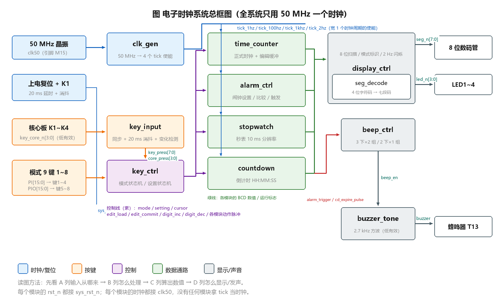
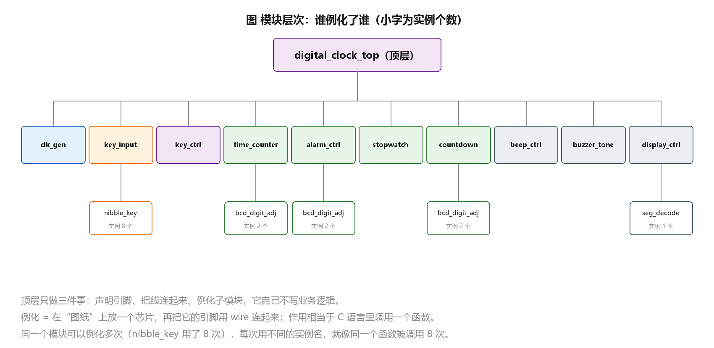
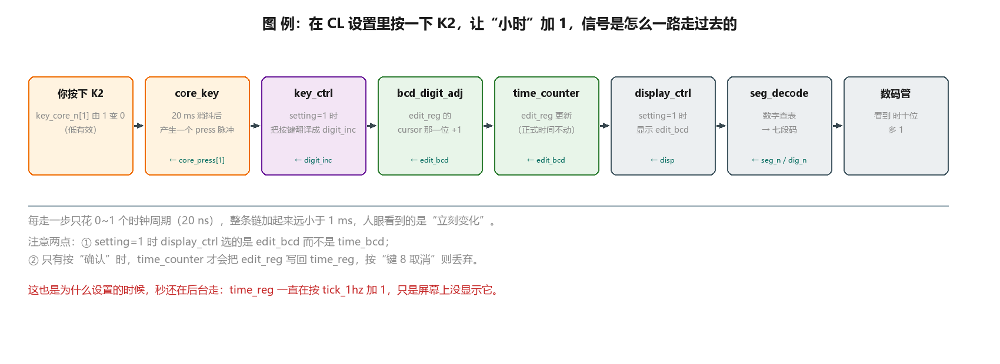
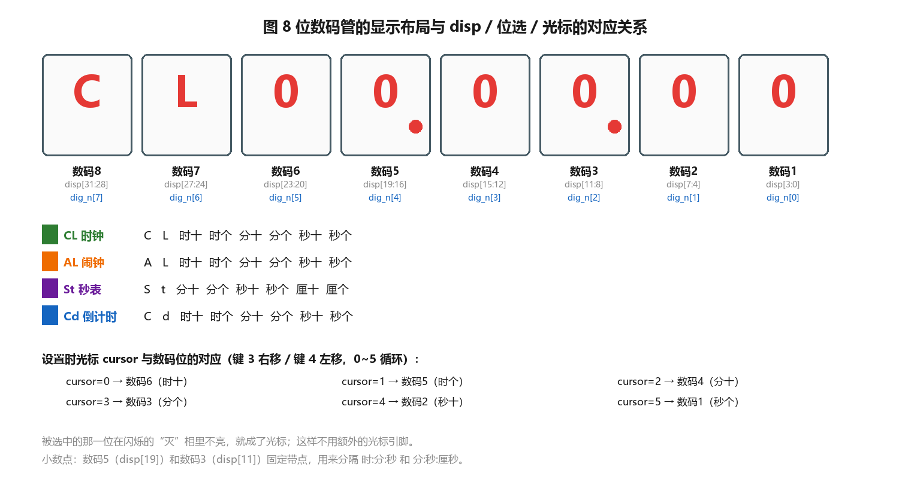

# 04 顶层与连接：模块是怎么“焊”在一起的

第 02 章你知道了这个工程有哪些模块，第 05/06 章你知道了每个模块各自干什么。但硬件不是“调用完就返回”的程序：14 个模块同时上电、同时工作，靠顶层（top level）文件里的端口和导线互相递信号。本章就把 `rtl/digital_clock_top.v` 逐段拆开，讲清楚“谁连谁、为什么这样连”。

| 学完你能做什么 | 前置知识 | 对应源文件 |
|---|---|---|
| 读懂顶层每一个端口、每一条例化、每一条连线；能自己新增一个子模块并接进系统；看到一条需求能判断该动哪个文件；能解释参数、复位和低有效输出 | 第 02 章的模块清单、第 05/06 章各模块的功能；会 C 的函数调用、参数传递、指针 | `rtl/digital_clock_top.v`（303 行）、`rtl/key_input.v`、`rtl/display_ctrl.v`、`DigitalClock.qsf` |

## 4.1 顶层只做三件事

顶层文件 303 行，除了注释和空行，真正干的事只有三类：

1. **声明引脚端口**（第 7~19 行）。哪些脚是输入、哪些是输出、每个信号几位宽（bit width），全在这里写死。至于“哪根脚对应芯片的哪个物理引脚”，不写在 Verilog 里，而是写在 `DigitalClock.qsf` 的引脚约束里。
2. **产生复位**（第 21~67 行）。上电延时 20 ms，再加上核心板 K1 的手动复位，合成一根全系统共用的 `sys_rst_n`。
3. **例化（instantiation）并连线**（第 69~301 行）。把 10 个子模块各放一份，声明 38 根模块间信号，然后把“子模块的端口”和“顶层的信号”一条条接起来。

除此之外，顶层没有第 4 件事：它不数秒、不比较闹钟、不做 BCD 加减、不扫描数码管、不消抖。**顶层不写业务逻辑**，这不是风格偏好，而是这个工程最重要的一条分工原则。

> 为什么必须这样分？因为需求变化有两个完全不同的方向。**改功能**（秒表分辨率、提示音节奏、倒计时默认值）只动对应子模块；**改引脚**（换板子、换引脚、加一个 LED）只动顶层端口和 qsf。如果顶层里塞了业务逻辑，这两类改动就会互相纠缠：改一个引脚要重读计数逻辑，改一个功能又怕碰坏引脚。

还有一条硬约束：`DigitalClock.qsf` 第 3 行写着 `set_global_assignment -name TOP_LEVEL_ENTITY digital_clock_top`，Quartus 从顶层开始往下找模块，所有引脚约束的 `-to` 名字也都是顶层端口名。所以顶层不仅是“连线图”，还是整个工程和芯片引脚之间的唯一接口。

用 C 的直觉对照一下，能少走很多弯路：

| C 里的概念 | Verilog 里对应的东西 | 关键差别 |
|---|---|---|
| 函数定义 | `module ... endmodule` | 模块描述的是硬件，不是“被调用才执行”的代码 |
| 函数调用 | 例化 `u_xxx (...)` | 例化是复制一份硬件，上电后每个时钟都在工作 |
| 形参 | 端口（port） | 端口有方向（input/output）和位宽，连接是永久导线 |
| 编译期常量 / 宏 | `parameter` | 综合前就定死，不占用任何硬件 |
| 全局变量 / 指针 | `wire`（线网） | wire 不存值，它只是导线，电平由驱动它的端口或 assign 决定 |



看图要点：
- 从左到右是“输入从哪来 → 怎么处理 → 算出什么 → 怎么显示/发声”，实际硬件里这几列是同时工作的，不是流水线。
- 图底部写着两句话，是读这个工程的钥匙：每个模块的 `rst_n` 都接 `sys_rst_n`，每个模块的时钟都接 `clk50`；`tick_*` 只是使能，没有任何模块拿它当时钟。
- 时钟/复位（蓝）和按键（绿）从左边进来；控制线（紫）从 `key_ctrl` 扇出到 4 个数据模块；数据（绿线）从 4 个数据模块汇总到 `display_ctrl`。
- `seg_decode` 画在 `display_ctrl` 框里，说明它是 `display_ctrl` 的子模块，不是顶层直接例化的。
- 蜂鸣器那条路是独立的：`alarm_trigger` / `cd_expire_pulse` → `beep_ctrl` → `beep_en` → `buzzer_tone` → `buzzer`。

## 4.2 顶层端口表：58 个引脚怎么分组

顶层端口就是 FPGA 对外的全部用户 I/O 引脚。这个工程一共 58 个：

| 端口名 | 方向 | 位宽 | 含义 | 引脚 |
|---|---|---|---|---|
| `clk50` | input | 1 | 50 MHz 系统时钟，全系统唯一时钟 | `M15` |
| `pi_in` | input | 16 | 模式 9 的键 1~4，每个键占 4 位 | `pi_in[15:0]`，qsf 第 71~86 行 |
| `pio_in` | input | 16 | 模式 9 的键 5~8，每个键占 4 位 | `pio_in[15:0]`，qsf 第 91~106 行 |
| `key_core_n` | input | 4 | 核心板 K1~K4，低有效 | `key_core_n[0]…[3]` = `P9 / N9 / M10 / P11` |
| `seg_n` | output | 8 | 七段段选，低有效，段序 `{g,f,e,d,c,b,a,dp}` | `seg_n[7:0]` = `D1 / B3 / A3 / B5 / A5 / B7 / B6 / C2` |
| `dig_n` | output | 8 | 8 位数码管位选，低有效 | `dig_n[0]…[7]` = `J2 / G1 / L2 / K1 / P2 / N1 / R1 / L4` |
| `buzzer` | output | 1 | 蜂鸣器，低有效 | `T13` |
| `led_n` | output | 4 | LED1~4，低有效 | `led_n[0]…[3]` = `T15 / M9 / L9 / T14` |

数量对得上：1 + 16 + 16 + 4 + 8 + 8 + 1 + 4 = 58。

**为什么输入偏偏是 16 位？** 因为这块实验箱的模式 9 不是“一个键一根线”，而是底板 CPLD 把每个键编码成一个 4 位（nibble，半字节）计数器：每按一次，这个 4 位值加 1，FPGA 只负责检测“值变了”。所以一个键要 4 位，4 个键就是 16 位；两个 16 位端口正好覆盖 8 个键。`rtl/key_input.v` 就是按这个规则切片的：

| 端口位段 | 对应键 | 引脚（高位→低位） |
|---|---|---|
| `pi_in[3:0]` | 键 1 | `N8 / M8 / P6 / L7` |
| `pi_in[7:4]` | 键 2 | `T4 / R5 / K8 / R3` |
| `pi_in[11:8]` | 键 3 | `T8 / R9 / T6 / R7` |
| `pi_in[15:12]` | 键 4 | `T12 / R13 / T10 / R11` |
| `pio_in[3:0]` | 键 5 | `N2 / P1 / L6 / N5` |
| `pio_in[7:4]` | 键 6 | `A4 / B1 / G2 / K2` |
| `pio_in[11:8]` | 键 7 | `L1 / J6 / L3 / P3` |
| `pio_in[15:12]` | 键 8 | `B4 / C3 / D3 / J1` |

**低有效（active low）在名字里怎么体现？** 输出端口名带 `_n` 后缀，表示“0 有效、1 无效”：`seg_n`、`dig_n`、`led_n` 都是。代码里能直接看到证据：`rtl/seg_decode.v` 里字符 `0` 的段码是 `8'h81`（bit7 和 bit0 为 1，其余为 0，也就是 a~f 段亮），`rtl/display_ctrl.v` 里位选写成 `dig_n <= ~(8'b00000001 << scan_idx);`，`rtl/display_ctrl.v` 的 LED 写成 `assign led_n = {~led4_on, ~sw_running, ~alarm_en, ~heartbeat};`——都是“先算出亮的条件，再取反送出去”。

`buzzer` 的名字没带 `_n`，但它同样是低有效：`rtl/buzzer_tone.v` 里 `assign buzzer = ~(beep_en & tone);`，注释也写明“低有效：beep_en=1 且 tone=1 时输出低，蜂鸣器响”。**读代码不能只看名字，要看赋值表达式和注释。**

引脚号不在 Verilog 里，而在 qsf 里。以时钟和 K1~K4 为例（逐字摘自 `DigitalClock.qsf` 第 33~42 行）：

```tcl
set_location_assignment PIN_M15 -to clk50

#------------------------------------------------------------------------------
# Core board keys K1~K4 (active low)
#------------------------------------------------------------------------------
set_location_assignment PIN_P9  -to key_core_n[0]
set_location_assignment PIN_N9  -to key_core_n[1]
set_location_assignment PIN_M10 -to key_core_n[2]
set_location_assignment PIN_P11 -to key_core_n[3]
set_instance_assignment -name WEAK_PULL_UP_RESISTOR ON -to key_core_n[*]
```

这里有三点值得记住：

- `-to` 后面的名字必须和顶层端口名一字不差。Verilog 里把 `key_core_n` 改名，qsf 不会自动跟着改，Quartus 会报“找不到该节点”。
- `[*]` 是一次约束整个总线的写法；`key_core_n[*]` 给 4 根脚都开了弱上拉，这样按键松开时读到 1，按下时被按键拉到 0——这正是“低有效”的电气来源。
- 同一份 qsf 还统一给了 `3.3-V LVTTL` 电平标准和 8 mA 驱动电流（第 120~133 行）。这些是“引脚的电学属性”，和逻辑功能无关，所以也归顶层管。

## 4.3 参数与复位

### 4.3.1 两个参数：让同一份代码适配不同时钟和仿真

```verilog
module digital_clock_top #(
    parameter integer CLK_FREQ = 50_000_000,
    parameter integer SIM_FAST = 0
)(
```

`parameter` 是**编译期常量**：综合工具在展开模块时就把值代进去，不会在芯片上生成一个“可以运行时改”的寄存器（register）。

- `CLK_FREQ` 告诉子模块“这块板子的时钟到底多少 Hz”。`clk_gen` 用它算分频终值，比如 1 Hz 的终值是 `CLK_FREQ`，1 kHz 的终值是 `CLK_FREQ / 1000`。默认 50_000_000 对应 M15 上的 50 MHz 晶振。
- `SIM_FAST` 是**只给仿真用的开关**：0 是正常硬件，1 是“把时间压缩”。顶层把它传给 `clk_gen` 和 `buzzer_tone`，自己算复位延时时也用它。

**为什么 testbench 一定要把 `SIM_FAST` 改成 1？** 因为正常参数下，`tick_1hz` 要数满 50 000 000 个时钟才来一次。ModelSim 里跑 1 秒仿真时间就是 5000 万个时钟沿，想看到“秒表走 1 秒”“闹钟到点”几乎跑不完。改成 1 之后，`rtl/clk_gen.v` 把 1 Hz 的终值改成 1000（20 µs 就来一次），复位延时从 1 000 000 拍缩到 4 拍，`buzzer_tone` 的分频也从 9259 缩到 4。仿真跑得快，行为时序的比例关系还保留着。

`sim/tb_digital_clock_top.v` 第 30~42 行就是这么做的：例化顶层时写 `#(.CLK_FREQ(50_000_000), .SIM_FAST(1))`，实例名叫 `dut`，8 个端口一一接上测试平台自己的信号。源文件一行不用改，参数只在这一次例化里生效——这正是 `parameter` 比 `localparam` 灵活的地方。

### 4.3.2 复位延时常量：三目运算符在综合前就算完

```verilog
    localparam integer POR_DIV = (SIM_FAST != 0) ? 4 : 1_000_000; // 20 ms @50MHz
    localparam integer K1_DIV  = (SIM_FAST != 0) ? 4 : 1_000_000;

    reg [19:0] por_cnt  = 20'd0;
    reg        por_done = 1'b0;
```

`localparam` 是“只在模块内部用的常量”，外面不能覆盖。`(SIM_FAST != 0) ? 4 : 1_000_000` 就是 C 里的三目运算符 `cond ? a : b`，但它在**展开阶段**就求值：仿真时 `POR_DIV` 就是 4，综合时就是 1_000_000，硬件里既没有比较器也没有多路选择器。这相当于 C 里 `#define POR_DIV (SIM_FAST ? 4 : 1000000)`，只不过类型和位宽由 Verilog 管。

50 MHz 下 20 ms 需要 50 000 000 × 0.02 = 1 000 000 个时钟。`por_cnt` 声明成 20 位，是因为 2²⁰ = 1 048 576 > 1 000 000，刚刚够数；再多一位是浪费触发器，少一位就永远数不到。这是“位宽要按最大值算”的典型例子。

### 4.3.3 POR + K1 消抖：贴在顶层的两段完整代码

下面这段逐字来自 `rtl/digital_clock_top.v` 第 30~67 行，是顶层里唯一的“逻辑”：

```verilog
    always @(posedge clk50) begin
        if (!por_done) begin
            if (por_cnt == POR_DIV - 1) begin
                por_cnt  <= 20'd0;
                por_done <= 1'b1;
            end
            else begin
                por_cnt <= por_cnt + 1'b1;
            end
        end
    end

    reg [1:0]  k1_sync = 2'b11;
    reg [19:0] k1_cnt  = 20'd0;
    reg        k1_db   = 1'b0;      // 1=松开，0=按下

    always @(posedge clk50) begin
        k1_sync <= {k1_sync[0], key_core_n[0]};

        if (!por_done) begin
            k1_cnt <= 20'd0;
            k1_db  <= 1'b0;
        end
        else if (k1_sync[1] != k1_db) begin
            if (k1_cnt == K1_DIV - 1) begin
                k1_db  <= k1_sync[1];
                k1_cnt <= 20'd0;
            end
            else begin
                k1_cnt <= k1_cnt + 1'b1;
            end
        end
        else begin
            k1_cnt <= 20'd0;
        end
    end

    wire sys_rst_n = por_done & k1_db;
```

**第一段：上电复位（power-on reset，POR）。** `por_done` 初值 0，计数器老老实实数 1 000 000 拍；数满后 `por_done` 置 1 并永远保持（这个 `always` 里没有把它清 0 的分支）。之后 `por_cnt` 停在 0 不再动。这 20 ms 的作用是：等电源和晶振稳定，并保证所有寄存器都拿到确定的复位值，而不是上电瞬间的随机态。

**第二段：K1 同步 + 消抖（debounce）。** `k1_sync <= {k1_sync[0], key_core_n[0]};` 是标准的**两级同步器**（two-flop synchronizer）：`key_core_n[0]` 是异步按键，先打一拍进 `k1_sync[0]`，再打一拍进 `k1_sync[1]`，后面只使用 `k1_sync[1]`。这样即使按键边沿刚好落在时钟沿附近，也不会把亚稳态传给后面的逻辑。

`k1_db` 的注释写得很清楚：**1 = 松开，0 = 按下**。当同步后的值和当前稳定值不同，就启动 `k1_cnt` 数 1 000 000 拍（20 ms）；连续 20 ms 都不一样才承认新状态，中途抖回去就立刻把计数器清零重来。机械按键抖动通常几毫秒，20 ms 足够滤掉。

**为什么不用现成的 `core_key`，也不用 `tick_1khz`？** 因为这里有个“先有鸡还是先有蛋”的问题：`core_key` 和 `clk_gen` 自己都要等 `sys_rst_n` 释放才能工作，而 `sys_rst_n` 又需要 K1 的消抖结果。所以这段消抖只能手写在顶层，而且直接用 50 MHz 计数，不能等 `tick_1khz`——那个使能信号也要等复位释放才会出现。

**第三段：一根与门合成复位。** `wire sys_rst_n = por_done & k1_db;` 低有效，两个条件都满足才释放：

| `por_done` | `k1_db` | `sys_rst_n` | 含义 |
|---|---|---|---|
| 0 | 0 | 0 | 上电 20 ms 还没数完，复位中 |
| 1 | 0 | 0 | K1 正被按住（或抖动还没稳定），复位中 |
| 1 | 1 | 1 | 松开且稳定，系统正常运行 |

上电时 `k1_db` 初值是 0（当作“按下”），所以即使 K1 一开始就松着，也要等 POR 的 20 ms 加上 K1 消抖的 20 ms，总共约 40 ms 后才真正放开复位。这个“多等一会儿”是有意为之：复位释放得越干净，后面所有计数器、状态机的起点越确定。

**按住 K1 会一直复位，这是设计意图。** 只要 `k1_db` 还是 0，`sys_rst_n` 就一直是 0，所有子模块每个时钟沿都在执行自己的复位分支：走时停在 00:00:00，秒表清零，倒计时回到设定值，数码管全灭（`seg_n`、`dig_n` 复位成 `8'hFF`），蜂鸣器不响。松开 K1 后，再等 20 ms 消抖，系统从各自的复位值重新开始。K1 在功能上就是“硬复位”，`rtl/key_input.v` 里虽然也给它例化了一个 `core_key`（`u_core_k1`），但 `key_ctrl` 明确不使用 `core_press[0]`，原因就写在 `rtl/key_ctrl.v` 的注释里：“K1 只做全局复位，本模块不处理 core_press[0]”。

**为什么用同步复位（synchronous reset）？** 这两段代码都是 `always @(posedge clk50)` 加 `if (!por_done)` / `if (!rst_n)`，复位信号只在时钟上升沿被采样，没有写 `always @(posedge clk or negedge rst_n)`。好处是：

- 所有触发器在同一拍、同一方向离开复位，不会出现“异步复位释放时刻不一致”导致的亚稳态；
- 不需要额外的异步复位网络，Quartus 可以把复位直接综合进触发器自带的清零端；
- 时序分析只需要针对 `clk50` 一个时钟，SDC 里也只写了一条 `create_clock`。

代价是“时钟必须一直在跑”，而本设计 50 MHz 时钟从 M15 进来后从不停止，所以这个代价等于零。

**为什么低有效、为什么写 `if (!rst_n)`？** 板上按键按下是 0，低有效复位与硬件直觉一致；`_n` 后缀一眼能看出来；`if (!rst_n)` 读作“如果复位有效”，比 `if (rst_n == 0)` 更接近“复位是常态、运行是例外”的语义。全工程 10 个顶层子模块的 `rst_n` 都接同一根 `sys_rst_n`，复位是全局同步的，不存在“一半模块复位了、另一半还在跑”的中间态。

## 4.4 例化 = 放芯片 + 接线：一次讲透

例化（instantiation）是本章最重要的动作：它不是“调用函数”，而是**在顶层这块板子上放一颗子模块芯片，然后把它的引脚一根根焊到顶层网络上**。放几颗就有几份独立的硬件，同时工作。

以 `clk_gen` 为例（逐字摘自第 122~132 行）：

```verilog
    clk_gen #(
        .CLK_FREQ(CLK_FREQ),
        .SIM_FAST(SIM_FAST)
    ) u_clk_gen (
        .clk(clk50),
        .rst_n(sys_rst_n),
        .tick_1hz(tick_1hz),
        .tick_100hz(tick_100hz),
        .tick_1khz(tick_1khz),
        .tick_2hz(tick_2hz)
    );
```

逐项拆开看：

| 写法 | 含义 | 类比 |
|---|---|---|
| `clk_gen` | 要例化的模块名，必须和 `module clk_gen` 完全一致 | 函数名 |
| `#(...)` | 参数传递（parameter override），在“放芯片”之前先设定它的常量 | 编译期常量实参 |
| `u_clk_gen` | **实例名**（instance name），顶层给这颗芯片起的名字 | 变量名，但它是硬件副本 |
| `.clk(clk50)` | 端口连接：左边是**子模块的端口名**，右边是**顶层连过去的信号** | 形参 ← 实参 |
| `;` | 例化语句结束 | 语句分号 |

- **`#(...)` 是传参数，不是接信号。** `.CLK_FREQ(CLK_FREQ)` 里，左边是子模块 `clk_gen` 的 parameter，右边是顶层自己的 parameter。两个名字碰巧一样，但它们是两个不同作用域的东西。传参发生在“造芯片”阶段，不占用引脚，也不产生连线。
- **`u_clk_gen` 是实例名，不是模块名。** 同一个模块可以例化很多次，靠实例名区分。`rtl/key_input.v` 里例化了 8 个 `nibble_key`（`u_key1`~`u_key8`）和 4 个 `core_key`（`u_core_k1`~`u_core_k4`）；`time_counter`、`alarm_ctrl`、`countdown` 里各有 2 个 `bcd_digit_adj`（`u_edit_inc`、`u_edit_dec`）。这些实例名在**同一个父模块内**必须唯一，但在不同父模块里可以重名——每个 `time_counter` 都有自己的 `u_edit_inc`，互不干扰。习惯上统一加 `u_` 前缀。
- **`.clk(clk50)` 的左右不能反。** 左边是子模块端口名，写错工具会报错；右边是顶层信号。顺序无所谓，可以按名字乱序写，所以叫“按名连接”（named connection）。也可以写成位置连接 `clk_gen #(CLK_FREQ, SIM_FAST) u_clk_gen (clk50, sys_rst_n, ...)`，但一旦模块端口顺序变了就会静默接错，工程里一律用按名连接。
- **右边不一定是简单名字。** `rtl/key_input.v` 里写的是 `.nibble_in(pi_in[3:0])`，右边是一个位选（part-select）表达式，等价于“只把 `pi_in` 的低 4 位焊上去”。例化端口右边可以是任意合法表达式，左边只能是端口名。

### 4.4.1 为什么信号必须先声明成 wire

在例化之前，顶层先集中声明了所有模块间信号（第 72~75 行只是其中 4 根）：

```verilog
    wire tick_1hz;
    wire tick_100hz;
    wire tick_1khz;
    wire tick_2hz;
```

`wire` 是线网（net），表示“一根导线”，它自己不存值，电平由驱动它的东西决定：要么是某个子模块的 output 端口，要么是 `assign` 语句。这里 4 根 tick 都由 `clk_gen` 的输出驱动，所以声明成 `wire`。

这几行不是形式主义，有三个实际作用：

1. **告诉工具位宽。** `wire [23:0] time_bcd;` 明确这是 24 位。如果漏声明，Verilog 的隐式线网规则会临时造一根 **1 位**的线，24 位输出接上去就被截断成最低位——功能全错，而且不一定报错。
2. **让“谁驱动谁”一目了然。** 所有连线集中在第 69~117 行，读顶层时先看这段就知道系统里有哪些信号，再看例化就知道谁产生、谁使用。
3. **区分 wire 和 reg。** 顶层只声明 `wire`，因为顶层从不写 `always` 去给它们赋值（那两段复位 `always` 用的是顶层自己的 `por_cnt`、`por_done`、`k1_sync`、`k1_cnt`、`k1_db`，它们在 27~44 行声明为 `reg`）。规则很简单：**在 `always` 里被赋值的声明成 `reg`，被端口或 `assign` 驱动的声明成 `wire`。** 顶层不产生数据，所以对外全是 `wire`；子模块里 `seg_n`、`dig_n` 在 `always` 里赋值，端口就写成 `output reg`。

### 4.4.2 第二个例子：16 位总线怎么接

`key_input` 的例化（第 137~146 行）演示了总线连接：

```verilog
    key_input u_key_input (
        .clk(clk50),
        .rst_n(sys_rst_n),
        .tick_1khz(tick_1khz),
        .pi_in(pi_in),
        .pio_in(pio_in),
        .key_core_n(key_core_n),
        .key_press(key_press),
        .core_press(core_press)
    );
```

`key_input` 没有 parameter，所以不写 `#(...)`，直接在模块名后面跟实例名。`pi_in`、`pio_in` 各是 16 位输入（内部再切成 4 个 nibble），`key_press` 是 8 位输出、`core_press` 是 4 位输出，位宽在顶层声明和子模块端口两边必须一致。注意这里子模块端口名和顶层信号名恰好同名；不同名也完全可以，下一节的表里就有好几处。

### 4.4.3 四个反例：哪些错误工具能抓，哪些抓不到

- **端口名写错**：把 `.clk(clk50)` 写成 `.clk50(clk50)`。Quartus 在 Analysis & Synthesis 阶段就会报错，说 `clk_gen` 没有名叫 `clk50` 的端口。这类错误编译期必被抓到，改起来也快。
- **信号接错但名字合法**：把 `.tick_1hz(tick_1hz)` 写成 `.tick_1hz(tick_2hz)`。语法完全正确、位宽也一致，**编译不报错**，但走时会快 4 倍（`tick_2hz` 每 250 ms 才来一个脉冲）。唯一能发现的办法是仿真或上板观察。所以连线表（4.5 节）不是给人看的装饰，它是核对连接的唯一依据。
- **实例名重复**：在顶层再写一个 `u_clk_gen`，工具会报“实例名重复”。实例名是父模块内的命名空间，必须唯一。
- **位宽不匹配**：把 8 位的 `key_press` 接到 4 位端口上，Quartus 通常给 warning 而不是 error，然后默默截断高位。看到“width mismatch”警告不能放过。



看图要点：
- 第一层只有 `digital_clock_top`，它是 qsf 里的 `TOP_LEVEL_ENTITY`，也是唯一直接对应引脚的文件。
- 第二层是顶层直接例化的 10 个模块；小字标的是实例个数。`key_input`、`time_counter`、`alarm_ctrl`、`countdown`、`display_ctrl` 下面还挂着子模块。
- 全工程一共 14 个模块文件（不含顶层），总共 29 个实例：顶层 10 个 + `key_input` 里 12 个（8 个 `nibble_key` + 4 个 `core_key`）+ `time_counter` 2 个 + `alarm_ctrl` 2 个 + `countdown` 2 个 + `display_ctrl` 1 个。
- 叶子模块（`nibble_key`、`core_key`、`bcd_digit_adj`、`seg_decode`）只被别人的内部例化，顶层看不到它们；想看它们的行为，要去父模块里找。
- 树越深，越说明“顶层只管大局”：顶层甚至不知道 `seg_decode` 的存在，它只和 `display_ctrl` 打交道。

## 4.5 连线清单：谁给谁什么

顶层声明了 38 根模块间信号（第 72~116 行），下面这张表逐条按 `digital_clock_top.v` 的例化端口对应关系核对过。读法是：**产生者**那一列是驱动源，**使用者**那一列是接收方。

| 信号名 | 位宽 | 产生者 | 使用者 | 作用 |
|---|---|---|---|---|
| `tick_1hz` | 1 | `clk_gen.tick_1hz` | `time_counter`、`countdown` | 每 1 s 一个时钟宽的使能：走时加 1 秒、倒计时减 1 秒 |
| `tick_100hz` | 1 | `clk_gen.tick_100hz` | `stopwatch` | 每 10 ms 一个使能：秒表的厘秒计数 |
| `tick_1khz` | 1 | `clk_gen.tick_1khz` | `key_input`、`beep_ctrl`、`display_ctrl` | 每 1 ms 一个使能：按键消抖、蜂鸣器节奏、数码管扫描 |
| `tick_2hz` | 1 | `clk_gen.tick_2hz` | `display_ctrl` | 每 250 ms 一个使能：2 Hz 闪烁和 1 Hz 心跳的分频源 |
| `key_press[7:0]` | 8 | `key_input.key_press` | `key_ctrl` | 模式 9 键 1~8 的“按下”单周期脉冲 |
| `core_press[3:0]` | 4 | `key_input.core_press` | `key_ctrl` | 核心板 K1~K4 的按下脉冲（`[0]` 即 K1 不参与功能） |
| `mode[1:0]` | 2 | `key_ctrl.mode` | `time_counter`、`alarm_ctrl`、`countdown`、`display_ctrl` | 当前模式：00=CL、01=AL、10=St、11=Cd |
| `setting` | 1 | `key_ctrl.setting` | `display_ctrl` | 1 = 正在设置，显示编辑缓冲并让被选位闪烁 |
| `cursor[2:0]` | 3 | `key_ctrl.cursor` | `time_counter`、`alarm_ctrl`、`countdown`、`display_ctrl` | 光标 0~5，选中要修改的 BCD 位 |
| `edit_load` | 1 | `key_ctrl.edit_load` | `time_counter`、`alarm_ctrl`、`countdown` | 进入设置：把正式值复制到编辑寄存器 |
| `edit_commit` | 1 | `key_ctrl.edit_commit` | `time_counter`、`alarm_ctrl`、`countdown` | 确认退出：把编辑值写回正式值 |
| `digit_inc` | 1 | `key_ctrl.digit_inc` | `time_counter`、`alarm_ctrl`、`countdown` | 当前位 +1（键 2 / K2，可连发） |
| `digit_dec` | 1 | `key_ctrl.digit_dec` | `time_counter`、`alarm_ctrl`、`countdown` | 当前位 −1（键 1 / K3，可连发） |
| `alarm_en_toggle` | 1 | `key_ctrl.alarm_en_toggle` | `alarm_ctrl` | 闹钟开关翻转一次 |
| `sw_start_pause` | 1 | `key_ctrl.sw_start_pause` | `stopwatch.start_pause` | 秒表启动 / 暂停 |
| `sw_clear` | 1 | `key_ctrl.sw_clear` | `stopwatch.clear` | 秒表清零并暂停 |
| `cd_start_pause` | 1 | `key_ctrl.cd_start_pause` | `countdown.start_pause` | 倒计时启动 / 暂停 |
| `cd_reset` | 1 | `key_ctrl.cd_reset` | `countdown.reset` | 倒计时剩余值回到设定值 |
| `beep_silence` | 1 | `key_ctrl.beep_silence` | `beep_ctrl.silence` | 任意键按下时立即停响 |
| `time_bcd[23:0]` | 24 | `time_counter.time_bcd` | `alarm_ctrl`、`display_ctrl` | 正式时间 HH:MM:SS（6 个 BCD 位） |
| `time_edit_bcd[23:0]` | 24 | `time_counter.edit_bcd` | `display_ctrl.edit_bcd` | CL 设置过程中正在编辑的时间 |
| `alarm_bcd[23:0]` | 24 | `alarm_ctrl.alarm_bcd` | `display_ctrl` | 闹钟设定时间 |
| `alarm_edit_bcd[23:0]` | 24 | `alarm_ctrl.alarm_edit_bcd` | `display_ctrl` | 闹钟编辑值 |
| `alarm_en` | 1 | `alarm_ctrl.alarm_en` | `display_ctrl` | 闹钟开关状态（LED2 指示） |
| `alarm_trigger` | 1 | `alarm_ctrl.alarm_trigger` | `beep_ctrl` | 时间与闹钟相等那一刻的单周期脉冲 |
| `sw_min_bcd[7:0]` | 8 | `stopwatch.min_bcd` | `display_ctrl` | 秒表分钟 00~99 |
| `sw_sec_bcd[7:0]` | 8 | `stopwatch.sec_bcd` | `display_ctrl` | 秒表秒 00~59 |
| `sw_cs_bcd[7:0]` | 8 | `stopwatch.cs_bcd` | `display_ctrl` | 秒表厘秒 00~99 |
| `sw_running` | 1 | `stopwatch.running` | `display_ctrl` | 秒表正在运行（LED3 指示） |
| `cd_preset_bcd[23:0]` | 24 | `countdown.preset_bcd` | —（本顶层没有接收方） | 倒计时设定值；目前只接到顶层，供仿真观察 |
| `cd_remain_bcd[23:0]` | 24 | `countdown.remain_bcd` | `display_ctrl` | 倒计时剩余时间 |
| `cd_edit_bcd[23:0]` | 24 | `countdown.edit_bcd` | `display_ctrl` | 倒计时编辑值 |
| `cd_running` | 1 | `countdown.running` | `key_ctrl`、`display_ctrl` | 倒计时运行中；影响能否进入设置、能否复位、LED4 |
| `cd_paused` | 1 | `countdown.paused` | `display_ctrl` | 倒计时处于暂停状态 |
| `cd_expired` | 1 | `countdown.expired` | `key_ctrl`、`display_ctrl` | 倒计时到期标志；禁止再次启动并让标志闪烁 |
| `cd_expire_pulse` | 1 | `countdown.expire_pulse` | `beep_ctrl.cd_expire` | 倒计时 1→0 那一刻的单周期脉冲 |
| `beep_en` | 1 | `beep_ctrl.beep_en` | `buzzer_tone.beep_en` | “此刻该不该响”的门控电平（不是方波） |

**同名信号不一定来自同一个模块，也不一定只给一个模块。** 例如 `tick_1khz` 同时进了 `key_input`、`beep_ctrl`、`display_ctrl` 三个模块，各自拿它当 1 ms 节拍：按键每 1 ms 检查一次电平，蜂鸣器每 1 ms 推进一次节奏状态机（FSM，finite state machine），显示每 1 ms 换一位扫描。再如 `mode` 同时给 4 个模块，每个模块自己判断“这个模式跟我有关吗”：`time_counter` 只在 `mode==CL` 时接受 `digit_inc`，`alarm_ctrl` 只在 `mode==AL` 时响应，`countdown` 只在 `mode==CD` 时响应。**控制信号广播出去，各模块用 `mode` 自己设门槛**——这样 `key_ctrl` 不需要为每个模块生成一套独立的使能线，顶层也少了很多线。

**端口名和顶层信号名可以不同**，读例化时别被绕晕。下面这些“左名 ≠ 右名”的连接是故意的，因为子模块的端口名按自己的语义起，顶层信号名按全局语义起：

| 子模块端口（左） | 顶层信号（右） | 说明 |
|---|---|---|
| `display_ctrl.edit_bcd` | `time_edit_bcd` | 显示模块只关心“编辑值”，顶层要区分是时间还是闹钟 |
| `stopwatch.start_pause` | `sw_start_pause` | 秒表的启动/暂停 |
| `countdown.start_pause` | `cd_start_pause` | 倒计时的启动/暂停 |
| `countdown.reset` | `cd_reset` | 倒计时“回到设定值” |
| `beep_ctrl.silence` | `beep_silence` | 静音请求 |
| `beep_ctrl.cd_expire` | `cd_expire_pulse` | 子模块叫“到期”，顶层强调是脉冲 |

另外有两根不在这 38 根里的全局线：`clk50` 和 `sys_rst_n`，它们各自扇出（fan-out）到全部 10 个顶层实例。`cd_preset_bcd` 是唯一一根“有产生者、没使用者”的线：`countdown` 把设定值送出来后，顶层没有把它接到任何地方，综合时这条线没有负载，Quartus 可能给一条 unused 警告。保留它是因为调试和后续扩展（比如以后想在别的模式显示设定值）会用到，删掉也不影响功能。

## 4.6 一条数据流的完整旅程（例：CL 设置）

静态连线看完了，现在让信号动起来。场景：系统停在 CL 模式，先按 K7（或 K4）进入设置，光标停在时的十位（`cursor=0`），再按一下 K2 让小时的十位加 1。注意 K2 在 `key_ctrl` 里的含义是“加 1”（`rtl/key_ctrl.v` 第 133~136 行），不是在切模式。

1. **按下 K2。** `key_core_n[1]` 从 1 变 0（引脚 N9，qsf 第 38 行）。
2. **`key_input` 里的 `u_core_k2`**（`rtl/key_input.v` 第 63~68 行，`REPEAT_EN(1)` 表示支持长按连发）：两级同步 + 连续 20 个 `tick_1khz` 稳定后，`press` 拉高 1 个时钟，送到 `core_press[1]`。
3. **`key_ctrl`**（`rtl/key_ctrl.v` 第 133~136 行）：在 `setting==1` 的分支里看到 `core_press[1]`，把 `digit_inc` 置 1，同样只高 1 个时钟。
4. **`time_counter`**（`rtl/time_counter.v` 第 50~51 行）：`mode==CL` 且 `digit_inc` 有效，于是把组合逻辑算出的 `edit_inc` 写进 `edit_reg`。正式时间 `time_reg` 完全不受影响，它继续按 `tick_1hz` 走。
5. **`bcd_digit_adj`**（`rtl/bcd_digit_adj.v`）：根据 `cursor` 选中 24 位 BCD 中的一位加减 1。光标在个位时满 10 向本段十位进 1、分/秒满 60 归零（不进下一段）、时满 24 归零；光标在十位时只在本段循环，这是“调表”而不是“加一秒”的关键区别。
6. **`edit_bcd = edit_reg`**（`rtl/time_counter.v` 第 58 行）→ 顶层线 `time_edit_bcd` → `display_ctrl.edit_bcd`。
7. **`display_ctrl`**（`rtl/display_ctrl.v` 第 143~150 行）：`setting` 为 1 时，把 `edit_bcd` 的 6 个 nibble 填进 `disp` 的对应位置（而不是 `time_bcd`）；`scan_idx` 轮流选中一位，`seg_decode` 把 4 位字符码变成 8 位段码，每个 `tick_1khz` 更新一次 `seg_n`。
8. **`seg_n[7:0]`** 经 qsf 的 D1/B3/A3/B5/A5/B7/B6/C2 八根脚送到数码管，对应段亮。注意这 8 根脚是**按实测段序反着锁的**（`seg_n[7]`=g→`PO[6]`，`seg_n[0]`=dp→`PO[7]`），原因见 11.1 的段序说明。



看图要点：
- 这张图画的是“按 K2 让小时加 1”这一条横向路径：灰色方块是模块，蓝色箭头是信号，箭头方向就是信号流向，不是“执行顺序”。
- 路径上的每一次“跨模块”都经过一根顶层 wire，名字能在 4.5 节的表里查到；图上任何一个箭头断了，现象就是“按 K2 没反应”。
- 注意 `time_counter` 内部有两条支路：一条是 `tick_1hz` 驱动的正式走时（`time_reg`），一条是 `digit_inc` 驱动的编辑缓冲（`edit_reg`），设置时走的是后者。看图时别把两条混成一条。
- `bcd_digit_adj` 是纯组合模块（`always @(*)`），它把“加 1 后的结果”立刻算出来，真正“存下来”的是 `time_counter` 里 `edit_reg` 的时钟沿。组合算、时序存，这是本工程所有“调整某一位”功能的统一套路。
- `display_ctrl` 内部还有 `seg_decode`，图上看不到它，因为它是 `display_ctrl` 的子模块；段码到 `seg_n` 已经是最后一步。

**光标到底落在哪一位？** 设置时 `cursor` 决定改谁，`display_ctrl` 又用同一个 `cursor` 决定让哪一位闪烁——两个用途共用一根 3 位线，所以不会出现“改的和闪的不是同一位”。图 4-4 把 `disp`、位选和光标的对应关系画在一起：



看图要点：
- 数码 8/7 是模式标签（C/L、A/L、S/t、C/d），数码 6~1 是 6 位数值；`disp` 的 nibble 编号和 `dig_n` 的编号方向相反：最左边是 `disp[31:28]`、`dig_n[7]`，最右边是 `disp[3:0]`、`dig_n[0]`。
- `cursor=0` 对应数码 6（时的十位），`cursor=5` 对应数码 1（秒的个位）。“键 3 右移、键 4 左移、0~5 循环”说的就是这 6 位。
- 被选中的位不是加一个光标符号，而是在 `tick_2hz` 的“灭”相里被 `cur_blank` 消隐——这样不用额外引脚，代价是设置时那一位会闪。
- 小数点固定在数码 5 和数码 3（`disp[19]`、`disp[11]`），用来分隔时:分:秒；它和 `cursor` 无关，扫描到这两位时 `cur_dp` 恒为 1。

把这条路径的时间账算一下：一个时钟 20 ns；`core_press[1]` → `digit_inc` → `edit_reg` 是两次寄存器更新，约 2 个时钟（40 ns）；`edit_reg` 到 `disp` 是纯组合逻辑，0 个时钟；`seg_n` 要等下一个 `tick_1khz` 才更新，而 8 位是轮流扫描的，同一位要 8 ms 才轮到一次。**真正“搬数据”的部分只有几个 20 ns 的时钟周期**，人眼看不出任何延迟；你能感觉到的“慢”，其实来自前面 20 ms 的消抖窗口和后面最多 8 ms 的扫描轮回。这也是为什么按键消抖必须做在顶层之外：它决定了“人按键”到“系统认账”的时间尺度。

**第二条数据流：闹钟到点。** 这条路径没有按键参与，完全由时间自己触发：

1. `time_counter` 每个 `tick_1hz` 把 `time_reg` 加 1，`time_bcd` 随之变化。
2. `alarm_ctrl`（`rtl/alarm_ctrl.v` 第 42、66~67 行）计算 `match = en_reg && (time_bcd == alarm_reg)`；`alarm_trigger <= match & ~match_d`，所以只在“刚相等”的那一拍输出一个时钟宽的脉冲，不会整秒一直响。
3. `beep_ctrl`（`rtl/beep_ctrl.v` 第 48~54 行）收到 `alarm_trigger` 后进入 `ST_ON`，把 `beep_en` 拉高；之后按 150 ms 响、150 ms 停的节奏响 3 下，隔 600 ms 再响 3 下。
4. `buzzer_tone`（`rtl/buzzer_tone.v` 第 30~40 行）在 `beep_en` 期间用 `TONE_DIV = 9259` 翻转 `tone`，`buzzer = ~(beep_en & tone)` 输出约 2.7 kHz 的低有效方波，经三极管驱动蜂鸣器。
5. 任何人按任意键：`key_ctrl` 把 `beep_silence` 拉高一拍，`beep_ctrl` 立刻回到 `ST_IDLE`，`beep_en` 变 0，声音停止。

## 4.7 为什么这样划分模块

如果不用模块化，把 14 个模块的功能全塞进一个文件，大概会是 1000 多行的巨型 `always` 块加一堆互相纠缠的 `reg`。对比一下：

| 维度 | 一个 1000 行的巨型模块 | 现在：14 个模块 + 顶层 |
|---|---|---|
| 读代码 | 从头读到尾，想找“秒表”要翻半天 | 按文件名直达 `rtl/stopwatch.v`，接口就在文件头 20 行 |
| 改需求 | 动一处可能碰坏别处，因为共享同一组 `always` | 只改对应模块的内部，端口不变就不影响别人 |
| 复用 | 秒表逻辑和时钟绑死，想单独用只能复制 | `stopwatch` 只依赖 `clk`、`tick_100hz` 和两个脉冲，可以整块搬走 |
| 换引脚 | 逻辑和引脚混在一起，一改全动 | 只动顶层端口和 qsf，子模块一行不改 |
| 仿真 | 只能整体仿真，跑到闹钟到点要很久 | 可以单独给 `bcd_digit_adj`、`seg_decode` 写 testbench，几行就覆盖所有分支 |
| 例化多份 | 想要两个 BCD 加减器就复制一段代码 | 例化两次即可：`u_edit_inc` / `u_edit_dec` |
| 看综合报告 | 资源、路径名全混在一起 | 按层次展开，一眼定位是哪个模块占资源、哪条路径慢 |
| 多人协作 | 一个文件同一时间只能一个人改 | 14 个文件可以并行改，顶层端口表就是“接口合同” |

**模块边界是按“谁拥有状态”划的。** 这是比“按功能分”更硬的规则：

- **有寄存器的模块，各自管自己的状态**：`clk_gen`（4 个计数器 + 4 个 tick 寄存器）、`key_input`（同步链、消抖计数、上次值）、`key_ctrl`（`mode`/`setting`/`cursor` 和 10 个动作脉冲）、`time_counter`（`time_reg`、`edit_reg`）、`alarm_ctrl`（`alarm_reg`、`edit_reg`、`en_reg`、`match_d`）、`stopwatch`（分/秒/厘秒/运行标志）、`countdown`（设定/剩余/编辑/运行/暂停/到期）、`beep_ctrl`（状态机、定时器、响声计数）、`buzzer_tone`（分频计数、`tone`）、`display_ctrl`（`scan_idx`、闪烁标志、`seg_n`/`dig_n`）。
- **纯组合（combinational logic）的模块不存状态**：`bcd_digit_adj` 和 `seg_decode` 都只有一个 `always @(*)`，输出完全由当前输入决定。它们没有时钟、没有复位，所以可以随便例化多份，也可以单独用真值表验证。
- 直接后果：**只有拥有状态的模块才需要 `clk` 和 `rst_n`**。`bcd_digit_adj`、`seg_decode` 的端口里没有时钟，这不是遗漏，是设计。

一张“改需求 → 改哪个文件”的对照表，比背接口有用得多：

| 想改什么 | 改哪个文件 | 具体位置 |
|---|---|---|
| 数码管扫描频率 / 每位停留时间 | `rtl/clk_gen.v` | `DIV_1KHZ`（现在是 `CLK_FREQ/1000`；`display_ctrl` 每来一个 tick 换一位） |
| 提示音节奏（响停时长、响几下） | `rtl/beep_ctrl.v` | `ALARM_ON_MS`、`ALARM_OFF_MS`、`ALARM_GAP_MS` 和 `ST_OFF` 里的 `beep_cnt` 判断 |
| 哪个物理键对应哪个功能 | `rtl/key_input.v`（键序）或 `rtl/key_ctrl.v`（功能） | `nibble_key` 的 `nibble_in` 切片 / `key_press[n]` 的条件分支 |
| 走时快慢 / 分频比 | `rtl/clk_gen.v` | `DIV_1HZ`（现在是 `CLK_FREQ`） |
| 数码管字符形状、段序 | `rtl/seg_decode.v` | `case` 表和 `{g,f,e,d,c,b,a,dp}` 的对应 |
| 显示布局 / 小数点 / 闪烁方式 | `rtl/display_ctrl.v` | `disp` 的 nibble 分配、`cur_dp`、`cur_blank` |
| 倒计时默认 5 分钟 | `rtl/countdown.v` | 复位分支里的 3 处 `24'h000500` |
| 引脚、电平标准、驱动电流 | `rtl/digital_clock_top.v` + `DigitalClock.qsf` | 端口声明 + `set_location_assignment` / `IO_STANDARD` |

注意第一行有个连带影响：`tick_1khz` 是“三合一”的使能，`key_input` 的 20 次消抖、`beep_ctrl` 的 150 次计时、`display_ctrl` 的扫描都用它。改 `DIV_1KHZ` 会同时改掉消抖时间和提示音节奏。如果只想改扫描速度，正确做法是给 `display_ctrl` 单独加一个使能，而不是动全局的 1 kHz——这也是“一个信号被多个模块共享”时必须先查连线表的原因。

## 4.8 本章小结

- 顶层 `digital_clock_top` 只做三件事：声明 58 个引脚端口、产生 `sys_rst_n`、例化 10 个模块并连 38 根线。它不含任何业务逻辑，所以“改功能”和“改引脚”永远不会互相牵连。
- 端口方向、位宽、引脚名都在顶层，具体引脚号在 `DigitalClock.qsf`；两边的名字必须一字不差，`_n` 后缀表示低有效。
- `parameter` 是编译期常量：`CLK_FREQ` 适配时钟，`SIM_FAST` 压缩仿真时间；`(SIM_FAST != 0) ? 4 : 1_000_000` 在综合前就求值，不生成硬件。
- 复位 = 20 ms 上电延时 & K1 消抖结果；K1 的消抖手写在顶层，因为它不能依赖尚未释放的复位；按住 K1 就是持续复位，这是设计意图。
- 全系统同步复位、低有效、只有一个 50 MHz 时钟；`tick_*` 是使能，不是时钟。
- 例化 = 放芯片 + 接线：`#(...)` 传参数，实例名区分多份硬件，`.端口(信号)` 左边是子模块端口、右边是顶层信号。
- 连线清单里的 38 根线是排查问题的地图；`mode` 广播 + 各模块自己设门槛，是减少连线的关键设计。
- 模块边界按“谁拥有状态”划：有寄存器的模块管自己，纯组合模块（`bcd_digit_adj`、`seg_decode`）不存状态、可多份例化。

## 4.9 练习

**1.** 想新增一路 2 Hz 的 LED 心跳，需要改哪几处？`clk_gen` 要不要动？

**2.** 把 `key_press[7]` 和 `key_press[6]` 交换，也就是让键 7 和键 8 的功能对调，应该改哪里？只改一处够不够？

**3.** 为什么不能写 `always @(posedge tick_1hz)`，直接拿 1 Hz 使能当时钟用？

**4.** 把倒计时默认值从 5 分钟改成 3 分钟，要改哪个文件的哪几行？顶层要不要动？

**5.** 如果把板上的 50 MHz 晶振换成 25 MHz，除了改引脚约束，还要改哪些地方？

### 答案要点

**1.** `tick_2hz` 已经由 `clk_gen` 产生（`rtl/clk_gen.v` 第 22、72~79 行），**不用改 `clk_gen`**。要动的是：① `rtl/digital_clock_top.v` 增加一个输出端口（或在 `led_n` 上加一位），② `DigitalClock.qsf` 给新端口分配引脚，③ 在 `rtl/display_ctrl.v` 里加一个寄存器，`if (tick_2hz) ledx <= ~ledx;`，再按低有效取反送出去。注意现有 4 个 LED 已经全被占用（LED1 是 1 Hz 心跳、LED2 闹钟、LED3 秒表、LED4 倒计时），没有空位就得扩宽 `led_n` 或者复用其中一个。另外，`tick_2hz` 每 250 ms 来一次，直接翻转得到的是周期 500 ms，正好 2 Hz；现有 `heartbeat` 是先二分频再翻转，所以是 1 Hz——两者别搞混。

**2.** 有两种改法，**只能选一种**。改键序：在 `rtl/key_input.v` 里把 `u_key7` 的 `.nibble_in(pio_in[11:8])` 和 `u_key8` 的 `.nibble_in(pio_in[15:12])` 对调（第 43~50 行），`press` 仍然分别接 `key_press[6]` 和 `key_press[7]`。改功能：不动 `key_input`，改 `rtl/key_ctrl.v` 里 `key_press[7]`（第 91 行，切模式，优先级最高）和 `key_press[6]`（第 38 行的 `enter_req`，进入设置/确认）的分支。两种都改等于换回来。注意键 8 和键 7 的功能本来就不对称（一个是切模式、一个是进入设置/确认），交换后操作逻辑会变，不只是“位置换一下”。顶层不用动。

**3.** `tick_1hz` 是“在 50 MHz 下只高 1 个时钟”的使能信号，占空比约 1/50 000 000，而且它本身是由 `clk50` 计数产生的。拿它当 `posedge` 时钟会生成一个门控/衍生时钟：时钟树要重新处理，SDC 里只约束了 `clk50` 一条时钟，时序分析会把整条路径算错，跨模块的建立/保持关系也全乱。正确写法永远是 `always @(posedge clk) if (tick_1hz) ...`，让所有触发器共用 50 MHz，使能只决定“这一拍做不做”。`rtl/clk_gen.v` 文件头注释“不产生分频时钟，所有逻辑仍然使用 50 MHz，避免门控时钟”说的就是这件事。

**4.** 只改 `rtl/countdown.v`：复位分支里三处 `24'h000500`（`preset_reg`、`remain_reg`、`edit_reg`，第 50~52 行）都改成 `24'h000300`。`24'h000500` 按 BCD 解释是 00:05:00（时:分:秒），`24'h000300` 就是 00:03:00。顶层完全不用动——这正是“顶层不写业务逻辑”的好处：默认值是业务参数，归 `countdown` 自己管。

**5.** ① `rtl/digital_clock_top.v` 的 `CLK_FREQ` 默认值改成 `25_000_000`（或者由上层实例覆盖），`clk_gen` 的分频终值会自动重算；② 顶层 `POR_DIV`/`K1_DIV` 现在硬编码 `1_000_000`（按 50 MHz 算 20 ms），25 MHz 下会变成 40 ms，要改成 `500_000`，或者干脆写成 `CLK_FREQ / 50`；③ `rtl/buzzer_tone.v` 的 `TONE_DIV = 9259` 是按 50 MHz 算 2.7 kHz 的，25 MHz 下音调降一半，要改成约 `4629`；④ `DigitalClock.sdc` 第 2 行的 `-period 20.000` 要改成 `40.000`。引脚号本身不用变，但如果换的是整块板子，qsf 的引脚分配要重新核对。这个练习说明：**参数化只覆盖了“分频比”，没有覆盖所有隐含的频率假设**，改时钟前要把所有跟时间有关的常量找一遍。
