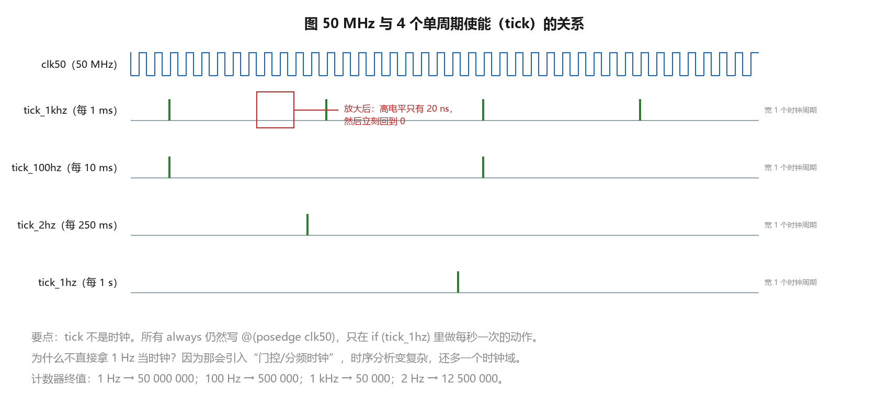
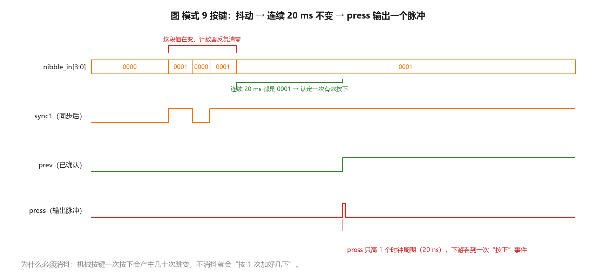
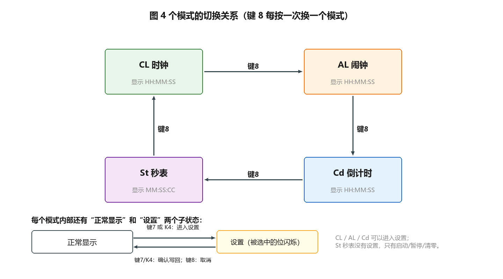

# 05 模块解读（一）：时钟、按键、控制

| 学完你能做什么 | 前置知识 | 对应源文件 |
|---|---|---|
| ① 说清 50 MHz 怎么变成 4 个单周期 tick，以及为什么不能拿 1 Hz 当时钟<br>② 读懂 `nibble_key` / `core_key` 的同步、20 ms 消抖（debounce）、单周期脉冲、长按连发<br>③ 画出 8 个模式 9 键 + 4 个核心键到 `key_ctrl` 的映射<br>④ 解释 `key_ctrl` 的优先级链、四模式循环、进入设置的条件<br>⑤ 自己改一个键位、改一个消抖时间，并知道要连带改什么 | C 语言的 `if` / `for` / 函数 / 变量 / 指针（本章用不到指针）<br>没写过 Verilog、没打开过 Quartus 也能读<br>只需接受一件事：信号只有 0 和 1 | `rtl/clk_gen.v`（83 行）<br>`rtl/nibble_key.v`（68 行）<br>`rtl/core_key.v`（88 行）<br>`rtl/key_input.v`（82 行）<br>`rtl/key_ctrl.v`（184 行）<br>`rtl/bcd_digit_adj.v`（83 行） |

本章按信号流动的方向讲：**谁产生节拍 → 单个按键怎么变成"事件" → 谁把 12 路按键汇总 → 谁做决策 → 谁执行"改一位"**。每个模块都回答四个问题：解决什么问题、输入从哪来、输出给谁、写错会看到什么现象。代码块全部摘自 `rtl/` 并标注行号范围，删除处一定有说明，信号名和数值一个没改。

## 5.1 读代码的顺序：从时钟往按键走

**为什么先读 clk_gen。** 这个设计只有一个 50 MHz 时钟。除 `clk_gen` 外的 14 个模块里，几乎每个 `always` 块都以 `if (tick_1hz)` 或 `if (tick_1khz)` 开头。先看按键代码，很容易把 `if (tick_1khz)` 读成"用 1 kHz 时钟驱动这个模块"——于是 20 ms 消抖会被算成 20 个时钟周期，连发间隔、扫描频率全部差 1000 倍。

先读 `clk_gen` 有两个理由：一是钉死"**tick 是使能（enable），不是时钟（clock）**"这句话，它只回答"这一拍要不要干活"；二是它不例化任何模块，读它不会卡住，是整棵模块树的根。

**六个模块的依赖关系。** 它们不是一个链条，而是"一个源头 + 一条链 + 一个外挂工具"：

- `clk_gen` 是源头，只依赖顶层的 `clk` 和 `rst_n`；
- `nibble_key`、`core_key` 是链上的叶子，都只吃 `tick_1khz`；
- `key_input` 几乎没有逻辑，把 8 个 `nibble_key` 和 4 个 `core_key` 并起来；
- `key_ctrl` 消费那 12 路脉冲，另外还看 `countdown` 的 `cd_running` / `cd_expired`（第 06 章），所以不是纯叶子；
- `bcd_digit_adj` 不在链上，是一把"只改一位"的螺丝刀，被 `time_counter`、`alarm_ctrl`、`countdown` 例化（都在第 06 章）。本章提前讲它，因为 `digit_inc` / `digit_dec` 最终由它执行。

| 模块 | 行数 | 依赖谁 |
|---|---|---|
| `clk_gen` | 83 | 无（只依赖顶层的 `clk`、`rst_n`） |
| `nibble_key` | 68 | `clk_gen` 的 `tick_1khz` |
| `core_key` | 88 | `clk_gen` 的 `tick_1khz` |
| `key_input` | 82 | `nibble_key`（8 个）、`core_key`（4 个）、`tick_1khz` |
| `key_ctrl` | 184 | `key_input` 的 `key_press` / `core_press`；`countdown` 的 `cd_running` / `cd_expired` |
| `bcd_digit_adj` | 83 | 无（纯组合逻辑，被数据模块例化） |

"依赖"就是"谁例化了谁"。Verilog 的例化（instantiation）不是函数调用，而是**复制一份硬件**：`key_input` 里写了 8 个 `nibble_key`，电路上就是 8 份独立并行工作的消抖器。

**先认 6 个语法。** 给只学过 C 的读者一张对照表，看不懂先跳过，遇到再回来查。

| Verilog | 先这样理解（C 类比） | 关键差别 |
|---|---|---|
| `wire` | 一根导线，或只读变量 | 不能赋值，只能被一个源驱动 |
| `reg` | 变量 | 写在 `always @(posedge clk)` 里会综合成触发器（flip-flop），值保持到下一拍 |
| `always @(posedge clk)` | 一个"每 20 ns 被调用一次"的函数体 | 描述的是并发硬件，不是 CPU 顺序执行 |
| `<=` | `x_next = ...`：本拍算右边，下一拍才生效 | 所有 `<=` 同时更新，交换两个变量不用临时变量 |
| `=` | 普通赋值 | 只在 `always @(*)` 组合逻辑里用，此时顺序有意义 |
| `#(...)` + 实例名 | 带参数的函数调用 | 是复制硬件；参数综合时定死，不占运行时资源 |

## 5.2 clk_gen：把 50 MHz 变成 4 个"使能"

> **解决什么问题**：人手和机械世界的时间尺度是秒、毫秒，50 MHz 是 20 ns，需要一层翻译。<br>
> **输入**：`clk`（50 MHz）、`rst_n`（低有效复位）。<br>
> **输出**：`tick_1hz` / `tick_100hz` / `tick_1khz` / `tick_2hz`，每个都只高**一个时钟周期**。<br>
> **写错会看到**：时钟不走、秒表快 1000 倍、数码管不扫描、按键完全没反应。

**为什么不能直接做一个 1 Hz 时钟。** 最直觉的写法是计数器数到 50,000,000 翻转一次输出，然后写 `always @(posedge tick_1hz)`。能跑，但有三个问题：

1. **门控时钟 / 分频时钟（gated / divided clock）**：拿普通寄存器的输出当时钟，等于用逻辑信号驱动时钟脚。FPGA 专用时钟网络有限，走普通布线会带来很大时钟偏斜（skew），还容易被毛刺干扰；综合工具会警告，或者偷偷把它改写成时钟使能，行为已不是你写的那样。
2. **时序分析（timing analysis）**：TimeQuest 只分析 SDC 里声明过的时钟。`DigitalClock.sdc` 第 2 行只声明了 `clk50`（`-period 20.000`）。分频时钟没被声明，跨域路径不会被正确分析，STA 报不出来，能不能稳定只能靠运气。
3. **跨时钟域（clock domain crossing, CDC）**：1 Hz 域周期 1 s，50 MHz 域的脉冲只有 20 ns，送过去基本采不到；反过来传多位数据还要握手或异步 FIFO。单时钟 + tick 使能时，所有寄存器共享同一个时钟沿，这类问题根本不存在。

所以本项目的约定是：**全系统只有一个时钟 `clk50`，4 个 tick 只是"这一拍要不要干活"的使能**。写法永远是 `always @(posedge clk)` 里套 `if (tick_1hz)`；`posedge` 后面永远只写 `clk`。

**计数器终值怎么算。** 公式只有一条：`DIV = CLK_FREQ / 事件频率`，计数器从 0 数到 `DIV-1`，共 `DIV` 个时钟周期。

| tick | 用途 | 事件间隔 | 计数终值 | 算式 |
|---|---|---|---|---|
| `tick_1hz` | 秒计数、闹钟比较、倒计时 | 1 s | 50,000,000 | `CLK_FREQ` |
| `tick_100hz` | 秒表的 10 ms 位 | 10 ms | 500,000 | `CLK_FREQ / 100` |
| `tick_1khz` | 扫描、消抖、蜂鸣器节奏 | 1 ms | 50,000 | `CLK_FREQ / 1000` |
| `tick_2hz` | 设置时光标闪烁 | 250 ms | 12,500,000 | `CLK_FREQ / 4` |

最后一行是"命名陷阱"：`tick_2hz` 指的是**闪烁频率 2 Hz**，tick 本身是每秒 4 个（每 250 ms 一个）。因为显示模块是"每来一个 tick 翻转一次"，一亮一灭才算一个闪烁周期，4 次翻转/秒 = 2 Hz 闪烁。这是全项目唯一"名字不等于频率"的地方，读 `display_ctrl` 时别绕进去。位宽上，`50,000,000` 需要 26 位，因为 `2^25 = 33,554,432` 不够、`2^26 = 67,108,864` 够。若只给 25 位，计数器最高到 33,554,431 就回绕，永远等不到 `50,000,000-1`，`tick_1hz` 一次都不出现——现象是**时钟永远停在 00:00:00**。

**为什么用 `== DIV-1` 再回 0。** 计数器从 0 开始，`0..DIV-1` 正好 `DIV` 个状态，周期精确等于 `DIV` 拍；写成 `== DIV` 周期就多一拍，1 Hz 每秒慢 20 ns，一天约 1.7 ms。等值比较 `==` 综合出来就是一个比较器，`>=` 多一层判断，且万一计数越界会连续多拍命中、产生连发脉冲。命中后立即归零，误差不累积。

**逐段读 always 块。**

```verilog
module clk_gen #(
    parameter integer CLK_FREQ = 50_000_000,
    parameter integer SIM_FAST = 0
)(
    input  wire clk,
    input  wire rst_n,
    output reg  tick_1hz,
    output reg  tick_100hz,
    output reg  tick_1khz,
    output reg  tick_2hz
);

    // SIM_FAST=1 时使用很短的计数终值，只用于仿真加速。
    localparam integer DIV_1HZ   = (SIM_FAST != 0) ? 1000 : CLK_FREQ;
    localparam integer DIV_100HZ = (SIM_FAST != 0) ? 8    : (CLK_FREQ / 100);
    localparam integer DIV_1KHZ  = (SIM_FAST != 0) ? 4    : (CLK_FREQ / 1000);
    localparam integer DIV_2HZ   = (SIM_FAST != 0) ? 250  : (CLK_FREQ / 4);
```

`#(...)` 里两个 `parameter` 是可被上层改写的常量；`localparam` 只能在本模块用，由它们算出来。那个三元表达式在综合/仿真开始前就算完，等价于 C 的 `#define`，不生成运行时多路选择器。

```verilog
    always @(posedge clk) begin
        if (!rst_n) begin
            cnt_1hz   <= 26'd0;
            cnt_100hz <= 26'd0;
            cnt_1khz  <= 26'd0;
            cnt_2hz   <= 26'd0;
            tick_1hz   <= 1'b0;
            tick_100hz <= 1'b0;
            tick_1khz  <= 1'b0;
            tick_2hz   <= 1'b0;
        end
        else begin
            // 1 Hz：每 1 秒一个时钟周期宽度的脉冲
            if (cnt_1hz == DIV_1HZ - 1) begin
                cnt_1hz  <= 26'd0;
                tick_1hz <= 1'b1;
            end
            else begin
                cnt_1hz  <= cnt_1hz + 1'b1;
                tick_1hz <= 1'b0;
            end
```

`always @(posedge clk)` 只列了 `clk`、没列 `rst_n`，说明这是**同步复位**（synchronous reset）：`rst_n` 拉低后还要等一个上升沿才生效。`rst_n` 低有效，所以判断写 `if (!rst_n)`。四个计数器在第 24~27 行声明为 `reg [25:0]`（摘录省略了那四行），复位把 4 个计数器和 4 个 tick 一起清零；tick 也要清，否则仿真开始时是 `x`、真实硬件是随机值，下游会在复位期间收到假事件。

`else` 里 1 Hz 分支只有两个出口：到终值就归零并把 tick 置 1，否则加 1 并把 tick 清 0。**两个分支都同时给 `cnt` 和 `tick` 赋值**，所以 tick 宽度精确等于一个时钟周期（20 ns），下一拍必被清 0。tick 声明成 `output reg` 而非 `wire` 也是为了这个：触发器直接输出，没有组合毛刺（glitch）。

关键点：`else` 下面是**四条独立的 `if`，不是 `else if`**。四个 tick 各自计数、互不排斥。整秒那一拍四个计数器会同时到终值，因为 50,000,000 同时是 500,000、50,000、12,500,000 的整数倍；每 10 ms 那一拍 100 Hz 和 1 kHz 也同时到。若图省事写成 `else if`，后面三个分支永远轮不到，现象是**秒表、扫描、消抖全停，只剩 1 Hz 活着**。另外三个分支（第 51~79 行）与 1 Hz 完全一样，只换计数器、终值、tick 名和注释；摘录停在第一个分支的 `end`，后面的闭合 `end`、`endmodule` 和三段重复分支都略去了。

**SIM_FAST 怎么把仿真变快。** 真实终值下仿真 1 秒要跑 50,000,000 个周期，82 项测试跑完要几十分钟，所以留了个开关：

| 终值 | 真实值 | `SIM_FAST=1` | 仿真里的"1 个单位" |
|---|---|---|---|
| `DIV_1HZ` | 50,000,000 | 1000 | 1 个"秒" = 20 µs |
| `DIV_100HZ` | 500,000 | 8 | 1 个"10 ms" = 160 ns |
| `DIV_1KHZ` | 50,000 | 4 | 1 个"毫秒" = 80 ns |
| `DIV_2HZ` | 12,500,000 | 250 | 1 个"250 ms" = 5 µs |

`sim/tb_digital_clock_top.v` 第 30~32 行用 `.SIM_FAST(1)` 覆盖顶层参数，"1 秒"就从 5000 万拍缩成 1000 拍。综合时 `SIM_FAST=0`，这些短值会被完全优化掉。但注意：这 4 个快值**不是等比例缩小的**。真实终值之比是 1000 : 10 : 1 : 250（都除以 50,000），快值之比却是 1000 : 8 : 4 : 250。功能仿真没问题（每个模块只要"tick 够多"），但**不能用 `SIM_FAST=1` 的波形量真实的消抖时间或连发间隔**。



看图要点：
- 最上面是 `clk50`，周期 20 ns；下面四条不是时钟，是使能，平时为 0，只在特定那一拍冒一个尖峰。
- 红色放大框把 `tick_1khz` 的一个尖峰放大，写着"高电平只有 20 ns，然后立刻回到 0"——这就是 `tick <= 1'b0` 那两行的作用。1 kHz 看着密（每 1 ms 一次），但每次只有 20 ns 宽。
- 图下两行是全章地基：tick 不是时钟，所有 `always` 仍写 `@(posedge clk50)`，只在 `if (tick_1hz)` 里做每秒一次的动作。

## 5.3 nibble_key：把"值变了"变成"按下一次"

> **解决什么问题**：模式 9 的按键根本不是开关，按下去不产生 0/1 电平。它后面有一块 CPLD，按一次就把 4 位计数器加 1，FPGA 只能看到一个会变的值。<br>
> **输入**：`nibble_in[3:0]`（`PI`/`PIO` 的一个 nibble）、`tick_1khz`。<br>
> **输出**：`press`，只高一个时钟周期，送给 `key_ctrl`。<br>
> **写错会看到**：按一次跳好几个模式、上电自己动一下、按键彻底失灵、按住不放数字飞涨。

**为什么按键是 4 位计数器。** 模式 9 的动态配置板上，每个键对应一个 4 位十六进制计数器：按第 1 次 `0000→0001`，第 15 次 `1110→1111`，第 16 次回绕到 `0000`。所以判据只能是"值变了"，不是"值是 1"；16 次回绕不会丢键，任何一次变化（包括 `1111→0000`）都算一次；FPGA 端只读不写，若去驱动 `pi_in` / `pio_in` 会和 CPLD 输出打架，可能损坏器件。

**两级同步：为什么要多此一举。** `PI`/`PIO` 相对 50 MHz 完全异步，直接进比较器可能落在时钟沿附近正在跳变的位置，触发器会进入**亚稳态（metastability）**：输出卡在 0 和 1 之间，什么时候稳定不确定。两级触发器串联，让第一级去冒风险，第二级有几乎一整个 20 ns 周期等它稳定，出错概率被压到几十年一遇。

代码里这两行写在复位判断**之前**：

```verilog
    always @(posedge clk) begin
        sync0 <= nibble_in;
        sync1 <= sync0;
```

也就是说同步链不受复位影响，任何时刻都在采样。这没问题：它们只是"输入管道"，复位期间清不清没意义，真正决定行为的是 `initialized`。

**20 ms 稳定判定：四个寄存器（register）各管什么。**

| 寄存器 | 位宽 | 作用 | 忘写的后果 |
|---|---|---|---|
| `sync0` / `sync1` | 4+4 | 两级同步管道，把异步输入搬进 50 MHz 域 | 亚稳态，偶发误判 |
| `prev` | 4 | 上一次**已经确认**的值 | 无法判断"是否真的变了" |
| `candidate` | 4 | 正在确认的新值 | 无法区分"抖动"和"新值" |
| `cnt` | 5 | 稳定计数器，0~19，数到 19 就是 20 个 tick = 20 ms | 没有时间门槛，任何毛刺都算一次按键 |
| `initialized` | 1 | 上电后"基准是否已锁存" | 上电误报一次按键 |

20 ms 为什么够：机械按键抖动通常小于 10 ms，20 ms 大于抖动、小于人手最快连按间隔（约 100 ms），不会把两次按压缩成一次。

`initialized` 为什么必须有：复位后 `prev = 0`，但上电时 nibble 可能是 `0101`，没有它的话 `candidate != prev` 立刻成立，20 ms 后就"确认"一次没发生的按键——现象是**上电自动跳一个模式**。加上之后，第一个 `tick_1khz` 只把当前值同时写进 `prev` 和 `candidate`，把现状当基准，不产生 press。

`press` 为什么只高一拍：`press <= 1'b0;` 放在 `else` 分支最前面是"默认清零"，只有确认那一拍才置 1，下一拍又被清零。若它保持高电平，`key_ctrl` 里 `if (key_press[7])` 每拍都成立，模式会以 50 MHz 循环——现象是显示乱闪、完全不受控。

**完整代码（68 行，全文）。**

```verilog
//============================================================================
// 文件名  : nibble_key.v
// 功能    : 模式 9 的单路 4 位按键检测
// 原理    : 底板 CPLD 每按一次让 nibble 加 1，FPGA 只检测“值变化”。
//           先两级同步，再连续 20 ms 保持不变，才认为是一次有效按下。（被 key_input 例化 8 次，键 1~8；每路只输出一个单周期 press）
//============================================================================
module nibble_key #(
    parameter integer DEBOUNCE_MS = 20        // 稳定时间门限（ms），靠 tick_1khz 计数；20 ms 足够滤掉机械与 CPLD 抖动
)(
    input  wire       clk,                    // 系统 50 MHz 时钟，所有寄存器都在此上升沿更新
    input  wire       rst_n,                  // 同步复位，低有效；只有同步级在复位期间仍持续跟随输入
    input  wire       tick_1khz,   // 1 ms 使能，来自 clk_gen，只有它为 1 的拍才推进一步状态机
    input  wire [3:0] nibble_in,              // 底板 4 位按键计数器的当前值：按一次 +1；异步输入，必须先同步
    output reg        press        // 单周期脉冲，确认到新值时高一个 clk，可直接当按键事件给顶层
);

    reg [3:0] sync0;                          // 第一级同步：直接采异步的 nibble_in，把亚稳态挡在这一级
    reg [3:0] sync1;                          // 第二级同步：后续逻辑只读 sync1，不再碰异步输入
    reg [3:0] prev;       // 上一次已经确认的值，也就是当前稳定值，只有它变了才可能产生 press
    reg [3:0] candidate;  // 正在确认的新值，输入一变就重新装载它并把 cnt 清 0
    reg [4:0] cnt;        // 0 ~ 19，candidate 连续不变的毫秒数，计到 DEBOUNCE_MS-1 才确认
    reg       initialized;                    // 0=还没锁存上电基准，1=已初始化；上电先锁一次基准，避免误报按键

    always @(posedge clk) begin               // 唯一时序块：两级同步 + 20 ms 稳定判定都在 50 MHz 域内完成
        sync0 <= nibble_in;                   // 同步级不受复位影响，复位期间也持续采样
        sync1 <= sync0;

        if (!rst_n) begin                     // 复位：状态机回初始值，press 拉低，initialized 清 0 等重新锁基准
            prev        <= 4'd0;
            candidate   <= 4'd0;
            cnt         <= 5'd0;
            initialized <= 1'b0;
            press       <= 1'b0;
        end
        else begin
            press <= 1'b0;                    // 默认每拍清 0，只有下面确认到新值时才重新拉高一拍，保证单周期

            if (tick_1khz) begin              // 每毫秒只走一步，20 拍正好 20 ms
                if (!initialized) begin       // 上电第一拍只锁基准、不做判定，所以初始化本身不会产生 press
                    // 上电后先把当前值锁存为基准，避免误报一次按键
                    prev        <= sync1;
                    candidate   <= sync1;
                    cnt         <= 5'd0;
                    initialized <= 1'b1;
                end
                else if (sync1 != candidate) begin  // 输入还在变：重新装载候选值并清零计时，抖动期间永远计不满
                    // 输入还在变，重新计时
                    candidate <= sync1;
                    cnt       <= 5'd0;
                end
                else if (candidate != prev) begin  // 输入已稳定且与旧值不同：才开始（或继续）计这 20 ms
                    if (cnt == DEBOUNCE_MS - 1) begin  // 连续稳定满 20 ms 才认账，此时才更新 prev 并发出一个 press
                        prev  <= candidate;
                        press <= 1'b1;        // 确认有效按下，单周期脉冲，下游可直接当事件用
                        cnt   <= 5'd0;
                    end
                    else begin
                        cnt <= cnt + 1'b1;    // 还没满 20 ms，继续等
                    end
                end
                else begin                    // 值与 prev 相同，说明没变化，计时器保持 0，不产生 press
                    cnt <= 5'd0;              // 清零，等下一次变化重新计时
                end
            end
        end
    end

endmodule
```

**逐段解释。** `tick_1khz` 这个 `if` 是时间基准：只有它来的那一拍计数器才动，其余 49,999 拍所有状态原地保持。这就是"用使能代替时钟"的直接收益——逻辑还是 50 MHz 的，计数节奏却是 1 ms。

`if (tick_1khz)` 里面是**四个互斥分支**，和 `clk_gen` 的四条独立 `if` 正好相反。这里必须互斥，因为它们是同一个判断流程的四个阶段：

| 条件 | 动作 | 含义 |
|---|---|---|
| `!initialized` | `prev`、`candidate` 都写 `sync1`，`cnt=0`，`initialized=1` | 上电锁基准，不报按键 |
| `sync1 != candidate` | `candidate = sync1`，`cnt = 0` | 值又变了，推翻重来 |
| `candidate != prev` | `cnt` 数到 19 → `prev = candidate`，`press = 1`，`cnt = 0` | 新值连续保持 20 ms，确认一次 |
| 其他 | `cnt = 0` | 空闲 |

第三个分支一旦确认，`prev` 就跟上 `candidate`，下一拍 `candidate == prev` 又回空闲——同一个值不会重复报两次，这就是"电平变化 → 单个事件"的闭环。`cnt == DEBOUNCE_MS - 1` 与 `clk_gen` 的写法同构：0 到 19 正好 20 个 tick，若写成 `== DEBOUNCE_MS` 就变成 21 ms。



看图要点：
- `nibble_in` 在按下瞬间先变 `0001`，紧接着闪回 `0000`、再变 `0001`——这就是抖动，上方红字标着"这段值在变，计数器反复清零"；`sync1` 是同步后的版本，比 `nibble_in` 晚几拍，毛刺被采样成窄脉冲。
- `prev` 这条绿线很久不动，直到"连续 20 ms 都是 0001"才跳变，跳变的同一拍 `press` 冒出一个尖峰。
- `press` 宽一个时钟周期（20 ns），右下角写着"下游看到一次'按下'事件"。对比 `prev` 的宽度就能记住：**`prev` 是状态，`press` 是事件**。

**反例：去掉消抖会怎样。** 只留"`sync1 != prev` 就发 press"，按一次键可能跳 2~5 个模式，因为 CPLD 更新 nibble 的那几微秒里值可能来回变好几次，每次都被当成独立按键。更隐蔽的错法是"只做两级同步、不做稳定判定"：同步能消亚稳态，但消不掉抖动，同步后的值照样连续变化，只是变化得"干净"；这类 bug 在理想激励的仿真里常看不出来，一上板就暴露。反过来，`DEBOUNCE_MS` 设太大（比如 500 ms）会把快速连按合成一下，表现为"按得快就没反应"。

## 5.4 core_key：低有效按键、消抖、长按连发

> **解决什么问题**：核心板 K1~K4 是普通独立按键，低有效（按下 0、松开 1）。需要消抖、需要"按下瞬间"的脉冲，K2/K3 还要长按连发——调时间时不用点几十下。<br>
> **输入**：`key_n`（单根低有效按键）、`tick_1khz`。<br>
> **输出**：`press`，单周期脉冲。<br>
> **写错会看到**：按一下加两位、按住不放数字疯涨、松开也触发、K4 一按就反复进出设置。

**把同步链打包成 2 位。**

```verilog
    always @(posedge clk) begin
        sync0 <= {sync0[0], key_n};
        sync1 <= sync0;
```

`{sync0[0], key_n}` 是拼接（concatenation）：旧的 `sync0[0]` 放高位、当前 `key_n` 放低位，整体赋回 `sync0`，等价于 C 的 `sync0 = (sync0 << 1) | key_n;`，即一个左移寄存器，新值从低位挤进来。好处是用一个变量表达"移位 + 采样"，也更清楚"这是一条延迟链"。数延迟：`key_n` 到 `sync0[0]` 是 1 拍，到 `sync0[1]` 是 2 拍，再到 `sync1[1]` 是 3 拍。所以名义上叫"两级同步"，实际用到的是 `sync1[1]`，已经过了 3 个触发器。多一级延迟 = 60 ns，按键完全感觉不到，换来更保守的亚稳态保护。

**`level` 和 `nibble_key` 的 `prev` 是同一类东西。** `level` 表示"当前已确认的稳定电平"，1 松开、0 按下。两者都存"上一次确认过的输入状态"，区别是：`nibble_key` 比较"4 位值是否不同"，任何变化都可能是按键；`core_key` 比较"电平是否不同"，但只有新电平是 0 时才发脉冲。所以 `core_key` 天然支持"按住"：按住时 `level` 已是 0，`sync1[1] == level` 成立，不重复触发消抖，而是进入连发计时。

确认消抖那段里有关键一行：`if (sync1[1] == 1'b0) press <= 1'b1;`。**只有按下沿才发脉冲**，松开沿虽然也走同一套消抖，但不产生事件。若忘了这个 `if`，松开也会触发一次，现象是"按一下加两位"。

**长按连发。**

```verilog
                    if ((level == 1'b0) && (REPEAT_EN != 0)) begin
                        if (!repeating) begin
                            if (hold_cnt == REPEAT_DELAY_MS - 1) begin
                                repeating <= 1'b1;
                                hold_cnt  <= 9'd0;
                                rep_cnt   <= 7'd0;
                                press     <= 1'b1;
                            end
                            else begin
                                hold_cnt <= hold_cnt + 1'b1;
                            end
                        end
                        else begin
                            if (rep_cnt == REPEAT_RATE_MS - 1) begin
                                rep_cnt <= 7'd0;
                                press   <= 1'b1;
                            end
                            else begin
                                rep_cnt <= rep_cnt + 1'b1;
                            end
                        end
                    end
```

这段缩在 `else`（输入已稳定）里，并且要求 `level == 1'b0`（按着）和 `REPEAT_EN != 0`。时间线：按下瞬间消抖确认那一拍给第 1 个 press；继续按住，`hold_cnt` 从 0 数到 499，共 500 ms（`REPEAT_DELAY_MS = 500`）；到时给第 2 个 press 并置 `repeating`；之后 `rep_cnt` 每 100 ms（`REPEAT_RATE_MS = 100`）给一个 press，直到松手。

`repeating` 的作用是区分"还在等 500 ms"和"已进入连发"。没有它，500 ms 一到 `hold_cnt` 归零，下一拍又从 0 开始数，连发就变成"每 500 ms 一次"而不是"每 100 ms 一次"。

**为什么 K1/K4 不用连发。** `REPEAT_EN` 是 `parameter` 而不是输入端口，综合时就是常量，`(REPEAT_EN != 0)` 会被常量折叠，K1/K4 实例里那套 `hold_cnt` / `rep_cnt` 逻辑直接被优化掉，不占寄存器；写成 `input` 端口则每个实例都要真做比较，省不掉。语义上也不需要：连发是"重复同一个调整动作"，只有 K2（加）、K3（减）需要。K4 是"进入/确认"，连发会让设置状态反复进出；K1 是全局复位，在顶层单独消抖（`digital_clock_top.v` 第 42~67 行），`key_ctrl` 根本不看 `core_press[0]`。

三个计数的位宽是"刚好够用"：`db_cnt` 5 位够 19，`hold_cnt` 9 位（0~511）够 499，`rep_cnt` 7 位（0~127）够 99。改参数时必须一起检查，练习 4 就是这个坑。

## 5.5 key_input：8 路 nibble + 4 路核心键的"接线板"

> **解决什么问题**：把 12 路按键检测并成两组总线，让 `key_ctrl` 只面对 `key_press[7:0]` 和 `core_press[3:0]`。<br>
> **输入**：`pi_in[15:0]`、`pio_in[15:0]`、`key_core_n[3:0]`、`tick_1khz`。<br>
> **输出**：`key_press[7:0]`（键 1~8）、`core_press[3:0]`（K1~K4）。<br>
> **写错会看到**：按一个键另一个功能动、两个键一起响应、某个键没反应。

这个模块**本身几乎没有逻辑**：没有 `always`、没有 `reg`，全是例化。它的价值就是把"哪个物理键接在哪几位"这个知识集中在一处，改映射只改这里，`key_ctrl` 一行都不用动。

```verilog
    nibble_key u_key1 (
        .clk(clk), .rst_n(rst_n), .tick_1khz(tick_1khz),
        .nibble_in(pi_in[3:0]),  .press(key_press[0])
    );
    nibble_key u_key2 (
        .clk(clk), .rst_n(rst_n), .tick_1khz(tick_1khz),
        .nibble_in(pi_in[7:4]),  .press(key_press[1])
    );
```

`nibble_key u_key1 (...)` 的意思是"在这里放一份 `nibble_key` 电路，起名 `u_key1`"。`.nibble_in(pi_in[3:0])` 是**命名端口连接**，把外层信号接到同名端口，类似 C 的指定初始化器 `.field = value`，端口顺序无所谓。键 3~8 的六段与键 1、键 2 完全同构，只有切片和 `key_press` 下标递增（第 28~51 行），键 5~8 换到 `pio_in` 那半边。

```verilog
    core_key #(
        .REPEAT_EN(0)
    ) u_core_k1 (
        .clk(clk), .rst_n(rst_n), .tick_1khz(tick_1khz),
        .key_n(key_core_n[0]), .press(core_press[0])
    );
    core_key #(
        .REPEAT_EN(1)
    ) u_core_k2 (
        .clk(clk), .rst_n(rst_n), .tick_1khz(tick_1khz),
        .key_n(key_core_n[1]), .press(core_press[1])
    );
```

`#(.REPEAT_EN(0))` 是参数覆盖，只改这一个实例，不影响别的实例。`u_core_k3` 用 `REPEAT_EN(1)`、`u_core_k4` 用 `REPEAT_EN(0)`，其余照抄第 69~80 行。

| 键号 | 信号切片 | 模块实例 | `key_press` 位 |
|---|---|---|---|
| 键 1 | `pi_in[3:0]` | `u_key1` | `key_press[0]` |
| 键 2 | `pi_in[7:4]` | `u_key2` | `key_press[1]` |
| 键 3 | `pi_in[11:8]` | `u_key3` | `key_press[2]` |
| 键 4 | `pi_in[15:12]` | `u_key4` | `key_press[3]` |
| 键 5 | `pio_in[3:0]` | `u_key5` | `key_press[4]` |
| 键 6 | `pio_in[7:4]` | `u_key6` | `key_press[5]` |
| 键 7 | `pio_in[11:8]` | `u_key7` | `key_press[6]` |
| 键 8 | `pio_in[15:12]` | `u_key8` | `key_press[7]` |
| K1 | `key_core_n[0]` | `u_core_k1` | `core_press[0]` |
| K2 | `key_core_n[1]` | `u_core_k2` | `core_press[1]` |
| K3 | `key_core_n[2]` | `u_core_k3` | `core_press[2]` |
| K4 | `key_core_n[3]` | `u_core_k4` | `core_press[3]` |

规律很整齐：`key_press[n]` 对应键 `n+1`，`core_press[n]` 对应 K`n+1`。`key_press` / `core_press` 在 `key_input` 里声明为 `output wire`，却被赋以子模块的 `output reg`——这是合法的：`reg` 只在定义它的模块内部表示"寄存器"，从外面看它就是一根被驱动的线。12 个实例共用同一个 `tick_1khz`，不是"12 个模块抢一个时钟"，而是同一个节拍广播给 12 份并行硬件，各自计数、各自判断。这也是 `clk_gen` 只做一个 1 kHz 计数器就够的原因。

## 5.6 key_ctrl：整个系统唯一的"大脑"

> **解决什么问题**：把 12 路"按下了一次"翻译成"做什么"。它记着当前模式、是否在设置、光标在哪一位。<br>
> **输入**：`key_press[7:0]`、`core_press[3:0]`、`cd_running`、`cd_expired`。<br>
> **输出**：3 个状态量 `mode` / `setting` / `cursor`，11 个动作脉冲。<br>
> **写错会看到**：设置退不出去、光标乱跳、数字每秒加几百万次、倒计时模式点不动。

3 个状态量会一直保持到下次改变：`mode[1:0]`（`MODE_CL`=00 / `MODE_AL`=01 / `MODE_ST`=10 / `MODE_CD`=11）送给 `time_counter`、`alarm_ctrl`、`countdown`、`display_ctrl`；`setting` 送给 `display_ctrl` 决定闪烁；`cursor[2:0]` 是光标位置 0~5。

| 组 | 动作脉冲 | 给谁 |
|---|---|---|
| 编辑 | `edit_load` / `edit_commit` | `time_counter` / `alarm_ctrl` / `countdown`（进设置拷入、确认写回） |
| 编辑 | `digit_inc` / `digit_dec` | 同上（选中位加 1 / 减 1，最终调 `bcd_digit_adj`） |
| 闹钟 | `alarm_en_toggle` | `alarm_ctrl`（开关闹钟） |
| 秒表 | `sw_start_pause` / `sw_clear` | `stopwatch`（启动暂停 / 清零） |
| 倒计时 | `cd_start_pause` / `cd_reset` | `countdown`（启动暂停 / 恢复设定值） |
| 蜂鸣器 | `beep_silence` | `beep_ctrl`（任意按键提前静音） |

**"默认清零、需要时置 1"。**

```verilog
            // 默认每周期清零，需要时置一个时钟周期的脉冲
            edit_load       <= 1'b0;
            edit_commit     <= 1'b0;
            digit_inc       <= 1'b0;
            digit_dec       <= 1'b0;
```

紧接着的几行（`alarm_en_toggle` 到 `cd_reset`）以同样方式清零。每拍开头先把 10 个动作信号全清零，后面哪个分支需要就把对应的置 1；因为赋值是 `<=`，同一拍内后写优先，所以"先清后置"的顺序不能反。效果是没事时恒为 0、有事时宽度正好一拍。

为什么必须这样：下游把这些信号当**事件**用——"这一拍做一次"。若信号保持高电平，`time_counter` 会在每个时钟沿执行一次 `+1`，即每秒加 5,000 万次，现象是数字完全不可读。

`beep_silence` 是唯一例外，它不在清零列表里，而是每拍被无条件赋值一次：`beep_silence <= (|key_press) | (|core_press);`。`|key_press` 是归约或，8 位里任意一个 1 就为 1，所以它天然是跟随按键脉冲的单周期信号。它包含 `core_press[0]`，即按 K1 复位也会静音。

**优先级链。** 整个 `always` 的 `else` 分支是一条 `if / else if / else` 链，同一拍只命中一个：

| 优先级 | 条件 | 处理 |
|---|---|---|
| 1（最高） | `key_press[7]`（键 8） | 取消设置、光标归零、切下一个模式 |
| 2 | `enter_req`（键 7 或 K4） | 设置中→确认；否则按条件进入设置 |
| 3 | `setting` | 光标左右移、加、减 |
| 4 | 正常显示 | 按 `mode` 分四种情况处理各自的键 |
| 5（默认） | `default` | 保持，什么都不做 |

组内还有第二层优先级：设置下是 键4 > 键3 > 键2/K2 > 键1/K3；秒表下 键1 > 键2；倒计时下 键1 > 键2。为什么键 8 必须最高：它是"逃跑键"，任何时候按它都能从设置里退出来并切模式，系统不会卡死。若把它放到 `setting` 之后，设置中它会被设置分支吞掉（设置分支不看 `key_press[7]`，命中不了任何内层条件），现象是**设置中键 8 失灵，只能靠键 7/K4 确认退出**。

```verilog
            if (key_press[7]) begin
                setting <= 1'b0;
                cursor  <= 3'd0;
                mode    <= next_mode(mode);
            end
```

这段**没有** `edit_commit <= 1'b1`，所以键 8 在设置中的语义是"放弃修改并跳到下一个模式"，编辑缓冲里改了一半的值被丢弃。确认是键 7 / K4 的事：一个键负责"过"，一个键负责"定"。

**next_mode 与四模式循环。**

```verilog
    localparam [1:0] MODE_CL = 2'b00;
    localparam [1:0] MODE_AL = 2'b01;
    localparam [1:0] MODE_ST = 2'b10;
    localparam [1:0] MODE_CD = 2'b11;

    wire enter_req;
    assign enter_req = key_press[6] | core_press[3]; // 键 7 或 K4

    // 下一个模式：CL -> AL -> St -> Cd -> CL
    function [1:0] next_mode;
        input [1:0] m;
        begin
            case (m)
                MODE_CL: next_mode = MODE_AL;
                MODE_AL: next_mode = MODE_ST;
                MODE_ST: next_mode = MODE_CD;
                MODE_CD: next_mode = MODE_CL;
                default: next_mode = MODE_CL;
            endcase
        end
    endfunction
```

`function` 是纯组合逻辑，没有时钟、没有状态，类似 C 的 `static inline` 函数：给 `m` 立刻返回下一个模式。`case` 把四个模式串成环，`default` 兜底防止 `m` 出现 `x` 时锁死。写成函数而不是展开在 `if` 里，好处是"下一个模式是什么"只有一处定义。`enter_req` 用 `assign` 定义成 `wire`，是连续赋值的线而非寄存器，两个输入一变它立刻跟着变。

**进入设置的条件。**

```verilog
            else if (enter_req) begin
                if (setting) begin
                    edit_commit <= 1'b1;
                    setting     <= 1'b0;
                    cursor      <= 3'd0;
                end
                else if ((mode == MODE_CL) ||
                         (mode == MODE_AL) ||
                         ((mode == MODE_CD) && (!cd_running) && (!cd_expired))) begin
                    edit_load <= 1'b1;
                    setting   <= 1'b1;
                    cursor    <= 3'd0;
                end
            end
```

- 已经在设置：`edit_commit` 一个脉冲，退出，光标归零，这是"确认"。
- CL 或 AL：直接进，发 `edit_load` 让数据模块把正式值拷进编辑缓冲。
- Cd 且没在跑、也没过期：可以进。正在倒计时时改设定是自相矛盾；已到期还让进，会造成"设了却不生效"的困惑，想改先 `cd_reset`（恢复设定值）。
- St：不满足任何条件，按了没反应。秒表没有可编辑的数值，只有启停/清零。

`cd_running` / `cd_expired` 来自 `countdown`，所以 `key_ctrl` 不是纯下游，它也依赖倒计时状态。`if (setting)` 写在最前而不是合并进条件，是为了让"确认"和"进入"两条路径一眼分开。

**光标与加减。**

```verilog
            else if (setting) begin
                if (key_press[3]) begin
                    // 键 4：光标左移，0~5 循环
                    if (cursor == 3'd0)
                        cursor <= 3'd5;
                    else
                        cursor <= cursor - 1'b1;
                end
                else if (key_press[2]) begin
                    // 键 3：光标右移，0~5 循环
                    if (cursor == 3'd5)
                        cursor <= 3'd0;
                    else
                        cursor <= cursor + 1'b1;
                end
                else if (key_press[1] | core_press[1]) begin
                    // 键 2 或 K2：加 1
                    digit_inc <= 1'b1;
                end
                else if (key_press[0] | core_press[2]) begin
                    // 键 1 或 K3：减 1
                    digit_dec <= 1'b1;
                end
            end
```

光标 0~5 六个位置，正好对应 6 个数码管位（时十、时个、分十、分个、秒十、秒个）。键 4 减 1、键 3 加 1，到边界回绕而不是夹住：0 再减回 5，5 再加回 0；六个字段都常用，循环比"到头停住"少按一次。

`digit_inc` / `digit_dec` 只发脉冲，**不直接改时间**。真正改值的是三个数据模块，它们收到脉冲后配合 `cursor` 调用 `bcd_digit_adj`：`key_ctrl` 决定"谁该动"，数据模块负责"怎么动"。物理键号容易看错：`key_press[0]` 是键 1（减）、`[1]` 是键 2（加）、`[2]` 是键 3（右移）、`[3]` 是键 4（左移）；K2 是 `core_press[1]`（加）、K3 是 `core_press[2]`（减）。

**倒计时模式的按键。**

```verilog
                    MODE_CD: begin
                        // 键 1：启动/暂停（和秒表一致，键 1 恒定表示"运行/暂停"）
                        if (key_press[0])
                            cd_start_pause <= 1'b1;
                        // 键 2：恢复设定值（未运行时）。原来键 6 的"复位"与键 2 的
                        //       "清零"合并成一个键；需要 00:00:00 就到设置里把六位改成 0
                        else if (key_press[1] && (!cd_running))
                            cd_reset <= 1'b1;
                    end
```

键 1 启停，键 2 恢复设定值；后者加了 `(!cd_running)`，正在跑时不允许复位，不然一按就把时间抹了。它们用 `else if` 串起来，同一拍只做一件事。另外三种正常模式也在同一个 `case` 里：CL 下键 1~6 全无操作，AL 下键 1 开关闹钟，ST 下键 1 启停、键 2 清零。



看图要点：
- 四个方框就是 `mode` 的四个取值，箭头上的"键 8"表示每按一次走一格：`CL → AL → St → Cd → CL` 闭环，和 `next_mode` 的 `case` 一一对应。
- 方框下写着该模式显示什么：CL/AL/Cd 是 `HH:MM:SS`，St 是 `MM:SS:CC`（`CC` 是百分秒，对应 `tick_100hz`）。下半部分画的是模式内部的第二个维度：`正常显示` 和 `设置` 两个子状态，由 `setting` 表示；键 7/K4 进入和确认，键 8 取消并跳下一个模式——正是上面那条优先级链。
- 右下角"CL / AL / Cd 可以进入设置；St 秒表没有设置"就是"进入设置的条件"那段代码的图形版。

## 5.7 bcd_digit_adj：按位加减（段内进位 / 借位）

> **解决什么问题**：时间是 BCD 格式（每位 4 位、只表示 0~9），不能直接做二进制加 1。本模块对"选中的那一位"做 +1/-1：光标停在**个位**时，满 10 向本段十位进 1，分/秒满 60 归零、时满 24 归零；停在**十位**时只在本位范围内循环。<br>
> **输入**：`bcd_in[23:0]`、`cursor[2:0]`、`inc`（1 加 0 减）。<br>
> **输出**：`bcd_out[23:0]`，调整后的新值。<br>
> **写错会看到**：出现 29:30 这种不存在的时间、`09 + 1` 变成 `0A` 显示乱码、改"时十位"结果"时个位"跟着跳。

**为什么不能直接 `time_reg + 1`。** BCD 用 4 位二进制表示一位十进制数，`0x09` 是 9，`0x10` 是 10。直接 `+1` 会让 `09` 变成 `0A`（`A` 不是合法十进制数字，七段译码显示乱码）、`59` 变成 `5A` 而不是 `60`。所以必须**按位判断边界**，而且边界分两种：个位到 9 要进位到十位，十位到自己上限（时 2、分/秒 5）要归零。

| `cursor` | 位 | 加 1 时 | 减 1 时 |
|---|---|---|---|
| 0 | 时十位 | 0→1→2→0，并夹住时个位 ≤ 3 | 0→2 |
| 1 | 时个位 | 个位 +1；9→0 且时十位 +1；23→00 | 个位 −1；0→9 且时十位 −1；00→23 |
| 2 | 分十位 | 0→…→5→0，不动分个位 | 0→5 |
| 3 | 分个位 | 个位 +1；9→0 且分十位 +1；59→00（不进时） | 个位 −1；0→9 且分十位 −1；00→59 |
| 4 | 秒十位 | 0→…→5→0，不动秒个位 | 0→5 |
| 5 | 秒个位 | 个位 +1；9→0 且秒十位 +1；59→00（不进分） | 个位 −1；0→9 且秒十位 −1；00→59 |

24 位 = 6 个 nibble，`{ht, ho, mt, mo, st, so} = bcd_in;` 是**拆包**：`ht` 拿最高 4 位 `[23:20]`，`so` 拿最低 4 位 `[3:0]`；最后 `bcd_out = {ht, ho, mt, mo, st, so};` 再**打包**回去。这和 C 里用位域或移位掩码拆字节是一回事。

**个位：满 10 进位、满 60 归零。** 以分个位为例：

```verilog
            3'd3: begin // 分个位：满 10 进分十位；59 加 1 归零（不向时进位）
                if (inc) begin
                    if ({mt, mo} == 8'h59) begin      // 59 分再 +1 → 00 分（满 60 归零，不进时）
                        mt = 4'd0;
                        mo = 4'd0;
                    end
                    else if (mo == 4'd9) begin        // 个位满 10：本位回 0，十位 +1
                        mo = 4'd0;
                        mt = mt + 1'b1;
                    end
                    else begin
                        mo = mo + 1'b1;
                    end
                end
                else begin
                    if ({mt, mo} == 8'h00) begin      // 00 分再 -1 → 59 分（借位）
                        mt = 4'd5;
                        mo = 4'd9;
                    end
                    else if (mo == 4'd0) begin
                        mo = 4'd9;
                        mt = mt - 1'b1;
                    end
                    else begin
                        mo = mo - 1'b1;
                    end
                end
            end
```

三个判断解决三件事：① `09 + 1 → 10`（个位 9 回 0、十位 +1，这就是"满 10 进 1"）；② `59 + 1 → 00`（分十位已经 5，再进就跨段了，所以整段归零，**不进到小时**）；③ `00 - 1 → 59`（减法对称借位）。

**为什么不进到小时。** 设置时你改的是"分"这一段，预期是"把 59 分调成 0 分"，而不是"把时间加一分钟"。跨段进位交给 `time_counter` 的 `inc_time()`——那是走时逻辑，每秒一次、会从秒一路进到时。分工很清楚：`bcd_digit_adj` 负责"调表"，`inc_time()` 负责"走时"。

**时个位：满 24 归零。** 小时没有"60"，上限是 24：

```verilog
            3'd1: begin // 时个位：满 10 向时十位进 1；23 加 1 回 00；00 减 1 借位成 23
                if (inc) begin
                    if ({ht, ho} == 8'h23) begin      // 23:xx 再 +1 小时 → 00:xx（满 24 归零）
                        ht = 4'd0;
                        ho = 4'd0;
                    end
                    else if (ho == 4'd9) begin        // 个位满 10：本位回 0，十位 +1（段内进位）
                        ho = 4'd0;
                        ht = ht + 1'b1;
                    end
                    else begin                        // 普通情况：个位 +1
                        ho = ho + 1'b1;
                    end
                end
```

于是 `09:xx + 1 → 10:xx`、`19:xx + 1 → 20:xx`、`23:xx + 1 → 00:xx`；减法是反向的 `00 → 23`、`20 → 19`、`10 → 09`。

**十位：只在本位循环，还要夹住个位。**

```verilog
            3'd0: begin // 时十位：本段十位范围内循环 0→1→2→0，不向更高位进位
                if (inc)
                    ht = (ht == 4'd2) ? 4'd0 : ht + 1'b1; // 2 再加回 0
                else
                    ht = (ht == 4'd0) ? 4'd2 : ht - 1'b1; // 0 再减回 2
                // 时十位变成 2 时，时个位最大只能是 3，否则会出现 24~29 时这种非法值
                if ((ht == 4'd2) && (ho > 4'd3))
                    ho = 4'd3;
            end
```

光限制十位不够：`19:30` 加十位会得到 `29:30`，十位合法、个位 9 却非法。所以改完十位要加夹位判断：只要十位变成 2，个位必须 ≤ 3，超了按 3 处理。于是 `19:30` 加一次变成 `23:30`；同理 `05:xx` 减时十位（0→2）会变成 `23:xx`。

分十位、秒十位结构相同，只是变量换成 `mt` / `st`、上限是 5。最后是兜底和打包：

```verilog
            default: begin // cursor 为 6/7：无对应位
                // 保持原值；bcd_out 与 bcd_in 相同
            end
        endcase

        bcd_out = {ht, ho, mt, mo, st, so}; // 按原顺序拼回 24 位 BCD
    end
```

`default` 里什么都不做，`cursor` 即使出现 6、7（正常不会）也不会把时间改坏。

**两个语法点。** 第一，`always @(*)` 是**组合逻辑**（combinational logic）：`*` 表示敏感列表自动推断，右边用到的信号一变就重算；没有 `posedge`，不产生触发器，也没有时钟端口。这个模块是"计算器"不是"存储器"，给输入立刻出结果，谁用它谁负责把结果存进寄存器——这就是它没有 `clk`、`rst_n` 的原因。第二，组合逻辑用阻塞赋值 `=`，时序逻辑用非阻塞 `<=`；在 `@(*)` 里写 `<=` 也许能过综合，但仿真和综合语义可能不一致。规矩很简单：`@(*)` 用 `=`，`@(posedge clk)` 用 `<=`。

## 5.8 这 6 个模块怎么串起来

一次按键的完整旅程：

1. 手指按下键 1。动态配置板上的 CPLD 把 `PI[3:0]` 从 `0000` 加到 `0001`，这个变化和 50 MHz 没有任何同步关系。
2. `u_key5` 的 `nibble_in` 收到 `pio_in[3:0]`，`sync0` / `sync1` 两级触发器把它搬进 50 MHz 域。
3. 每个 `tick_1khz` 到来时，`nibble_key` 检查这个值是否连续 20 次不变；第 20 次那一拍 `prev` 更新、`press` 拉高一个周期。
4. `press` 连到 `key_press[0]`，`key_ctrl` 在下一个时钟沿看到它。
5. `key_ctrl` 按优先级判断：键 8？否。键 7/K4？否。在设置？若在设置，键 1 被当成「选中位 −1」；若不在设置且当前是 Cd，发一个 `cd_start_pause`。
6. `cd_start_pause` 送到 `countdown`，倒计时开始，`cd_running` 变 1。
7. `cd_running` 又回到 `key_ctrl`，影响"能否进入设置"的判断——控制通路上一个小闭环。而 `tick_1khz` 这一根线接到 12 个按键实例（8 个 `nibble_key` + 4 个 `core_key`）。一个节拍、多个消费者，这是"单时钟 + 使能"架构最典型的形态：不需要 12 个分频器，也不需要 12 个时钟域。

| 信号 | 从哪来 | 到哪去 | 位宽 |
|---|---|---|---|
| `pi_in` | 外部引脚 `PI` | `key_input` | 16 |
| `pio_in` | 外部引脚 `PIO` | `key_input` | 16 |
| `key_core_n` | 核心板 K1~K4（低有效） | `key_input` | 4 |
| `tick_1khz` | `clk_gen` | `key_input` 里 12 个按键实例 | 1 |
| `key_press` | `key_input` | `key_ctrl` | 8 |
| `core_press` | `key_input` | `key_ctrl` | 4 |
| `mode` | `key_ctrl` | `time_counter` / `alarm_ctrl` / `countdown` / `display_ctrl` | 2 |
| `setting` | `key_ctrl` | `display_ctrl` | 1 |
| `cursor` | `key_ctrl` | `time_counter` / `alarm_ctrl` / `countdown` / `display_ctrl` | 3 |
| `edit_load` / `edit_commit` | `key_ctrl` | 三个数据模块 | 各 1 |
| `digit_inc` / `digit_dec` | `key_ctrl` | 三个数据模块 → `bcd_digit_adj` | 各 1 |
| `alarm_en_toggle` | `key_ctrl` | `alarm_ctrl` | 1 |
| `sw_start_pause` / `sw_clear` | `key_ctrl` | `stopwatch` | 各 1 |
| `cd_start_pause` / `cd_reset` | `key_ctrl` | `countdown` | 各 1 |
| `beep_silence` | `key_ctrl` | `beep_ctrl` | 1 |
| `cd_running` / `cd_expired` | `countdown` | `key_ctrl` | 各 1 |

## 5.9 本章小结

- **一个时钟**：全系统只有 `clk50`；4 个 tick 是单周期使能，不是时钟，`always` 的敏感列表里永远只写 `clk`。
- **终值公式**：`DIV = CLK_FREQ / 频率`，数到 `DIV-1` 归零，周期精确；`tick_2hz` 的 tick 实际 4 次/秒，闪烁才是 2 Hz。
- **四条独立 if**（`clk_gen`）vs **互斥 if/else if**（`nibble_key`）：前者是并行事件，后者是同一判断流程的分支，别混。
- **异步输入必须两级同步**；**消抖必须"稳定足够久"**，只同步不判稳定是不够的。
- **`level` / `prev` 是状态，`press` 是事件**；事件只有一拍宽，靠"默认清零"实现。
- **12 个按键实例并行工作**，`key_input` 只是接线板；`key_ctrl` 是唯一决策者，优先级 键8 > 键7/K4 > 设置 > 正常模式。
- **确认与取消**：键 7/K4 确认写回，键 8 取消并切模式；Cd 在跑或已到期进不了设置，St 没有设置。
- **BCD 按位改**：个位满 10 进本段十位、满 60 归零；十位只在本段循环；改完时十位还要把时个位夹到 3。

## 5.10 练习

**练习 1** 把模式 9 的 8 个键的消抖从 20 ms 改成 50 ms，最少改哪两处？只改参数会怎样？

> **答案要点**：改 `nibble_key.v` 第 8 行的 `parameter integer DEBOUNCE_MS = 20`（或在 `key_input` 的 8 个实例里都传 `.DEBOUNCE_MS(50)`）。但还必须把第 21 行 `reg [4:0] cnt;` 改成 `reg [5:0] cnt;`：5 位最大 31，数不到 `50-1=49`，计数器会 0→31→0 回绕，`cnt == DEBOUNCE_MS - 1` 永不成立。现象是**这个键彻底失灵**，而不是"消抖变慢"。`core_key` 的 `db_cnt` 同理。

**练习 2** 想把键 1 和键 2 的物理位置互换（键 1 干原来键 2 的活），改哪几行？只换切片会怎样？

> **答案要点**：改 `key_input.v` 第 20~27 行，把 `.nibble_in(pi_in[3:0])` 与 `.nibble_in(pi_in[7:4])` 互换（或把 `.press(key_press[0])` 与 `.press(key_press[1])` 互换）。注意 `key_ctrl` 里键 1 是"减"（第 140 行）、键 2 是"加"（第 136 行），换切片后物理位置换了、加减功能也跟着换；只想换位置不想换功能就得同时改 `key_ctrl` 的下标。最容易犯的错是两个切片都写成 `pi_in[3:0]`，那样两个实例会盯着同一个 nibble，两个键一起动。

**练习 3** 为什么 `press` 只高一个时钟周期？删掉 `nibble_key.v` 第 36 行的 `press <= 1'b0;` 会怎样？

> **答案要点**：每个非复位周期开头先清 0，只有确认那拍置 1，下一拍又被清 0，所以宽度正好 1 拍（20 ns）。删掉默认清零后 `press` 一旦置 1 就再不回 0，`key_ctrl` 里 `if (key_press[7])` 每拍都成立，模式以 50 MHz 循环、数字每秒被加 5,000 万次，显示完全失控。

**练习 4** 把 K2/K3 的连发延时从 500 ms 改成 1000 ms，改哪个参数？还要连带改什么？

> **答案要点**：改 `core_key.v` 第 8 行的 `REPEAT_DELAY_MS = 500`；`hold_cnt` 是 9 位（0~511），数不到 `1000-1=999`，要改成 `reg [9:0] hold_cnt;`。不改的现象是**连发永远不启动**，按住不放只有第一下。`key_input` 里 K2/K3 实例没覆盖这个参数，所以改默认值就同时生效。

**练习 5** 19:30 时把光标放在"时十位"按加，会发生什么？把 `bcd_digit_adj.v` 第 32 行的夹位判断删掉呢？

> **答案要点**：`ht` 从 1 变 2，随后 `(ht == 4'd2) && (ho > 4'd3)` 成立，`ho` 从 9 被夹成 3，结果是 `23:30`。删掉夹位就得到 `29:30`：两个 nibble 各自合法（2 和 9 都在 0~9 内），BCD 编码没问题，但 24 小时制里不存在这个时间，显示照原样显示 `29`，之后走时也从一个不存在的状态继续，彻底乱掉。
