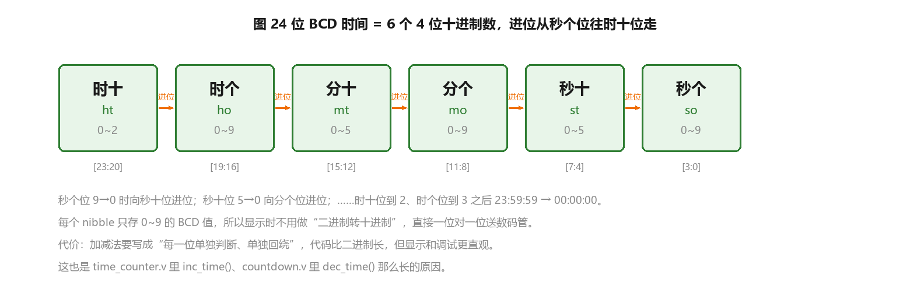
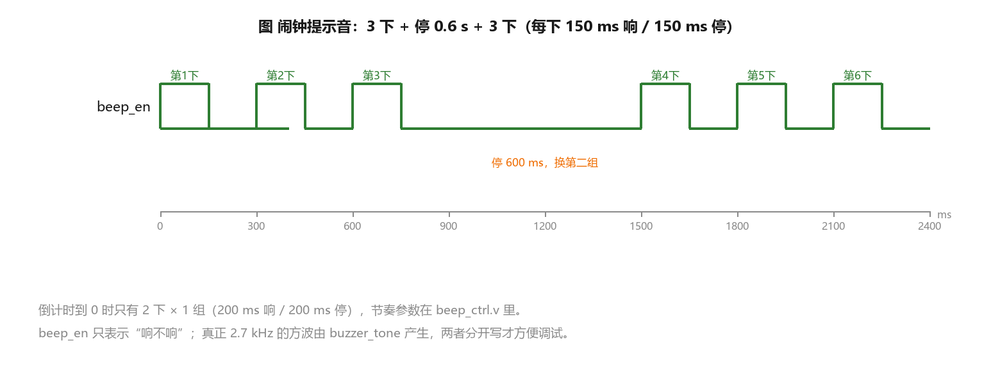
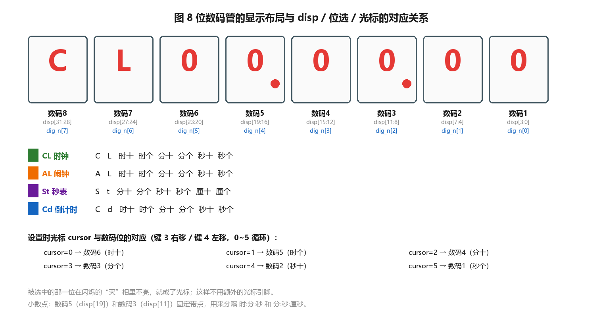
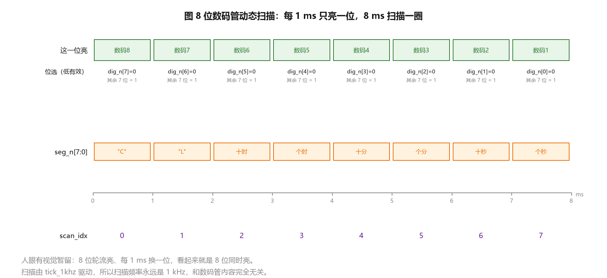
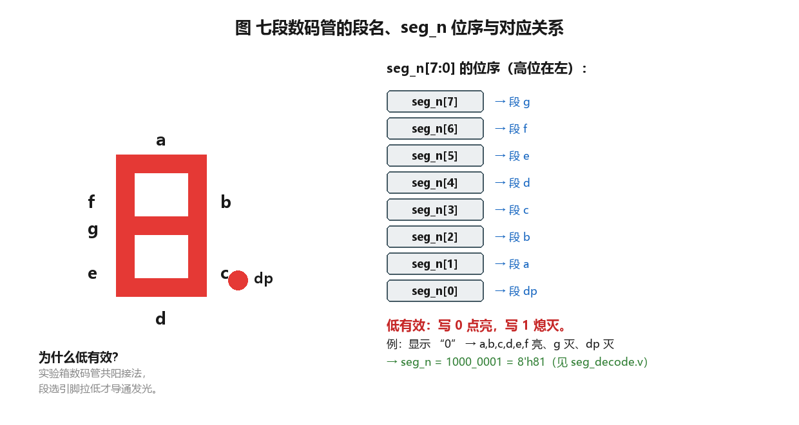

# 06 模块解读（二）：时钟、闹钟、秒表、倒计时、显示、蜂鸣

| 项目 | 内容 |
|---|---|
| 学完你能做什么 | ① 看懂 24 位 BCD 时间是怎么"一位一位进位"的；② 说清"编辑缓冲"为什么必须和正式时钟分开；③ 解释闹钟为什么只响一次、蜂鸣器为什么要用状态机排队；④ 看懂 8 位数码管"扫描"的全过程，能算出某一位显示的是哪个 nibble；⑤ 能对着七段译码表反查任意字符码 |
| 前置知识 | 第 05 章的 `tick_1hz / tick_100hz / tick_1khz / tick_2hz`（单周期使能，见 5.2）和按键动作脉冲（`digit_inc`、`edit_commit` 等只高 1 个时钟，见 5.6）；第 04 章的顶层端口与连线；C 语言的 `if / for / 函数 / 数组`。**不需要**学过 Verilog，本章出现的语法都会现场解释 |
| 对应源文件 | `rtl/time_counter.v`、`rtl/alarm_ctrl.v`、`rtl/stopwatch.v`、`rtl/countdown.v`、`rtl/beep_ctrl.v`、`rtl/buzzer_tone.v`、`rtl/display_ctrl.v`、`rtl/seg_decode.v`。`rtl/bcd_digit_adj.v` 是"改某一位"的公共子模块，本章只引用、不重复讲（见 5.7） |

本章这 8 个模块只做三件事：**把时间存起来**（time_counter / stopwatch / countdown）、**把时间变成声音**（alarm_ctrl / beep_ctrl / buzzer_tone）、**把时间变成光**（display_ctrl / seg_decode）。

## 6.1 四条计时通路一张表

系统里同时存在四条"时间"，各自独立累加：

| 模块 | 计时单位 | 显示格式 | 最大值 | 数据来源 | 后台是否继续跑 |
|---|---|---|---|---|---|
| `time_counter` | 1 s（`tick_1hz`） | HH:MM:SS（数码 6~1） | 23:59:59 | 自己累加；设置时来自编辑缓冲 | **是**，四个模式都在走 |
| `alarm_ctrl` | 1 s（不自己计时） | HH:MM:SS（数码 6~1） | 23:59:59 | 拿 `time_bcd` 和自己存的 `alarm_bcd` 比较 | **是**，比较一直在做，不需要"启动" |
| `stopwatch` | 10 ms（`tick_100hz`） | MM:SS:CC（数码 6~1） | 99:59.99 | 自己累加 | **是**，切到别的模式照跑 |
| `countdown` | 1 s（`tick_1hz`） | HH:MM:SS（数码 6~1） | 23:59:59 | 自己递减，初值来自 `preset_reg` | **是**，切模式照减 |

**四条通路互不干扰**：它们各有独立的寄存器，只共享同一个 50 MHz 时钟和同一组 `tick` 使能。秒表只认 `tick_100hz`，倒计时只认 `tick_1hz`，谁也改不了别人的寄存器。

**显示只挑一条送到数码管**：`display_ctrl` 里有一个 `case (mode)`，按当前模式从四组数据里**选一组**填进 `disp`。其余三组虽然还在后台变，但这一帧根本没被选中，所以看不见——切回去就能看到"它一直在走"。一句话记忆：**四条通路并行跑，一个 8 位数码管轮流看。**

## 6.2 time_counter：正式时钟 + 编辑缓冲

- **解决什么问题**：产生真正的"现在几点"，并给一个可以随便改、确认后才生效的副本。
- **输入哪来 / 输出给谁**：`tick_1hz`（clk_gen）、`mode / edit_load / edit_commit / digit_inc / digit_dec / cursor`（key_ctrl） → `time_bcd` → alarm_ctrl（比较）、display_ctrl（显示）；`edit_bcd` → display_ctrl（设置时显示编辑值）。
- **写错会看到什么现象**：少了 `edit_reg` → 一进设置正在走的钟就被改乱、取消也回不去；`inc_time` 少一层嵌套 → 进位多米诺，`00:00:09` 变 `00:01:10`；24 小时判定写错 → 出现 `24:00:00`。

### 6.2.1 为什么要两个寄存器：time_reg 与 edit_reg

`time_reg`（`reg [23:0] time_reg;`）是**正式时钟**，只要不复位就每秒 +1，永远在走；`edit_reg` 是**编辑缓冲**（edit buffer），只有进入设置后才被装载，用户在它上面加加减减。只用一个寄存器会怎样？假设直接改 `time_reg`：你在 10:30:45 进设置把"分"从 30 调到 31，中途发现调错想按"取消"——原来的 30 已经被覆盖，**回不去了**；而且设置那几十秒里时钟"停着"没走，一确认时间就慢了。

两个寄存器把这件事分开得很干净：

```verilog
            if ((mode == MODE_CL) && edit_commit)
                time_reg <= edit_reg;
            else if (tick_1hz)
                time_reg <= inc_time(time_reg);

            if ((mode == MODE_CL) && edit_load)
                edit_reg <= time_reg;
            else if ((mode == MODE_CL) && digit_inc)
                edit_reg <= edit_inc;
            else if ((mode == MODE_CL) && digit_dec)
                edit_reg <= edit_dec;
```

1. `edit_commit`（确认）时 `time_reg` 直接**装载** `edit_reg`——这是唯一一条"改正式时钟"的路。
2. 否则只要 `tick_1hz` 来了就 +1 秒。注意**设置期间 `tick_1hz` 照样在走**，正式时钟一秒都没落下。
3. `edit_load`（进入设置）把当前正式时间**拷进**缓冲区作为编辑起点；`digit_inc / digit_dec` 只改缓冲区。
4. 第 1~2 条和第 3~4 条是**两组独立的 if/else**，所以"装载正式值"和"缓冲区 ±1"不会打架。四行条件都带 `mode == MODE_CL`：`digit_inc` 是**全局广播**的脉冲（闹钟、倒计时也接同一条线），每个模块自己用 `mode` 筛选"这一下是不是给我的"。

### 6.2.2 完整代码：inc_time()

```verilog
    // 24 位 BCD 时钟加 1 秒，23:59:59 回到 00:00:00
    function [23:0] inc_time;
        input [23:0] t;
        reg [3:0] ht, ho, mt, mo, st, so;
        begin
            {ht, ho, mt, mo, st, so} = t;

            if (so != 4'd9)
                so = so + 1'b1;
            else begin
                so = 4'd0;
                if (st != 4'd5)
                    st = st + 1'b1;
                else begin
                    st = 4'd0;
                    if (mo != 4'd9)
                        mo = mo + 1'b1;
                    else begin
                        mo = 4'd0;
                        if (mt != 4'd5)
                            mt = mt + 1'b1;
                        else begin
                            mt = 4'd0;
                            if ((ht == 4'd2) && (ho >= 4'd3)) begin
                                ht = 4'd0;
                                ho = 4'd0;
                            end
                            else if (ho == 4'd9) begin
                                ho = 4'd0;
                                ht = ht + 1'b1;
                            end
                            else begin
                                ho = ho + 1'b1;
                            end
                        end
                    end
                end
            end

            inc_time = {ht, ho, mt, mo, st, so};
        end
    endfunction
```

第一句 `{ht, ho, mt, mo, st, so} = t;` 把 24 位切成 6 个 4 位，`{}` 是拼接（concatenation），左边是高位。每个 4 位存一个十进制数字（0~9），这就是 BCD（Binary-Coded Decimal，二进制编码的十进制）——好处是显示时**不用做二进制转十进制**，一个 nibble 直接送一位数码管。

**函数（function）**是一段"给输入、算输出"的组合逻辑，不能有时序、不能写 `<=`，只能像 C 函数那样用 `=` 一步步算，所以函数里全是**阻塞赋值**（blocking assignment，`=`）：上一句算完立刻生效，下一句能看见新值，和 C 的顺序执行一致。而 `time_reg <= inc_time(time_reg)` 用的是**非阻塞赋值**（non-blocking，`<=`）：右边先算好，等时钟沿结束才写进寄存器。牢记一句：**函数内部用 `=`，寄存器用 `<=`**。

**为什么必须一层层 else 嵌套？** 假如图省事写成 6 个并列的 `if`（"秒个位到 9 就清零"、"秒十位到 5 就清零"……），问题有两个：一是**进位会多米诺**，`00:00:09 +1` 本该只进到秒十位，可并列条件让更高的位也可能同时被清或加，结果可能是 `00:01:10`；二是**不会停在第一位**，`00:00:08 → 00:00:09` 这种根本不进位的加法也可能误伤高位。嵌套 if/else 保证的语义是"**只有前一张骨牌倒了，才推下一张**"：只有 `so == 9` 才进入"向秒十位进位"的分支，否则 `so + 1` 就走人；进了分支先把 `so` 清 0，再看 `st` 是否也满，最多推 5 层。它也顺手挡住非法值：`09:59:59 + 1` 绝不会变成 `09:60:00`，因为"分个位归零"和"分十位 +1"绑定在同一个分支里。这就是这段代码又长又深的原因——**BCD 的代价就在这里**。若用二进制存"总共过了多少秒"，加 1 只要一句 `cnt <= cnt + 1`，但显示前要做除法取余，那部分更长也更容易错。

**24 小时回绕的判定**是 `(ht == 4'd2) && (ho >= 4'd3)`：能走到这一层说明"分十位满了、秒十位也满了"，也就是整点又要 +1 小时；此时若已是 `2X` 点且个位 ≥ 3（即 23 点），就把小时整个清零回到 `00`。用 `>= 4'd3` 而非 `== 4'd3` 是**防御式写法**：`bcd_digit_adj` 已限制"时十位 = 2 时个位最大 3"，理论上不会出现 24、25 点，但万一某条路径漏了检查，`24:xx:xx` 也会自己收回 `00:00:00`，而不是卡在非法状态里。这里只清小时——分和秒在上面的层级已经清过了，所以最终结果是完整的 `00:00:00`。

### 6.2.3 四个进位实例

| 进位前 | 走到哪一层 | 进位后 | 说明 |
|---|---|---|---|
| `00:00:59` | 第 1 层（`so == 9`）→ 第 2 层（`st` 0→1） | `00:01:00` | 只动秒，不进分 |
| `00:59:59` | 第 3 层（`mo == 9`）→ 第 4 层（`mt` 0→1） | `01:00:00` | 秒、分全清，时 +1 |
| `09:59:59` | 第 4 层（`mt == 5`）→ 第 5 层（`ho == 9`） | `10:00:00` | 时个位 9→0 **且**时十位 +1 |
| `23:59:59` | 第 5 层特殊分支（`ht == 2 && ho >= 3`） | `00:00:00` | 不是 `24:00:00`，直接回零 |

### 6.2.4 看图：进位链



看图要点：

- 6 个方块就是 6 个 nibble，方块下方的 `[23:20] … [3:0]` 是它们在 `time_bcd` 里的位段，从右往左权重递增。
- 橙色箭头**只有单向**：低位满了才向高位进 1。这就是 `inc_time()` 那 5 层嵌套的图形版；`dec_time()` 里箭头反着走，就是"借位"。
- 每块标的取值范围（`0~2`、`0~9`、`0~5`）就是代码里每个 `if` 的比较常数：秒十位、分十位只到 5，时十位只到 2；最左两块的 `2` 和 `3` 正是 `(ht == 4'd2) && (ho >= 4'd3)` 的来源。

## 6.3 alarm_ctrl：比较 + 单次触发

- **解决什么问题**：存一个"闹钟时间"，当正式时间等于它时产生**一个**脉冲。
- **输入哪来 / 输出给谁**：`time_bcd`（time_counter）、`mode / edit_* / digit_* / cursor`、`alarm_en_toggle`（key_ctrl，AL 模式下键 1） → `alarm_trigger` → beep_ctrl；`alarm_bcd / alarm_edit_bcd` → display_ctrl；`alarm_en` → display_ctrl（LED2）。
- **写错会看到什么现象**：没有 `match_d` → 蜂鸣器疯响一整秒；只比较低 16 位 → 一天响 60 次；`en_reg` 写成置位 → 闹钟关不掉。

### 6.3.1 24 位整体比较

```verilog
    assign match = en_reg && (time_bcd == alarm_reg);
```

`==` 作用在两个 24 位向量上，表示**每一位都相等**。拆成"时相等 && 分相等 && 秒相等"结果一样，但整体比较只写一句、**不会漏掉某一位**（漏掉秒个位就是"一天响 60 次"），以后要加"星期"只需把两个向量一起加宽。`en_reg` 与在比较里，意味着**关掉闹钟时 `match` 恒为 0**，后面所有逻辑自然都不动——比"触发之后再判断开关"更安全，不会留下半截状态。

### 6.3.2 为什么要 match_d：上升沿检测

```verilog
            // 相等时只产生一个脉冲；时间离开相等状态后 match_d 清零
            alarm_trigger <= match & ~match_d;
            match_d       <= match;
```

问题在于 `match` 不是瞬时信号，而是**持续一秒**的电平：时间走到 `07:00:00` 的那一整秒里（1 秒 = 5000 万个时钟），`match` 一直是 1。如果直接写 `alarm_trigger <= match;`，这一秒里 `alarm_trigger` 也一直是 1，beep_ctrl 每个时钟都会把序列重置回第一下，你听到的不是"3 下"而是"响到这一秒结束"。

加一个延迟一拍的副本 `match_d`，就有了一对"上一拍 / 这一拍"：只有 `match` 由 0 变 1 的那一拍 `match & ~match_d` 才等于 1；`0→0`、`1→1`、`1→0` 三种情况都是 0。这就是"上升沿检测"（rising-edge detection）：**只在 0→1 的那一拍输出 1**。时间离开相等状态后 `match_d` 自动回 0，为明天同一时刻重新准备好。`alarm_trigger` 因此只有 **1 个时钟周期（20 ns）宽**；beep_ctrl 抓到 20 ns 就够启动整个序列了——**动作脉冲只需一拍，序列由状态机自己维持**。

### 6.3.3 闹钟自己的编辑缓冲与开关

```verilog
            if (alarm_en_toggle)
                en_reg <= ~en_reg;

            if ((mode == MODE_AL) && edit_commit)
                alarm_reg <= edit_reg;
            else if ((mode == MODE_AL) && edit_load)
                edit_reg <= alarm_reg;
            else if ((mode == MODE_AL) && digit_inc)
                edit_reg <= edit_inc;
            else if ((mode == MODE_AL) && digit_dec)
                edit_reg <= edit_dec;
```

和 `time_counter` 完全同构：正式值 `alarm_reg` + 缓冲 `edit_reg`，只是装载和提交的先后调换了，两件事互斥所以结果一样。`alarm_en_toggle` 用的是**翻转**（toggle，`en_reg <= ~en_reg`）而不是置位——键 1 只有一个动作"切换"，如果写成 `en_reg <= 1'b1`，按一下打开、再按还是打开，**永远关不掉**；翻转让同一个键既能开也能关，代价是无法从外部指定"必须是开"，所以复位时 `en_reg <= 1'b0`（默认关）。

### 6.3.4 一个具体例子

设闹钟 = `00:00:03`、`alarm_en = 1`、当前 `00:00:02`：

| 时刻 | `time_bcd` | `match` | `match_d` | `alarm_trigger` | 说明 |
|---|---|---|---|---|---|
| T0 | `00:00:02` | 0 | 0 | 0 | 还没到 |
| T1（`tick_1hz` 那一拍） | 还是 `00:00:02` | 0 | 0 | 0 | `match` 用的是**旧值** |
| T2 | `00:00:03` | 1 | 0 | **1**（一拍） | 到点，触发一次 |
| T3 | `00:00:03` | 1 | 1 | 0 | 还在这一秒，不再触发 |
| T4（下一秒） | `00:00:04` | 0 | 1 | 0 | 时间走过去了 |

两个推论：① `time_bcd` 变了以后 `match` 要**下一拍**才更新（它由 `time_reg` 驱动），触发比时间跳变晚 20 ns，肉眼看不出来；② 如果你把闹钟设成"正好等于现在的时间"，`match` 会 0→1，于是**立刻响一次**——这不是 bug，是"到点"的定义导致的（之后 `match_d` 变 1，不再重复触发，直到时间离开这一秒）。

## 6.4 stopwatch：10 ms 分辨率秒表

- **解决什么问题**：一个独立的正计时器，精确到 0.01 秒，可启停、可清零。
- **输入哪来 / 输出给谁**：`tick_100hz`、`start_pause / clear`（key_ctrl，St 模式下键 1 / 键 2） → `min_bcd / sec_bcd / cs_bcd` → display_ctrl；`running` → display_ctrl（LED3）。
- **写错会看到什么现象**：用 `tick_1hz` 当节拍 → 小数位永远 00；厘秒十位写成 `!= 4'd5` → 每秒只有 50 个厘秒；忘了自动停止 → 到 99:59.99 后从 00:00.00 重新转圈。

### 6.4.1 为什么是 tick_100hz

1 秒 = 100 个 10 ms，所以**每来一个 `tick_100hz` 就是过了 1 个厘秒**（centisecond，显示里的 `CC`），`CC` 取 00~99 正好表示 0.00~0.99 秒。最大好处是**不需要再算除法**：`CC` 的十位和个位各是一个 4 位 BCD 数，直接送数码管。若内部存"总共过了多少个 10 ms"，显示前就得除以 100 再除以 10 取余，综合出来的除法器又大又慢。

### 6.4.2 BCD 进位链（关键嵌套分支）

```verilog
        else if (tick_100hz && run_reg) begin
            if ((min_reg == 8'h99) && (sec_reg == 8'h59) && (cs_reg == 8'h99)) begin
                run_reg <= 1'b0;       // 到最大值停止
            end
            else begin
                // 厘秒个位
                if (cs_reg[3:0] != 4'd9) begin
                    cs_reg[3:0] <= cs_reg[3:0] + 1'b1;
                end
                else begin
                    cs_reg[3:0] <= 4'd0;
                    // 厘秒十位
                    if (cs_reg[7:4] != 4'd9) begin
                        cs_reg[7:4] <= cs_reg[7:4] + 1'b1;
                    end
```

（"厘秒十位回 0 之后继续向秒进位"以及后面的"秒个位 → 秒十位 → 分个位 → 分十位"写法完全相同，为省篇幅省略，见 `stopwatch.v` 第 47~89 行。）和 `inc_time()` 同一个套路，但有三处不同：① **用非阻塞赋值、不写成函数**，每级都要 `begin/end`，代码更长，但能顺带在分支里改 `run_reg`（函数做不到）；② **不用切 nibble**，`min_reg` 等直接声明 8 位，用 `[3:0]` / `[7:4]` 取个位十位；③ **分十位的上限是 9 不是 5**，秒表最大 `99:59.99`、分钟可以到 99，而时钟的分只到 59——这是两条通路唯一的范围差异，写错就会看到"秒表最多只能走 59 分钟"。

### 6.4.3 优先级：clear > start_pause > tick

```verilog
        else if (start_pause) begin
            if (run_reg)
                run_reg <= 1'b0;
            else if (!((min_reg == 8'h99) && (sec_reg == 8'h59) && (cs_reg == 8'h99)))
                run_reg <= 1'b1;
        end
        else if (tick_100hz && run_reg) begin
```

（`clear` 分支排在最前，内部就是三个清零加 `run_reg <= 1'b0`，省略。）一段 `if / else if` 链就是硬件里的**优先级**：前面的条件成立，后面的整段都不执行。`!rst_n` 最高，复位一切归零；`clear` 第二，清零**同时停止**（`run_reg <= 0`），所以清完是"00:00.00 停着"而不是"从零开始跑"；`start_pause` 第三，运行中就停、停止中就启动，**启动前多一个判断**——已经在 `99:59.99` 就不许启动，否则一启动就到最大值又立刻停，看起来像"按了没反应"；`tick_100hz && run_reg` 最后，条件里带 `run_reg`，所以暂停时来了 tick 也不动——**暂停的实现方式不是关时钟，而是让使能失效**。

### 6.4.4 到 99:59.99 自动停止与后台运行

两处都在管最大值：启动时那行 `else if (!((min==99) && (sec==59) && (cs==99)))` 才允许启动；计时时 `if (max) run_reg <= 1'b0;` 是真正起作用的。走到最大值那一拍不再累加，`cs_reg` 停在 `99`，屏幕定在 `99:59.99` 直到你清零或复位。**它是"停"而不是"回零重来"**——漏了这个分支，下一拍所有位会一起归零，秒表就变成无限循环的跑马灯。

秒表模块的输入里**没有 `mode`**，也没有 `setting`，状态只由 `tick_100hz / start_pause / clear` 决定。所以你切到 CL 看时间、切到 AL 调闹钟，它照样每秒加 100 次，切回来看到的是一个**一直在跑**的秒表。这就是"后台计时"最省事的实现：**模块根本不知道有模式这回事**，模式只影响"谁被显示"。

## 6.5 countdown：倒计时

- **解决什么问题**：从设定值往下减到 0，到 0 时给一个脉冲，可启停、可恢复设定值。
- **输入哪来 / 输出给谁**：`tick_1hz`、`mode / edit_* / digit_* / cursor`、`start_pause / reset`（key_ctrl，Cd 模式下键 1 / 键 2） → `remain_bcd / edit_bcd` → display_ctrl；`expire_pulse` → beep_ctrl；`running / paused / expired` → display_ctrl（标签闪烁与 LED4）。
- **写错会看到什么现象**：少了 `expired_reg` → 到 0 后按启动还会继续减、减成 `99:59:59`；`expire_pulse` 不设默认 0 → 到期后一直响；剩 0 时不拦启动 → 从 0 借位成 23:59:59 开始倒数。

### 6.5.1 三个寄存器

| 寄存器 | 是什么 | 什么时候变 |
|---|---|---|
| `preset_reg` | **设定值**，用户"打算倒多久" | 只在 `edit_commit` 时变 |
| `remain_reg` | **剩余值**，屏幕上看着减少的那个 | 每次 `tick_1hz` 减 1；`reset` 时被 `preset_reg` 覆盖 |
| `edit_reg` | **编辑缓冲**，设置时随便改，不影响别人 | `edit_load` 从 `preset_reg` 装载；`digit_inc/dec` 改它 |

为什么必须三个？到 0 之后按"复位"要回到起点，所以必须有 `preset_reg` 记住起点；正在倒数时剩余值每秒在变，所以 `remain_reg` 一直在动；设置时改的既不能是剩余值（会把跑到一半的倒计时搞乱），也不能直接是设定值（没确认就生效、取消不了），所以必须有 `edit_reg`。

**一个容易看错的地方**：`edit_load` 装载的是 `preset_reg`（**设定值**）而不是 `remain_reg`（剩余值）。所以倒计时跑到一半进设置，看到的是"当初设的 5 分钟"，不是"还剩 2 分 13 秒"。这跟时钟不一样（时钟装载正在走的当前时间），是有意的：**倒计时设置的是"要倒多久"，不是"现在剩多久"**。复位初值 `24'h000500`（默认 5 分钟）也说明这一点：上电就能按启动，不用先设置。

### 6.5.2 优先级链（严格按代码顺序）

```verilog
            if ((mode == MODE_CD) && edit_commit) begin
            else if ((mode == MODE_CD) && edit_load) begin
            else if ((mode == MODE_CD) && digit_inc)
            else if ((mode == MODE_CD) && digit_dec)
            else if (reset) begin
            else if (start_pause) begin
            else if (tick_1hz && run_reg) begin
```

（只保留判断行，各分支里的语句省略。）排在越前面越优先：`edit_commit` 同时改 `preset_reg`、`remain_reg` 并清掉所有状态标志，动静最大所以最先；`edit_load` 装载缓冲；`digit_inc` / `digit_dec` 只改缓冲；`reset` 回到设定值并停下；`start_pause` 启停；`tick_1hz && run_reg` 最低，前面都没事发生才走一秒。

前四条都带 `mode == MODE_CD`，后三条**不带**。这是有意的：`reset / start_pause` 由 key_ctrl 在 Cd 模式发出，但即使别的模式误发，倒计时也允许它们生效——它是"后台在跑"的东西，用户在任何模式下按"停"都该停得住；而编辑类动作必须严格限定模式，否则在 CL 模式调时钟会把倒计时也改掉。

### 6.5.3 两处关键代码

**"剩余为 0 时启动无效"**：

```verilog
            else if (start_pause) begin
                if (run_reg) begin
                    run_reg    <= 1'b0;
                    paused_reg <= 1'b1;
                end
                else if ((!expired_reg) && (remain_reg != 24'h000000)) begin
                    run_reg    <= 1'b1;
                    paused_reg <= 1'b0;
                end
            end
```

两个条件缺一不可：`!expired_reg` 拦住"已经到期过，不许再启动"（否则会在 0 和 23:59:59 之间来回借位）；`remain_reg != 0` 拦住"设定值就是 0"那种"0 且没到期"的状态。如果只留 `!expired_reg`，把设定值改成 0 之后按启动会让 `dec_time(0)` 借位成 `23:59:59`——按下"开始"屏幕跳到 23 小时，很典型的"少一个条件"故障。

**"只有 1→0 才产生 expire_pulse"**：

```verilog
            expire_pulse <= 1'b0;
            ...
            else if (tick_1hz && run_reg) begin
                if (remain_reg == 24'h000001) begin
                    remain_reg   <= 24'h000000;
                    run_reg      <= 1'b0;
                    paused_reg   <= 1'b0;
                    expired_reg  <= 1'b1;
                    expire_pulse <= 1'b1;
                end
```

两句话配合：每个时钟先把 `expire_pulse` 清 0（相当于给脉冲定死 20 ns 宽度）；只有"剩余正好 == 1"的那一拍才置 1。所以脉冲**一定只有一拍宽**，而且**整个过程只出现一次**。如果写成 `expire_pulse <= (remain_reg == 0)` 那就是电平不是脉冲——beep_ctrl 会以为"一直到期"，蜂鸣器停不下来。

### 6.5.4 dec_time() 与 inc_time() 的对称

`dec_time()` 的结构和 `inc_time()` 逐层对应，只是每层判断从"到没到上限"变成"是不是 0"、置的值从 `0` 变成该位的上界（`so` 处就是 `if (so != 4'd0) so = so - 1'b1; else begin so = 4'd9; ...`）。尾部处理"借位到底"：

```verilog
                            if (ho != 4'd0)
                                ho = ho - 1'b1;
                            else begin
                                ho = 4'd9;
                                if (ht != 4'd0)
                                    ht = ht - 1'b1;
                                else begin
                                    ht = 4'd2;
                                    ho = 4'd3;
                                end
                            end
```

对照起来：`inc_time()` 每层判断"到没到上限"、进位时置 `0` 并向上一层，时 23 再进位就回 `00:00:00`；`dec_time()` 每层判断"是不是 0"、借位时置该位上界（`9` 或 `5`），时 00 再借位就到 `23:59:59`；两者触发条件也只差一个 `run_reg`。

最后那个 `ht = 4'd2; ho = 4'd3;` 就是"从 00:00:00 借位 → 23:59:59"。**正常走不到**，因为函数注释写着"调用前已保证当前值 > 0"（外层用 `remain_reg == 24'h000001` 单独处理了最后一秒）。留着它一让函数对任何输入都有意义，二万一以后改了外层判断也不会算出 `99:xx:xx` 这种非法值。

### 6.5.5 状态表

三个标志 `run_reg / paused_reg / expired_reg` 分出四个状态：idle = `000`，running = `100`，paused = `010`，expired = `001`（按 run / paused / expired 顺序）。

| 当前状态 | 条件 | 下一状态 | 同时发生 |
|---|---|---|---|
| idle | `start_pause` 且 `!expired` 且 `remain != 0` | running | "Cd"标签开始闪 |
| running | `start_pause` | paused | 剩余值停住不动 |
| paused | `start_pause` 且 `remain != 0` | running | 继续递减 |
| running | `tick_1hz` 且 `remain == 1` | expired | `remain` 清 0、`expire_pulse` 一拍 |
| 任意 | `edit_commit` | idle | `preset` 与 `remain` 同时 = `edit_reg`，三标志清 0 |
| paused / idle | `reset` | idle | `remain = preset` |

`paused` 和 `expired` **互斥**：`edit_commit`、`reset` 都会把三个标志一起清掉，不存在"既暂停又到期"的中间态。少清一个，就会出现"到 0 后按复位，屏幕回到 5 分钟但标签还在闪"这种怪现象。

## 6.6 beep_ctrl：把一次触发变成"响几下"

- **解决什么问题**：把"一个 20 ns 的脉冲"翻译成"响 3 下、停一下、再响 3 下"这种有节奏的序列。
- **输入哪来 / 输出给谁**：`alarm_trigger`（alarm_ctrl）、`cd_expire`（countdown 的 `expire_pulse`）、`silence`（key_ctrl，任意键）、`tick_1khz` → `beep_en`（"响/不响"）→ buzzer_tone。
- **写错会看到什么现象**：没有 `ST_GAP` → 连响 6 下没间隔；`timer` 判断差一 → 少响或长响；`silence` 不排最前 → 按任意键停不下来。

### 6.6.1 四个状态与计时器

```verilog
    localparam [1:0] ST_IDLE = 2'd0;
    localparam [1:0] ST_ON   = 2'd1;
    localparam [1:0] ST_OFF  = 2'd2;
    localparam [1:0] ST_GAP  = 2'd3;

    localparam integer ALARM_ON_MS  = 150;
    localparam integer ALARM_OFF_MS = 150;
    localparam integer ALARM_GAP_MS = 600;
    localparam integer CD_ON_MS     = 200;
    localparam integer CD_OFF_MS    = 200;
```

| 状态 | 输出 | 在干什么 | 停留多久 |
|---|---|---|---|
| `ST_IDLE` | `beep_en = 0` | 等触发 | 直到 `alarm_trigger` / `cd_expire` |
| `ST_ON` | `beep_en = 1` | 正在响这一下 | 闹钟 150 ms / 倒计时 200 ms |
| `ST_OFF` | `beep_en = 0` | 两下之间的静音，**同时决定下一走去哪** | 闹钟 150 ms / 倒计时 200 ms |
| `ST_GAP` | `beep_en = 0` | 两组之间的长停 | 600 ms |

计时靠 `reg [15:0] timer;`。`tick_1khz` 每 1 ms 来一次，所以 `timer` 的值就等于"已经过了多少毫秒"。判断统一写 `timer == (N - 1)`：从 0 数到 N−1 正好 N 个数，也就是 N 毫秒。写成 `timer == N` 就变成 N+1 毫秒——150 ms 变 151 ms 听不出来，但**两个状态都长 1 ms**，总时长就慢慢偏移，这类"差一"是状态机最常见的坑。

### 6.6.2 beep_cnt：0~5 与"3 下 × 2 组"

```verilog
                ST_OFF: begin
                    if (timer == ((is_alarm ? ALARM_OFF_MS : CD_OFF_MS) - 1)) begin
                        timer <= 16'd0;

                        if (is_alarm) begin
                            if (beep_cnt == 3'd2) begin
                                state <= ST_GAP;       // 第一组 3 下结束
                            end
                            else if (beep_cnt == 3'd5) begin
                                state <= ST_IDLE;      // 第二组 3 下结束
                            end
                            else begin
                                beep_cnt <= beep_cnt + 1'b1;
                                state    <= ST_ON;
                            end
                        end
```

`beep_cnt` 记的是"**已经响完第几下**"（从 0 数）：

| `beep_cnt` | 刚响完 | `ST_OFF` 结束时去哪 |
|---|---|---|
| 0 / 1 | 第 1、2 下 | → `ST_ON`，`beep_cnt + 1` |
| 2 | 第 3 下（第一组结束） | → `ST_GAP` |
| 3 / 4 | 第 4、5 下 | → `ST_ON`，`beep_cnt + 1` |
| 5 | 第 6 下（第二组结束） | → `ST_IDLE` |

`ST_GAP` 里那句 `beep_cnt <= 3'd3;` 是关键：**长停结束后不是从头数，而是接着数第 4 下**。这样"3 下 + 停 + 3 下"共用一条计数器、一套判断，不必为第二组再写一遍逻辑。倒计时只有一组 2 下，所以那里的判断是 `if (beep_cnt == 3'd1) state <= ST_IDLE;`，`beep_cnt` 走 0 → 1 就结束，**没有 GAP 状态**。

### 6.6.3 优先级：silence > alarm_trigger > cd_expire > tick

```verilog
        else if (silence) begin
            ...
        else if (alarm_trigger) begin
            // 闹钟优先；如果正在响倒计时，也立即切换到闹钟
            state    <= ST_ON;
            is_alarm <= 1'b1;
            beep_cnt <= 3'd0;
            timer    <= 16'd0;
        end
        else if (cd_expire && (state == ST_IDLE)) begin
```

从上到下：`!rst_n` 全部清零；`silence` **立刻**回 `ST_IDLE`、`beep_en` 归 0 → 静音；`alarm_trigger` 启动闹钟，正在响倒计时也**直接抢过来**（`is_alarm` 改 1、计数器归零）；`cd_expire && state == ST_IDLE` 只在空闲时才理倒计时；最后才是 `tick_1khz` 正常推进状态机。

两处不对称值得注意：闹钟触发**无条件**抢占，倒计时到期**只在 `ST_IDLE`** 才响应。所以倒计时到期时若闹钟正在响，倒计时的提示被吞掉，不会两个序列叠成"乱响"。`silence` 排最前，任何时候按键都能停——这正是 key_ctrl 里 `beep_silence <= (|key_press) | (|core_press);` 的用途：**任意键都静音**。

### 6.6.4 看图：闹钟的节奏



看图要点：

- 方波高度只表示 `beep_en` 是 1 还是 0，**跟响度、音调无关**；真正的 2.7 kHz 波形在下一节 `buzzer_tone` 里产生。
- 每一下 = 150 ms 响（`ST_ON`）+ 150 ms 停（`ST_OFF`），3 下正好 900 ms（第 3 下在 750 ms 结束）。
- 第 4 下从 1500 ms 开始，而第 3 下在 750 ms 结束，中间空 **750 ms** = 150 ms（第 3 下后面那段 `ST_OFF`）+ 600 ms（`ST_GAP`）。所以"停 0.6 s"指的是 `ST_GAP` 本身，两下之间实际空 750 ms；第 6 下在 2250 ms 结束，还要再走 150 ms 的 `ST_OFF` 才回 `ST_IDLE`（图上 2400 ms 落平）。倒计时那一路把 150/150 换成 200/200，只有 2 下、没有 `ST_GAP`，总长 800 ms。

## 6.7 buzzer_tone：2.7 kHz 方波

- **解决什么问题**：在 `beep_en = 1` 期间产生 2.7 kHz、占空比 50% 的方波，驱动无源蜂鸣器。
- **输入哪来 / 输出给谁**：`beep_en`（beep_ctrl） → `buzzer` → 顶层引脚 → PNP 三极管 → 蜂鸣器。
- **写错会看到什么现象**：分频数算错 → 音调偏高/偏低；忘了取反 → 不该响时常响；`beep_en=0` 时不清 `cnt` → 每一下起头有"咔"声。

### 6.7.1 翻转计数 9259 是怎么来的

```verilog
    // 50 MHz / (2 * 2700) ≈ 9259
    localparam integer TONE_DIV = (SIM_FAST != 0) ? 4 : 9259;
```

要得到 2700 Hz 方波，就得让输出每隔**半个周期**翻转一次：一个完整周期 = 1/2700 s ≈ 370.37 µs，半个周期 = 185.19 µs，除以 20 ns 得 9259.26，取 9259。

写成公式就是 `50_000_000 / (2 × 2700) = 9259.26`，取整 9259，误差 0.003%，实际 2700.0 Hz，听不出来。位宽也要够：`reg [13:0] cnt;` 要能数到 `TONE_DIV - 1 = 9258`，而 `2^13 = 8192 < 9259`、`2^14 = 16384`，所以用 **14 位**。少一位，计数器会数不到 9258 就回绕，翻转周期变成 8192 而不是 9259，音调偏高约 13%。`SIM_FAST` 是给仿真用的：真实分频要跑 9259 个时钟才看到一个翻转，太慢，设成 4 就快得多；综合时 `SIM_FAST = 0`，三目运算被折叠成常数 9259，不消耗逻辑。

### 6.7.2 为什么低有效

```verilog
    // 低有效：beep_en=1 且 tone=1 时输出低，蜂鸣器响
    assign buzzer = ~(beep_en & tone);
```

实验箱的蜂鸣器是**无源**的（内部没有振荡电路，你给什么频率它就按什么频率振动），经一个 **PNP** 三极管驱动。PNP 的规矩是**基极低电平导通**：FPGA 输出 0 时三极管导通、蜂鸣器发声，输出 1 时截止、不响。所以真值表只有一种"响"：`beep_en = 1` 且 `tone = 1` 时 `buzzer = 0`；其余三种（`00`、`01`、`10`）`buzzer` 都是 1，不响。

**为什么必须取反，不能把 `tone` 直接接出去？** 那样 `beep_en = 0` 期间 `tone` 停在某个值，若恰好是 0，蜂鸣器就一直响——而且它只在 `tone` 落到 0 时出现，表现为"有时候响有时候不响"，特别难查。`~(beep_en & tone)` 把"使能"和"波形"绑在一起，`beep_en = 0` 时**无论 `tone` 是什么都输出 1**，从结构上杜绝了这个问题。

### 6.7.3 为什么 beep_en=0 时要清零

```verilog
        else if (!beep_en) begin
            cnt  <= 14'd0;
            tone <= 1'b0;
        end
```

两个理由：① **保证每一响都从完整波形的起点开始**。不清零的话 `cnt` 停在 0~9258 之间的任意值，下次 `beep_en` 变 1 时先输出"半个周期剩下的部分"，起音不干净，听起来像"咔"一声再进正常音；清零后每次都从 `cnt = 0`、`tone = 0` 开始，波形完全一致。② **让静音状态确定**：`tone` 清 0，配合上一节的 `~(beep_en & tone)` 输出恒为 1（不响），不会因残留值意外发声。这属于"**让状态可复现**"的写法：同一个输入序列每次运行结果完全一样；反过来，`cnt` 不清零时仿真里两次响的波形都不一样，你连对比波形都做不了。

## 6.8 display_ctrl：8 位扫描 + 模式标识

- **解决什么问题**：只用 8 根段选 + 8 根位选轮流点亮 8 个数码管，同时决定"显示哪条通路的数据、哪一位在闪、哪个是光标"。
- **输入哪来 / 输出给谁**：四组数据（`time_bcd/edit_bcd`、`alarm_bcd/alarm_edit_bcd`、`sw_*`、`cd_remain_bcd/cd_edit_bcd`）、`mode / setting / cursor`、`tick_1khz / tick_2hz` → `seg_n` / `dig_n` → 数码管；`led_n` → 4 个 LED。
- **写错会看到什么现象**：位选写成高有效 → 全灭或全亮；`seg_n` 与 `dig_n` 不同拍更新 → 出现"鬼影"；`3'd5 - cursor` 写成 `cursor` → 光标跑到反方向。

### 6.8.1 disp：32 位 = 8 个 nibble

`disp` 的声明是 `reg [31:0] disp;`（注释：8 个 nibble，`disp[3:0]` 是最右边的数码 1）。它不是一个数，而是**8 个数码管要显示的内容排成一排**，每个 nibble 交给 `seg_decode` 译成七段码。

| `disp` 位段 | 数码位（面板从左到右 8→1） | `dig_n` 编号 | `scan_idx` | CL 模式下是什么 |
|---|---|---|---|---|
| `disp[31:28]` | 数码 8 | `dig_n[7]` | 7 | `C`（模式标识） |
| `disp[27:24]` | 数码 7 | `dig_n[6]` | 6 | `L`（模式标识） |
| `disp[23:20]` | 数码 6 | `dig_n[5]` | 5 | 时十位 |
| `disp[19:16]` | 数码 5 | `dig_n[4]` | 4 | 时个位（带小数点） |
| `disp[15:12]` | 数码 4 | `dig_n[3]` | 3 | 分十位 |
| `disp[11:8]` | 数码 3 | `dig_n[2]` | 2 | 分个位（带小数点） |
| `disp[7:4]` | 数码 2 | `dig_n[1]` | 1 | 秒十位 |
| `disp[3:0]` | 数码 1 | `dig_n[0]` | 0 | 秒个位 |

请反复确认这两条，它们是全章最容易记反的地方：**`dig_n[0]` 对应数码 1（最右）**，`dig_n[7]` 对应数码 8（最左），位选编号和面板编号是**反的**；同理 `disp[3:0]` 是最右边的数码 1，**不是**最左。`disp` 和 `dig_n` 用同一套编号，写代码时才不用来回换算。

### 6.8.2 `+:` 位选怎么写

```verilog
    assign cur_digit = disp[(scan_idx * 4) +: 4];
```

这是 Verilog-2001 的**变量部分选择**（indexed part-select），读法是：**从 `disp` 的第 `scan_idx * 4` 位开始，向上取 4 位**。于是 `scan_idx = 0` 取 `disp[3:0]`（数码 1）、`= 1` 取 `disp[7:4]`（数码 2）、`= 4` 取 `disp[19:16]`（数码 5）、`= 7` 取 `disp[31:28]`（数码 8）。

**为什么不能写 `disp[(scan_idx*4)+3 : scan_idx*4]`？** Verilog 规定 `[msb:lsb]` 两端必须是常数，只有 `+:` 和 `-:` 允许一端是变量——因为"位宽"（这里固定 4 位）必须在编译时确定，综合器才知道要拉几根线。`+:` 等于告诉它："宽度 4，起点算出来的。"起点比终点小用 `+:`，起点比终点大用 `-:`；用反了会取到相邻 nibble 的一半，显示出来是乱码。

### 6.8.3 扫描：每 1 ms 换一位

```verilog
            if (tick_1khz) begin
                seg_n    <= seg_cur;
                dig_n    <= ~(8'b00000001 << scan_idx);
                scan_idx <= scan_idx + 1'b1;
            end
```

三件事**在同一个时钟沿**完成：把这一位的段码送出（`seg_n <= seg_cur;`）、把这一件的位选拉低（其余 7 位为 1 灭）、换下一位。**关键点：这三句用的都是"旧的" `scan_idx`**（`<=` 要等这一拍结束才生效），所以这一拍送出去的段码和位选**对应同一位**，绝不会"位选换到第 6 位、段码还是第 5 位的"——那样的现象叫**鬼影**（ghosting）：前一位的残影留在新一位上。这也是为什么 `seg_cur` 是组合逻辑（由 `cur_digit` 经 `seg_decode` 算出）而 `seg_n` 是寄存器：**用寄存器把段码和位选锁在同一拍**。

`scan_idx` 是 3 位，`0→7` 后自动回 `0`（`3'b111 + 1 = 3'b000`），所以一圈 8 个。每 1 ms 换一位，**8 ms 转一圈**，刷新率 125 Hz，远高于人眼闪烁感知（约 60 Hz），看起来就是 8 位同时亮。位选表达式拆开看：`8'b00000001 << scan_idx` 只有第 `scan_idx` 位是 1，取反后只有它是 0、其余为 1；例如 `scan_idx = 2` → `8'b11111011` → `dig_n[2] = 0` → 点亮数码 3。

小数点位置由 `assign cur_dp = (scan_idx == 3'd4) || (scan_idx == 3'd2);` 决定，是**固定**的两位、不随模式变化：`scan_idx == 4` → 数码 5 → `HH:MM` 之间；`scan_idx == 2` → 数码 3 → `MM:SS` 之间。在 St 模式下它们正好落在 `MM` 和 `SS` 的右端，于是 `MM.SS.CC` 的分隔也成立。一个 `cur_dp` 同时服务四种模式，省掉了"按模式切换小数点位置"的一堆判断。

### 6.8.4 模式标识字符

```verilog
    // 字符码：A=A，B=C，C=d，D=L，E=S，F=t
    localparam [3:0] CHAR_A = 4'hA;
    localparam [3:0] CHAR_C = 4'hB;
    localparam [3:0] CHAR_d = 4'hC;
    localparam [3:0] CHAR_L = 4'hD;
    localparam [3:0] CHAR_S = 4'hE;
    localparam [3:0] CHAR_t = 4'hF;
```

命名是"**常量名 = 你想显示的字符**"，但它的**值不是 ASCII**，而是 `seg_decode` 认识的 4 位编码：

| 常量 | 值 | 显示的样子 | 用在哪 |
|---|---|---|---|
| `CHAR_A` | `4'hA` | `A` | AL 模式第 8 位 |
| `CHAR_C` | `4'hB` | `C` | CL / Cd 模式第 8 位 |
| `CHAR_d` | `4'hC` | `d` | Cd 模式第 7 位 |
| `CHAR_L` | `4'hD` | `L` | CL / AL 模式第 7 位 |
| `CHAR_S` | `4'hE` | `S` | St 模式第 8 位 |
| `CHAR_t` | `4'hF` | `t` | St 模式第 7 位 |

为什么值这么排？`0~9` 已占了 `4'h0~4'h9`，剩下的 `4'hA~4'hF` 正好六个空位，一个字符一个。于是四种模式的标识就是 `CL` / `AL` / `St` / `Cd`，只有最左两位（数码 8、7）不同，后 6 位都是数字——所以 `disp` 的赋值代码里，模式只影响 `disp[31:24]`。`A`/`C`/`L` 用大写、`d`/`t` 用小写，因为"小写 d"和"小写 t"的段数更少、更好认（详见 6.9）。

### 6.8.5 闪烁、光标与消隐

`tick_2hz` 每 250 ms 来一次，`blink2 <= ~blink2;` 每次翻转 → 亮 250 ms、灭 250 ms → **2 Hz 快闪**；另有 `blink_slow`，由 `tick_2hz` 再二分频得到 **1 Hz 慢闪**。设置中用快闪（"我正在改"），Cd 运行/暂停/到期用慢闪（只是状态提示）。`label_blink` 是**组合逻辑**（`always @(*)`），表示"模式标识这两位要不要闪"：

```verilog
    always @(*) begin
        case (mode)
            MODE_CL: begin
                label_blink = setting;      // 设置中：2 Hz
                label_slow  = 1'b0;
            end
            MODE_AL: begin
                label_blink = setting;
                label_slow  = (!setting) & alarm_en;   // 闹钟开关打开 → AL 慢闪确认
            end
            MODE_ST: begin
                label_blink = 1'b0;         // 秒表不闪
                label_slow  = 1'b0;
            end
            MODE_CD: begin
                label_blink = setting;                                // 设置中：2 Hz 快闪
                label_slow  = (!setting) & (cd_running | cd_paused | cd_expired); // 运行/暂停/到期：1 Hz 慢闪
            end
            default: begin
                label_blink = 1'b0;
                label_slow  = 1'b0;
            end
        endcase
    end
```

CL / AL 设置时闪（提醒你"现在在改"）；AL 还有第二种闪法——**闹钟打开时标签以 1 Hz 慢闪**，关掉就常亮，不看 LED2 也能知道闹钟开没开。St 永不闪（秒表运行是正常状态，闪反而干扰读数）；Cd 设置时 2 Hz 快闪，运行 / 暂停 / 到期用 1 Hz 慢闪——因为倒计时是"后台计时"，闪一下告诉你"这个东西正在活动中"。真正决定"这一帧亮不亮"的是：

```verilog
    assign cur_blank = ((scan_idx >= 3'd6) &&
                        ((label_blink && (!blink2)) || (label_slow && (!blink_slow)))) ||
                       (setting && (scan_idx == (3'd5 - cursor)) && (!blink2));
```

拆成两半：① `scan_idx >= 6` → 数码 7、8（标识位），再与上 `((label_blink && !blink2) || (label_slow && !blink_slow))` → 处在"快闪暗半周"或"慢闪暗半周"时，两位**消隐**（blank，输出全灭）。② `setting && scan_idx == (3'd5 - cursor)` → 光标所在的那一位，在 2 Hz 的暗半周消隐。`cursor` 取 0~5，对应 6 个可编辑数字位；为什么是 `5 - cursor`？`cursor = 0` 想指向**时十位**（数码 6，`scan_idx = 5`），`cursor = 5` 想指向**秒个位**（数码 1，`scan_idx = 0`）；`cursor` 从小到大是"从左往右"，`scan_idx` 从小到大是"从右往左"，方向相反，所以要用 `5 - cursor` 翻过来。

`3'd5` 是 3 位常数、`cursor` 是 3 位且最大 5，所以 `5 - cursor` 结果 0~5，**不会下溢**；如果 `cursor` 能到 6 或 7，`5 - 6` 会变成 `3'b111`（借位成 7），光标就跳到数码 8 上去闪——这类 3 位减法的下溢是 Verilog 里很隐蔽的坑。**"消隐"就是光标**：被选中的那一位在闪烁的暗半周变成全灭，看起来像"这里有个空格在闪"，不需要额外的光标引脚或光标段，全靠软件控制段码，硬件成本为零。

### 6.8.6 LED 指示

```verilog
    // LED1 1 Hz 心跳；LED2 闹钟开关；LED3 秒表运行；LED4 倒计时后台/到期
    assign led4_on = cd_running | (cd_expired & blink2);
    assign led_n   = {~led4_on, ~sw_running, ~alarm_en, ~heartbeat};
```

**位序怎么读**：`{}` 拼接时**左边是高位**，所以 `led_n[3]` 是 LED4（倒计时在跑或到期在闪）、`led_n[2]` 是 LED3（秒表在跑）、`led_n[1]` 是 LED2（闹钟开关开着）、`led_n[0]` 是 LED1（1 Hz 心跳）。**每个都取了反**，因为 LED 也是低有效（引脚拉低才亮），所以"表达式为 1"表示"这个功能有效"。

`heartbeat` 来自 `hb_div <= ~hb_div;`（每 250 ms 翻转一次）和 `if (hb_div) heartbeat <= ~heartbeat;`：`heartbeat` 只在 `hb_div` 为 1 的那次 `tick_2hz` 才翻转，也就是**每 500 ms 翻一次** → 周期 1 s → **1 Hz**，亮 0.5 s、灭 0.5 s，一眼就能判断"时钟还在跑"。`led4_on = cd_running | (cd_expired & blink2)`：运行时**常亮**，到期后**跟着 `blink2` 闪**（2 Hz）。注意 `cd_paused` 没出现在这里——暂停时 LED4 是灭的，但你还能从 "Cd" 标签在闪知道它处于暂停态。

### 6.8.7 两张图



看图要点：

- 面板上**数码 8 在最左、数码 1 在最右**；`disp[31:28]` 是数码 8，`disp[3:0]` 是数码 1。记代码时以"数码 1 = 最右 = `disp[3:0]` = `dig_n[0]`"为锚点。
- 四种模式只有**最左两位**（数码 8、7）的字符不同，后 6 位都是数字。
- 小数点固定在数码 5 和数码 3（`scan_idx` 为 4 和 2），用于分隔 `HH:MM` 和 `MM:SS`；`cursor` 0~5 对应数码 6~1，这就是 `3'd5 - cursor` 的来历。



看图要点：

- **任一时刻只有一个 `dig_n` 位是 0**，其余 7 位都是 1。这就是"扫描"：不是 8 位同时亮，而是 8 位轮流亮。
- 每 1 ms 换一位、8 ms 一圈，刷新率 125 Hz，人眼看到的是"全亮"，不会闪。
- 位选和段选**在同一拍更新**（`seg_n` 和 `dig_n` 都是寄存器，都在 `tick_1khz` 那一拍赋值），所以不会串位；图下方的 `scan_idx` 标注只是标出 8 个时间片的位置，代码里 `scan_idx = 0` 点亮的是数码 1（最右），`= 7` 是数码 8（最左）。

## 6.9 seg_decode：4 位字符码 → 七段码

- **解决什么问题**：把 4 位字符码变成 8 根段选线的电平。
- **输入哪来 / 输出给谁**：`bcd`（`display_ctrl` 里的 `cur_digit`）、`dp`（小数点）、`blank`（消隐） → `seg_n` → 经 `display_ctrl` 寄存后送数码管。
- **写错会看到什么现象**：dp 和 blank 顺序写反 → 闪烁时小数点还亮着；段序记反 → 镜像/乱码；漏了 `default` → 仿真出现 X。

### 6.9.1 段序与低有效

文件头注释写着 `// 段序 : {g, f, e, d, c, b, a, dp}`：8 根线里 `seg_n[7]` 是 g 段、`seg_n[0]` 是 dp（小数点），**高位在左**，与 `dig_n` 的编号习惯一致。**低有效**（active-low）意味着写 0 点亮、写 1 熄灭：实验箱数码管是**共阳**接法，段选引脚拉低才导通发光，所以信号名后面加了 `_n`（negative）。这解释了两件事——"全灭"是 `8'hFF`（全 1）而不是 `8'h00`；"点亮 a 段"要清 bit1 而不是置 bit1。验算一次显示 `0`：要点亮 `a b c d e f`、熄灭 `g` 和 `dp`，即 `g f e d c b a dp = 1 0 0 0 0 0 0 1 = 8'b1000_0001 = 8'h81`。

### 6.9.2 完整译码表

| 字符码 | 显示 | `seg_n` | 二进制 `g f e d c b a dp` | 点亮的段 |
|---|---|---|---|---|
| `4'h0` | `0` | `8'h81` | `1000_0001` | a b c d e f |
| `4'h1` | `1` | `8'hF3` | `1111_0011` | b c |
| `4'h2` | `2` | `8'h49` | `0100_1001` | a b d e g |
| `4'h3` | `3` | `8'h61` | `0110_0001` | a b c d g |
| `4'h4` | `4` | `8'h33` | `0011_0011` | b c f g |
| `4'h5` | `5` | `8'h25` | `0010_0101` | a c d f g |
| `4'h6` | `6` | `8'h05` | `0000_0101` | a c d e f g |
| `4'h7` | `7` | `8'hF1` | `1111_0001` | a b c |
| `4'h8` | `8` | `8'h01` | `0000_0001` | a b c d e f g |
| `4'h9` | `9` | `8'h21` | `0010_0001` | a b c d f g |
| `4'hA` | `A` | `8'h11` | `0001_0001` | a b c e f g |
| `4'hB` | `C` | `8'h8D` | `1000_1101` | a d e f |
| `4'hC` | `d` | `8'h43` | `0100_0011` | b c d e g |
| `4'hD` | `L` | `8'h8F` | `1000_1111` | d e f |
| `4'hE` | `S` | `8'h25` | `0010_0101` | a c d f g |
| `4'hF` | `t` | `8'h0F` | `0000_1111` | d e f g |

（表里的值都假设 `dp = 0`、`blank = 0`，即"不加小数点、不消隐"的原始段码；`dp = 1` 时就是表中值再清 bit0。）

### 6.9.3 为什么 S 与 5 相同、t 与 1 不同

`4'h5` 和 `4'hE` 都是 `8'h25`：七段管能画的形状有限，`S` 和 `5` 的笔画完全一样（a、c、d、f、g 五段），只是"5"对着数字用、"S"对着字母用。这不算偷懒而是合理复用——数字位只会是 `0~9`，永远不送 `4'hE`；标识位只会送 `4'hA~4'hF`，也永远不和数字混，所以复用不会造成歧义，还少写一个 case 分支。

`t` 却不能用 `1` 的段码（`1` 是 `8'hF3`，只亮 `b c`）。St 模式要显示的是字母 `t` 而不是数字 `1`：七段管上"小写 t"的画法是 `d + e + f + g`（下面一横 + 左上两竖 + 中间一横），即 `8'h0F`，看起来像一个袖珍的 `t`；而 `b + c` 是两根右侧竖线，放在 `S` 后面读起来像"秒表 1"而不是"秒表 St"。代价是 `t` 占用了 `g` 段（`8` 也要用），但两者不会出现在同一位；如果哪天要在同屏同时显示 `t` 和 `8`，段码互斥，就得换方案。

> 修正记录：早期这里写的是 `8'h07`（`0000_0111`），低 5 位全 0，等于把 `c` 段也点亮，实机上看到的就是"t 下面多一横"；正确的是 `8'h0F`。

### 6.9.4 dp 与 blank 的处理顺序

```verilog
        // 小数点：dp=1 时点亮，低有效所以清 bit0
        if (dp)
            seg_n = seg_n & 8'hFE;

        // 闪烁消隐
        if (blank)
            seg_n = 8'hFF;
```

顺序**不能换**：`seg_n & 8'hFE` 只清最低位（dp）、其余段照旧，这是"加小数点"；`seg_n = 8'hFF` 是整体覆盖，这是"消隐"。如果反过来（先 blank 再 dp），`blank = 1` 时 `seg_n` 已是 `8'hFF`，接着 `dp` 又把 bit0 清成 0——结果是**整位都灭着、小数点却还亮着**，设置时光标位会变成"数字不见了，只有一个点在闪"。正确顺序保证的语义是：**消隐是最后一道工序，优先级最高，能盖掉一切（包括小数点）**。另外这里是 `always @(*)` + 阻塞赋值，不是时钟驱动的 `always @(posedge clk)`：译码是**纯组合逻辑**，输入变了输出立刻变，没有状态要保存；也正因如此，`seg_cur` 必须在 `display_ctrl` 里被 `seg_n <= seg_cur` 打一拍，才能和 `dig_n` 对齐（见 6.8.3）。

### 6.9.5 看图：段名与位序



看图要点：

- 左边是段名的物理位置：`a` 上、`b` 右上、`c` 右下、`d` 下、`e` 左下、`f` 左上、`g` 中间，`dp` 在右下角外侧。段名是**固定叫法**，所有数码管都一样。
- 右边是 `seg_n[7:0]` 的位序：`seg_n[7] = g`、`seg_n[6] = f`、…、`seg_n[0] = dp`。**注意这不是 a→g 顺排**，`g` 在最高位；对错一位，显示就会"缺一根"或"多一根"。
- 低有效：写 0 亮、写 1 灭。图里 `0` 的例子 `8'h81 = 1000_0001` 正好是"只有 g 和 dp 是 1（灭）"；共阳数码管 + 段选拉低才亮，这就是信号名带 `_n` 后缀的原因。

## 6.10 从按键到数码管：一次完整的变化

场景：CL 模式下时间是 `08:30:00`，已进入设置，光标停在**时的个位**（`cursor = 1`，从默认的 0 按一次键 3 右移即可），按一次 **K2** 让小时 +1。（为什么强调"时的个位"：`bcd_digit_adj` 对个位是"满 10 向本段十位进 1"，所以 `cursor = 1`（时个位）按 K2 是 +1 小时，`09 → 10` 会自动进位；`cursor = 0`（时十位）则是 +10 小时，只在本段循环。分、秒同理：改"个位"能自然进位，改"十位"只在本段转。）

| # | 模块 | 信号 | 这一级做了什么 | 延迟 |
|---|---|---|---|---|
| 1 | `key_input` | K2 引脚 → `core_press[1]` | 两级同步 + 20 ms 消抖，产生**一个时钟宽**的脉冲 | ≈ 20 ms + 3 clk |
| 2 | `key_ctrl` | `core_press[1]` → `digit_inc` | 组合判断 `setting && (key_press[1] \| core_press[1])`，寄存器输出高 1 拍 | +1 clk |
| 3 | `time_counter` | `digit_inc` → 选中 `edit_inc` | `(mode == MODE_CL) && digit_inc` 成立的是这一支 | 组合 |
| 4 | `bcd_digit_adj` | `edit_reg`、`cursor` → `edit_inc` | `cursor = 1`：`ht != 2`，`ho` 8 → 9（只改这一位） | 组合（0 clk） |
| 5 | `time_counter` | `edit_inc` → `edit_reg` | `edit_reg <= edit_inc`，写入寄存器 | +1 clk |
| 6 | `time_counter` → `display_ctrl` | `edit_reg` → `edit_bcd` | `assign edit_bcd = edit_reg;`，只是改个名字 | 0 |
| 7 | `display_ctrl` | `edit_bcd` → `disp` | `always @(*)` 里 `if (setting)` 选 `edit_bcd`，填进 6 个 nibble | 组合 |
| 8 | `display_ctrl` | `disp` → `cur_digit` | 扫描到那一位时 `disp[(scan_idx*4) +: 4]` 取出来 | 组合 |
| 9 | `seg_decode` | `cur_digit` → `seg_cur` | 查表 + dp + blank，得到 8 位段码 | 组合 |
| 10 | `display_ctrl` | `seg_cur` → `seg_n` / `dig_n` | `tick_1khz` 那一拍段码和位选同时寄存输出 | 等 tick（0~1 ms）+1 clk |
| 11 | 数码管 | `seg_n` + `dig_n` → 光 | 扫描轮到这一位时点亮 | 等扫描（0~8 ms） |

延迟分两段看。**内部状态**（第 1~5 级）约 `20 ms + 3 clk`：20 ms 是消抖，占绝对主导，3 个 clk 只有 60 ns 等于"瞬间"。**肉眼可见**（第 6~11 级）：`edit_reg` 一更新 `disp` 立刻跟上（20 ns 内），但 `seg_n / dig_n` 是寄存器，要等下一个 `tick_1khz` 才输出，还要等扫描轮到这一位，最坏 `1 ms + 8 ms ≈ 9 ms`。

还有一个"看不见的延迟"：设置状态下光标位在**闪烁**。如果这一下正好赶上 `blink2` 的暗半周（250 ms 一个半周），那一位本来就是灭的——你会觉得"按了没反应"，直到 250 ms 后进入亮半周才看到新数字。**这是正常现象，不是按键失灵**。再强调一次：`digit_inc` 只高 **1 个时钟周期（20 ns）**，`time_counter`、`alarm_ctrl`、`countdown` 三个模块的端口上**都连着同一个 `digit_inc`**，靠 `mode == MODE_xx` 各自筛选；广播式动作 + 本地模式过滤，是这套设计里最省线的做法。

## 6.11 本章小结

1. **BCD 是"一位一个 nibble"的取舍**：显示不用转码、直接一位对一位；代价是加减法要写成逐层嵌套的进位链。进位必须**层层 else 嵌套**，否则会多米诺式误加。
2. **编辑一定要有缓冲**。`time_reg / alarm_reg / preset_reg` 是"正式的"，`edit_reg` 是"草稿"，`edit_commit` 才写回。没有缓冲，取消没法撤销，而且设置期间时钟会停走。
3. **脉冲靠"打一拍"产生**。`alarm_trigger <= match & ~match_d;` 和 `expire_pulse` 的"默认清零 + 条件置一"是同一个套路：电平变脉冲，只给下游一拍。
4. **动作与序列分离**。alarm_ctrl 只给一个 20 ns 脉冲，beep_ctrl 用 4 个状态 + 毫秒计数器把它展开成"3 下 + 停 + 3 下"，分开写两边的 bug 不会缠在一起。
5. **使能 vs 时钟**：所有计时模块都用 `tick` 使能 + `always @(posedge clk)`，没有一个模块自己造分频时钟。暂停只是"让使能失效"（`tick_100hz && run_reg`），不是关时钟。
6. **显示是"选出 + 扫描 + 译码"三步**：`case (mode)` 选数据填 `disp`，`scan_idx` 每 1 ms 换一位，`seg_decode` 组合译码；`seg_n` / `dig_n` 必须**同拍寄存**才不会串位。
7. **低有效贯穿到底**：`seg_n`、`dig_n`、`buzzer`、`led_n` 全是低有效，所以代码里到处是 `~`。看到 `~(8'b1 << scan_idx)`、`~(beep_en & tone)` 不要奇怪，那就是"拉低才有效"的直接翻译。

## 6.12 练习

**1. 把 `inc_time()` 最内层的 `(ht == 4'd2) && (ho >= 4'd3)` 改成 `== 4'd3`，会有什么区别？**

<details><summary>答案要点</summary>

对正常计时**没有区别**：`bcd_digit_adj` 保证了 `ht == 2` 时 `ho` 最大是 3，走不到 `ho > 3`。区别在异常输入：`edit_reg` 是通过 `edit_commit` 直接装载进 `time_reg` 的，装载路径上没有再做范围校验。若出现 `24:xx:xx`、`25:xx:xx`，`==` 版本会**卡在非法值上继续加**，直到 `ht` 溢出才偶然离开；`>=` 版本会在下一次整点进位时把小时收回 `00`。所以 `>=` 是零成本的防御式写法，应保留。
</details>

**2. 为什么函数内部用 `=`（阻塞），而 `time_reg` 那一句用 `<=`（非阻塞）？把函数里的 `=` 全改成 `<=` 会怎样？**

<details><summary>答案要点</summary>

函数是**组合逻辑**，描述的是一串顺序动作，必须用阻塞赋值让每一步立刻生效，后面的 `if` 才能看到前面刚改的值（和 C 的顺序执行一致）。寄存器是**时序逻辑**，用非阻塞表示"这一拍结束时一起更新"，避免竞争。若函数里用 `<=`：返回值在函数返回时还没算完，`{ht, ho, ...}` 拼出来是**旧值**，秒永远加不上去；而且 Verilog 不允许 function 里对输出做非阻塞赋值，多数工具直接报错。附带好处是"函数不能含 `<=`"本身就是一道编译期检查，防止你把锁存器误写进组合逻辑。
</details>

**3. 把 `alarm_trigger <= match & ~match_d;` 改成 `alarm_trigger <= match;`，上板会看到什么？为什么加了 `match_d` 就只响一次？**

<details><summary>答案要点</summary>

现象：到点后**不是响 3 下，而是响到这一秒结束**（约 1 秒），甚至像"卡住"。因为 `match` 保持 1 整整一秒（5000 万个时钟），beep_ctrl 每个时钟都看到 `alarm_trigger = 1`，不停把状态机重置回 `ST_ON`、`timer` 清零，序列永远走不出第 1 下。`match_d` 是 `match` 延迟一拍的副本，`match & ~match_d` 只在 `match` 由 0 变 1 的那**一拍**为 1，之后 `match_d` 也变 1、与项归零，所以输出是宽 1 个时钟的脉冲。时间离开相等状态后 `match_d` 自动回 0，为第二天同一时刻重新准备好。
</details>

**4. 想把秒表分辨率从 10 ms 改成 1 ms，需要改哪些地方？**

<details><summary>答案要点</summary>

① 端口：`tick_100hz` 改接 `tick_1khz`（在顶层改连线，或加参数化的 tick 输入）。② 位宽与范围：厘秒变成毫秒，`0~999` 需要 **3 个 nibble**（12 位），`cs_reg` 扩成 `[11:0]`，进位链多一层。③ 最大值判断：`cs_reg == 8'h99` 要改成三个 nibble 的比较，`99:59.999` 的判断也跟着改。④ 显示：`disp[7:0] = sw_cs_bcd` 只放得下 2 个 nibble，8 位数码管已排满（2 位标识 + 6 位数字），要显示 3 位毫秒必须牺牲一位标识或一位分钟，`MODE_ST` 分支和 `cur_dp` 都要重排。⑤ `clk_gen` 不用改（`tick_1khz` 已有）。结论：**改分辨率不是改一个常数，而是"位宽 + 进位链 + 显示布局"三处联动**，这也是原设计选 10 ms 的原因——`MM:SS:CC` 正好 6 位，和 8 位数码管天然匹配。
</details>

**5. 上电后数码管全灭，但 LED1 心跳正常、按键切换模式也没反应。按"现象→原因→排查"列出最可能的原因。**

<details><summary>答案要点</summary>

先分清"全灭"是**段全灭**还是**位全灭**（仿真看 `seg_n` / `dig_n`）：

| 现象 | 原因 | 怎么确认 |
|---|---|---|
| `dig_n` 恒为 `8'hFF` | `tick_1khz` 没来，`scan_idx` 卡在复位值，`dig_n` 停在复位值 `8'hFF` | 看 `tick_1khz` 有没有周期脉冲、`scan_idx` 是否一直为 0 |
| `dig_n` 正常翻转，`seg_n` 恒为 `8'hFF` | `seg_decode` 的 `blank` 恒为 1：检查 `cur_blank` 两个条件是否被误置 | 看 `setting`、`blink2`、`label_blink` |
| `seg_n` 有变化但数码管不亮 | 段选/位选极性搞反（把低有效当高有效），或引脚锁定错了组 | 把 `seg_n` 强制改成全 0 看是否全亮 |
| 只有一位亮 | `dig_n` 的移位写成 `(8'b1 << scan_idx)`（少了 `~`），变成"7 位亮 1 位灭" | 看 `dig_n` 是否只有一个 0；显示乱码/镜像则是 `seg_n` 位序搞错或 `disp` 的 nibble 顺序接反，可让所有位显示 `8`（`8'h01`）验证 |

最省事的顺序：**先仿真看 `tick_1khz` → 再看 `scan_idx` 是否在 0~7 循环 → 再看 `disp` 是否有值 → 最后看 `seg_n` / `dig_n` 的极性**。四步里必有一处是"死的"，那就是病根。
</details>
