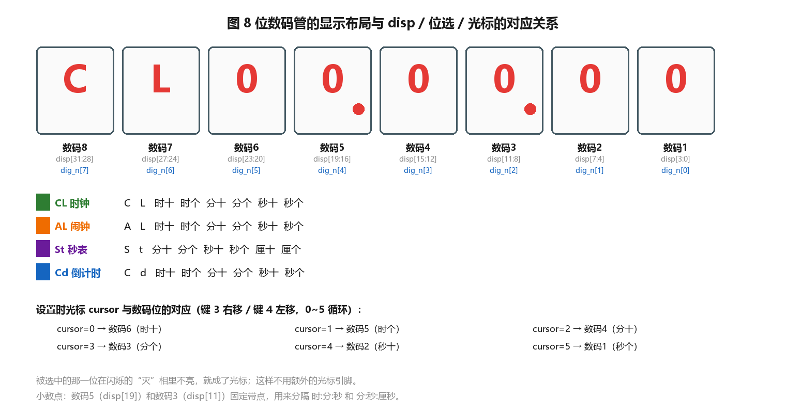
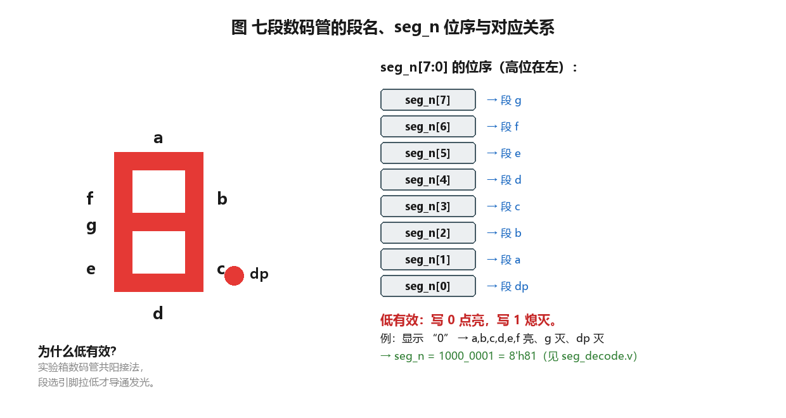

# 07 Verilog 语法速查：只学这个工程用得到的

| 项目 | 说明 |
| --- | --- |
| 学完你能做什么 | 独立读懂 `rtl/` 下 15 个 `.v` 和 `sim/tb_digital_clock_top.v` 的每一行；能自己写出“计数器 + 使能脉冲 + 状态机 + 译码”这套结构；能看懂 Quartus 报错并自己改错 |
| 前置知识 | 会 C（指针、结构体、位运算、宏）。Verilog 一个关键字都不用提前背，本章每条都从本工程源码里抠出来 |
| 使用方法 | 当字典用，不必背。写代码卡住时按目录找；看到陌生写法查 `## 7.10` 的出处表，直接跳回真实源码 |

本章代码块除明确标注「示意」「反例」的片段外，**逐字**抄自本工程 `rtl/` 与 `sim/`，出处写成 `文件名:行号`。行号对不上说明工程被改过，以源码为准。

## 7.1 先建立正确的心智模型

### 一句话

**Verilog 不是“写程序给 CPU 跑”，而是“画电路”。** C 有 `main` 从第一行往下执行；Verilog 没有 `main`，没有“先执行谁”。每一行都在描述一块硬件，综合工具把它变成门和触发器。

### 三条铁律

**① module = 芯片，例化 = 把芯片放上去并接线。** `module ... endmodule` 是一颗芯片的封装，`()` 里是引脚。写 `seg_decode u_seg_decode (...)` 不是调用函数，而是在板上焊一颗芯片、把脚接到这几根线上。

**② `always @(posedge clk)` = 触发器，`always @(*)` = 组合逻辑。** 前者块里的信号有时钟沿才更新，综合成有记忆的寄存器；后者跟着输入立刻变，综合成纯组合电路。本工程 rtl 里 13 处 `always @(posedge ...)` 全是触发器（另 2 处在 testbench），4 处 `always @(*)` 全是组合逻辑。

**③ 所有 always 同时工作（并行），不是一个接一个跑。** `clk_gen.v` 里一个 `always` 同时数 4 个计数器；`display_ctrl.v` 里扫描块和拼 `disp` 的块也同时工作。

### C ↔ Verilog 概念对照表

| C 的概念 | Verilog 里对应什么 | 本工程例子 |
| --- | --- | --- |
| 函数 | `module`（一颗芯片，不是一次调用） | `module seg_decode(` — `rtl/seg_decode.v:7` |
| 调用函数 | 例化模块（放芯片 + 接线） | `seg_decode u_seg_decode (` — `rtl/display_ctrl.v:77` |
| 全局变量 | `wire`（导线，无存储） | `wire sys_rst_n = por_done & k1_db;` — `rtl/digital_clock_top.v:67` |
| `static` 变量（有记忆） | `reg` | `reg [23:0] time_reg;` — `rtl/time_counter.v:23` |
| `#define` 宏 | `parameter` / `localparam` | `parameter integer CLK_FREQ = 50_000_000,` — `rtl/clk_gen.v:7` |
| `printf` | `$display` | `$display("PASS  [%0s] = %h", name, actual);` — `sim/tb_digital_clock_top.v:87` |
| `#include` | **不需要**，靠 `.qsf` 的文件列表拼起来 | `DigitalClock.qsf` 里列 15 个 `.v` |
| `return` 返回值 | `function` 的返回值（函数名就是返回变量） | `inc_time = {ht, ho, mt, mo, st, so};` — `rtl/time_counter.v:99` |
| 数组 `int a[8]` | 位宽向量 | `reg [31:0] disp;` — `rtl/display_ctrl.v:49` |
| 循环 `for` | 在 `always` 里展开成硬件；tb 里当普通循环 | `for (i = 0; i < 8; i = i + 1)` — `sim/tb_digital_clock_top.v:189` |
| 指针 | **没有对应物**，连接关系用端口和连线表达 | — |
| `main()` | **没有**，顶层模块就是入口 | `rtl/digital_clock_top.v:7` |

### 为什么 C 的思维会害你：`=` 与 `<=`

下面两行是**对比示意**（非工程代码）。同样 `a=0, b=1`，只来一个时钟沿：

```verilog
a = b;   c = a;    // 阻塞：a=1, c=1  → 两根线串起来
a <= b;  c <= a;   // 非阻塞：a=1, c=0 → 两级触发器
```

阻塞赋值立刻生效，`c` 读到的是刚被覆盖的新 `a`；非阻塞要等块结束才一起更新，`c` 拿的是上一拍的 `a`。这个差别仿真里常常看不出来，硬件上就是两级触发器变成一根短路线。

本工程时序逻辑一律用 `<=`（`rtl/core_key.v:39-40`）：

```verilog
        else begin
            press <= 1'b0;
```

条件成立时再写一次（`:51-52`）：

```verilog
                        if (sync1[1] == 1'b0)
                            press <= 1'b1;  // 刚按下
```

同一 `always` 里 `press` 被写两次并不冲突——非阻塞的规则是“**块结束时最后一次赋值生效**”，正好构成“默认清零 + 条件置位”（见 `## 7.5`）。若写成 `press = 1'b0;`，一旦块里有信号互相读，就会读到刚被覆盖的新值，仿真与综合不一致。**口诀：`always @(posedge clk)` 里写 `<=`，`always @(*)` 和 `function` 里写 `=`。**

## 7.2 模块：端口、参数、例化

```verilog
module seg_decode(
    input  wire [3:0] bcd,
    input  wire       dp,
    input  wire       blank,
    output reg  [7:0] seg_n
);
```

`rtl/seg_decode.v:7-12`。`endmodule`（`:44`）后面**没有分号**，`module` 那行也没有；头部的 `);` 是端口列表的括号加分号。这是 **ANSI 风格**：方向、类型、位宽、名字全写在 `()` 里，一行一个端口。

| 方向 | 含义 | 本工程例子 |
| --- | --- | --- |
| `input` | 只读输入 | `input  wire [15:0] pi_in,` — `rtl/digital_clock_top.v:12` |
| `output` | 输出 | `output wire [7:0]  seg_n,` — `rtl/digital_clock_top.v:15` |
| `inout` | 双向（三态总线） | **本工程 0 处，未使用**，本章不展开 |

同一个信号在不同文件里类型可以不一样：顶层写 `output wire [7:0] seg_n`（`rtl/digital_clock_top.v:15`），因为它只是把子模块输出“接出来”、自己不驱动；子模块 `display_ctrl` 写 `output reg [7:0] seg_n`（`rtl/display_ctrl.v:31`），因为真正驱动它的是 `always` 里的 `seg_n <= seg_cur;`。

### parameter 与 localparam

```verilog
module clk_gen #(
    parameter integer CLK_FREQ = 50_000_000,
    parameter integer SIM_FAST = 0
)(
```

`rtl/clk_gen.v:6-9`。`#( ... )` 是**参数列表**，夹在模块名和端口列表之间，位置不能变。

| | `parameter` | `localparam` |
| --- | --- | --- |
| 上层能否覆盖 | 能，例化时 `#(.名字(值))` | 不能，模块私有 |
| 本工程用途 | 板级频率、仿真加速开关、消抖毫秒数 | 分频终值、状态编码、字符码 |
| 例子 | `rtl/clk_gen.v:8`，tb 里改成 `.SIM_FAST(1)`（`sim/tb_digital_clock_top.v:32`） | `localparam integer DIV_1HZ   = (SIM_FAST != 0) ? 1000 : CLK_FREQ;`（`rtl/clk_gen.v:19`） |

```verilog
    localparam integer DIV_1HZ   = (SIM_FAST != 0) ? 1000 : CLK_FREQ;
    localparam integer DIV_100HZ = (SIM_FAST != 0) ? 8    : (CLK_FREQ / 100);
```

`rtl/clk_gen.v:19-20`。`localparam` 里可以直接算表达式，综合前折叠成常数，不占硬件。三目在“真实分频比”和“仿真极小值”之间切换，这是本工程能在 ModelSim 里几秒跑完一秒的关键。本工程的 `localparam` 没有集中放头文件，每个模块各写一份：`MODE_CL` 在 `rtl/display_ctrl.v:36`、`rtl/key_ctrl.v:32`、`rtl/time_counter.v:21` 各定义一次。

### 例化：本工程最核心的一步

逐字来自 `rtl/digital_clock_top.v:121-131`：

```verilog
    clk_gen #(
        .CLK_FREQ(CLK_FREQ),
        .SIM_FAST(SIM_FAST)
    ) u_clk_gen (
        .clk(clk50),
        .rst_n(sys_rst_n),
        .tick_1hz(tick_1hz),
        .tick_100hz(tick_100hz),
        .tick_1khz(tick_1khz),
        .tick_2hz(tick_2hz)
    );
```

| 片段 | 含义 |
| --- | --- |
| `clk_gen` | 芯片型号（模块名） |
| `#( ... )` | 参数传递区。没有参数要传时整块省略，如 `key_input u_key_input (`（`:137`） |
| `.CLK_FREQ(CLK_FREQ)` | 点号后是**芯片上的参数名**，括号里是**你给的实参**。左边永远是子模块的名字，右边才是本文件的信号 |
| `u_clk_gen` | 实例名，相当于“芯片在板子上的位号”，同模块放多颗时不能重名 |
| `.clk(clk50)` | 点号后是**芯片上的引脚名**，括号里是**接到哪根线**：`clk_gen` 的 `clk` 脚 ← 顶层 `clk50` |
| `);` | 连接区结束，整个例化语句结束（**这个分号必须有**） |

命名连接可以一行写多个，如 `rtl/time_counter.v:29-31` 的 `.bcd_in(edit_reg), .cursor(cursor), .inc(1'b1), .bcd_out(edit_inc)`——括号里可以直接放常量。`time_counter` 用两颗 `bcd_digit_adj`，一颗固定 `inc=1`（加），一颗固定 `inc=0`（减）。

**位置连接 vs 命名连接**：位置连接写成 `clk_gen u (clk50, sys_rst_n, tick_1hz, ...)`，短，但端口顺序一变全错；命名连接写成 `.引脚名(信号名)`，长，但顺序无关、改名即报错。本工程 rtl 里 **29 处例化全部用命名连接**——`display_ctrl` 有 24 个端口，位置连接根本数不过来；而且命名连接下端口名拼错会直接编译报错，等于免费拿一层检查。

## 7.3 wire 与 reg：最容易搞混的两个词

**`wire` = 导线**，自己不能存值，必须被驱动：`assign`、模块输出脚，或顶层输入脚。**`reg` = 能存值的变量**，只能在 `always` / `initial` 里被赋值。

| | `wire` | `reg` |
| --- | --- | --- |
| 声明 | `wire [7:0] key_press;`（`rtl/digital_clock_top.v:77`） | `reg [23:0] time_reg;`（`rtl/time_counter.v:23`） |
| 怎么赋值 | `assign`，或模块输出，或端口 | 只能在 `always` / `initial` 里 |
| 能否在 `always` 里被赋值 | **不能**（编译报错） | 能 |
| 能否用 `assign` 赋值 | 能 | **不能**（编译报错） |
| 有无记忆 | 没有，输入变就跟着变 | 看写法：`@(posedge clk)` 有，`@(*)` 没有 |
| 本工程用途 | 模块间连线、顶层输出 | 计数器、状态、寄存器组 |

```verilog
    wire sys_rst_n = por_done & k1_db;
```

`rtl/digital_clock_top.v:67` —— 声明同时用表达式驱动，等价于“声明 + 一句 `assign`”，这是 wire 唯一能“顺便初始化”的写法。而 `rtl/digital_clock_top.v:72-75` 的 `wire tick_1hz; ...` 只声明，真正的驱动来自 `clk_gen` 的输出脚（`:128-131` 的 `.tick_1hz(tick_1hz)`）。**顶层 `:72-117` 那一段 wire 声明，本质就是一张连线清单。**

reg 的两种命运：`reg [23:0] time_reg;`（`rtl/time_counter.v:23`）在 `always @(posedge clk)`（`:37`）里赋值，综合成 **24 位触发器**；`reg [31:0] disp;`（`rtl/display_ctrl.v:49`）在 `always @(*)`（`:94`）里赋值，综合成**纯组合逻辑**（一堆多路选择器），一个触发器都不占。

### 常见误解：`reg` 不一定综合成寄存器

`reg` 只是“能在 always 里被赋值的变量”这个语法身份，跟“会不会变成触发器”**没有关系**。决定权在敏感列表：

| 写法 | 综合结果 | 本工程例子 |
| --- | --- | --- |
| `always @(posedge clk)` 里的 reg | 触发器 | `rtl/time_counter.v:23` 的 `time_reg` |
| `always @(*)` 里的 reg | 组合逻辑（LUT + MUX） | `rtl/display_ctrl.v:49` 的 `disp` |
| `always @(*)` 里某条路径没赋值 | **锁存器 latch**（多半是 bug） | 本工程靠“进块先给默认值”避免，见 `## 7.5` |

同理，`rtl/display_ctrl.v:31` 的 `output reg seg_n` 由 `always @(posedge clk)`（`:214`）驱动，是真触发器；`rtl/seg_decode.v:11` 的 `output reg [7:0] seg_n` 由 `always @(*)`（`:14`）驱动，是纯组合。

## 7.4 assign 与运算符

`assign` 是“**永久连接**”：右边一变左边立刻变，没有时钟、没有先后。

```verilog
    assign cur_digit = disp[(scan_idx * 4) +: 4];
    assign cur_dp    = (scan_idx == 3'd4) || (scan_idx == 3'd2);
```

`rtl/display_ctrl.v:68-69`。左边必须是 `wire`，右边可以是任意表达式。

本工程 24 处 `assign`，多数是“把内部 reg 接到输出脚”：`assign time_bcd = time_reg;`（`rtl/time_counter.v:57`）。为什么要有这一层？因为 `time_bcd` 是 `output wire`（`:17`），而 `time_reg` 是 `reg`；reg 不能直接接 `output wire`，必须用 `assign` 过渡。

| 类别 | 符号 | 含义 | 本工程出处 |
| --- | --- | --- | --- |
| 位运算 | `&` | 按位与 | `assign buzzer = ~(beep_en & tone);` — `rtl/buzzer_tone.v:40` |
| 位运算 | `\|` | 按位或 | `assign enter_req = key_press[6] \| core_press[3];` — `rtl/key_ctrl.v:38` |
| 位运算 | `~` | 按位取反 | `dig_n <= ~(8'b00000001 << scan_idx);` — `rtl/display_ctrl.v:242` |
| 位运算 | `^` | 按位异或 | **0 处，未使用**，不展开 |
| 逻辑 | `&&` | 逻辑与 | `assign match = en_reg && (time_bcd == alarm_reg);` — `rtl/alarm_ctrl.v:42` |
| 逻辑 | `\|\|` | 逻辑或 | `rtl/display_ctrl.v:69` |
| 逻辑 | `!` | 逻辑非 | `if (!rst_n) begin` — `rtl/clk_gen.v:30` |
| 归约 | `\|x` | 向量所有位“或”成 1 位 | `(\|key_press)` — `rtl/key_ctrl.v:86` |
| 比较 | `==` `!=` `>=` | 相等/不等/大于等于 | `rtl/alarm_ctrl.v:42`、`rtl/core_key.v:43`、`rtl/display_ctrl.v:71` |
| 三目 | `? :` | 二选一 | `rtl/bcd_digit_adj.v:28` |
| 拼接 | `{a, b}` | 几段拼成更宽的向量 | `rtl/display_ctrl.v:250` |
| 复制 | `{n{a}}` | 把 a 重复 n 次 | **0 处，未使用**，不写 |
| 移位 | `<<` | 左移 | `rtl/display_ctrl.v:242`（唯一一处） |
| 算术 | `+` `-` | 加减 | `cnt_1hz  <= cnt_1hz + 1'b1;` — `rtl/clk_gen.v:47` |
| 算术 | `/` | 除，只在常量表达式里 | `(CLK_FREQ / 100)` — `rtl/clk_gen.v:20` |

### 重点：归约或 `|key_press`

`|` 放在向量**前面**（一元运算）时，表示把向量所有位或起来得到 1 位，这是 Verilog 特有、C 里没有对应的东西：

```verilog
            beep_silence <= (|key_press) | (|core_press);
```

`rtl/key_ctrl.v:86`。`key_press` 是 8 位，`|key_press` 是 1 位，含义是“**8 个键里有没有任意一个被按下**”；用 C 要写 `k[0]||k[1]||...||k[7]`。这一行里 `|` 有三种身份：`|key_press` 是归约或（8 位 → 1 位），中间的 `|` 是按位或（1 位与 1 位），`|core_press` 又是归约或（4 位 → 1 位）。

### 拼接、三目、移位、位选

拼接把几段窄的拼成一段宽的，也能反过来拆（`rtl/display_ctrl.v:250`）：

```verilog
    assign led_n   = {~led4_on, ~sw_running, ~alarm_en, ~heartbeat};
```

四个 1 位拼成 4 位，**顺序从左到右对应高位到低位**：`led_n[3]=~led4_on`、`led_n[2]=~sw_running`、`led_n[1]=~alarm_en`、`led_n[0]=~heartbeat`。反过来拆的写法在 `rtl/time_counter.v:65` 的 `{ht, ho, mt, mo, st, so} = t;`，把 24 位的 `t` 拆成 6 个 4 位变量；拼接当左值等价于 6 个独立赋值，这是本工程处理 BCD 时间的标准套路（`rtl/countdown.v:119`、`rtl/bcd_digit_adj.v:23` 同一句）。

三目是本工程最常用的“回绕”（`rtl/bcd_digit_adj.v:27-30`）：

```verilog
                if (inc)
                    ht = (ht == 4'd2) ? 4'd0 : ht + 1'b1;
                else
                    ht = (ht == 4'd0) ? 4'd2 : ht - 1'b1;
```

含义：等于上界就回 0，否则加 1。`bcd_digit_adj` 现在只有三个“十位”分支还用这个模式，共 6 处三目（`:28,30,67,69,103,105`）；“个位”分支改成带进位的 if/else 了。三目也能进常量表达式：`localparam integer DIV_1HZ = (SIM_FAST != 0) ? 1000 : CLK_FREQ;`（`rtl/clk_gen.v:19`）。

**移位只有一处**（`rtl/display_ctrl.v:242`）：

```verilog
                dig_n    <= ~(8'b00000001 << scan_idx);
```

`scan_idx` 是 3 位（`:55`），取值 0~7。`8'b00000001` 左移 `scan_idx` 位就是“第 `scan_idx` 位为 1、其余为 0”的独热码，取反得到低有效位选，一句实现“8 位数码管轮流点亮”。本工程**没有**写 `1 << scan_idx` 这种裸写法：裸 `1` 是 32 位，移位后 32 位，取反再赋给 8 位 `dig_n` 会被截断——结果碰巧对，但招来位宽警告。

位选两种写法本工程都在用：常量位选 `cs_reg[3:0]`（`rtl/stopwatch.v:50`，两端都是常量）；变量位选 `disp[(scan_idx * 4) +: 4]`（`rtl/display_ctrl.v:68`，起点是变量）。后者意为“从第 `scan_idx*4` 位开始往**上**取 4 位”，等价于 `disp[scan_idx*4+3 : scan_idx*4]`；不能直接写后者，因为 Verilog 规定 `[a:b]` 两端必须是**常量**，只要有一端是变量就必须用 `+:`（往上）或 `-:`（往下）。常量位选当左值的例子是 `rtl/stopwatch.v:50` 的 `cs_reg[3:0] <= cs_reg[3:0] + 1'b1;`——只改低 4 位、高 4 位不动，这就是秒表能把一个字节当两个十进制位用的原因。

### 常量写法

| 写法 | 含义 | 出处 |
| --- | --- | --- |
| `1'b0` / `1'b1` | 1 位二进制 | `rtl/clk_gen.v:35` |
| `2'b11` | 2 位二进制 11（=3） | `rtl/display_ctrl.v:39` |
| `3'd5` / `4'd9` | 3 位/4 位十进制 | `rtl/key_ctrl.v:122`、`rtl/stopwatch.v:49` |
| `8'hFF` | 8 位十六进制 FF（全灭） | `rtl/seg_decode.v:32` |
| `8'h81` | 8 位十六进制 81（显示 “0”） | `rtl/seg_decode.v:16` |
| `8'b00000001` | 8 位二进制 | `rtl/display_ctrl.v:242` |
| `24'h000500` | 24 位十六进制（= BCD 00:05:00） | `rtl/countdown.v:50` |
| `26'd0` | 26 位十进制 0 | `rtl/clk_gen.v:31` |
| `50_000_000` / `1_000_000` | 下划线只是给人看，综合器忽略 | `rtl/clk_gen.v:7`、`rtl/digital_clock_top.v:24` |

格式是 `位宽'进制数值`：`'b` 二进制、`'d` 十进制、`'h` 十六进制。位宽可以省，但本工程从不省——省了就是 32 位，容易出位宽警告。

## 7.5 always 块：组合逻辑与时序逻辑

### 组合逻辑：always @(*)

```verilog
    always @(*) begin
        case (bcd)
            4'h0: seg_n = 8'h81; // 0
            4'h1: seg_n = 8'hF3; // 1
```

`rtl/seg_decode.v:14-17`。`@(*)` 的 `*` 表示“**自动把所有被读到的信号都放进敏感列表**”。老写法要一个个列（`@(bcd or dp or blank)`），漏一个就仿真对、综合错；`@(*)` 永远不会漏。块里的 `if`/`case` 就是普通分支，但**综合出来是电路不是跳转**：`case` 变多路选择器，`if` 变带使能的选择器。

### 必须给所有分支赋值，否则出锁存器（latch）

组合逻辑没有记忆，所以**每个输出在每种输入下都必须有确定的值**。写 `if (a) y = 1;` 却不写 `else`，`a=0` 时 `y` 该是多少？组合电路答不上来，综合器只好塞一个锁存器记住上次的值——这就是 latch，组合逻辑最经典的 bug。

本工程用两种手法规避。**手法一：进块先给默认值**（`rtl/display_ctrl.v:115-120`）：

```verilog
    always @(*) begin
        disp = 32'h00000000;

        case (mode)
            MODE_CL: begin
                disp[31:28] = CHAR_C;
```

第一行把 32 位全清零，后面的 `case` 只改关心的几位——**无论 `mode` 是什么值，`disp` 每一位都有确定的来源**。**手法二：`case` 一定带 `default`**，如 `rtl/seg_decode.v:32` 的 `default: seg_n = 8'hFF;`（全灭）。`bcd` 是 4 位、`case` 已列了 0~F 全部 16 种，本工程仍写 `default`——因为仿真里 `bcd` 可能取到 `4'bxxxx`，`default` 是兜底。

`disp` 是 8 个数码管的字符，布局如下：



**看图要点**：`disp[31:28]` 是最左第 8 位（显示模式字母），`disp[3:0]` 是最右第 1 位；`disp[19:16]` 与 `disp[11:8]` 那两位带小数点，所以在 `:69` 被单独拎出来做 `cur_dp`。`cursor` 与数码位的对应（`cursor=0` → 数码 6）用的是 `3'd5 - cursor`（`:73`）。

### 时序逻辑：always @(posedge clk)

```verilog
    always @(posedge clk) begin
        if (!rst_n) begin
            cnt_1hz   <= 26'd0;
            cnt_100hz <= 26'd0;
```

`rtl/clk_gen.v:29-32`。`posedge` = 上升沿。块里的信号只在 `clk` 上升沿更新，其余时间保持不动，综合出来就是一组触发器。

### 本工程是同步复位，不是异步复位

| | 同步复位（本工程） | 异步复位（本工程**没有**） |
| --- | --- | --- |
| 写法 | `always @(posedge clk)` 里写 `if (!rst_n)` | `always @(posedge clk or negedge rst_n)` |
| 何时生效 | 只在**时钟上升沿**采样到 `rst_n=0` 时清零 | `rst_n` 一变低**立刻**清零，不等时钟 |
| 需要的触发器 | 普通 D 触发器 + 一点组合逻辑 | 带异步清零端的触发器 |
| 本工程 | `rtl/clk_gen.v:29-30`、`rtl/key_ctrl.v:54-55`、`rtl/display_ctrl.v:214-215` | **0 处**：15 处 `always @(posedge ...)` 全都没有 `or negedge` |

同步复位不会被毛刺误触发，时序分析简单，适合 FPGA；代价是复位脉冲必须比一个时钟周期宽。本工程的 `rst_n` 来自 `sys_rst_n = por_done & k1_db`（`rtl/digital_clock_top.v:67`），上电后由 20 ms 计数器 `por_done` 拉高，再叠加 K1 消抖后的 `k1_db`，宽度远远够。

**非阻塞 `<=` 为什么用于时序逻辑**：时序逻辑描述“所有触发器在同一个时钟沿同时采样旧值”，只有非阻塞能精确表达。看本工程的 2 位移位寄存器（`rtl/digital_clock_top.v:42` 声明，`:47` 使用）：`k1_sync <= {k1_sync[0], key_core_n[0]};` 左移一位、新输入进最低位。若用阻塞 `=`，`k1_sync[1]` 会先拿到 `k1_sync[0]` 的新值，两级同步退化成一级——真实板子上就是亚稳态扩散。

### “默认清零 + 条件置 1”的单周期脉冲

本工程出现频率最高的技巧，`rtl/key_ctrl.v` 里 10 个动作脉冲全靠它。头部（`:74-83`）：

```verilog
        else begin
            // 默认每周期清零，需要时置一个时钟周期的脉冲
            edit_load       <= 1'b0;
            edit_commit     <= 1'b0;
            digit_inc       <= 1'b0;
```

条件分支里再置 1（`:102`）：

```verilog
            else if (enter_req) begin
                if (setting) begin
                    edit_commit <= 1'b1;
```

机制：每周期**开头**先把这 10 个脉冲全写 0，某键按下时把对应的**改写**成 1。因为非阻塞“最后写的赢”，没按键时全部保持 0；按了键 7 且在设置中时，`edit_commit` 本周期为 1、下周期自己回 0，**正好一个时钟周期宽**。

下游靠这个 1 周期脉冲做一次动作，不用自己再检测边沿：`rtl/time_counter.v:43` 的 `if ((mode == MODE_CL) && edit_commit)` 就是接收方。注意 `beep_silence`（`:89`）不一样——它是 `<= (|key_press) | (|core_press);`，“按键按着就一直是 1”的**电平信号**，因为它控制“现在要不要闭嘴”这个持续状态。同样的模式在别处也出现，只是每次只清一个信号：`rtl/core_key.v:40` 的 `press <= 1'b0;`（后面 `:52`、`:67`、`:76` 条件置 1）、`rtl/nibble_key.v:36`、`rtl/countdown.v:59` 的 `expire_pulse <= 1'b0;`。

## 7.6 if / else if / case / function

### if / else if / else

和 C 一样，只是**判断是“电路的真假”，不是“程序的跳转”**。本工程最长的 if 链在 `rtl/key_ctrl.v:91-179`：先判 `key_press[7]`（键 8 最高优先），再 `else if (enter_req)`（键 7 / K4），再 `else if (setting)`（设置中的光标与加减），最后 `else` 里套 `case (mode)` 处理各模式自己的按键。**`if` 链有优先级**：越靠前越优先，综合成一串级联选择器；本工程故意把“键 8”放第一，就实现了“任何时候按 8 都能退出设置并切模式”。`begin ... end` 相当于 C 的 `{}`，单条语句可省（`rtl/core_key.v:51-52` 就省了）。

### case 的两种用法

**用法一：译码表。** `rtl/seg_decode.v:15-18`，4 位字符码 → 8 位段码：

```verilog
        case (bcd)
            4'h0: seg_n = 8'h81; // 0
            4'h1: seg_n = 8'hF3; // 1
            4'h2: seg_n = 8'h49; // 2
```

`8'h81` 为什么是 “0”？



**看图要点**：`seg_n[7:1]` 依次是 g/f/e/d/c/b/a，`seg_n[0]` 是小数点 dp；**低有效**，写 0 才亮。显示 “0” 要点亮 a,b,c,d,e,f（g 与 dp 灭），所以 `seg_n = 1000_0001 = 8'h81`。对照 `rtl/seg_decode.v:36-37` 的 `if (dp) seg_n = seg_n & 8'hFE;`——点亮小数点就是清 bit0。

**用法二：模式选择。** `rtl/display_ctrl.v:118-208`，`case (mode)` 每个分支再套 `if (setting)`，决定显示实时值还是编辑值。这是“一张表决定整个显示内容”，比一堆 `if` 清楚。

### default 分支

本工程 9 处 `case`（`rtl/` 里 8 处 + tb 1 处）**全部带 `default`**，作用两个：组合逻辑兜底防 latch；让状态机在非法状态自恢复（`rtl/beep_ctrl.v:118-120` 的 `default: state <= ST_IDLE;`）。即使 `state` 被干扰成非法值，下一拍也回到空闲。`default` 也可以什么都不做只写注释（`rtl/key_ctrl.v:174-176` 的 `// 保持`），这时“保持”是靠块开头的默认清零实现的，仍然是确定的电路。

### function：本工程 3 个

`function` 是模块内部的**纯组合子电路**，把一段复杂表达式打包成一行调用：

```verilog
    function [1:0] next_mode;
        input [1:0] m;
        begin
            case (m)
                MODE_CL: next_mode = MODE_AL;
                MODE_AL: next_mode = MODE_ST;
                default: next_mode = MODE_CL;
            endcase
        end
    endfunction
```

`rtl/key_ctrl.v:41-52`（`MODE_ST`/`MODE_CD` 两个分支略去）。要点：`function [1:0] next_mode;` 里 `[1:0]` 是**返回值位宽**，函数名本身就是返回变量；`input [1:0] m;` 的参数**写在函数体内部**，不是写在括号里（和 C 完全不同）；函数体内用 `=`（纯组合，必须阻塞）；末尾 `next_mode = ...` 就是返回，不需要 `return`。调用当表达式用：`mode <= next_mode(mode);`（`rtl/key_ctrl.v:94`）——CL→AL→St→Cd→CL 循环。

| function | 文件:行 | 作用 | 规模 |
| --- | --- | --- | --- |
| `next_mode` | `rtl/key_ctrl.v:41` | 模式循环切换 | 5 分支 |
| `inc_time` | `rtl/time_counter.v:61` | 24 位 BCD 时间 +1 秒，23:59:59 → 00:00:00 | 41 行 |
| `dec_time` | `rtl/countdown.v:115` | 24 位 BCD 时间 −1 秒，00:00:00 → 23:59:59 | 41 行 |

`inc_time` 的签名见 `rtl/time_counter.v:61-63`：`function [23:0] inc_time;`、`input [23:0] t;`、`reg [3:0] ht, ho, mt, mo, st, so;`，返回在 `:99` 的 `inc_time = {ht, ho, mt, mo, st, so};`。注意第三行——**function 内部可以声明局部 `reg`**（相当于 C 的局部变量），但它们不是触发器，只是组合电路里的中间节点。**function 三条禁令**（本工程严格遵守）：不能含 `@(posedge clk)` 或任何时钟（3 个 function 里都没有 `always`）；不能有 `#10` 这类延迟（0 处）；不能调用 `task`（0 处）。之所以要把 40 多行的 BCD 进位写成 function，是因为 `time_reg <= inc_time(time_reg);`（`rtl/time_counter.v:46`）一行就能读懂，内联进去会让 `always` 膨胀到看不清主逻辑。

## 7.7 位宽、字面量与截断

| 情况 | 处理 | 后果 |
| --- | --- | --- |
| 右值比左值**窄** | 高位**补 0**（零扩展） | 一般安全 |
| 右值比左值**宽** | 砍掉高位，**截断** | 可能丢数据，综合器给警告 |

本工程大量出现“窄的加到宽的上去”，靠的就是零扩展：

```verilog
                cnt_1hz  <= cnt_1hz + 1'b1;
```

`rtl/clk_gen.v:47`。`cnt_1hz` 是 26 位、`1'b1` 是 1 位，相加时 `1'b1` 被零扩展成 `26'd1`，结果也是 26 位。若写成 `cnt_1hz <= cnt_1hz + 1;`，那个 `1` 是 **32 位**整数，`cnt_1hz` 被扩展到 32 位参与加法，结果 32 位再截断回 26 位——功能没错，但可能招来位宽警告。本工程的办法是**把常量写成和左值一样的位宽**：26 位用 `26'd0`（`rtl/clk_gen.v:31`）、24 位用 `24'h000000`（`rtl/time_counter.v:39`）、20 位用 `20'd0`（`rtl/digital_clock_top.v:27`）、16 位用 `16'd0`（`rtl/beep_ctrl.v:40`）、14 位用 `14'd0`（`rtl/buzzer_tone.v:23`）、9/7/5/3 位用 `9'd0`/`7'd0`/`5'd0`/`3'd0`（`rtl/core_key.v:34-35`、`rtl/nibble_key.v:31`、`rtl/key_ctrl.v:58`）。这就是本工程“到处写 `26'd0`、`5'd0`”的原因——不是啰嗦，是把位宽钉死，让综合器闭嘴。

### `reg [25:0] cnt_1hz` 为什么是 26 位

`rtl/clk_gen.v:24` 声明 `reg [25:0] cnt_1hz;`。它要数到 `DIV_1HZ - 1`，即 `50_000_000 - 1 = 49 999 999`：

| 位宽 | 最大值 | 够不够装 49 999 999 |
| --- | --- | --- |
| 25 位 | 33 554 431 | **不够**（差 1600 多万） |
| 26 位 | 67 108 863 | 够，还余 1700 多万 |

26 位是**最小可用位宽**。写 27 位也能工作，只浪费一个触发器；写 25 位则永远数不到终值，计数器一直加、溢出回绕，1 Hz 永远不来——典型的“仿真不报错但功能全错”。同理：`por_cnt` 20 位（`1_000_000 - 1 < 2^20`，`rtl/digital_clock_top.v:27,24`）、`db_cnt` 5 位（`19 < 32`，`rtl/core_key.v:22,7`）、`timer` 16 位（`599 < 2^16`，`rtl/beep_ctrl.v:31,24`）、蜂鸣器 `cnt` 14 位（`9258 < 2^14`，`rtl/buzzer_tone.v:18,16`）。

### 为什么 BCD 用 24 位

`[23:20]` 时十、`[19:16]` 时个、`[15:12]` 分十、`[11:8]` 分个、`[7:4]` 秒十、`[3:0]` 秒个，每个 nibble 只存 0~9。所以 24 位里有一大半编码浪费（十六进制 16 个值，BCD 只用 10 个）。代价是浪费几位，收益是**显示时不用做二进制转十进制**，一位对一个数码管。这也直接导致 `inc_time`/`dec_time` 那 80 多行“每位单独判断、单独回绕”的代码——BCD 的加法不能当二进制加。

## 7.8 结构化代码的公共套路（本工程反复出现的 5 个模式）

**套路 1：计数器 + 终值比较产生 tick**（把 50 MHz 变成各种单周期使能；本工程不分频出时钟，只产生使能，见 `rtl/clk_gen.v:3-4` 注释）：

```verilog
            if (cnt_1hz == DIV_1HZ - 1) begin
                cnt_1hz  <= 26'd0;
                tick_1hz <= 1'b1;
            end
            else begin
                cnt_1hz  <= cnt_1hz + 1'b1;
                tick_1hz <= 1'b0;
            end
```

`rtl/clk_gen.v:42-49`。同文件 `:52-59`、`:62-69`、`:72-79` 是同结构的另外三份；`rtl/buzzer_tone.v:30-36` 是变体（数到终值就翻转 `tone`）。精髓是 `tick` 只有 1 个时钟周期宽，所有模块**共用 50 MHz**，只在 `tick` 为 1 的那一拍动作——所以全工程只有 `clk50` 一个时钟域。

**套路 2：两级同步**（外部异步信号进 FPGA 前先过两级触发器，防亚稳态）：

```verilog
        sync0 <= nibble_in;
        sync1 <= sync0;
```

`rtl/nibble_key.v:25-26`；`rtl/core_key.v:28-29` 是同样两句；`rtl/digital_clock_top.v:47` 用移位写法 `k1_sync <= {k1_sync[0], key_core_n[0]};`。两种都对。**关键：这两句必须用 `<=`**，用 `=` 就只有一级了。

**套路 3：消抖（candidate / prev / cnt）**（机械按键会抖 10~20 ms，要等输入稳定 20 ms 才认一次按下）：

```verilog
                else if (sync1 != candidate) begin
                    // 输入还在变，重新计时
                    candidate <= sync1;
                    cnt       <= 5'd0;
                end
                else if (candidate != prev) begin
                    if (cnt == DEBOUNCE_MS - 1) begin
                        prev  <= candidate;
                        press <= 1'b1;
```

`rtl/nibble_key.v:46-54`。`candidate` 记录正在确认的新值、`prev` 记录已确认的旧值、`cnt` 计时。三个判断的顺序就是精髓：**输入变了 → 重来；输入稳定但和旧值不同 → 攒够 20 ms 就认；否则 → 清零**。`rtl/core_key.v:43-46` 是另一种写法（不需要 `candidate`，只关心“和当前稳定值 `level` 不同”）：`if (sync1[1] != level)` 后等 `db_cnt == DEBOUNCE_MS - 1`，再 `level <= sync1[1];`。

**套路 4：单周期脉冲（默认 0，条件置 1）**（把持续的电平变成“只响一拍”的事件）：

```verilog
            edit_load       <= 1'b0;
            edit_commit     <= 1'b0;
            digit_inc       <= 1'b0;
            digit_dec       <= 1'b0;
```

`rtl/key_ctrl.v:74-77` 是默认清零，条件置 1 在 `:133-135` 的 `else if (key_press[1] | core_press[1]) begin` 里一行 `digit_inc <= 1'b1;`。`rtl/core_key.v:40` + `:52`、`rtl/nibble_key.v:36` + `:54`、`rtl/countdown.v:59` + `:105` 都是同一套路。注意 `digit_inc` 其实是**电平**型脉冲：按住 K2 不放会每拍都置 1，所以连发是在 `core_key.v` 里用 `repeating`/`hold_cnt` 做的（`:61-82`），`key_ctrl` 只负责转发。

**套路 5：上升沿检测**（把“电平相等”变成“只在刚相等的那一拍给脉冲”）：

```verilog
            // 相等时只产生一个脉冲；时间离开相等状态后 match_d 清零
            alarm_trigger <= match & ~match_d;
            match_d       <= match;
```

`rtl/alarm_ctrl.v:65-67`。`match` 是当前拍“闹钟开着且时间等于设定值”（`:42` 的 `assign`），`match_d` 是它延迟一拍的副本，所以 `match & ~match_d` 正好只在一个时钟周期为 1。等价于 `pulse <= sig & ~sig_d; sig_d <= sig;`，只是把 `sig` 直接写成了 `match` 表达式——它本身是 `wire`（`:33`），不需要额外寄存器。同一思想在 `rtl/display_ctrl.v:226-235` 的“二分频出 1 Hz 心跳”里也用（`if (tick_2hz) blink2 <= ~blink2;`）。

## 7.9 testbench 专用语法

```verilog
`timescale 1ns/1ps
```

`sim/tb_digital_clock_top.v:7`。**反引号开头**（编译指令，不是模块的一部分，后面不加分号）。含义：时间单位 1 ns、精度 1 ps，所以 `#10` 就是 10 ns。

```verilog
    always #10 clk50 = ~clk50;
```

`:45`。50 MHz 周期 20 ns，`#10` 翻转一次正好半个周期。**没有敏感列表的 `always` + 延迟**是 testbench 独有的永动机，综合器看到会直接拒绝。

`initial` 块在 0 时刻执行一次，用来给初值和启动波形记录（`:203-206` 的 `clk50 = 1'b0;`、`pi_in = 16'h0000;` 等）。rtl 里**一个 `initial` 都没有**。这里给 `reg` 赋值用阻塞 `=`——不涉及时钟沿，`=` 最直观。

四个系统任务覆盖了波形和打印：`$dumpfile("tb.vcd");`（`:212`）指定波形文件名、`$dumpvars(0, tb_digital_clock_top);`（`:213`）从层级 0 记录整个 tb 下所有信号、`$display("...", args);`（`:87`）打印一行并自动换行、`$finish;`（`:452`）结束仿真。

`$display` 的格式串和 `printf` 几乎一样，Verilog 专属的：`%h` 十六进制、`%b` 二进制、`%0d` 十进制（`0` 表示不补前导空格）、`%0t` 当前仿真时间、`%0s` 字符串；配套变量 `$time` 给出当前时间值。`sim/tb_digital_clock_top.v:83` 就是一句完整例子：`$display("ERROR [%0s] at %0t: got %h, expected %h", name, $time, actual, expected);`

### task：本工程 14 个

`task` 相当于 testbench 里的“函数”，但它**可以带延迟、可以消耗时间**，这是 `function` 做不到的。14 个 task 全在 `sim/tb_digital_clock_top.v:58-198`。最基础的是 `wait_clk`（`:58-62`）：

```verilog
    task wait_clk(input integer n);
        begin
            repeat (n) @(posedge clk50);
        end
    endtask
```

`press_key`（`:105-120`）用 `case` 给对应 nibble 加 1 再 `wait_clk(180)`——因为模式 9 的键不是电平，而是“每按一次底板 CPLD 让该 nibble 加 1”；180 个周期 = 45 个 1 ms tick，足够 20 ms 消抖；里面还写了 `default: ;` 空语句，避免 `case` 缺分支的警告。最有价值的是自动记分断言 `check32`（`:80-90`）：

```verilog
    task check32(input [255:0] name, input [31:0] actual, input [31:0] expected);
        begin
            if (actual !== expected) begin
                $display("ERROR [%0s] at %0t: got %h, expected %h", name, $time, actual, expected);
                errors = errors + 1;
            end
            else begin
                $display("PASS  [%0s] = %h", name, actual);
            end
        end
    endtask
```

三个细节：`input [255:0] name` —— 字符串在 Verilog 里就是宽向量，256 位够放 32 个字符；`!==` 是“**case 不等**”，把 `x`/`z` 也当成不同值比较，普通 `!=` 遇到 `x` 结果还是 `x`，会让断言永远不报错（**tb 里比较一律用 `!==`**）；出错就 `errors = errors + 1`，最后 `:447` 用 `if (errors == 0)` 决定打印 PASS 还是 FAIL。

`integer` 是 32 位有符号整数，**只能在 tb / 仿真里用**，综合代码里不要用。本工程三个（`:21-23`）：`integer errors;` 记失败次数、`integer beep_count;` 数蜂鸣器响了几次、`integer core2_count;` 数 K2 连发了几次。后两个靠 `always @(posedge dut.beep_en)`（`:48`）和 `always @(posedge dut.u_key_input.core_press[1])`（`:52`）——拿 DUT 内部信号当“时钟”来数次数，综合里没有这种东西。

### 层次化引用：白盒测试技巧

tb 里用 `.` 一层层点进 DUT 内部，直接读写内部寄存器：

```verilog
            dut.u_time_counter.time_reg = v;
```

`:145`。拆解：`dut`（顶层实例名，`:33`）→ `u_time_counter`（实例名，`rtl/digital_clock_top.v:175`）→ `time_reg`（内部 reg，`rtl/time_counter.v:23`）。这一招在本工程里用得非常多，因为要测“23:59:59 进位”“闹钟到点”“倒计时到期”，靠正常走秒要等几百秒：`dut.u_alarm_ctrl.alarm_reg`（`:152`）、`dut.u_alarm_ctrl.en_reg`（`:159`）、`dut.u_countdown.preset_reg`（`:166`）、`dut.u_stopwatch.min_reg`（`:177`）、`dut.u_display_ctrl.disp[31:28]`（`:431`）。

```verilog
    task set_time_at_tick(input [23:0] v);
        begin
            @(posedge dut.tick_1hz);
            @(negedge clk50);
            dut.u_time_counter.time_reg = v;
        end
    endtask
```

`:141-147`。为什么在 `tick_1hz` 之后、`clk50` **下降沿**改？因为下一个上升沿 `time_reg <= inc_time(time_reg)` 就会拿到新值，测试可以精确预测“下一次 tick 之后应该变成什么”。**在时钟沿上改寄存器的值会打架，在下降沿改最安全**——白盒测试的基本功。

其他 tb 语法：`repeat (n) @(posedge clk50);`（`:60`）重复等 n 个沿；`for (i = 0; i < 8; i = i + 1)`（`:189`）和 C 一样，是全工程唯一的 `for`；`@(posedge dut.tick_1hz);`（`:66`）等某个信号上升沿；`#1;`（`:68`）等 1 ns 跳出当前沿再读值，避免竞争。

## 7.10 语法 → 本工程出处对照表

| 语法点 | 本工程出处（文件:行） |
| --- | --- |
| `module ... endmodule` | `rtl/seg_decode.v:7` / `:44`（15 个 rtl 模块 + 1 个 tb） |
| ANSI 端口列表 | `rtl/seg_decode.v:7-12` |
| `output reg` | `rtl/display_ctrl.v:31`；`rtl/clk_gen.v:12-15` |
| `inout` | 全工程 **0 处，未使用** |
| `#(parameter integer ...)` | `rtl/clk_gen.v:6-9` |
| `localparam integer` / 向量常量 | `rtl/clk_gen.v:19`；`rtl/display_ctrl.v:36-39` |
| 例化 + 命名连接 | `rtl/digital_clock_top.v:121-131` |
| 参数覆盖 `.SIM_FAST(1)` | `sim/tb_digital_clock_top.v:30-33` |
| 一行多个命名连接 | `rtl/time_counter.v:29-31` |
| `wire` 声明 / 带表达式初始化 | `rtl/digital_clock_top.v:72-75` / `:67` |
| `reg` 声明 / 带初值 | `rtl/time_counter.v:23-24` / `rtl/digital_clock_top.v:27-28` |
| `assign` | `rtl/display_ctrl.v:68`（共 24 处） |
| `&` / `\|` / `~` | `rtl/buzzer_tone.v:40` / `rtl/key_ctrl.v:38` / `rtl/display_ctrl.v:242` |
| `^` | 全工程 **0 处，未使用** |
| `&&` / `\|\|` / `!` | `rtl/alarm_ctrl.v:42` / `rtl/display_ctrl.v:69` / `rtl/clk_gen.v:30` |
| 归约或 `\|x` | `rtl/key_ctrl.v:86` |
| 拼接 `{a,b}` | `rtl/display_ctrl.v:250`；`rtl/time_counter.v:65` |
| 复制 `{n{a}}` | 全工程 **0 处，未使用** |
| 比较 `==` `!=` `>=` | `rtl/alarm_ctrl.v:42`；`rtl/core_key.v:43`；`rtl/display_ctrl.v:71` |
| 三目 `? :` | `rtl/bcd_digit_adj.v:28`（全工程共 15 处） |
| 移位 `<<` | `rtl/display_ctrl.v:242`（唯一一处） |
| 常量位选 `[3:0]` / 变量位选 `+:` | `rtl/stopwatch.v:50` / `rtl/display_ctrl.v:68` |
| 常量 `1'b0` / `8'hFF` / `24'h000500` | `rtl/clk_gen.v:35` / `rtl/seg_decode.v:32` / `rtl/countdown.v:50` |
| 下划线字面量 / 常量除法 | `rtl/clk_gen.v:7` / `rtl/clk_gen.v:20-22` |
| `always @(*)` | `rtl/seg_decode.v:14`；`rtl/display_ctrl.v:87`；`rtl/bcd_digit_adj.v:22` |
| `always @(posedge clk)` | `rtl/clk_gen.v:29`（共 15 处） |
| 同步复位 `if (!rst_n)` | `rtl/clk_gen.v:30`；`rtl/key_ctrl.v:55` |
| 非阻塞 `<=` / 组合块阻塞 `=` | `rtl/clk_gen.v:31` / `rtl/display_ctrl.v:120` |
| `if / else if / else` | `rtl/key_ctrl.v:91-179` |
| `case / endcase / default` | `rtl/seg_decode.v:15-33`（共 9 处 `case`） |
| `function ... endfunction` | `rtl/key_ctrl.v:41-52`（共 3 个） |
| `for` 循环 / `repeat` | `sim/tb_digital_clock_top.v:189` / `:60`（`for` 全工程唯一，仅 tb） |
| `` `timescale 1ns/1ps `` | `sim/tb_digital_clock_top.v:7` |
| `initial` / `#10` 延时 | `sim/tb_digital_clock_top.v:203` / `:45`（rtl 里 `initial` 0 处） |
| `$display` / `$finish` | `sim/tb_digital_clock_top.v:87` / `:491` |
| `$dumpfile` / `$dumpvars` | `sim/tb_digital_clock_top.v:212-213` |
| `task ... endtask` | `sim/tb_digital_clock_top.v:58-62`（共 14 个） |
| `integer` / `!==` / `$time` | `sim/tb_digital_clock_top.v:21-23` / `:82` / `:83` |
| 层次化引用 `dut.u_xxx.reg` | `sim/tb_digital_clock_top.v:145` |
| `always @(posedge dut.xxx)` | `sim/tb_digital_clock_top.v:48`、`:52` |

## 7.11 常见编译错误对照

报错文字以 Quartus 17.1 / ModelSim 的典型输出为准，版本不同编号后缀略有差别，**抓关键词即可**。

| # | 报错长什么样 | 原因 | 怎么改 |
| --- | --- | --- | --- |
| 1 | `Error (10170): Verilog HDL syntax error at xxx.v(42) near text "endmodule"; expecting ";"` | 上一条语句漏了分号 | 看报错行号的**上一行或上几行**。`assign`、例化、`<=` 赋值结尾要分号；`begin`/`end`/`always`/`endmodule` 后面**不要**分号 |
| 2 | `Error (10170): ... near text "end"; expecting "endmodule"` | `begin`/`end` 数量不等，或 `case` 缺 `endcase` | 用编辑器括号匹配；按缩进看最容易发现 |
| 3 | `Error (10137): object "seg_n" on left-hand side of assignment must have a variable data type` | 用 `assign` 给 `reg` 赋值 | `assign` 左边必须是 `wire`：改声明为 `output wire`，或把逻辑挪进 `always` |
| 4 | `Error (10137): ... left-hand side of assignment must have a variable data type`，指向 `always` 里的赋值 | 在 `always` 里给 `wire` 赋值 | 把 `wire cnt;` 改成 `reg cnt;` |
| 5 | `Warning (10230): truncated value with size 32 to match size of target (8)` | 位宽不匹配，宽的被截断 | 常量写成对应位宽：`8'd0` 而不是 `0`（见 `## 7.7`） |
| 6 | `Error (10170): ... near text ";"`，指向 `x[7:4] = ...` | 位选越界：选了不存在的位，如 4 位信号写 `x[5]` | 检查声明位宽；`cs_reg` 是 `[7:0]`，所以 `cs_reg[7:4]` 合法（`rtl/stopwatch.v:56`） |
| 7 | `Error (10239): ... object "cnt_1hz" is not declared`，或拼错名字却报“位宽不匹配” | 信号没声明。Verilog 遇到没声明的名字会猜成 1 位 wire（隐式声明），所以拼错往往不报“未声明” | 打开隐式声明警告；本工程所有信号在文件开头集中声明（`rtl/digital_clock_top.v:72-116`） |
| 8 | `Error (12007): Top-level design entity "digital_clock_top" is undefined` | 顶层模块名和工程设置不一致，或文件没加进工程 | 确认 `rtl/digital_clock_top.v:7` 与工程设置一致 |
| 9 | `Error (10239): ... port "tick_1hz" does not exist in module "clk_gen"` | 命名连接里点号后的端口名拼错 | 点号后**永远**是子模块里的端口名，去子模块头部复制（`rtl/clk_gen.v:12`） |
| 10 | `Error (10028): Can't resolve multiple constant drivers for net "seg_n"` | 同一个 `wire` 被两处驱动 | 一个 wire 只能有一个驱动源；`seg_n` 只在 `rtl/display_ctrl.v:241` 被赋值一次 |
| 11 | `Error (10170): ... near text "int"; expecting a statement`，或 `near text "++"` | 写了 C 语法：`int`、`i++`、`x += 1` | Verilog 没有 `int`（用 `integer`，且只该在 tb 里）、没有 `++`、没有 `+=`；写 `i = i + 1` |
| 12 | `Warning (10240): ... inferring latch(es) for variable "disp"` | `always @(*)` 里某条路径没给信号赋值 | 进块先给默认值（`rtl/display_ctrl.v:116`），并给 `case` 加 `default` |

三条新手常问：`//` 注释能用，本工程全用它；`/* */` 也能用，但**不要嵌套**——`/* a /* b */ c */` 在第一个 `*/` 就结束，后面的 `c */` 变成语法错误。中文注释在 Quartus 17.1 下没问题，但文件若存成非 UTF-8 会变乱码并可能吃掉后面的代码，保存选 UTF-8。文件名语法上不必等于模块名，但本工程 15 个文件全是“文件名 = 模块名”，强烈建议照做。

## 7.12 本章小结

**三个心智模型**：module 是芯片不是函数；`always @(posedge)` 是触发器、`@(*)` 是组合逻辑；所有 always 同时工作。**两个词**：`wire` 是导线（`assign` 驱动），`reg` 是变量（`always` 里赋值），但 `reg` 不等于寄存器。**两个赋值符**：时序用 `<=`，组合和 `function` 用 `=`，判断看敏感列表。**一个兜底原则**：组合逻辑里每个输出在每条路径上都要有值——进块先给默认值，`case` 必带 `default`，否则综合出 latch。

**五个套路**：计数器 + 终值出 tick、两级同步、candidate/prev/cnt 消抖、默认 0 条件置 1 出脉冲、`sig & ~sig_d` 出上升沿。这五个认熟了，15 个文件就没有看不懂的地方。**一句话自检**：写完任何一段 `always`，问三件事——组合还是时序？块里的信号都赋过值了吗？复位分支覆盖全了吗？

## 7.13 练习

**1** 下面这段综合出组合逻辑还是触发器？说明理由。

```verilog
    always @(*) begin
        case (mode)
            MODE_CL: label_blink = setting;
            MODE_ST: label_blink = 1'b0;
            default: label_blink = 1'b0;
        endcase
    end
```

**2** `rtl/clk_gen.v:24` 的 `reg [25:0] cnt_1hz;` 若改成 `reg [24:0]`，会发生什么？仿真会报错吗？

**3** 把 `rtl/key_ctrl.v:86` 的 `beep_silence <= (|key_press) | (|core_press);` 改写成不用归约运算的等价写法，至少两种。

**4** 下面这段（**反例**）想“按一下键发一个脉冲”，却综合出了 latch。找错并改正。

```verilog
    always @(*) begin
        if (key_press[0])
            pulse = 1'b1;
    end
```

**5** `rtl/display_ctrl.v:242` 是 `dig_n <= ~(8'b00000001 << scan_idx);`。若写成 `dig_n <= ~(1 << scan_idx);`，功能还对吗？有什么隐患？

**6** 测“闹钟 00:00:03 到点响 6 下”时，若不用层次化引用就得等 3 秒真实时间。本工程怎么做的？为什么必须在下降沿改内部寄存器？

### 参考答案

**答 1** 组合逻辑。判据是敏感列表 `@(*)`，不是信号名里有没有 `reg`。`label_blink` 声明时是 `reg`（`rtl/display_ctrl.v:50`），但块里没有时钟沿，且分支加 `default` 覆盖了 `mode` 的全部取值，每条路径都给它赋了值，所以综合成纯多路选择器，零个触发器。

**答 2** 25 位最大只能表示 33 554 431，而 `DIV_1HZ - 1 = 49 999 999`。计数器永远等不到终值，会从 33 554 431 溢出回 0 继续数，`tick_1hz` 永远不产生。**仿真不会报错**，只是 1 Hz 永远不来——最危险的一类 bug：语法正确、仿真能跑、功能全错。综合器可能给一条位宽比较警告，但很容易被忽略。

**答 3** 逐位或：`key_press[0] | key_press[1] | ... | core_press[3]`（12 项，啰嗦但等价）；和零比较（推荐）：`beep_silence <= (key_press != 8'd0) | (core_press != 4'd0);`。归约或的优势就是不用数位宽：`|key_press` 无论 8 位还是 80 位都自动正确。

**答 4** 错在“只有 `if` 没有 `else`”：`key_press[0]=0` 时 `pulse` 没有确定驱动源，综合器只能推断出 latch 来记住上次的值。改正（对应 `rtl/display_ctrl.v:116` 的手法）：

```verilog
    always @(*) begin
        pulse = 1'b0;
        if (key_press[0])
            pulse = 1'b1;
    end
```

另外提醒：这段改成 `always @(posedge clk)` + `<=` 才是真正的“单周期脉冲”，`@(*)` 版本只是“按键按着就输出 1”的组合逻辑。

**答 5** 功能上碰巧对，但有隐患。裸 `1` 是 32 位整数，`1 << scan_idx` 得 32 位结果，取反还是 32 位，赋给 8 位 `dig_n` 时截断保留低 8 位——低 8 位恰好就是想要的值，所以数码管看起来正常。隐患两个：综合器会报 `truncated value with size 32 to match size of target (8)` 警告，淹没在警告海里不好找真问题；读者也无法一眼确定位宽。写成 `8'b00000001` 就是把位宽钉死。

**答 6** 本工程用**层次化引用 + 白盒预置**：`sim/tb_digital_clock_top.v:149-154` 的 `set_alarm` 直接写 `dut.u_alarm_ctrl.alarm_reg = v;`，`:156-161` 的 `set_alarm_en` 直接写 `dut.u_alarm_ctrl.en_reg = v;`，再用 `set_time_at_tick` 把时间预置成 `24'h000002`（`:306`）。下一个 `tick_1hz` 时间就变 3，闹钟立刻触发，不用等 3 秒。必须在**下降沿**改，是因为寄存器在上升沿采样：若在上升沿同一时刻用阻塞赋值改 `time_reg`，会和 DUT 内部的 `time_reg <= inc_time(time_reg)` 抢同一个时刻，谁先谁后取决于仿真器调度顺序（竞争 race）。放到 `negedge clk50`（`:144`）改，离下一个上升沿还有半个周期，DUT 采样到的必然是新值，测试结果稳定可复现。
