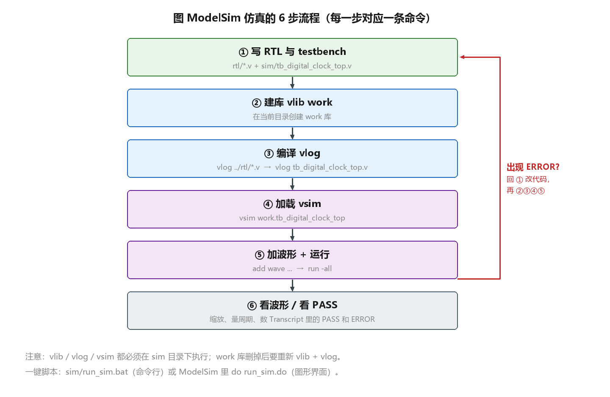
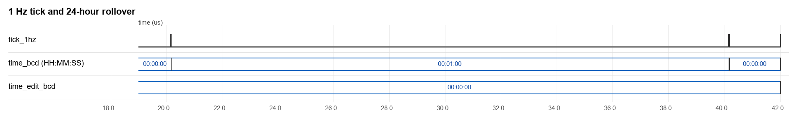
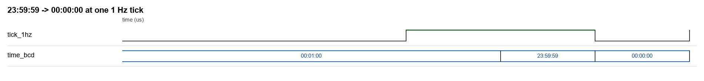
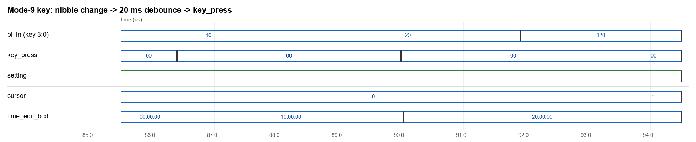
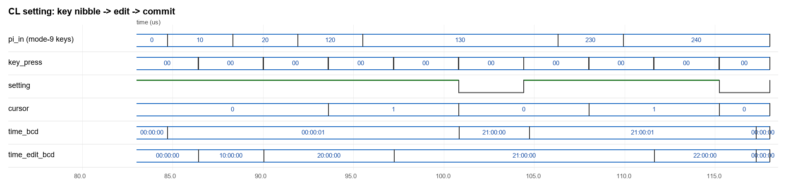
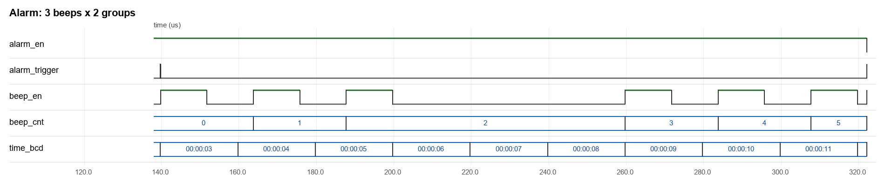
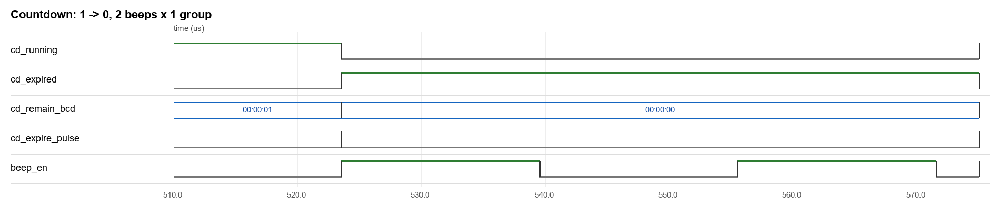
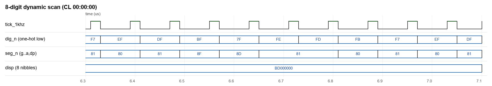
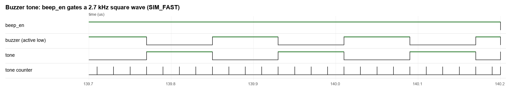

# 08 仿真实战：不用板子也能看波形、数 PASS

| 学完你能做什么 | 独立跑通 ModelSim 仿真，看到 `82 PASS`；看懂波形上每一个跳变的原因；自己加一条测试用例并让它通过 |
|---|---|
| 前置知识 | 会看 0/1、会开软件、会双击 `.bat`；Verilog 语法只需认识 `always`/`if` |
| 对应文件 | `sim/tb_digital_clock_top.v`、`sim/compile.do`、`sim/run_sim.do`、`sim/wave_all.do`、`sim/run_sim.bat`、`images/wave_*.png` |
| 预计耗时 | 边看边做 60 分钟 |

---

## 8.1 为什么必须先仿真，而不是直接下载

下载一次 `.sof` 要 1~3 秒，但**改代码 → 全编译**要 30 秒到 2 分钟。更麻烦的是，上板之后你只能看到数码管的最终结果，看不到“中间某根线在第几个时钟周期是 1”。

仿真解决三个问题：

| 问题 | 仿真给出的答案 |
|---|---|
| 时序对不对？（消抖是不是 20 ms、进位是不是在正确的那一拍） | 时间轴精确到 1 ps，可以放大到 20 ns 看一个时钟周期 |
| 边界对不对？（23:59:59、99:59.99、倒计时到 0） | 可以“作弊”直接把内部寄存器改成边界值，立刻测 |
| 逻辑对不对？（按键译码、模式切换、提示音下数） | 自动检查 + `PASS/ERROR` 打印，82 条断言一次跑完 |

一句话：**仿真里找逻辑错误，上板只做最后确认。**

---

## 8.2 仿真要哪些文件

| 文件 | 作用 | 要不要改 |
|---|---|---|
| `rtl/*.v`（15 个） | 被测设计（DUT） | 改 bug 时改这里 |
| `sim/tb_digital_clock_top.v` | testbench：产生激励、检查结果 | 加测试时改这里 |
| `sim/compile.do` | ModelSim 脚本：重建 work 库并编译全部文件 | 加新文件时改 |
| `sim/run_sim.do` | 一键脚本：编译 → 加载 → 加波形 → 运行 | 一般不动 |
| `sim/wave_all.do` | 把 40 多个信号分组加进波形窗口 | 想加信号时改 |
| `sim/run_sim.bat` | Windows 批处理：命令行跑完整仿真 | 一般不动 |

三个 `.do` 脚本全文都不长，值得先看一眼：

```tcl
# compile.do：重建 work 库并编译全部 RTL 和 testbench
if {[file exists work]} {
    vdel -all -lib work
}
vlib work
vmap work work

foreach f [glob ../rtl/*.v] {
    vlog $f
}
vlog ./tb_digital_clock_top.v
```

```tcl
# run_sim.do：编译 -> 加载 testbench -> 加波形 -> 运行到 $finish
do compile.do
vsim work.tb_digital_clock_top
do wave_all.do
run -all
```

> `foreach f [glob ../rtl/*.v]` 的意思是“把 `../rtl/` 下所有 `.v` 都编译一遍”，所以你**新建一个 `.v` 不用改脚本**，只要放在 `rtl/` 里就行。

---

## 8.3 testbench 是什么：给电路“接一台信号发生器”

testbench（简称 tb）本身也是一个 Verilog 模块，但它**不综合、不下载**，只给仿真器用。它的结构永远是四块：

```text
① 例化被测模块（DUT），把它的输入接成 reg、输出接成 wire
② 产生时钟
③ 产生激励（改输入、等一段时间）
④ 检查输出（对就打印 PASS，错就打印 ERROR 并计数）
```

本工程的 tb 逐段看：

### ① 例化 DUT，并把 `SIM_FAST` 打开

```verilog
    digital_clock_top #(
        .CLK_FREQ(50_000_000),
        .SIM_FAST(1)
    ) dut (
        .clk50(clk50),
        .pi_in(pi_in),
        .pio_in(pio_in),
        .key_core_n(key_core_n),
        .seg_n(seg_n),
        .dig_n(dig_n),
        .buzzer(buzzer),
        .led_n(led_n)
    );
```

- 输入信号（`clk50`、`pi_in`、`pio_in`、`key_core_n`）在 tb 里声明成 `reg`，因为 tb 要**驱动**它们；
- 输出信号（`seg_n`、`dig_n`、`buzzer`、`led_n`）声明成 `wire`，tb 只**观察**它们；
- `SIM_FAST(1)` 是给仿真的“加速开关”，把 1 秒从 5000 万个时钟缩短到 1000 个时钟（见 8.9）。

### ② 产生 50 MHz 时钟

```verilog
    // 50 MHz，周期 20 ns
    always #10 clk50 = ~clk50;
```

`#10` 表示“等 10 个时间单位”。文件开头写了 `` `timescale 1ns/1ps ``，所以 10 就是 10 ns；每 10 ns 翻转一次，一个完整周期 20 ns，正好是 50 MHz。

### ③ 用 task 把常用操作打包

```verilog
    task wait_clk(input integer n);
        begin
            repeat (n) @(posedge clk50);
        end
    endtask
```

```verilog
    // 按一次模式 9 的键：对应 nibble 加 1，保持足够长时间让 20 ms 消抖通过
    task press_key(input integer k);
        begin
            case (k)
                1: pi_in[3:0]   = pi_in[3:0]   + 1'b1;
                …
                8: pio_in[15:12]= pio_in[15:12]+ 1'b1;
                default: ;
            endcase
            wait_clk(180); // 180 个周期 = 45 个 1 ms tick，足够 20 ms 消抖
        end
    endtask
```

`press_key(8)` 这一行就等价于“用手指按一下键 8”。注意它**不是**把某个引脚拉低再拉高，而是把 4 位计数器加 1——因为模式 9 的按键在硬件上就是“按一次加 1”（见第 05 章）。

### ④ 检查：`check32` / `check1`

```verilog
    task check32(input [255:0] name, input [31:0] actual, input [31:0] expected);
        begin
            if (actual !== expected) begin
                $display("ERROR [%0s] at %0t: got %h, expected %h", name, $time, actual, expected);
                errors = errors + 1;
            end
            else begin
                $display("PASS  [%0s] = %h", name, actual);
            end
        end
    endtask
```

- `!==` 是“全等比较”，连 `x`（未知）也能比出来——所以仿真刚开始没复位时，`x` 会立刻被抓住；
- `$display` 把结果打印到 Transcript；
- `errors` 是全局计数器，最后一句判断 `errors == 0` 就打印 `==== ALL TESTS PASSED ====`。

**这就是“自动化测试”**：不用人眼看波形，只看最后这行结论。

### ⑤ 主流程：10 个 TEST

`initial begin … end` 里的内容就是脚本，顺序执行（只有这里可以“顺序”）。本工程分 10 组：

| TEST | 测什么 | 关键检查 |
|---|---|---|
| 1 | 复位后的默认值 | mode=CL、时间 00:00:00、闹钟关、倒计时 00:05:00、LED 全灭 |
| 2 | 1 Hz 进位与 24 小时回绕 | 00:00:59→00:01:00、23:59:59→00:00:00 |
| 3 | 模式 9 按键与模式切换 | 键 8 连按 4 次：CL→AL→St→Cd→CL |
| 4 | CL 设置：进入/冻结/加/移位/确认/取消 | 编辑缓冲不动、正式时间在走、确认后写回、取消不写回 |
| 5 | 闹钟开关、比较、3 下×2 组 | `beep_count == 6` 且不重复触发 |
| 6 | 秒表启动/暂停/清零/到最大/后台运行 | 暂停后数值不变、99:59.99 自动停 |
| 7 | 倒计时设置/启动/到期/恢复设定值/0 启动无效 | `beep_count == 2`、0 启动不响 |
| 8 | K2 连发、K1 复位 | 连发次数 ≥ 2、复位后时间归零 |
| 9 | 显示扫描与模式标识 | `dig_n` 每次只有一位为 0、CL/AL/St/Cd 的字符码正确 |
| 10 | 设置时的段内进位/借位 | 分 59+1→00 不进时、分 09+1→10、分 00−1→59、时 23+1→00、时 09+1→10、时 00−1→23、分十位 5+1→0 不动个位 |

---

## 8.4 跑仿真：三条路，选一条就行



看图要点：无论哪条路，本质都是这 6 步；区别只是“你手动敲命令”还是“脚本替你敲”。

| 方式 | 怎么做 | 适合 | 能看到什么 |
|---|---|---|---|
| A. 批处理 | 双击 `sim\run_sim.bat` | 只想确认“有没有改坏” | 黑窗口里的 PASS / ERROR，最后窗口关闭 |
| B. GUI 一键 | 打开 ModelSim，在 `sim` 目录下 `do run_sim.do` | 想看波形 | 波形 + Transcript |
| C. 手动分步 | `vlib work` → `vlog` → `vsim` → `add wave` → `run` | 想弄懂每一步在干什么 | 同上，但每步都能看见 |

### 方式 A：双击批处理（最快）

```bat
@echo off
setlocal
rem Portable: uses QUARTUS_ROOTDIR, or probes common install paths
if not defined QUARTUS_ROOTDIR if exist "C:\intelFPGA\17.1\quartus\bin64\quartus.exe" set "QUARTUS_ROOTDIR=C:\intelFPGA\17.1\quartus"

rem 把 .. 规范化，避免 vmap 顺着相对路径写 ini
for %%I in ("%QUARTUS_ROOTDIR%\..\modelsim_ase") do set "MS_ROOT=%%~fI"
set "MS_PATH=%MS_ROOT%\win32aloem"
rem 优先用工程里自带的 modelsim.ini（可写），没有再用安装目录的
if exist "%~dp0modelsim.ini" set "MODELSIM=%~dp0modelsim.ini"
if not exist "%~dp0modelsim.ini" set "MODELSIM=%MS_ROOT%\modelsim.ini"
set "PATH=%MS_PATH%;%PATH%"

cd /d %~dp0

if exist work rmdir /s /q work
vlib work
vmap work work

for %%f in (..\rtl\*.v) do vlog "%%f"
vlog tb_digital_clock_top.v

vsim -c -do "run -all; quit -f" work.tb_digital_clock_top
```

它做的事：删掉旧 `work` → 建库 → 编译 15 个 RTL + 1 个 tb → 用 `-c`（无界面）模式跑到底 → 退出。
因为开了 `SIM_FAST`，**整个 10 组测试只要 2~3 秒**。

### 方式 B：ModelSim 图形界面一键（推荐）

1. 打开 `%QUARTUS_ROOTDIR%\..\modelsim_ase\win32aloem\modelsim.exe`；
2. `File → Change Directory…` 切到 `…\DigitalClock\sim`；
3. 在下方 **Transcript** 输入框里敲：

```tcl
do run_sim.do
```

4. 等十几秒，波形窗口自动出现，Transcript 里滚出 `82 PASS`。

### 方式 C：手动分步（理解每一步）

在 Transcript 里依次敲（**注意必须在 `sim` 目录下**）：

```tcl
vlib work                          # 建一个叫 work 的库（存放编译结果）
vmap work work                     # 把逻辑名 work 映射到这个库
vlog ../rtl/clk_gen.v              # 编译一个文件
vlog ../rtl/*.v                    # 或者一次编译全部 RTL
vlog tb_digital_clock_top.v        # 编译 testbench
vsim work.tb_digital_clock_top     # 把 tb 加载进仿真器（此时时间还是 0）
add wave -r /*                    # 把全部信号加进波形窗口
run -all                           # 一直跑到 $finish
```

| 命令 | 一句话 |
|---|---|
| `vlib work` | 新建“编译结果仓库” |
| `vmap work work` | 告诉工具 `work.xxx` 去哪个目录找 |
| `vlog x.v` | 编译一个 Verilog 文件（相当于 gcc -c） |
| `vsim work.tb_xxx` | 加载设计并准备仿真（相当于“上电”） |
| `add wave /run -all` | 把信号画出来 / 开始跑 |

---

## 8.5 看懂 Transcript：82 PASS 是什么意思

跑完后 Transcript 末尾长这样：

```text
============================================================
 TEST 9 : display scan, labels, one-hot
============================================================
PASS  [Cd label C] = 0000000b
PASS  [Cd label d] = 0000000c
============================================================
==== ALL TESTS PASSED ====
============================================================
** Note: $finish    : ./tb_digital_clock_top.v(452)
   Time: 785450 ns  Iteration: 1  Instance: /tb_digital_clock_top
```

- **PASS 一条 = 一条检查通过**，全工程 82 条；
- 最后的 `==== ALL TESTS PASSED ====` 是“总闸”；
- `Time: 785450 ns` 是仿真结束时刻。注意这个时间**不能**用来判断真实快慢：仿真里 1 秒只有 20 µs（见 8.9）。

如果出错，你会看到：

```text
ERROR [00:00:59 -> 00:01:00] at 24300000: got 000002, expected 000100
==== TEST FAILED : 1 ERRORS ====
```

一条 ERROR 会告诉你三件事：**哪个检查**（方括号里）、**什么时刻**、**实际值和期望值**。这也是整个课程里最有用的一条调试信息。

---

## 8.6 波形窗口：加信号、看周期、量时间

ModelSim 的波形窗口有四个区域：

| 区域 | 在哪 | 作用 |
|---|---|---|
| 信号名 + 值 | 左半边 | 每一行一个信号，右边显示当前光标处的值 |
| 波形区 | 右半边 | 0/1 的方波、总线的十六进制值 |
| 时间轴 | 波形区顶部 | 拖动可以缩放 |
| 光标 | 波形区里的竖线 | 点击波形区任意位置，左边的“值”列就变成那一刻的值 |

常用操作：

| 想干什么 | 怎么做 |
|---|---|
| 加一个信号 | 在 Objects 窗口里选中信号 → 拖到波形窗口；或 `add wave /tb/dut/xxx` |
| 分组 | `add wave -divider "Clock / Reset"`（本工程 `wave_all.do` 就是这么分组的） |
| 改进制 | 右键信号 → `Radix` → Binary / Hexadecimal / Unsigned / ASCII |
| 缩放 | 工具栏的放大镜；或 `wave zoom full` / `wave zoom range 0us 8us` |
| 量一段宽度 | 放两个光标（左键点一下，再按住右键拖），看顶部的时间差 |
| 找某个时刻 | 顶端输入框里填时间 → 回车 |

本工程的 `wave_all.do` 已经把信号按 7 组整理好了（Clock/Reset、Mode 9 keys、Mode/Setting、Time/Alarm、Stopwatch/Countdown、Display/Buzzer），直接 `do wave_all.do` 就能用。

---

## 8.7 八张波形图，逐个讲清楚

下面 8 张图是真实仿真跑完 `.vcd` 后渲染出来的（`sim/render_wave.py` 生成），每张对应一个测试点。**时间单位是微秒（µs），不是秒**——仿真里 1 秒被压缩成 20 µs。

### 8.7.1 1 Hz tick 与进位（`wave_time.png`）



看图要点（横轴 19~42 µs）：

1. `tick_1hz` 在约 20.4 µs 和 40.4 µs 各有一个**极窄的脉冲**——宽只有 20 ns，在这么长的窗口里看起来就是一根竖线。这就是“单周期使能”。
2. `time_bcd` 在 20.4 µs 从 `00:00:00` 变成 `00:01:00`。注意**不是 `00:00:01`**：这是 TEST 2 直接把时间预置成 `00:00:59`，下一秒自然进位到 `00:01:00`。
3. 40.4 µs 处 `time_bcd` 直接变成 `00:00:00`——那是 TEST 2 把时间预置成 `23:59:59` 后的回绕。
4. `time_edit_bcd` 从头到尾是 `00:00:00`：因为没进设置，编辑缓冲没被装载。**这一条很重要**：它证明“正式时间”和“编辑时间”是两个独立的寄存器。

### 8.7.2 23:59:59 → 00:00:00（`wave_rollover.png`）



看图要点（横轴 40.12~40.18 µs，放大到 60 ns）：

1. 窗口只包含**一个** `tick_1hz` 脉冲，宽度正好 20 ns（一个时钟周期）。
2. 在脉冲之后的第一个时钟上升沿，`time_bcd` 从 `23:59:59` 一步跳到 `00:00:00`。
3. 中间**没有**出现 `24:00:00`——因为 `inc_time()` 是组合函数，在同一拍里把所有位一起算好再输出，不存在“先到 24 点再改回来”的中间态。

### 8.7.3 模式 9 按键：变化 → 消抖 → 脉冲（`wave_key.png`）



看图要点（横轴 85.5~94.5 µs）：

1. `pi_in` 的低 8 位先变化（十六进制值变了），说明“有键被按了”；
2. `key_press` 不是跟着 `pi_in` 立刻变，而是**等约 20 ms**（仿真里 20 ms = 20 个 1 ms tick = 80 个时钟 = 1.6 µs）之后才出现一个窄脉冲——这就是消抖；
3. 脉冲宽度只有 1 个时钟周期，`key_ctrl` 靠这个脉冲做一次动作；
4. 同期的 `setting`、`cursor`、`time_edit_bcd` 会跟着变，说明这个按键被正确翻译成了“进入设置 / 移动光标 / 加 1”。

> 图 5-2（第 05 章）是这张图的原理示意，两张对照看最清楚。

### 8.7.4 CL 设置：进入、改、确认、取消（`wave_cl_set.png`）



看图要点（横轴 83~118 µs）：

1. `setting` 由 0 变 1 的那一刻，`time_edit_bcd` 被装载成当前时间（`edit_load`）；
2. 之后每次按键，`time_edit_bcd` 变，而 `time_bcd` **继续自己走**——两条线同时在动，这就是“后台计时”；
3. `cursor` 在 0~5 之间循环，对应时十/时个/分十/分个/秒十/秒个；
4. 确认（`edit_commit`）之后 `time_bcd` 一步变成编辑值；取消则 `time_bcd` 保持原样。

### 8.7.5 闹钟：3 下 × 2 组（`wave_alarm.png`）



看图要点（横轴 138~322 µs）：

1. `alarm_en=1`：闹钟开关打开；
2. `alarm_trigger` 只有一个窄脉冲——因为 `alarm_trigger <= match & ~match_d` 做了上升沿检测，时间继续走之后 `match` 变 0，不会重复触发；
3. `beep_en` 出现 **6 个脉冲**：前 3 个一组，中间空一段（`beep_cnt` 保持不变），后 3 个一组；
4. `beep_cnt` 从 0 数到 5，正好 6 下；第 6 下结束后回到 `ST_IDLE`，所以之后再也不会响（单次）。

### 8.7.6 倒计时到 0：2 下 × 1 组（`wave_countdown.png`）



看图要点（横轴 510~575 µs）：

1. `cd_running` 为 1 时 `cd_remain_bcd` 每秒减 1；
2. 剩 1 秒时下一个 tick 直接变 `00:00:00`，同时 `cd_running` 掉 0、`cd_expired` 置 1；
3. `cd_expire_pulse` 只有一个脉冲（和闹钟一样的上升沿检测思路）；
4. `beep_en` 只有 **2 个**脉冲——倒计时是“2 下 × 1 组”，和闹钟的 6 下不同。

### 8.7.7 8 位数码管动态扫描（`wave_display.png`）



看图要点（横轴 6.3~7.1 µs，一个 1 ms 的 tick 周期内）：

1. `tick_1khz` 是节拍：每来一个，`dig_n` 换一位、`seg_n` 换一个字符；
2. `dig_n` 的值依次是 `FE, FD, FB, F7, EF, DF, BF, 7F`——**每次只有一个 0**（one-hot 低有效），0 的位置就是“当前点亮的那一位”；
3. `seg_n` 跟着 `disp` 当前 nibble 变化；`disp` 一直是 `0B0D000000`（C、L、0、0、0、0、0、0），说明显示的是 `CL 00:00:00`；
4. 8 位扫完一圈正好 8 个 tick = 8 ms，人眼看起来是“同时亮”。

### 8.7.8 蜂鸣器方波（`wave_buzzer.png`）



看图要点（横轴 139.7~140.2 µs）：

1. `beep_en=1` 期间，`tone` 每 4 个时钟翻转一次（`SIM_FAST` 把 9259 缩成 4）；
2. `buzzer` 是 `tone` 的**反相**（低有效）；
3. `beep_en=0` 之后 `tone` 和 `cnt` 都被清零，`buzzer` 回到高电平（不响）；
4. 真实上板时 `tone` 频率是 50 MHz / (2 × 9259) ≈ 2.7 kHz，方波听上去是“滴——”。

---

## 8.8 自己加一条测试用例

假设你想验证“按 K4 也能进入设置”。在 `initial` 块的最后、`$display` 总结之前，插入：

```verilog
        $display("============================================================");
        $display(" TEST 10 : K4 enters CL setting");
        $display("============================================================");
        reset_dut();
        press_core(4, 120);              // 按一下 K4，保持 120 个时钟
        check1 ("K4 -> setting=1", dut.setting, 1'b1);
        check32("K4 -> mode stays CL", {30'd0, dut.mode}, 32'd0);
```

三个要点：

1. **先 `reset_dut()`**，让状态确定，不然会受前面测试的影响；
2. **用现成的 task**（`press_core` / `press_key` / `wait_clk` / `check32`），不要手写延时；
3. 检查时**用层次化引用**（`dut.setting`），可以看任何内部信号，不限于端口。

保存后在 ModelSim 里 `do run_sim.do`，你会看到 PASS 数从 82 变成 84。

---

## 8.9 `SIM_FAST`：为什么仿真比现实快 5 万倍

| 分频 | 真实计数值 | `SIM_FAST=1` 的计数值 | 仿真里“1 秒”等于 |
|---|---|---|---|
| 1 Hz | 50 000 000 | 1 000 | 20 µs |
| 100 Hz | 500 000 | 8 | 160 ns |
| 1 kHz | 50 000 | 4 | 80 ns |
| 2 Hz | 12 500 000 | 250 | 5 µs |

`clk_gen.v` 里就是一句三目运算：

```verilog
    localparam integer DIV_1HZ   = (SIM_FAST != 0) ? 1000 : CLK_FREQ;
```

所以：

- **仿真里**的时间标签（比如 `Time: 785450 ns`）**不能**当成“真实要跑 0.78 ms”；
- 想测“1 秒有没有走准”，只能看**tick 的个数和逻辑关系**，不能看绝对时间；
- 上板前必须把 `SIM_FAST` 恢复成 0（本工程的顶层默认就是 0，只有 tb 里改成 1，所以不会带到板子上）。

---

## 8.10 仿真常见问题

| 现象 | 原因 | 解决 |
|---|---|---|
| `Error: Can't find design unit work.tb_xxx` | 没编译，或编译到了别的库 | 先 `do compile.do`，或 `vlog tb_xxx.v` |
| 波形窗口是空的 | 没加信号就 `run`，或信号路径写错 | `add wave -r /*`；确认层级路径（`/tb/dut/xxx`） |
| 仿真一瞬间就结束 | tb 里 `$finish` 太早 | 检查 `initial` 块，或 `run -all` 改成 `run 1ms` |
| 所有信号都是 `x` | 没复位；`rst_n` 一直是 0 或一直是 x | 检查 `reset_dut()` 是否执行 |
| 仿真跑了几分钟没结果 | 没开 `SIM_FAST`，1 秒 = 5000 万周期 | 确认 tb 里是 `SIM_FAST(1)` |
| 改了 `.v` 但结果没变 | 忘了重新 `vlog` | `do compile.do` 全量重编 |
| `vsim` 打不开，提示 license | ModelSim 路径/license 没配 | 用 `run_sim.bat`（它自己设了 PATH 和 MODELSIM） |
| 波形里的时间单位和预期差 1000 倍 | `` `timescale `` 不一致 | tb 必须是 `1ns/1ps`，且 `#10` 表示 10 ns |

---

## 8.11 本章小结

- 仿真 = tb 给 DUT 加激励 + 自动检查；tb 不综合、不下载。
- 三条路：`run_sim.bat`（最快）、`do run_sim.do`（看波形）、手动 `vlib/vlog/vsim/add wave/run`（理解流程）。
- `82 PASS` 是 82 条自动断言；一条 ERROR 会告诉你名字、时刻、实际值、期望值。
- 波形窗口四件事：加信号、分组、缩放、用光标量时间。
- `SIM_FAST` 让 1 秒 = 20 µs，所以仿真时间不能当真实时间用。

## 8.12 练习

1. 为什么 `press_key(8)` 是“把 `pio_in[15:12]` 加 1”，而不是“拉低再拉高某个引脚”？
2. `wave_display.png` 里 `dig_n` 为什么是 `FE, FD, FB…`，而不是 `01, 02, 04…`？
3. 想在波形里只看 `nibble_key` 的 `cnt`，写出两种加信号的方法。
4. 你自己加的 TEST 10 里，为什么必须先 `reset_dut()`？
5. 把 `SIM_FAST` 改成 0 再跑仿真，会发生什么？怎么估算要跑多久？

<details>
<summary>答案要点</summary>

1. 模式 9 的 8 个按键在底板上是 4 位计数器，按一次加 1；FPGA 只能读这个值，不能驱动/清零（第 02、05 章）。
2. `dig_n` 是**低有效**位选，0 表示选中。`FE`=1111_1110 表示第 0 位被选中，`FD`=1111_1101 表示第 1 位。
3. ① Objects 窗口拖拽；② `add wave /tb_digital_clock_top/dut/u_key_input/u_key1/cnt`；③ 改 `wave_all.do` 加一行。
4. 前面的测试会把时间、模式、设置状态改成各种值，不复位就没有确定的起点，检查会随机失败。
5. 1 秒 = 5000 万个 50 MHz 周期；10 组测试里有很多 `wait_1hz`，总量级是几十秒到几分钟的仿真时间，实际可能跑十几分钟甚至更久（这也是 `SIM_FAST` 存在的原因）。

</details>
