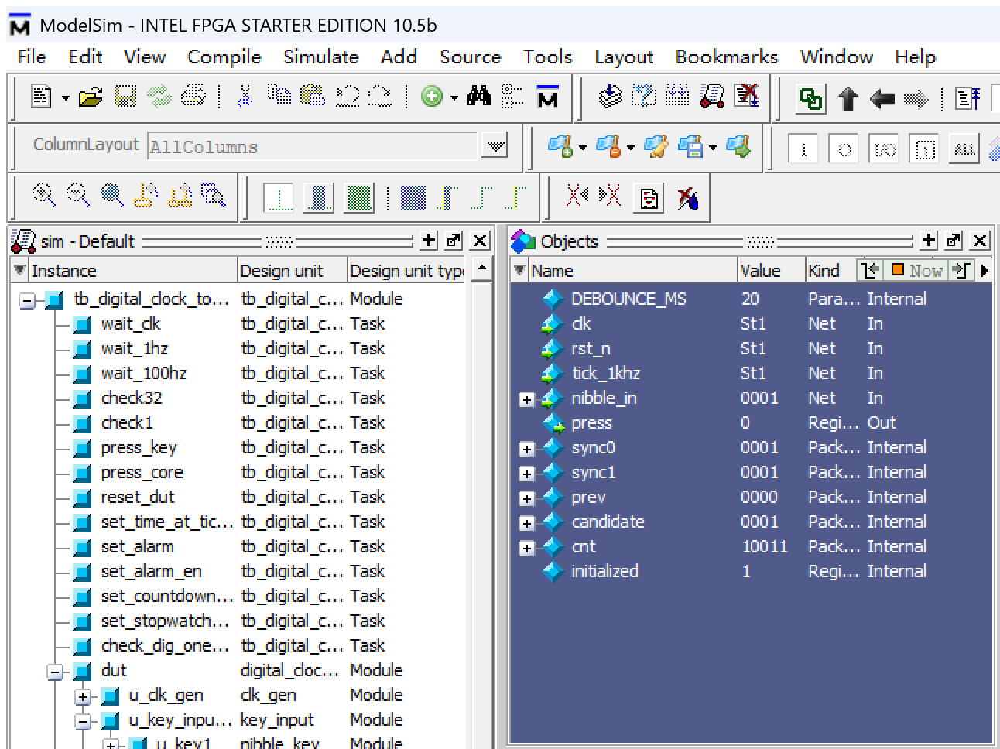

# 09 断点与单步：让仿真停在你想看的那一行

| 学完你能做什么 | 在 ModelSim 里把仿真停在任意一行，读出当时所有寄存器的值；用单步和断点定位“为什么这个信号不是我想要的” |
|---|---|
| 前置知识 | 看完第 08 章，能跑通 `do run_sim.do`，会在波形窗口加信号 |
| 对应操作 | `bp` 设断点、`run -continue` 继续、`step` / `step -over` 单步、`examine` 读值 |
| 预计耗时 | 40 分钟 |

---

## 9.1 断点到底在“断”什么

前面两章你有两种观察手段：看波形（事后回放）和看 `$display`（事先埋打印）。它们的共同缺点是**被动**：波形里信号太多，你往往不知道从哪一根看起；`$display` 要改代码、重编译。

断点是第三种手段：**让仿真在指定位置停下来，然后随便看**。

```text
正常仿真：  时钟沿 → 执行 → 执行 → 执行 → … → $finish
有断点：    时钟沿 → 执行 → 【停在这里】→ 你看一眼所有寄存器的值 → 继续
```

它和 C 的调试器（GDB）的断点是一个意思，只不过 Verilog 的“一行”通常对应一个时钟沿里的一小段组合逻辑。

---

## 9.2 三种调试手段怎么选

| 手段 | 优点 | 缺点 | 什么时候用 |
|---|---|---|---|
| 波形 | 不用改代码，能看整体时序趋势 | 信号多时找不到重点；总线值不直观 | 先看“大概是哪一段出的问题” |
| `$display` 打印 | 精确、可以算表达式、能打印字符串 | 要改 tb、重编译；输出会刷屏 | 已知要看哪个信号、想批量对比 |
| 断点 + 单步 | 停在任何一行，看全部局部变量；不用重编译 | 只能一行一行来，慢 | 已经缩小到某个模块/某个 if 分支 |

实战顺序通常是：**波形定位模块 → 该模块里设断点 → 单步看到底走了哪个分支**。

---

## 9.3 在 ModelSim 里设断点

### 9.3.1 命令行方式（最可靠）

先加载设计（`sim` 目录下）：

```tcl
do compile.do
vsim work.tb_digital_clock_top
do wave_all.do
```

然后设断点、开跑：

```tcl
bp nibble_key.v 54          # 在 nibble_key.v 第 54 行设断点
bp -query                   # 看看现在有哪些断点
run -all                    # 一直跑，直到撞上断点
```

撞上以后 Transcript 会打印：

```text
# Break in Module nibble_key at ../rtl/nibble_key.v line 54
# Stopped at ../rtl/nibble_key.v line 54
```

`bp` 的完整语法（`help bp` 的输出）：

```text
Usage: bp {<filename> <line_number> | in <task_or_fcn>}
       [-ancestor] [-appendinst] [-cond "<condition_expression>"]
       [-disable] [-id <id#> | -label "<label>"] [-uvm]
       [<command>...] | [-query <filename> [<line_number>]]
```

最常用的三种写法：

| 写法 | 含义 |
|---|---|
| `bp nibble_key.v 54` | 在第 54 行设断点（**文件名可以只写 basename**，不用全路径） |
| `bp in press_key` | 在 task / function `press_key` 被调用时停 |
| `bp -cond "dut.mode == 2'b10" nibble_key.v 54` | 条件断点：只有条件成立才停 |

### 9.3.2 图形界面方式

1. 先 `vsim work.tb_digital_clock_top`，让 Source 窗口出现（没出现就 `view source`）；
2. 在 Source 窗口里打开 `nibble_key.v`；
3. 在**行号左边的灰色边缘**点一下——出现红色标记就是断点，再点一下取消；
4. 工具栏的 `Run` 按钮按下后，会自动停在该行。

> 图形界面和命令行是同一套东西：你在界面上点的断点，等价于 `bp 文件名 行号`。

---

## 9.4 一次真实的断点现场

下图是本工程实际跑仿真、在 `nibble_key.v` 第 54 行停住时的截图（左侧是层次树，中间是 Objects 观察窗口，右侧是 Source 源码窗口）：



看图要点（按区域读）：

| 区域 | 看到什么 | 说明什么 |
|---|---|---|
| 左上 `sim` 层次树 | `dut → u_key_input → u_key1 (nibble_key)` | 断点命中的是“键 1”那一路消抖器，说明此时正在处理键 1 |
| 中间 Objects | `DEBOUNCE_MS = 20` | 参数（常量），消抖门限是 20 个 1 ms |
| | `nibble_in = 0001` | 键 1 的 4 位计数器当前是 1（按过一次） |
| | `sync1 = 0001` | 两级同步后的值也是 1，没有抖动 |
| | `candidate = 0001` | “正在确认的新值”是 1 |
| | `prev = 0000` | “上一次已确认的值”还是 0，所以确实检测到了一次变化 |
| | `cnt = 10011`（二进制）= 19 | 稳定计时器已经数到 19 |
| | `press = 0` | 脉冲还没打出去（正要在这一行打出） |
| | `initialized = 1` | 上电初值锁存已经完成 |
| 右侧 Source | 行号 30~49，红色行号 | 红色表示该行可执行；光标行 54 就是断点行 |

把这一屏串起来就是一句话：

> **输入稳定了 20 个 tick，`prev != candidate`，`cnt` 已经数到 19，(20-1) 这个条件成立的这一拍，代码准备执行 `press <= 1'b1;`。**

这就是断点最大的价值：**你不需要猜，寄存器就摆在那里。**

---

## 9.5 实战一：`press` 为什么只有 1 个时钟周期？

第 05 章说“`press` 只高一个周期”，但为什么？看 `nibble_key.v` 的第 36 行和第 54 行：

```verilog
        else begin
            press <= 1'b0;
```

```verilog
                    if (cnt == DEBOUNCE_MS - 1) begin
                        prev  <= candidate;
                        press <= 1'b1;
                        cnt   <= 5'd0;
                    end
```

**调试步骤：**

1. `bp nibble_key.v 54`，`run -all`，停在上面那一屏；
2. `step` 走一步，`press` 变成 1；
3. `bp nibble_key.v 36`，`run -continue` 跑到下一个时钟沿，`press` 又变回 0；
4. 结论：每个时钟沿进 always 块，第一件事就是把 `press` 清 0；只有当“刚好数到 19”这个分支命中时才置 1。所以宽度恒等于 1 个周期。

如果你怀疑“它是不是连续高了好几个周期”，只要在波形里量一下 `press` 的宽度：20 ns 就是对的，40 ns 就说明哪里写错了。

**顺带一个常见 bug：** 把 `press <= 1'b0;` 写到 `if (tick_1khz)` 里面，`press` 就会保持 1 ms，下游会以为“按了很多次”。断点设在 54 行、再看 36 行，就能立刻发现这个结构问题。

---

## 9.6 实战二：闹钟到点但不响，怎么定位

症状：时间到点了，`buzzer` 一点动静都没有。按下面的顺序设三个断点，一路缩小范围：

| 步骤 | 断点 | 期望看到 | 如果不对 |
|---|---|---|---|
| ① `alarm_ctrl.v` 第 66 行（`alarm_trigger <= match & ~match_d;`） | `bp alarm_ctrl.v 66` | `match=1`、`match_d=0`、`alarm_trigger` 随后变 1 | 停在别的地方 → `time_bcd` 和 `alarm_reg` 不相等，或 `en_reg=0`（闹钟没开） |
| ② `beep_ctrl.v` 第 50 行（`state <= ST_ON;`） | `bp beep_ctrl.v 50` | 被打中，`state` 从 IDLE 变 ON | 没被打中 → `alarm_trigger` 没接到 `beep_ctrl`，或 `silence` 一直为 1 |
| ③ `buzzer_tone.v` 第 32 行（`tone <= ~tone;`） | `bp buzzer_tone.v 32` | 每 4 个时钟命中一次 | 没被打中 → `beep_en` 没拉高；如果 `beep_en=1` 但 `tone` 不翻，看 `TONE_DIV` |

三个断点从“数据对不对”查到“声音有没有”，这就是**由后往前、逐级排除**的调试思路。

用 `examine` 可以在不停下来的情况下读任意信号：

```tcl
examine /tb_digital_clock_top/dut/u_alarm_ctrl/match
examine /tb_digital_clock_top/dut/u_alarm_ctrl/alarm_reg
examine /tb_digital_clock_top/dut/u_beep_ctrl/state
```

`examine` 的路径就是 `Objects` 窗口里那一列信号名，可以一直点进去（`dut → u_alarm_ctrl → match`）。

---

## 9.7 实战三：数码管显示乱码

症状：数码管亮的段不对（比如该显示 `1` 却像 `7`）。

| 步骤 | 断点/命令 | 看什么 |
|---|---|---|
| ① | `bp display_ctrl.v 214`（`dig_n <= ~(8'b00000001 << scan_idx);`） | `scan_idx` 是否 0→7 循环、`dig_n` 是否每次只有一位为 0 |
| ② | `bp display_ctrl.v 213`（`seg_n <= seg_cur;`） | `seg_cur` 的值，和 `seg_decode` 的译码表对一下 |
| ③ | `bp seg_decode.v 16`（`4'h0: seg_n = 8'h81;`） | `bcd` 是不是你期望的数字 |

如果 `seg_cur` 是对的但屏幕上不对，那问题在**硬件**（段序接反、共阳/共阴搞错），不在代码——断点在这里帮你划清了“代码 vs 板子”的界限。

---

## 9.8 断点的局限，别踩坑

| 坑 | 说明 | 怎么办 |
|---|---|---|
| 断点打在声明行、注释行、`end` 上不生效 | 那些行没有“可执行语句” | 打在赋值、`if`、`case` 上（Source 窗口里行号变红的行才有效） |
| 停在时序逻辑某行，看到的值是“这个时钟沿之前”的值 | `<=` 是同时赋值 | 想看在沿之后的值，再 `step` 一次 |
| 内部信号不在 Objects 里 | 仿真被优化掉了 | `vsim -voptargs="+acc" work.tb_xxx`，或先 `vlog +acc` |
| 断点太多，每次都停 | 每个时钟沿都判一次 | 用条件断点 `-cond`，或 `-once` |
| 停住以后 `run -all` 会继续跑到下一个断点或 `$finish` | 正常行为 | 想跑一段就 `run 100ns`、`run -continue` |
| 断点会改变仿真时序吗 | **不会**，断点只是暂停，不插入延迟 | 放心用 |

补充两条常用命令：

```tcl
run -continue              # 从断点继续，跑到下一个断点
run 500ns                  # 只跑 500 ns，然后停
step                       # 单步进入（会进到 function/task 里面）
step -over                 # 单步跳过（不进入被调用的 function/task）
```

---

## 9.9 没有仿真器的时候怎么“断点”：上板调试

板上没有 ModelSim，但同样的思路可以搬过去，只是“看值”的手段变成：

| 手段 | 怎么做 | 精度 |
|---|---|---|
| LED 打点 | `assign led_n[0] = ~some_signal;` 把内部信号引到 LED | 只能看 0/1，慢变化 |
| 数码管打点 | 临时把 `disp` 换成想看的值（例如 `32'h12345678`） | 能看 8 个十六进制位 |
| 蜂鸣器打点 | 条件满足时拉响 | 只能判断“有没有到过” |
| SignalTap II | Quartus 自带的“片上逻辑分析仪”，把内部信号抓进片内 RAM，再通过 JTAG 读出来 | 能看真实波形，但有资源开销 |

SignalTap 属于进阶内容，本教程只到“知道有这么个东西、知道它和 ModelSim 断点的区别（一个是真实硬件采样，一个是仿真暂停）”。等你把仿真断点用熟了，再学 SignalTap 会很快。

---

## 9.10 常见问题

| 现象 | 原因 | 解决 |
|---|---|---|
| `bp` 报 `invalid command name` | do 文件被存成了带 BOM 的 UTF-8，Tcl 读第一个字符就报错 | 用记事本“另存为 UTF-8 无 BOM”，或干脆不写中文注释 |
| `bp` 设了但从来不命中 | 行号是注释/声明；或那段代码根本没执行到 | 换一行可执行语句；先确认该模块在波形里有活动 |
| `vsim` 后 Objects 里看不到内部信号 | vopt 优化 | `vsim -voptargs="+acc" work.tb_digital_clock_top` |
| 停在断点后 `run -all` 又立刻停在同一行 | 那行在 `always` 里，每个时钟沿都会执行 | 改用 `-cond` 条件断点 |
| 断点面板里一堆断点，找不到 | 上次没删 | `bp -query` 看列表，在 Source 窗口点掉，或 `delete` |
| 想看数组/总线的某一位 | `examine` 只给整体值 | `examine /path/sig` 看整体，波形里展开 `+` 看位 |

---

## 9.11 本章小结

- 断点 = 在仿真里暂停在指定行，看当时所有寄存器的值；GDB 的那一套在 Verilog 里同样适用。
- `bp 文件名 行号` 设断点，`bp -query` 查，`run -all` / `run -continue` 跑，`step` 单步，`examine 路径` 读值。
- 读一屏断点信息的方法：先看**在哪个模块**（层次树），再看**关键寄存器的值关系**（`cnt == 19`、`prev != candidate`）。
- 调试顺序：波形定位模块 → 断点缩小到分支 → 单步确认。
- 断点不改变时序；但要注意 `<=` 让你看到的是“沿之前”的值。

## 9.12 练习

1. `bp nibble_key.v 54` 和 `bp in press_key` 有什么区别？
2. 想让仿真只在“mode 变成 St（2'b10）”时停下，写出断点命令。
3. 停在第 54 行时 `cnt = 19`，如果 `DEBOUNCE_MS` 改成 50，这里应该是多少？为什么？
4. 为什么断点不能设在 `reg [4:0] cnt;` 这一行？
5. 用 `examine` 读出 `beep_ctrl` 的 `state`，你能判断出当前是“响”还是“不响”吗？

<details>
<summary>答案要点</summary>

1. 前者在“某一行代码”停，任何实例执行到这一行都会停；后者在“task/function 被调用”时停，属于函数级断点，常用于看某个 task 的入参。
2. `bp -cond "dut.mode == 2'b10" key_ctrl.v 97`（行号取 `mode <= next_mode(mode);` 那句），或 `bp -cond "/tb_digital_clock_top/dut/mode == 2'b10" key_ctrl.v 97`。
3. 应该是 49。因为条件是 `cnt == DEBOUNCE_MS - 1`，`DEBOUNCE_MS=50` 时终值是 49，`cnt` 只有 5 位（0~31）装不下 49，所以还得把 `cnt` 加宽到 6 位（这也是第 05 章练习的一个坑）。
4. 那是声明行，没有可执行语句，断点不会命中；要打在 `cnt <= cnt + 1'b1;` 这类赋值行上。
5. 能。`beep_en = (state == ST_ON)`，所以 `state=1` 表示正在响，`state=0/2/3` 都不响（分别为空闲、间歇、组间停顿）。

</details>
