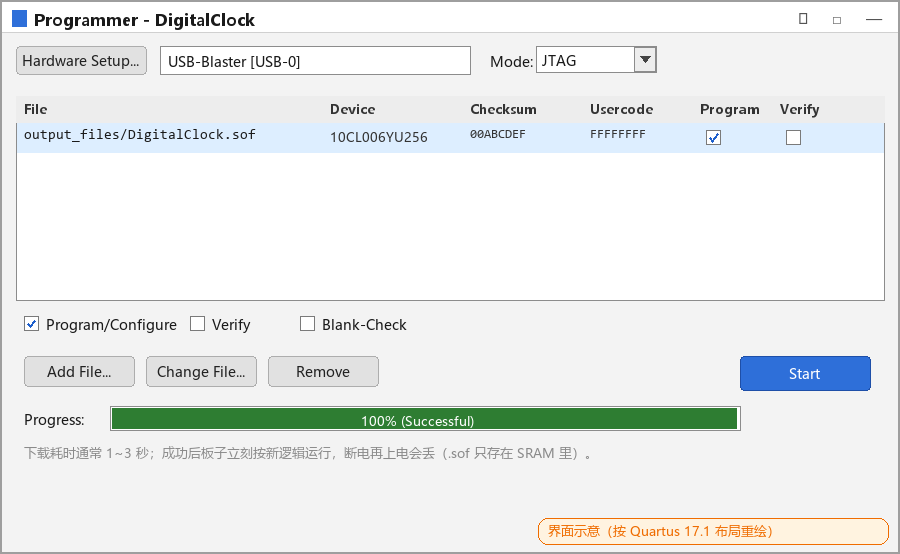
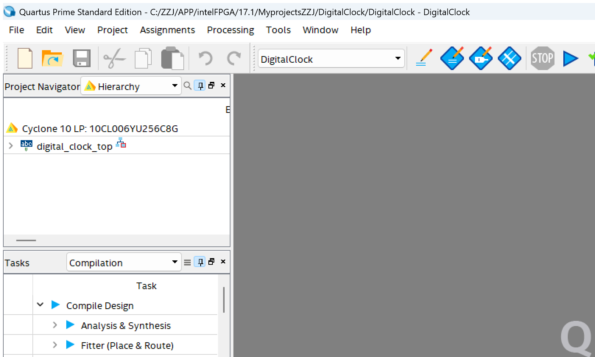

# 10 上板：把 .sof 下载进板子并让它跑起来

| 项目 | 内容 |
|---|---|
| 学完你能做什么 | 把 `output_files/DigitalClock.sof` 下载进 10CL006；按 K1 后看到 `CL 00.00.00` 和 LED1 的 1 Hz 心跳；按本章脚本把 CL / AL / St / Cd 四个模式各演示一遍；遇到 17 种典型现象时，能按“现象 → 原因 → 验证 → 改”的顺序自己定位 |
| 前置知识 | 第 03 章（Quartus 全流程）、第 08 章（仿真实战）；会用设备管理器、会双击 `.bat`；不需要懂电路和焊接 |
| 需要的硬件 | KX-MS65 实验箱 + KX-10CL006 核心板（10CL006YU256C8G）、USB-B 线一根（插核心板左下侧）、5V 电源适配器、装了 Quartus Prime Standard 17.1 的电脑；可选：万用表、示波器 |

这一章只做一件事：让板子动起来。所有步骤都假设你已经能在 ModelSim 里跑出 `82 PASS, 0 ERROR`；仿真过的东西上板还不一定对，所以本章把“看到什么才算对”写得很细。

---

## 10.1 上板前先自检

下载失败十次里有八次不是代码问题，而是下面这张表里某一项没做。花 3 分钟逐项打勾，比在板子前猜半小时划算。

| # | 检查项 | 怎么查 | 不合格怎么办 |
|---|---|---|---|
| 1 | 编译 0 error | Quartus 的 Messages 最后一行是 `0 errors`；Compilation Report 里 Flow Status 为 Successful | 先修 error，别下载 |
| 2 | 只有那 1 个 AN447 警告 | Messages 里是 `Warning (169177): 37 pins must meet Intel FPGA requirements for 3.3-V ...`，并提到 AN 447 | 这是实验箱 3.3 V 电平的正常提示，**不用管**；出现别的 warning 要看懂再下载 |
| 3 | 引脚已锁定 | `DigitalClock.qsf` 里搜 `set_location_assignment`，应有 58 条；Pin Planner 里 58 个脚都有位置 | 按第 03 章或 11.1 表补齐，改完必须重新全编译 |
| 4 | `.sof` 是最新的 | `output_files/DigitalClock.sof` 的修改时间晚于你最后一次改代码/改引脚 | `Processing → Start Compilation` 重新编译 |
| 5 | 板子上电 | 核心板左下侧红色电源开关按下，电源指示灯亮 | 检查电源适配器或 USB 供电 |
| 6 | USB-Blaster 驱动正常 | 设备管理器 → 通用串行总线控制器 → 出现 `Altera USB-Blaster` | 装 `%QUARTUS_ROOTDIR%\drivers\usb-blaster` 下的驱动 |
| 7 | 下载线插对位置 | 插核心板左下侧的 **USB-B** 口 | 不是动态配置 IO 板上的 USB，也不是左上侧 Type-C（那是 USB 转串口） |
| 8 | 模式选择是 **No.9** | 按动态配置 IO 板的“模式选择键”，看 1.8 寸 LCD 显示 `No.9` | 切到 No.9；这一步决定 PO/PI/PIO 这 64 根脚怎么分配 |
| 9 | K1 没被一直按住 | 核心板 K1 松开；`sys_rst_n` 才为 1 | 松开 K1，再按一次复位 |

> 记忆点：**编译干净、引脚锁定、板子有电、驱动认到、模式 No.9、K1 松开**。六件事都对了，下载基本不会失败。

---

## 10.2 认识 USB-Blaster 与 JTAG

**一句话**：JTAG（Joint Test Action Group，芯片级串行测试/配置接口）用 TCK、TMS、TDI、TDO 四根线把比特流一位一位移进 FPGA，下载 `.sof` 就是通过 JTAG 把配置数据写进 FPGA 内部的 SRAM（Static RAM，掉电即失）。

| 问题 | 回答 |
|---|---|
| 下载线怎么接 | 本实验箱把 USB-Blaster 做在核心板上：电脑 ↔ 核心板左下侧 USB-B 口，一根 USB 线同时供电和下载，不需要别的线 |
| 那 10 针座是干什么的 | 标准 Altera JTAG 座是 2×5 的 10 针（0.1 英寸间距），里面真正用的只有 TCK / TDO / TMS / TDI 四根信号加 GND，另外带 VCC 参考和防插反缺口。外置 USB-Blaster 时，用 10 芯排线一头插下载器、一头插板上的 10 针座，四根信号一次接好；本箱集成下载器，所以这个座留作外置烧写或级联用，平时不用接 |
| 为什么不能一根根接杜邦线 | JTAG 时钟频率高，飞线容易串扰、接触不良；10 针排线把信号和地绞在一起，可靠得多，也不会插反 |
| 要注意什么 | JTAG 的 TCK/TMS/TDI/TDO 是 FPGA 的专用配置脚，不能当普通 IO 锁定；下载时不要热插拔排线 |

10 针座里真正干活的就这四根信号：

| 信号 | 方向（相对 FPGA） | 作用 |
|---|---|---|
| TCK | 输入 | JTAG 时钟，由下载器产生，所有数据都按它的节拍一位一位移位 |
| TMS | 输入 | 模式选择，决定内部状态机走到“送指令”还是“送数据” |
| TDI | 输入 | 数据输入，配置比特流从这根线进 FPGA |
| TDO | 输出 | 数据输出，读回 IDCODE、回读校验结果 |
| GND / VCC | — | 公共地和电平参考，让两边“说同一种语言” |

Programmer 里的 `Auto Detect` 就是通过 TDO 读回器件的 IDCODE：读得到，说明 TCK/TMS/TDI/TDO 四根线全通；读不到，就报 `Can't access JTAG chain`。这也是为什么“下载失败”先看驱动和连线，而不是先改代码。

---

## 10.3 打开 Programmer 并下载 .sof

### 10.3.1 步骤 1~8

| 步骤 | 点哪里 | 应该看到什么 |
|---|---|---|
| 1 | `File → Open Project`，选 `DigitalClock.qpf`（或直接双击 `.qpf`） | 标题栏出现 `...\DigitalClock\DigitalClock - DigitalClock`，左侧 Project Navigator 显示器件 `10CL006YU256C8G` 和顶层 `digital_clock_top` |
| 2 | `Tools → Programmer`（工具栏上的 Programmer 图标等价） | 弹出 Programmer 窗口，上方是 Hardware Setup、Mode、文件列表，下方是 Progress 和消息栏 |
| 3 | 点 `Hardware Setup...` | 弹出 Hardware Setup 对话框 |
| 4 | 在 `Currently selected hardware` 下拉里选 `USB-Blaster [USB-0]`，点 `Close` | Programmer 窗口右上方显示 `USB-Blaster`；若下拉是空的，说明驱动或 USB 线有问题，回 10.1 第 6、7 项 |
| 5 | `Mode` 下拉框选 `JTAG` | Mode 显示 `JTAG`；若是 `Passive Serial`、`Active Serial`，必须改回 JTAG |
| 6 | 点 `Add File...`，选 `output_files/DigitalClock.sof` | 文件列表出现 `DigitalClock.sof`，Device 列显示 `10CL006`，最左边有 `Program/Configure` 复选框 |
| 7 | 勾选该文件行的 `Program/Configure` | 复选框打勾；这一步是“真的要把这个文件写进去”的开关，**漏勾就会显示下载成功但什么都没发生** |
| 8 | 点 `Start` | Progress 从 0% 涨到 100%，消息栏出现 `Successfully performed operation(s)`，Status 列显示 `Successful` |



看图要点：

1. 左上 `Hardware Setup...` 按钮：没选对硬件时这里会显示 `No Hardware`，点它选 `USB-Blaster`。
2. `Mode` 下拉必须是 `JTAG`，这是下载 `.sof` 的唯一正确模式。
3. 中间文件列表的 `Program/Configure` 列：只有打勾的那一行才会被写进 FPGA。
4. 右侧 `Start` 按钮：点下去才开始传输；只 Add File 不点 Start 是最常见的“假成功”。
5. 下方 Progress 百分比和消息栏：100% 加上 `Successfully performed operation(s)` 才算真的成功。



看图要点：

1. 标题栏会显示工程的完整路径，确认最后一段是 `DigitalClock`。
2. Project Navigator 里 `Cyclone 10 LP: 10CL006YU256C8G` 是器件，`digital_clock_top` 是顶层实体；这两个和 `.qsf` 对不上就编不出正确的 `.sof`。
3. 菜单栏的 `Tools` 是 Programmer 的入口；`Processing → Start Compilation` 是重新编译的入口。
4. 左下 Tasks 面板的 `Compile Design` 展开后能看到 Analysis & Synthesis、Fitter (Place & Route)，编译失败时从最上面那一项开始看。
5. 编译完先看 Messages 的 error/warning 数量，再看 Programmer，顺序不要反。

### 10.3.2 下载成功的三个标志

| 标志 | 位置 | 说明 |
|---|---|---|
| Progress 100% | Programmer 窗口中间进度条 | 传输完成，不代表板子已经跑起来 |
| Status 显示 `Successful` | 文件列表的 Status 列 | 器件配置成功 |
| 消息栏 `Successfully performed operation(s)` | 窗口下方 | 三样都对，才算真的下载成功 |

下载成功后 FPGA 立即开始运行，但本设计有 20 ms 上电复位和 K1 复位，所以**按一下 K1 再观察**，看到的现象才是干净的初始状态。

### 10.3.3 .sof 与 .jic 的区别

| 项目 | `.sof`（SRAM Object File） | `.jic`（JTAG Indirect Configuration File） |
|---|---|---|
| 写到哪里 | FPGA 内部 SRAM | 板上 EPCS16 配置芯片（16 Mbit SPI Flash） |
| 掉电后 | **丢失**，每次上电都要重新下载 | 保留，上电时 FPGA 自己从 EPCS16 读取 |
| 怎么来 | 全编译自动生成，在 `output_files/` 下 | 用 `File → Convert Programming Files` 从 `.sof` 转换 |
| 适用场景 | 调试阶段，改一版下一次 | 演示/交付，插电就能跑 |
| 下载方式 | Programmer，Mode = JTAG | Programmer，Mode = JTAG，文件换成 `.jic`，勾 `Program/Configure` 和 `Verify` |

需要固化时的最短路径：`File → Convert Programming Files` → `Programming file type` 选 `JTAG Indirect Configuration File (.jic)` → `Configuration device` 选 `EPCS16` → `Add File` 加 `DigitalClock.sof` → `Generate`。生成的 `.jic` 用同样的 JTAG 模式下载，烧完**断电再上电**验证。这一步属于可选操作，本章不展开。

编译和下载会用到这几个文件，别拿错：

| 文件 | 位置 | 什么时候用 |
|---|---|---|
| `DigitalClock.sof` | `output_files/` | 本章下载用，调试阶段每次都下它 |
| `DigitalClock.jic` | 需要自己转换 | 固化到 EPCS16 时用，当前工程未生成 |
| `DigitalClock.fit.summary` | `output_files/` | 核对 1,584 LE、680 registers、58 I/O 这几个数 |
| `DigitalClock.sta.summary` | `output_files/` | 看时序是否收敛（setup/hold slack） |
| `DigitalClock.pin` | `output_files/` | 核对引脚锁定结果，和 11.1 表逐条对 |

---

## 10.4 上板后的第一眼

按顺序做下面 6 步，每步都写清“看到什么”和“说明哪一段活着”。

| 步骤 | 操作 | 应该看到 | 说明什么 |
|---|---|---|---|
| 1 | 按一下 K1，松开 | 数码管显示 `CL 00.00.00`：最左两位是模式标识 `C`、`L`，后 6 位是时分秒，时与分、分与秒之间各有一个小数点（看上去像 `CL 00.00.00`） | 配置成功、上电复位完成、`display_ctrl` 已经在扫描 |
| 2 | 盯住最右边一位 | 约 1 秒后从 0 变 1，再变 2……到 9 后秒十位 +1 | `tick_1hz` 和 `time_counter` 的 BCD（二-十进制编码）进位正常 |
| 3 | 看核心板 LED1 | 亮 0.5 s、灭 0.5 s，周期 1 s | 1 Hz 心跳：50 MHz 时钟、`clk_gen` 的 2 Hz 分频、`led_n` 输出都活着 |
| 4 | 看 LED2 / LED3 / LED4 | 全灭（低有效，灭 = 输出高） | 闹钟默认关、秒表默认停、倒计时默认没跑 |
| 5 | 什么都不按，等 5 秒 | 秒位每秒 +1，到 59 进位到分 | 分频和时基没问题，不用怀疑时钟 |
| 6 | 再按一次 K1 | 回到 `CL 00.00.00` | 复位可用，随时能回到基线状态 |

> 为什么说“时间自己走”就能证明分频和时基没问题：LED1 心跳和走秒用的是同一个 `clk50`，一个走 `tick_2hz`、一个走 `tick_1hz`；两条路都正常，说明晶振、上电复位、`clk_gen` 的分频计数都没问题，后面再出问题只可能是显示、按键、蜂鸣器这些局部环节。

**记住这个基线状态**：`CL 00.00.00` + LED1 闪 + 秒位在走。后面任何异常，先按 K1 回到基线再复现，能排掉一半“其实是上一次设置没退出来”的假故障。

上电到出画面这 1 秒里，内部是按这个顺序走的：

```text
上电 → FPGA 从 JTAG 拿到配置 → por_cnt 计满 1,000,000 个 50 MHz 周期（20 ms）→ por_done = 1
     → K1 消抖 20 ms → sys_rst_n = por_done & k1_db = 1
     → clk_gen 四个计数器开始跑 → 0.5 s 时 LED1 第一次亮 → 1 s 时秒位第一次 +1
```

| 时刻 | 内部发生什么 | 你能看到什么 |
|---|---|---|
| 0 ms | 配置数据写进 FPGA，`por_cnt` 开始计数 | 数码管、LED 可能短暂乱亮，属正常 |
| 20 ms | `por_done = 1`，`sys_rst_n` 释放 | 显示进入 `CL 00.00.00` |
| 0.5 s | `tick_2hz` 第二次到来，心跳翻转 | LED1 第一次亮 |
| 1 s | 第一个 `tick_1hz` | 秒个位 0→1 |
| 59 s | 秒个位与秒十位都到 9 | 秒进位到分，秒位回 `00` |

所以“按 K1 后等 1 秒再看”是正确习惯：复位释放、第一个 tick 到来都需要时间，按下去立刻盯屏幕会以为没反应。

8 位数码管从左到右的对应关系（看错位会把“时间不走”误判成“显示坏了”）：

| 从左到右 | `dig_n` 位 | 显示内容 | 小数点 | 板上编号 |
|---|---|---|---|---|
| 第 1 位 | `dig_n[7]` | 模式标识左字（`C` / `A` / `S` / `C`） | 无 | 数码 8 |
| 第 2 位 | `dig_n[6]` | 模式标识右字（`L` / `L` / `t` / `d`） | 无 | 数码 7 |
| 第 3 位 | `dig_n[5]` | 时十位 | 无 | 数码 6 |
| 第 4 位 | `dig_n[4]` | 时个位 | 有 | 数码 5 |
| 第 5 位 | `dig_n[3]` | 分十位 | 无 | 数码 4 |
| 第 6 位 | `dig_n[2]` | 分个位 | 有 | 数码 3 |
| 第 7 位 | `dig_n[1]` | 秒十位 | 无 | 数码 2 |
| 第 8 位 | `dig_n[0]` | 秒个位 | 无 | 数码 1（最右） |

> 秒个位在 `dig_n[0]`，也就是最右边。扫描时 `dig_n` 每次只有一位为 0，肉眼看到的是“8 位一起亮”，其实是 1 ms 换一位的高速轮流点亮。

---

## 10.5 四个模式的演示脚本

先约定按键（和 `docs/00_board_config.md`、`rtl/key_ctrl.v` 一致）：

| 按键 | 在哪儿 | 作用 |
|---|---|---|
| 键 1～8 | 动态配置 IO 板（模式 9） | 键 8 切模式/取消；键 7 进入/确认设置；键 1 倒计时启动/暂停（正常态）/ 减 1（设置态）；键 2 加 1（设置态）/ 恢复设定值（Cd 正常态）；键 3 光标右移；键 4 光标左移；键 5、键 6 无操作 |
| K1 | 核心板 | 全局复位（低有效，20 ms 消抖） |
| K2 / K3 | 核心板 | 设置时加 1 / 减 1，按住 0.5 s 后 10 Hz 连发 |
| K4 | 核心板 | 大号“进入/确认”，和键 7 等效 |

> 模式 9 的 8 个键不是普通按键，是 4 位计数器：每按一次 nibble 加 1，16 次回绕。FPGA 只认“值变了”，所以**点按一次就够，不要长按**；长按可能被底板连续计数，看起来像“按一次跳好几下”。

### 10.5.1 CL 时钟演示

| 步骤 | 操作 | 应该看到 |
|---|---|---|
| 1 | 按 K1 | `CL 00.00.00`，LED1 心跳 |
| 2 | 等 3 秒 | 秒位每秒 +1，到 59 进 1 分 |
| 3 | 按一次键 8 | 模式标识变 `AL`，显示闹钟时间 |
| 4 | 再按 3 次键 8 | `AL → St → Cd → CL` 转一圈回到 `CL` |
| 5 | 按一次键 7（或 K4） | 进入设置：`CL` 两个字母以 2 Hz 闪烁，光标在时十位，该位数字也在闪 |
| 6 | 按键 3 一次 | 光标右移到时个位，闪烁位置跟着走 |
| 7 | 按键 2 三次 | 时个位 0→3，只改这一位，不向分进位 |
| 8 | 按键 1 一次 | 时个位 3→2 |
| 9 | 按键 7（或 K4）确认 | 退出设置，`CL` 常亮，时间从 `02.00.0x` 继续走 |
| 10 | 再进设置，随便改一位，然后按键 8 | 取消：编辑值丢弃，模式跳到 AL，时间保持第 9 步确认的值 |

设置时**正式时钟仍在后台走**，编辑值冻结不动；这是设计约定，不是死机。判断方法：看设置界面里被编辑的数字不跳，退出后时间比进入时多了几秒。

### 10.5.2 AL 闹钟演示（1 分钟后响，3 下 × 2 组）

| 步骤 | 操作 | 应该看到 |
|---|---|---|
| 1 | 从 CL 按键 8 一次 | 模式变 `AL`，显示闹钟时间（复位后 `00.00.00`），LED2 灭 |
| 2 | 按键 1 一次 | 闹钟打开，LED2 亮；再按一次灭。最后保持在“开” |
| 3 | 记住当前时间，按键 7 / K4 进设置 | `AL` 闪烁，光标在时十位 |
| 4 | 用键 4/3 把光标移到要改的位，用键 2/1（或 K2/K3）加减 | 把闹钟设成 **当前时间 + 1 分钟、秒 = 00**（例：现在 10:23:47，就设 10:24:00） |
| 5 | 按键 7 / K4 确认 | 回正常显示，`AL` 常亮，LED2 仍亮 |
| 6 | 等闹钟时间到 | 蜂鸣器响 3 下（每下 150 ms，间隔 150 ms），停 600 ms，再响 3 下，共 6 下；LED2 亮着 |
| 7 | 响的时候按任意模式 9 键（或 K2/K3/K4） | 立即静音；按 K1 会整个复位，不建议用 |

如果设置过程中分钟已经走过去了，就到点不响——不是坏了。这个比较是“时:分:秒完全相等”才触发，只触发一次；时间离开相等状态后不会重复响。补救办法：再进设置把分钟 +1。

### 10.5.3 St 秒表演示

| 步骤 | 操作 | 应该看到 |
|---|---|---|
| 1 | 从 CL 按键 8 两次 | 模式变 `St`，显示 `St 00.00.00`（分.秒.厘秒） |
| 2 | 按键 1 | 启动：最右两位每 10 ms 跳一次，LED3 亮 |
| 3 | 再按键 1 | 暂停：数字停住，LED3 灭 |
| 4 | 按键 2 | 清零并暂停：回到 `00.00.00` |
| 5 | 按键 1 启动，再按键 8 切到 Cd | 秒表在后台继续跑，LED3 仍亮 |
| 6 | 按键 8 转一圈回到 St | 数值是继续走之后的值，不是第 5 步离开时的值 |
| 7 | 一直跑到 99:59.99 | 自动停住，不会溢出回绕 |

### 10.5.4 Cd 倒计时演示（设 5 秒，到 0 响 2 下）

默认设定值是 `00:05:00`（5 分钟）。要设成 5 秒，得把“分个位”的 5 减到 0、再给“秒个位”加 5：

| 步骤 | 操作 | 应该看到 |
|---|---|---|
| 1 | 从 St 按键 8 一次 | 模式变 `Cd`，显示 `Cd 00.05.00`，`Cd` 常亮，LED4 灭 |
| 2 | 按键 7 / K4 进设置 | `Cd` 以 2 Hz 快闪（设置中），光标在时十位 |
| 3 | 按键 3 三次 | 光标移到第 4 位（分个位），该位在闪 |
| 4 | 按键 1 五次 | 分个位 5→4→3→2→1→0，显示 `00.00.00` |
| 5 | 按键 3 两次 | 光标移到第 6 位（秒个位），该位在闪 |
| 6 | 按键 2 五次 | 秒个位 0→5，显示 `00.00.05` |
| 7 | 按键 7 / K4 确认 | 回正常显示 `00.00.05`，LED4 灭 |
| 8 | 按键 1 | 启动：`Cd` 以 1 Hz 慢闪，数字每秒减 1：5→4→3→2→1→0，LED4 亮 |
| 9 | 到 `00.00.00` | 停住，蜂鸣器响 2 下（每下 200 ms，间隔 200 ms），`Cd` 继续闪，LED4 闪 |
| 10 | 按键 2（Cd 正常态） | 恢复回设定值 `00.00.05`，不响 |
| 11 | 再进设置把六位都改成 0 → 确认 → 按键 1 | **不启动、不响**——设计规定“剩余为 0 时启动无效”，只有 1→0 才触发提示音 |

四个模式一览：

| 模式 | 模式标识 | 显示格式 | 启动/暂停 | 恢复/清零 | LED 指示 |
|---|---|---|---|---|---|
| CL | `CL` | `HH.MM.SS` | 无 | K1 全局复位 | LED1 心跳 |
| AL | `AL` | `HH.MM.SS` | 键 1 开关闹钟 | K1 | LED2 闹钟开 |
| St | `St` | `MM.SS.CC` | 键 1 | 键 2 清零 | LED3 后台运行 |
| Cd | `Cd` | `HH.MM.SS` | 键 1 | 键 2 恢复设定值 | LED4 后台运行或到期闪 |

演示时最容易搞错的三点：

1. **键 8 是“取消并跳转”，不是保存。** 设置里按它，编辑值丢弃，模式直接切到下一个；要保存请按键 7 或 K4。
2. **键 7 和 K4 完全等价。** 一个是面板上的小键、一个是核心板上的大键，演示用哪个都行；别两个同时按，会当成同一次进入/确认。
3. **模式 9 的键别长按。** 按住可能被底板连续计数，一次长按看起来像按了好几次；要快速连加请用 K2/K3 的连发。

---

## 10.6 排错：现象 → 原因 → 解决

排错前先做三件事：**按 K1 回基线**、**看 LED1 闪不闪**（区分全局还是局部）、**回 ModelSim 跑一遍 `run_sim.bat`**（区分代码还是板子）。

| 现象（你看到什么） | 最可能原因 | 怎么验证 | 怎么改 |
|---|---|---|---|
| 数码管全不亮，LED1 也不闪 | 板子没配置成功，或没上电，或 K1 被一直按住 | Programmer 消息栏有没有 `Successfully`；核心板电源灯；K1 是否松开 | 重新下载；检查电源开关；K1 只按一下 |
| 数码管全不亮，但 LED1 正常闪 | 模式不是 No.9（PO 没接到数码管）；或 `seg_n` / `dig_n` 引脚锁错 | 看 LCD 的模式号；按 K1 后量某一位 `seg_n` 有没有扫描波形 | 切到模式 9；对照 11.1 表改 `.qsf`，重新全编译 |
| 8 位全亮，每位都是完整的 `8` | 段选/位选极性反了（本设计低有效）；或下载的不是本工程的 `.sof` | 看 8 位是否同时亮；量某位 `seg_n` 电平是否恒低 | 核对 `output_files/DigitalClock.sof`；按 `.qsf` 的低有效接法改回；重编译下载 |
| 数码管偏暗、白天看不清 | 8 位动态扫描的占空比只有 1/8，且 FPGA 引脚 8 mA 已是 10CL006 在 3.3-V LVTTL 下的上限（12/16/24 mA 会被 Fitter 报 `Error (169055)` 拒绝） | 让某一位只显示 “1”（两段）和 “8”（七段）对比：若 “1” 明显更亮，说明**位选引脚的总电流**是瓶颈（一段只分到约 1 mA） | 软件无法再提亮：驱动强度已到顶、占空比固定。只能硬件解决（位选加三极管/减小限流电阻），或减少同时点亮的位数（牺牲显示内容） |
| 只亮一位，其他位不扫 | `tick_1khz` 没来（`DIV_1KHZ`/`CLK_FREQ` 参数错）；`dig_n` 只锁对一位 | LED1 心跳正常说明 50 MHz 没问题；仿真看 `dig_n` 是否每 1 ms 只有一位为 0 | 改 `clk_gen` 参数；补齐 `dig_n[7:0]` 的 8 条引脚分配 |
| 显示乱码、缺段或多段，但 8 位都在正常扫描 | **段序接错**：板上 `PO[0..7]` 依次是 a,b,c,d,e,f,g,dp，而设计内部约定是 `{g,f,e,d,c,b,a,dp}`，所以 `.qsf` 里 8 条 seg 引脚必须**反序**锁定 | 用 `test/seg_check` 工程（每 1 秒点亮一段）看 `PO[0]` 先亮哪一段 | 按 11.1 段序表核对 `.qsf`：`seg_n[7]`→`D1`(PO[6]) … `seg_n[0]`→`C2`(PO[7])；改完重新全编译并重新下载 |
| 按键完全没反应 | 模式 9 没选中（PI/PIO 全 0）；或当前模式该键本来无操作（CL 正常态键 1～6 无操作）；K1 按住 | 仿真/SignalTap 看按下时 `pi_in` 的 nibble 变不变；先试 K2/K3（核心键不走 PI） | 切模式 9；对照 10.5 键表；松开 K1 |
| 按一次跳好几下 | 按住不放，底板 CPLD（复杂可编程逻辑器件）连续计数；或用了 K2/K3 的连发 | 快速点按一次 vs 按住 1 秒，看数值加了几次 | 点按，别长按；连发只该出现在 K2/K3 |
| 按 16 次才有反应 | nibble 只接了 1 位而代码看最高位；或旧代码用“大于”比较，16 次回绕时丢键 | 按 1 次后看 4 位 nibble 是否 +1；按 15→16 次看还认不认 | 四根线都接；只比较 `!=`，不用大小比较（`nibble_key.v` 已是这种写法） |
| 时间不走，但数码管有显示 | `tick_1hz` 没接到 `time_counter`；`sys_rst_n` 一直为 0 | LED1 心跳正常说明 `tick_2hz` 好；SignalTap 看 `tick_1hz` 有没有 1 秒一次的脉冲 | 查顶层 `.tick_1hz(tick_1hz)` 连线；查 K1 和 `por_done` |
| 时间走得太快或太慢 | `CLK_FREQ` 不是 `50_000_000`；板上时钟源不是核心板 50 MHz | 手机秒表对 60 秒，看差几倍 | 确认 `M15` 是 50 MHz 专用时钟脚；参数改回 `50_000_000` |
| 蜂鸣器一直响 | `buzzer` 极性反（本设计低有效）；`beep_ctrl` 卡在 `ST_ON`（`tick_1khz` 没来） | 复位后是否还响；量 `T13` 是不是恒低 | 换极性（改 `buzzer_tone` 的取反）或确认板子是高有效；查 `tick_1khz` |
| 蜂鸣器不响 | 闹钟没开（LED2 灭）；倒计时从 0 启动（设计禁止）；`T13` 引脚错；无源蜂鸣器没有方波 | 先看 LED2；再设 1 分钟后的闹钟单独测；示波器量 `T13` 有没有约 2.7 kHz | 键 1 打开闹钟；倒计时用 1 秒→0；核对 `T13` |
| LED 全不亮 | `led_n` 全 1（复位时的正常值）后没恢复；K1 卡住；`led_n` 引脚锁错 | 量 `T15` 有没有 1 Hz 翻转；松开 K1 再按一次 | 松开 K1；核对 `led_n[3:0]` 四个脚；低有效别写反 |
| 下载报 `Can't access JTAG chain` | USB 插错口（插了动态配置板的 USB）；驱动没装；板子没电；JTAG 被别的程序占用 | 设备管理器看有没有 `Altera USB-Blaster`；Programmer 里点 `Auto Detect` 能否认出 10CL006 | 插核心板 USB-B；装 `quartus\drivers\usb-blaster`；关掉其他 Programmer/Quartus |
| 下载显示成功但不运行 | 没点 `Start`；`Program/Configure` 没勾；Mode 不是 JTAG；下载的是旧 `.sof` | 消息栏是否 `Successfully`；`.sof` 时间戳；按 K1 看显示是否复位 | 勾 `Program/Configure` 再 `Start`；重新全编译；核对 `output_files\DigitalClock.sof` |
| 模式 9 选错，PI/PIO 全 0 | 动态配置板还在别的模式，CPLD 没把 8 个 nibble 送上来 | SignalTap/仿真看 `pi_in[3:0]` 恒 0，怎么按都不变 | 按模式选择键切到 No.9；再按动态配置板的复位键（FPGA 清不了 CPLD 的计数器） |
| 引脚锁到配置脚（nCONFIG/nSTATUS/CONF_DONE/DCLK 或 EPCS 脚） | 手改 `.qsf` 时抄错脚号 | Fitter 报 reserved/不能分配；或下载后 JTAG 连不上、板子行为异常 | 对照 11.1 表换回合法脚；配置脚一律不碰；改完重新全编译 |

---

## 10.7 怎么判断是“代码问题”还是“板子问题”

不要一上来就怀疑代码，也不要一上来就怀疑板子。用三个小实验把链路切成三段，每段单独判断。

先按下面这棵树分流，能少走很多弯路：

```text
上板异常
├─ 数码管全灭
│  ├─ LED1 在闪 ──→ 显示链：模式 No.9 / seg_n / dig_n / seg_decode
│  └─ LED1 也不闪 → 全局：电源 / .sof / M15 时钟 / K1 与 sys_rst_n
├─ 显示正常，但按键无效
│  ├─ K2/K3 有反应 → PI/PIO 链：模式 No.9 / nibble 接线 / 20 ms 消抖
│  └─ K2/K3 也没反应 → key_ctrl 状态机 / rst_n / 顶层连线
├─ 显示按键都正常，只是没声音
│  ├─ LED2 灭 ──→ 闹钟没开（键 1 开关）
│  └─ LED2 亮 ──→ beep_ctrl / buzzer_tone / T13 / 极性 / 剩余为 0
└─ 根本下载不进去 ──→ 10.6 的 JTAG 链与“勾选”两条
```

这棵树之所以按 LED1 分流，是因为 LED1 心跳和数码管扫描、走秒共用同一个 `clk50` 和同一个复位：LED1 正常，就说明“板子在跑”，剩下的一定是某个局部链路。

### 实验一：用 LED 心跳验证时钟链

1. 按 K1，数 LED1 闪 10 次，用手机秒表计时，应该约 10 秒（允许 1 秒误差）。
2. 若正常：`clk50`、上电复位、`clk_gen`、`led_n` 输出全部正常，时钟链可以排除。
3. 若 LED1 不闪但数码管亮：时钟是好的，问题在 `led_n` 这一段（引脚或极性）。
4. 若 LED1 和数码管都不动：先怀疑配置/时钟，不要改 RTL。

### 实验二：用数码管显示固定字符验证显示链

不改原工程，复制一份到临时目录做实验：

1. 在副本的 `rtl/display_ctrl.v` 里，把 `always @(*)` 中的 `disp = 32'h00000000;` 改成 `disp = 32'h12345678;`，并把后面两个 `case` 整段注释掉。
2. 重新全编译、下载。
3. 应该看到 `1 2 3.4 5.6 7 8`（`1 2` 是模式位，`3.4` 是时，`5.6` 是分，`7 8` 是秒；小数点固定在第 5、3 位）。
4. 显示正常 → 段译码、扫描、引脚、极性都没问题，故障在数据源（`time_bcd`、`alarm_bcd` 等）；显示仍乱 → 段序/位序/引脚问题，回到 10.6 的“显示乱码”那两条。

### 实验三：用 key_press 波形验证按键链

三个观察点，按顺序看：

| 观察点 | 用什么看 | 正常表现 | 不正常说明 |
|---|---|---|---|
| `pi_in` / `pio_in` | SignalTap II（采样时钟 `clk50`）或 ModelSim | 按一次键，对应 nibble 加 1 | nibble 不变 → 底板模式、CPLD、排线问题，不是 RTL |
| `key_press[k]` | SignalTap 触发 `key_press[k]` 上升沿，或仿真 | nibble 变化约 20 ms 后出现一个 50 MHz 周期宽的脉冲 | 有变化无脉冲 → 同步/消抖/`tick_1khz` 问题 |
| `mode` / `setting` | SignalTap 或仿真 | 按键 8 时 `mode` 加 1，键 7 时 `setting` 翻转 | 有脉冲但状态不动 → `key_ctrl` 或连线问题 |

交叉验证手段（知道有这个办法即可，本章不展开）：

| 手段 | 能看到什么 | 局限 |
|---|---|---|
| SignalTap II | FPGA 内部任意信号，按条件触发 | 要重新编译、占 LE、采样深度有限 |
| 示波器 / 万用表 | `M15` 的 50 MHz、`T13` 的 2.7 kHz、`seg_n` 扫描波形 | 只能看引脚，看不到内部逻辑 |
| 换板子 / 换核心板 | 同一 `.sof` 换块板子跑 | 需要第二套硬件；能快速区分“板子坏”还是“设计坏” |
| ModelSim 仿真 | 全部内部信号，可强制任意值 | 不是真实电气环境，仿真过不代表上板一定过 |

---

## 10.8 本章小结

- 上板前六件事：编译 0 error、引脚锁定、`.sof` 最新、板子有电、USB-Blaster 认到、模式 No.9 且 K1 松开。
- JTAG 用 TCK/TMS/TDI/TDO 四根线配置 FPGA；本箱下载器集成在核心板，一根 USB-B 线搞定，10 针座是外置下载器的标准接口。
- Programmer 的关键动作：`Hardware Setup` 选 `USB-Blaster`、Mode 选 `JTAG`、`Add File` 选 `.sof`、勾 `Program/Configure`、`Start`。
- `.sof` 掉电丢失，`.jic` 写进 EPCS16 才能上电自启动。
- 基线状态：`CL 00.00.00` + LED1 1 Hz 心跳 + 秒位在走；LED 低有效，灭 = 输出高。
- 排错按“现象 → 原因 → 验证 → 改”走，先用 K1 回基线、再用 LED1 和仿真把范围切小。
- 模式 9 按键是 4 位计数器，只认变化、不能清零；点按，不要长按。

---

## 10.9 练习

**练习 10-1** 下载显示 `Successful`，但数码管全灭、LED1 也不闪。写出你的排查顺序（至少 4 步），并说明每步能排除什么。

**答案要点**：① 看 Programmer 消息栏和 Status 是否真的成功，排除“假下载”；② 量核心板电源和 `M15` 有没有 50 MHz，排除供电/晶振；③ 看 K1 是否被按住、`sys_rst_n` 是否为 0，排除复位卡死；④ 看 LCD 模式号是否 No.9、`seg_n`/`dig_n` 是否锁对，排除模式与引脚。顺序原则：从“全局”到“局部”，先确认板子在跑，再查显示。

**练习 10-2** 数码管显示 `CL 00.00.00`，LED1 正常闪，但秒位一直不动。这说明哪一段有问题？怎么用 SignalTap 确认？

**答案要点**：时钟和复位是好的（LED1 用同一个 `clk50`），问题在 `tick_1hz` 或 `time_counter` 的连线上。把 `tick_1hz`、`time_bcd`、`u_time_counter` 的计数使能加进 SignalTap，采样时钟 `clk50`，触发 `tick_1hz` 上升沿；若 `tick_1hz` 有 1 秒一次的窄脉冲而 `time_bcd` 不变，查 `time_counter` 的 `.tick_1hz()` 是否接错；若 `tick_1hz` 根本没有脉冲，查 `clk_gen` 的 `DIV_1HZ` 和 `CLK_FREQ`。

**练习 10-3** 倒计时设 5 秒、启动后到 `00.00.00` 却没有声音。怎么区分“没到 0”“蜂鸣器坏”“被静音了”？

**答案要点**：先看显示是否真的到 `00.00.00`、`Cd` 是否在闪、LED4 是否闪；到了 0 还不响，再去 AL 设一个 1 分钟后的闹钟单独测蜂鸣器，能响说明蜂鸣器链好、问题在 `cd_expire_pulse`；两边都不响就量 `T13`，有 2.7 kHz 方波说明是蜂鸣器/三极管，没有方波查 `beep_ctrl` 和 `buzzer_tone`。另外注意：响的时候按过任意键会提前静音，从 0 启动本来就不响。
